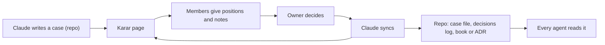
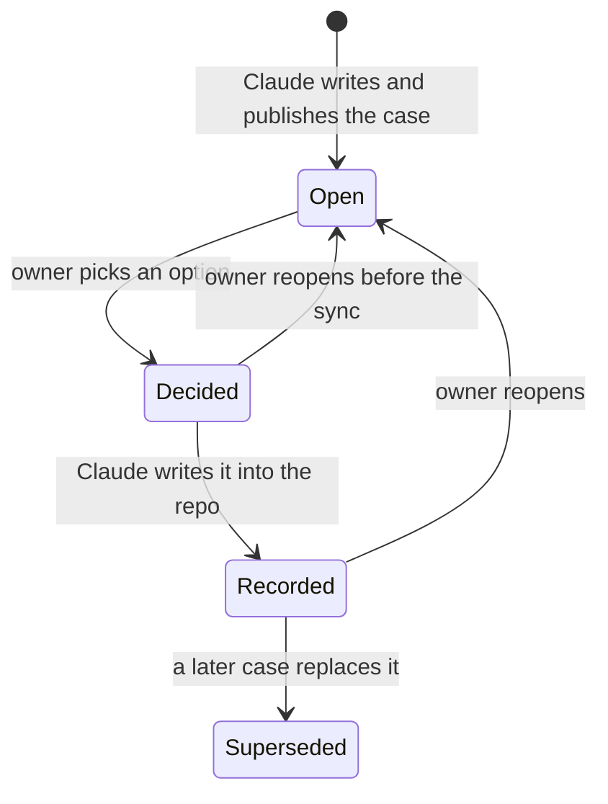
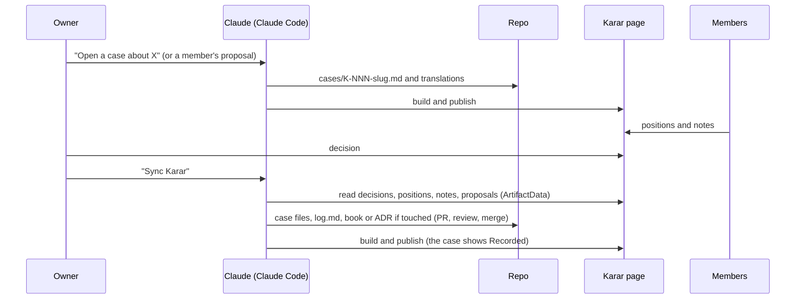

# Karar: Ýeral's decision room (build brief)

Status: brief for a new session (owner, 18.10.2026). Nothing is built yet. The session that builds Karar starts here,
asks the owner the open questions at the end, and turns this brief into `docs/karar/README.md`, ADR 0022 and the tools.

## What the owner asked

18.10.2026, in the owner's words: a new page "where we make decisions for business in future"; it should "save
decisions in this project, so agent could work with it"; it needs "language preferences, commenting and auth, so
specific users can enter, and then we can detect who is that and show user comments/decisions". The owner asked Claude to
improve the idea and to name it.

Why now: the product book page (https://claude.ai/artifact/LY9U6jrQRo3MfoHTg3JpyN) works for one person. The owner
expects partners, investors or future owners (the owner's note on Q-003, 17.10.2026; it is in the book page's `answers`
collection and not yet written into `questions.md`) and wants decisions made with them and recorded where agents work.

## Karar in one paragraph

**Karar** (Turkmen: "decision") is a private claude.ai page where the people who run Ýeral decide things together.
Claude prepares each decision as a **case**: context, options, a recommendation. Each invited person opens the page with
their own claude.ai account, reads the case in their language, gives a **position** and writes **notes**. The owner
**decides**. Claude writes the decision into this repo, where every agent reads it. It is the product book's pattern
(content from the repo, answers in the page's database, Claude writes them back) plus people, roles, languages and a
discussion.



## Who is in it

| Who | Does | Never |
|---|---|---|
| Owner | invites people, gives them labels, gives positions, decides, reopens | — |
| Members (partners, co-owners, investors, advisors, designer) | read cases, give and change their position, write notes, propose a case | decide, see other people's private settings |
| Claude (a Claude Code session) | writes cases and translations, syncs decisions into the repo, publishes the page, answers threads sent to it | decides, writes a position or note for anyone, writes `decisions` |
| Other agents | read the records in the repo | change records without a PR |

## What already exists to reuse

- `docs/product/tools/build.mjs`: a Markdown → single-page renderer with no dependencies (headings, lists, tables,
  mermaid, question cards from the `questions.md` format). Copy its approach for `docs/karar/tools/build.mjs`.
- `docs/product/tools/page.html`: tokens (Ýeral violet, light and dark, system font until Onest loads), sticky rail,
  filters, and the db script: one write queue per document with rollback, read-only states, the scroll-based nav
  highlight. **Don't copy its write gating:** it allows writes only on `user.can('data.write')` or `canEdit()`, which are
  false for view-only members. In Karar, enable a person's own inputs when `(await user.id()) !== null`, and the owner's
  controls (decide, labels) on `isOwner()`.
- `docs/product/README.md` → "Building and publishing the page": how capabilities are declared once and carried forward
  when a republish leaves them out.
- Claude's tools: `Artifact` (publish, read), `ArtifactData` (the page's database, incl. `profiles` and `as_level`),
  `ArtifactComments` (read and answer comment threads, watch an artifact).

## What the platform gives (and doesn't)

Source: the artifact runtime contract 0.2.47 type definitions (`user.d.ts`, `db.d.ts`, `comments.d.ts`), shipped with
Claude Code's `artifact-capabilities` skill. Re-read them before writing page code; they win over this table.

| Need | What the platform gives | So Karar does |
|---|---|---|
| Only specific people enter | The page is private; the owner shares it with chosen claude.ai accounts (view or edit). A page cannot run its own login. | Auth = claude.ai accounts + sharing. Never build a password, code or e-mail form. |
| Know who is viewing | `user` capability: `id()` is an opaque id per organization; names and avatars need scope `profile`; `id` is `null` when signed out, outside the organization, or undeclared. | Store only ids. Resolve names with `profiles(ids)` on every render, never store a name. |
| Trust who wrote what | `db` rules by sharing level (`view`, `interact`, `admin`, `owner`); a path ending in `{self}` is writable by that person, enforced by the server; the owner meets every level, so under the rules below the owner (and Claude acting as the owner) can write there too. | Everything a person writes lives under `members/<their id>/…`. What only the owner may do, and what Claude never does, is partly policy: see "Who can do what". |
| Shared data | `db`: realtime JSON documents. A page that declares it is organization-internal, never public. | Fine: Karar is never public. |
| Comments | The claude.ai shell shows every thread. A page can open the composer, write as the viewer (full `comments: {}`, the viewer consents once), and `sendToClaude` (editors only). A page cannot read threads. Claude reads them with `ArtifactComments` and replies only on threads sent to Claude. | The discussion of record is **notes in db** (the page shows them per case and per person; Claude syncs them). Shell comments stay for remarks on any text. |
| Limits | 5,000 documents per artifact, 256 KiB per document, 64 live subscriptions per view, no transactions (last writer wins), queries scan the collection. | There is no query across every member's subcollection, so each subscription must count: all positions live in the `members/<id>` documents (one subscription covers everyone), notes are one document per person per case, no document per event, at most ~30 members. |
| Telling people | No e-mail or push from a page. | "Waiting for you" on open; the owner tells people. |
| AI translation inside the page | `sample`: the viewer pays and is asked to consent. | Not in the MVP. |
| Edit access | "Can edit" = `admin` = can publish new versions of the page. | Members get view access, not edit. |

**The biggest unknown: can someone outside the owner's claude.ai organization use the page with an identity?** The hints
conflict. `db.d.ts`: "every reader and writer is a signed-in member of the owner's organization". `user.d.ts`: `id` is
`null` "outside the organization". `ArtifactData`'s `profiles` reports people as "guest — someone invited from outside the
organization". The owner's account looks personal, so every collaborator may be outside it. Step 0 proves this with a
real second account before anything else is built.

## Proposed design

### Words

| Word | Means |
|---|---|
| Case `K-001` | one decision to make: context, options, recommendation, area, decide-by date |
| Area | product · design · tech · business · money · legal · marketing · team |
| Position | one person's choice on a case and their reason; can change until the case is decided |
| Note | one person's remark in a case's discussion |
| Decision | the owner's final choice and note |
| Proposal | a member asks for a decision; Claude turns it into a case |
| Label | how a person appears in the repo, set by the owner ("Owner", "Partner A") |

### Lifecycle



The page shows "Decided, not recorded yet" between the owner's decision and Claude's sync. A reopen is
`decisions/{caseId}.state = reopened`; at the next sync Claude sets the case file back to `status: open` and adds a
"Reopened (date): note" line under its decision, keeping the old decision as history.

### Who can do what

| Action | Owner | Member | Claude |
|---|---|---|---|
| Read cases, positions, notes | yes | yes | yes |
| Give or change their own position, write notes | yes | yes | no |
| Propose a case | yes | yes | writes cases in the repo |
| Decide, reopen | yes | no | no |
| Set labels and roles | yes | no | no |
| "Ask Claude" on a case (`sendToClaude`) | yes (editors only) | no | answers the thread |
| Publish page versions | yes | no | yes, as the owner, after a PR |

What the server enforces (db rules below): members can't write `decisions`, `roster`, `triage` or another person's
`members/<id>`. What the page enforces: a position is locked once its case is decided. What is policy (the skill and
`AGENTS.md` say it): Claude never writes `decisions`, `roster` or anything under `members/`, although `ArtifactData`
acting as the owner could. The page only hides what a viewer can't do.

### Screens

- **Inbox:** "Waiting for you" (open cases without your position, nearest decide-by first), "Recently decided",
  proposals to triage (owner).
- **Case:** title, area, decide-by, context (Markdown and diagrams), options with the recommendation, your position
  (choice + reason), everyone's positions (avatar, name, choice, reason, time, "changed" marker), notes, the decision
  box (owner), a "Comment" button (shell composer) and "Ask Claude" (owner), status chip.
- **All cases:** filter by area, status and person; search.
- **People:** everyone with name, avatar, label and role; open a person to see all their positions and notes. This is
  "show user comments/decisions".
- **Decisions log:** decided cases, newest first, each linking to its record in the repo.
- Language switch in the header. Works at phone width, light and dark; outside claude.ai it says it's read-only.

### Languages

- The page's own words (buttons, labels, statuses) in tk, ru and en, in one table in `page.html`. Turkmen needs the
  owner's native check (as book question Q-101).
- Each person's choice is saved in `data/users/<id>/prefs` (private, follows them to other devices); otherwise the
  browser language; otherwise English.
- Case content: English is the source (agents read it); Claude adds translations per case file (question 4 below). A
  missing translation shows English with an "English only" chip.
- People write positions and notes in any language. Claude records them in English in the repo and keeps the original.

### Data in the page's database

| Path | Who writes | Fields |
|---|---|---|
| `decisions/{caseId}` | owner | `choice`, `note`, `by` (id), `at`, `state`: decided · reopened |
| `roster/{userId}` | owner | `label`, `role`: member · observer, `since` |
| `triage/{userId}~{proposalId}` | owner (or Claude as the owner) | `state`: taken · declined, `caseId` (`~` because ids start with `u_`) |
| `members/{userId}` | that person | `joinedAt`, `lastSeenAt`, `positions`: a map case → `{choice, reason, at, history}` (last 10 changes). A person appears when they first open the page; one subscription to `members` shows every position live. |
| `members/{userId}/notes/{caseId}` | that person | `items`: a list of `{text, at, replyTo}`. The case screen subscribes to the open case's note document for each member; the People screen reads one person's notes on demand. |
| `members/{userId}/proposals/{id}` | that person | `title`, `why`, `area`, `at` (read on demand) |
| `data/users/{userId}/prefs` | that person, private | `lang`, `seen` (case → time) |

Triage lives outside `members/` by choice, so everything under `members/<id>` is that person's own words.

Capabilities to declare (check that the publish accepts the rules):

```json
{
  "db": {
    "rules": [
      { "path": "", "read": "interact", "write": "owner" },
      { "path": "members", "read": "interact", "write": "owner" },
      { "path": "members/{self}", "write": "interact" },
      { "path": "data/users/{self}", "write": "interact" }
    ]
  },
  "user": { "scopes": ["profile"] },
  "comments": {}
}
```

If the owner chooses co-deciders (question 3), `decisions` needs its own rule and the deciders need edit access, which
also lets them publish the page. Weigh that before choosing.

### In the repo

```
docs/karar/
  README.md            how Karar works (from this brief)
  brief.md             this file
  log.md               every decision, newest first, one line each with a link
  people.md            labels and what each person decides (no ids, no e-mails)
  cases/K-001-<slug>.md      English source
  cases/K-001-<slug>.ru.md   translation (same headings)
  tools/build.mjs      cases → one page (no dependencies)
  tools/page.html
  tools/dist/          not committed
```

A case file, in the style of `docs/product/questions.md`:

```
# K-001 · Short title

area: business · status: open · opened: 2026-10-20 · decide-by: 2026-11-01
links: Q-003, ADR 0020

## Context
What has to be decided, why now, what each source says.

## Options
- A · First option. (recommended)
- B · Second option.

## Positions (written by Claude at sync)
- Owner · A · "reason" (21.10.2026)
- Partner A · B · "reason" (21.10.2026, original in Russian: "…")

## Notes (written by Claude at sync)
- Partner A (21.10.2026): …

## Decision (written by Claude at sync)
A · the owner's note (22.10.2026) · recorded in #NN
```

A decision lands where agents already look: a product rule also goes into the product book (chapter, `questions.md`,
chapter 9); an architecture or process decision also gets an ADR. The case links to them.

### The sync loop



### Agents

- A project skill `.claude/skills/karar/SKILL.md` holds the procedures: open a case, sync, triage proposals, answer
  "Ask Claude" threads. Add it to the skills table in `CLAUDE.md`.
- `AGENTS.md` → "Read first": business decisions are in `docs/karar/log.md`.
- Agents may read records and propose a case in a PR. Only the owner decides, in the page.

## Karar and the product book

Recommendation: the product book keeps its 116 questions for now; the owner has started answering them on the page (Q-001 to Q-003
on 17.10.2026, not yet written into `questions.md`). Karar starts with business cases (company, money, partners, launch, marketing, legal). Once Karar works
with two or more people, the owner decides whether open product questions move in (question 5). Later the book's
question cards can link to Karar cases.

Later alternative: if claude.ai can't identify outside people or the team grows, Karar can become a module of our own
CMS, with our phone login (ADR 0019), roles and i18n. That is code, so it waits for the book (ADR 0021).

## Build plan

### Step 0 · Prove identity (first, small)

1. Publish a ~50-line test page with `db` (rules as above), `user` (`profile`) and `comments`. It shows `me()` and lists
   `members`.
2. The owner shares it with one other person's claude.ai account ("can view"); that person opens it.
3. Check: they can open it; their `id()` is not null; the owner's view shows their name through `profiles`; they can
   write `members/<their id>` and not `decisions/x` (also check with `ArtifactData` `as_level: "interact"`); `profiles`
   says whether they are a guest.
4. Write the result into ADR 0022 (draft). Leave the test page; delete it only if the owner asks.

| Result | Next |
|---|---|
| Opens, has an id and a name | Phase 1 |
| Opens without an id, or can't open | The owner chooses: one organization for the team (a paid Claude plan: ask first, per `AGENTS.md`), Karar inside our CMS later, or Karar for the owner alone for now |

### Phase 1 · MVP

The repo layout, `build.mjs`, `page.html`, the screens above except proposals and "Ask Claude", the language switch,
the rules, the skill, the `AGENTS.md` and `CLAUDE.md` rows, ADR 0022, a memory-bank log note. First real cases come from
the owner: ask; never invent them.

Done when:

- Two accounts see each other's names and avatars on positions, and a new position appears live.
- With `as_level: "interact"`, writing `decisions/*`, `roster/*` or another person's `members/<id>/*` fails, and writing
  your own `members/<id>/…` works.
- The language switch changes every word of the page; another device keeps the choice.
- The owner decides → "Sync Karar" writes the case file and `log.md` → the republished page shows Recorded.
- `docs/karar` holds no ids, e-mails or avatars.
- 375 px width, light and dark; opened outside claude.ai it is read-only.
- Code review, PR, green CI, merge (`AGENTS.md`).

### Phase 2

Proposals and triage, "Ask Claude", blind positions, decide-by reminders in the inbox, product questions moved in (if
chosen), translation through `sample` (only if asked).

## Open questions for the owner

Ask in small batches (up to four at a time), recommendation first. Write each answer into this brief or ADR 0022.

1. **Name.** A · Karar (recommended) · B · Geňeş ("council") · C · Ýeral Decisions.
2. **Who joins first, and do they use claude.ai in your organization?** Step 0 shows whether it matters. A paid team
   plan is the owner's call.
3. **Who has the final say?** A · the owner alone, others advise (recommended) · B · the owner and co-owners by
   majority · C · one decider per area.
4. **Case languages.** A · English source + Russian (recommended) · B · + Turkmen too · C · English only.
5. **Product book questions.** A · stay in the book now, decide after Karar works (recommended) · B · move into Karar
   when it works · C · never.
6. **Blind positions** (you see others' positions only after giving yours). A · a per-case switch, off by default
   (recommended) · B · always · C · never. Note: every member can read `members`, so the page can hide positions but the
   server can't; server-side blindness means keeping a position private in `data/users/<id>/` until its author reveals
   it, which is more work.
7. **How people appear in the repo.** A · labels such as "Owner", "Partner A" (recommended) · B · first names. The repo
   is private today (checked 18.10.2026); no ids or e-mails either way.
8. **Proposals from the page.** A · yes, Claude triages them (recommended) · B · no, people ask the owner.

## Never

- A login, password, SMS code or e-mail form of our own; public sharing.
- Names, e-mails or avatars stored in the page's database or the repo (ids only in the database, labels in the repo).
- Claude deciding, or writing a position or note for someone.
- A page that republishes itself.

## How to work

- Parallel work rules (ADR 0014, `AGENTS.md`): open a GitHub issue for Karar listing Step 0 and Phase 1, claim it with
  the label `agent:<name>`, work in your own worktree and branch `feat/<issue>-karar`; don't edit `activeContext.md` or
  `progress.md`, write `docs/memory-bank/log/YYYY-MM-DD-karar.md`. The product book session may run at the same time;
  touch `docs/product/` only to add a link.
- ADR 0022 once Step 0 is done and questions 1–3 are answered.
- Starter prompt for the new session: "Read `docs/karar/brief.md`, then `AGENTS.md`. We're building Karar, Ýeral's
  decision room. Work in your own worktree. Start with Step 0 and ask me the open questions in small batches; don't
  build past Step 0 until I've answered questions 1–3."
