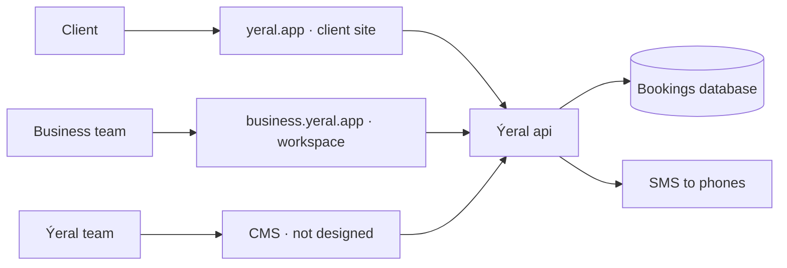
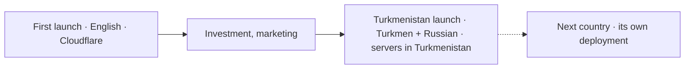
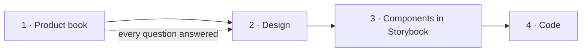

# 1. Vision

## What Ýeral is

**Ýeral** is a booking service for any business that sells its time:
barbers and beauty salons, dentists and doctors, physio, restaurants and cafés, gyms and yoga studios, tutors, mechanics,
groomers, home services. Every booking is a place: a chair, a table, a mat, a lesson. (client spec §1)

**Ýeral isn't bound to one country** (owner, 18.10.2026). It's built in English and launches country by country, each
country adding its own languages and settings. Turkmenistan is the first. (Q-104, ADR 0022) The name isn't Turkmen-bound
either: the owner chose it because it sounds good and is uncommon, not for its meaning (*ýer al*, take a place). (Q-109)

It has two sides that share one account and one set of rules:

- **Clients** find a business near them, see its free times and book in a few taps, without calling.
- **Businesses** get a free workspace: a calendar for the whole team, booking requests, a client list, their own page with
  a link and a QR code.

A third group, the **Ýeral team**, checks new businesses, moderates reported reviews and runs the category catalogue.

## Who it's for

| Who | What they want | Where they use Ýeral |
|---|---|---|
| Client | Book a service or a table without calling, see what's free, get reminders | yeral.app, on the phone first |
| Business owner | Fill the calendar, stop losing bookings, see the day at a glance | business.yeral.app |
| Administrator | Answer requests, take phone bookings, keep the calendar in order | business.yeral.app, often on a phone |
| Specialist | See their own day, answer their own requests | business.yeral.app on a phone |
| Ýeral team | Keep the catalogue trustworthy: verify businesses, handle reports | the CMS (not designed yet) |

## The product map

- **yeral.app** is the marketplace: home, search with a map, category pages, business pages, booking, the client's
  account. English while it's built; each country adds its languages, each with its own address (`/en`, and `/tk`,
  `/ru` for Turkmenistan). (ADR 0015, ADR 0022)
- **business.yeral.app** is the workspace for business teams, plus a page that tells businesses why to join. (business spec)
- **The CMS** is for the Ýeral team and is part of the launch: the team adds the first businesses there. It isn't
  designed yet. (business spec §24; Q-001, Q-002)
- Native phone apps come after the launch, and the business flow never depends on them. The web works fully on
  phones. (business spec §25; Q-001)

## Markets

A market is one country with its own settings: languages, money, phone numbers, time zone, SMS provider, legal texts.
**Each country gets its own deployment:** one code base, and per country its own servers, database and address, built
from that country's settings, so a country's data stays where its law wants it. (Q-131, decided 18.10.2026; ADR 0023)
**Turkmenistan is the first market:**

- **Ashgabat first.** Lists stay relative to the person ("Ýakynymda", near me). The person's location preselects a
  city and they can pick another; an address shows its city when it differs from the selected one. (client spec §1;
  Q-107)
- **Languages:** English at the first launch; Turkmen and Russian come with the Turkmenistan launch. (Q-101, Q-104,
  Q-133, ADR 0022)
- **Money:** manats, shown `40 TMT`. Clients pay at the place; there is no online payment. (client spec §1)
- **Phones:** every account is a +993 mobile number with a sign-in code: by SMS from the Turkmenistan launch, on
  the screen at the first launch. (ADR 0019, ROUND6-ANSWERS C1; Q-036)
- **Hosting:** the first launch runs on Cloudflare, with the database in Frankfurt; people in Turkmenistan reach it
  through a VPN. Servers in Turkmenistan, which also keep personal data inside the country as its law asks, come with
  the Turkmenistan launch. (Q-032, Q-037, decided 18.10.2026; ADR 0007, ADR 0023)

## How Ýeral makes money

**Ýeral is free for now** (owner, 16.10.2026): no plans, no commission, no invoices, no limit on specialists.
A paid model was designed and is kept for later (business spec §18, `screens/later/`):

- *Ýeke*: free for a single specialist.
- *Topar*: a monthly price per business for teams.
- A commission on the first completed visit of a new client who found the business through Ýeral search. Bookings
  through the business's own link or QR, phone bookings and returning clients would always stay free.

Nothing of the paid model is built until the owner turns it on.

## What never changes

These rules hold on every screen, in every app, for every business type. (client spec §1, business spec §2–§3)

1. **The business confirms bookings by hand, by default.** The client sees *Garaşylýar* (Pending) and the word "sent",
   never "booked", until the business confirms. A business can switch on instant confirmation.
2. **A request doesn't wait forever.** If the business doesn't answer within its hold time (30 minutes by default), the
   request is cancelled and the client is told, with three other free times: for tables the nearest times for the same
   party and area, for classes the next sessions with seats. (Q-252)
3. **Five statuses with one meaning everywhere:** *Garaşylýar* (Pending) · *Tassyklandy* (Confirmed) · *Tamamlandy*
   (Completed) · *Ýatyryldy* (Cancelled) · *Gelmedi* (No-show). Each has one icon.
4. **A visit is completed automatically** after it ends, unless the business marks a no-show.
5. **Who cancelled is always clear:** the client, the business, or the system (no answer in time).
6. **The category decides how a business is found and booked:** its booking type, search filters and starter services.
7. **Only verified businesses are public.** A new business uses its workspace at once, but clients find it only after
   the Ýeral team checks it.
8. **No city names written into the copy:** a city appears only as data, as the selected city or in an address in
   another city (Q-107). One gradient primary button per screen.
9. **Nothing is bound to one country.** Languages, money, phone numbers, time zones and legal rules come from the
   market's settings, never from code. (owner, 18.10.2026; ADR 0022)

## Launch

Decided by the owner on 17 and 18.10.2026:

- **One launch with all three web apps:** the client site, the business app and the CMS. The business flow doesn't
  work without all three. (Q-001)
- **Two steps.** The first launch is in English on Cloudflare: investors and early users see it (from Turkmenistan
  through a VPN), and it's also a portfolio piece. The Turkmenistan launch follows once marketing starts and investment
  arrives: Turkmen and Russian, servers and database in Turkmenistan, legal texts checked by a lawyer there. (Q-032, Q-033, Q-037, Q-133, Q-292)
- **The first launch is an English pilot** with Turkmenistan's settings. Example businesses from the design,
  marked "Example", confirm bookings at once and sit beside the real businesses the team adds; "Try the business
  app" opens a demo workspace that resets every night. No SMS goes out: anyone signs in with their own number and
  the code shows on the screen. (Q-004, Q-036)
- **The first businesses** are added by the Ýeral team in the CMS after meeting their owners and showing them the
  product; some owners set up by themselves to learn the product; sign-up stays open to anyone. (Q-002)
- **Name and domain:** Ýeral on yeral.app; investors or future owners may change them later. (Q-003) The name is
  written *Ýeral* everywhere, as in the logo; "Yeral" only where the letter can't be used: the domain and the
  SMS sender. (Q-005)
- **Booking types:** appointments at launch; tables and classes after the MVP. (Q-030)

## Reference product

**Fresha.** Copy its logic and flows when a decision is missing; never its visuals. (client spec §1, business spec)

## How we build it

The owner reset the plan on 17.10.2026: the product is described completely first, then designed, then built.

1. **Product book** (this document): every idea, rule, role, limit, feature and flow, with no open question left.
2. **Design:** Claude Design draws the screens from the book. Claude Code writes every prompt for it; the owner pastes
   it and reviews the result; Claude Code reads the canvas and checks it against the book.
3. **Components:** every piece of the design built and tested in Storybook.
4. **Code:** the apps, built only from closed chapters and finished components.

Already built and waiting (from before the reset): the monorepo and CI, the design system foundation (38 components),
the booking engine, the api for every client screen. They're kept, then adjusted to the book. The old Next.js site
stays on yeral.app until the new one replaces it.

> Open question Q-001: in what order do we launch the client site and the business workspace?

> Open question Q-002: how do the first businesses get onto Ýeral?

> Open question Q-003: is "Ýeral" on yeral.app the name we launch with?

> Open question Q-004: who the first launch is for.

> Open question Q-005: how the name is spelled.
