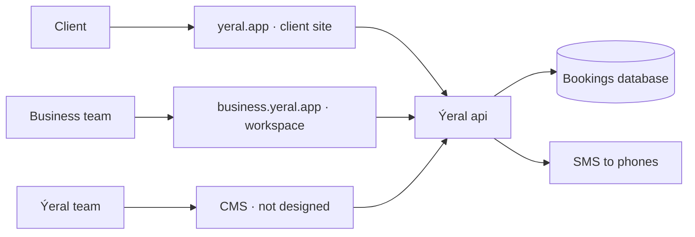
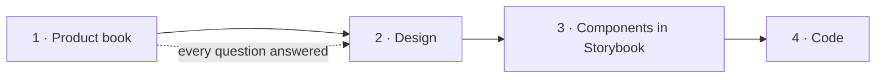

# 1. Vision

## What Ýeral is

**Ýeral** comes from *ýer al*, Turkmen for "take a place". It is a booking service for any business that sells its time:
barbers and beauty salons, dentists and doctors, physio, restaurants and cafés, gyms and yoga studios, tutors, mechanics,
groomers, home services. Every booking is a place: a chair, a table, a mat, a lesson. (client spec §1)

It has two sides that share one account and one set of rules:

- **Clients** find a business near them, see its free times and book in a few taps, without calling.
- **Businesses** get a free workspace: a calendar for the whole team, booking requests, a client list, their own page with
  a link and a QR code.

A third group, the **Ýeral team**, checks new businesses, moderates reported reviews and runs the category catalogue.

## Who it's for

| Who | What they want | Where they use Ýeral |
|---|---|---|
| Client | Book a service or a table without calling, see what's free, get reminders | yeral.app, on the phone first |
| Business owner | Fill the calendar, stop losing bookings, see the day at a glance | business.yeral.app |
| Administrator | Answer requests, take phone bookings, keep the calendar in order | business.yeral.app, often on a phone |
| Specialist | See their own day, answer their own requests | business.yeral.app on a phone |
| Ýeral team | Keep the catalogue trustworthy: verify businesses, handle reports | the CMS (not designed yet) |

## The product map

- **yeral.app** is the marketplace: home, search with a map, category pages, business pages, booking, the client's
  account. Turkmen, Russian and English, each with its own address (`/tk`, `/ru`, `/en`). (ADR 0015, ADR 0016)
- **business.yeral.app** is the workspace for business teams, plus a page that tells businesses why to join. (business spec)
- **The CMS** is for the Ýeral team. It isn't designed yet. (business spec §24)
- Native phone apps come later. The web works fully on phones in the meantime. (business spec §25)

## The market

- **Turkmenistan**, Ashgabat first. The interface never names a city: everything is relative to where the user is
  ("Ýakynymda", near me). (client spec §1)
- **Languages:** Turkmen first, then Russian and English. (ADR 0016)
- **Money:** manats, shown `40 TMT`. Clients pay at the place; there is no online payment. (client spec §1)
- **Phones:** every account is a +993 mobile number with an SMS code. (ADR 0019, ROUND6-ANSWERS C1)
- **Hosting:** Cloudflare for now, the team's own server later, because Cloudflare is reported filtered in Turkmenistan. (ADR 0007)

## How Ýeral makes money

**Ýeral is free for now** (owner, 16.10.2026): no plans, no commission, no invoices, no limit on specialists.
A paid model was designed and is kept for later (business spec §18, `screens/later/`):

- *Ýeke*: free for a single specialist.
- *Topar*: a monthly price per business for teams.
- A commission on the first completed visit of a new client who found the business through Ýeral search. Bookings
  through the business's own link or QR, phone bookings and returning clients would always stay free.

Nothing of the paid model is built until the owner turns it on.

## What never changes

These rules hold on every screen, in every app, for every business type. (client spec §1, business spec §2–§3)

1. **The business confirms bookings by hand, by default.** The client sees *Garaşylýar* (Pending) and the word "sent",
   never "booked", until the business confirms. A business can switch on instant confirmation.
2. **A request doesn't wait forever.** If the business doesn't answer within its hold time (30 minutes by default), the
   request is cancelled and the client is told. For appointments the client gets three other free times; what an
   expired table or class request offers is still open (Q-252).
3. **Five statuses with one meaning everywhere:** *Garaşylýar* (Pending) · *Tassyklandy* (Confirmed) · *Tamamlandy*
   (Completed) · *Ýatyryldy* (Cancelled) · *Gelmedi* (No-show). Each has one icon.
4. **A visit is completed automatically** after it ends, unless the business marks a no-show.
5. **Who cancelled is always clear:** the client, the business, or the system (no answer in time).
6. **The category decides how a business is found and booked:** its booking type, search filters and starter services.
7. **Only verified businesses are public.** A new business uses its workspace at once, but clients find it only after
   the Ýeral team checks it.
8. **No city names in the interface,** and one gradient primary button per screen.

## Reference product

**Fresha.** Copy its logic and flows when a decision is missing; never its visuals. (client spec §1, business spec)

## How we build it

The owner reset the plan on 17.10.2026: the product is described completely first, then designed, then built.

1. **Product book** (this document): every idea, rule, role, limit, feature and flow, with no open question left.
2. **Design:** Claude Design draws the screens from the book. Claude Code writes every prompt for it; the owner pastes
   it and reviews the result; Claude Code reads the canvas and checks it against the book.
3. **Components:** every piece of the design built and tested in Storybook.
4. **Code:** the apps, built only from closed chapters and finished components.

Already built and waiting (from before the reset): the monorepo and CI, the design system foundation (38 components),
the booking engine, the api for every client screen. They're kept, then adjusted to the book. The old Next.js site
stays on yeral.app until the new one replaces it.

> Open question Q-001: in what order do we launch the client site and the business workspace?

> Open question Q-002: how do the first businesses get onto Ýeral?

> Open question Q-003: is "Ýeral" on yeral.app the name we launch with?
