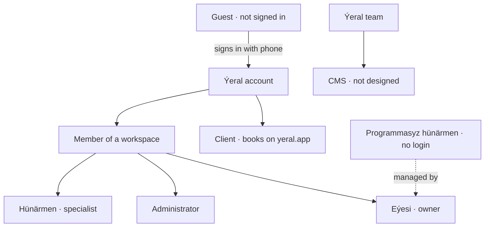
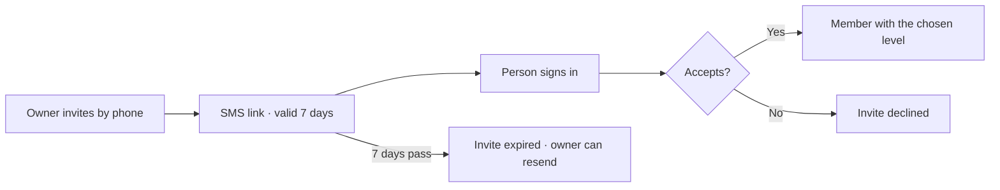

# 3. Roles

Who uses Ýeral, what each person can see and do, and how one person can have several roles.

## Everyone at a glance

- **One account for everything.** A person signs in with a phone number and an SMS code. The same account books on
  yeral.app and works in any number of business workspaces. (business spec §1, §25)
- **A workspace is one business at one address.** There are no branches: a second address is a second workspace with its
  own team, calendar, clients and settings. (business spec §1, §25)
- **A person has a level per workspace.** Aýna can be a specialist in Glow Studio and the owner of her own studio at the
  same time. (business spec §1)

## Guest and client

| Role | Who | Can |
|---|---|---|
| **Guest** | anyone on yeral.app who hasn't signed in | browse, search, open business pages, start a booking; signs in inside the booking flow to send it (client spec §4.4, §4.7) |
| **Client** | anyone signed in | book, see and change their bookings, review visits, keep favourites, choose language and SMS settings, delete the account (client spec §4.8) |

Only mobile numbers (+993 6x / 7x) can sign in; landlines are refused with a clear message. (ROUND6-ANSWERS C1)

A business can stop one client from booking online after repeated no-shows. That client still sees the business, with a
calm "book by phone" card and the number. Times the business itself offered after declining can still be taken online.
(ROUND6-ANSWERS A7)

## The business team

Three fixed access levels. There are no custom roles. A specialist may work without the app: an option on
*Hünärmen*, not a fourth level. (business spec §1, §25; Q-216, decided 18.10.2026)

| Level | Who it's for | By default sees and can |
|---|---|---|
| **Eýesi** (owner) | the person who created the workspace; exactly one | everything: all calendars, money, team, permissions, settings. Can hand ownership to another member |
| **Administrator** | front desk, manager | all calendars, bookings and clients; answers reviews; analytics without money; settings; sees the team but can't change it |
| **Hünärmen** (specialist) | a stylist, doctor, trainer… with their own login | their own column, bookings and requests; their own clients with phone numbers; reviews about them (read only); their own numbers and earnings; no settings |
| *Hünärmen* without the app (*programmasyz*) | a specialist who doesn't use Ýeral yet | no login, but a phone number is required. Clients can book them online; the owner and administrators handle their bookings and requests. Switching the app on sends the usual invite, and the same number lets them open their own workspace later (Q-216, Q-212) |

> Open question Q-216: specialists who don't use the app.

Anything a level can't use is **hidden, not greyed out**. Opening a hidden page by its address goes back to the calendar
with a short message. (business spec §1)

### The permission table

In the MVP every level has these permissions, fixed; letting the owner tune them in *Sazlamalar → Rugsatlar* is Later
(F-089). The owner's own column is "everything". (business demo data `accessLevels`; code: `@yeral/domain/permissions`,
ADR 0025)

| Permission | Administrator | Hünärmen |
|---|---|---|
| See every staff member's calendar | yes | no |
| Answer booking requests | yes | own only, set by "who answers requests" |
| Add, move and cancel bookings | yes | own only |
| Mark no-shows and file complaints | yes | own only |
| See clients with phone numbers | yes | own only |
| Reply to reviews | yes | no (reads reviews about them) |
| See revenue | no | own only |
| Analytics | yes, without money | own only |
| Change services and prices | yes | no |
| Change business settings | yes | no |
| Manage the team and permissions | view only | no |

Each cell is a switch, or a choice of *Ýok* (no) · *Diňe özüniňki* (own only) · *Hemmesi* (all); the team row uses
*Ýok* · *Diňe görmek* (view) · *Dolandyrmak* (manage). (business spec §8)

## Who answers booking requests

Only matters when the business confirms by hand. Set in *Sazlamalar → Ýazylyş düzgünleri*. (business spec §2, §25)

| Setting | What happens |
|---|---|
| *Administrator we eýesi* | only the owner and administrators answer; specialists see their requests but can't answer |
| *Her hünärmen özi* | each specialist answers their own; administrators only watch |
| *Ikisi hem* (default) | whoever answers first |

- A one-person business doesn't see this setting: the owner answers everything.
- The owner can override it for one person in the staff drawer ("Öz haýyşlaryna jogap berip biler").
- Requests for a phone-only specialist always go to the owner and administrators.
- Someone who can't answer sees the request with a read-only line instead of the *Tassykla* / *Ret et* buttons.

## Joining, leaving and handing over

- **Invite:** the owner enters a phone number, name, specialization and access level, then the services the person
  does. The person gets an SMS link valid for 7 days. They sign in with that phone and accept or decline. The owner can
  resend or cancel a pending invite. (business spec §1, §8)
- **Phone-only specialist:** added without an SMS and active at once. (business spec §11)
- **Leaving:** a member can leave a workspace from *Profilim* ("Bu biznesden çyk"); the owner can't. (business spec §1)
- **Removing a member:** the owner removes them and reassigns their future bookings to someone who does those services,
  or to "any free specialist". (business spec §8, §11)
- **Handing over ownership:** the owner picks an active member who signs in; that person becomes *Eýesi* and the old
  owner becomes an Administrator. (business spec §8)
- **Busy elsewhere** (in the MVP): someone in two workspaces is blocked in each calendar while they're the specialist
  on a confirmed booking or a waiting request in the other one, with its buffers. The calendar shows only a reserved
  gap, *Başga ýerde*, never anything from the other workspace, and nobody can book that time. There's no switch to
  turn it off. (business spec §1; Q-031, Q-271, Q-272, decided 18.10.2026) **Design to fix:** drop the *Profilim*
  switch *Beýleki iş ýerlerimdäki wagtymy «Başga ýerde» görkez*.

## The Ýeral team

The people who run Ýeral itself. At launch they work in a small admin tool, the CMS (cms.yeral.app), which isn't
designed yet. There is one role: every team member can do everything in it. (business spec §24; Q-010, Q-011, decided
18.10.2026)

At launch the team:

- verifies new businesses within 24 hours, so they become public (business spec §7);
- handles reported reviews: clears them or removes them (ROUND6-ANSWERS F2);
- adds a business for an owner it has met (Q-002, F-238);
- can hide a business from search and from its page, with a reason sent to the owner, and un-verify a live business
  by hand (Q-012, Q-275, decided 18.10.2026);
- closes a workspace when its owner asks: hides the page and keeps the data (Q-213, decided 18.10.2026).

Later, from the specs (Q-010):

- manage categories: icons, names in three languages, booking types, starter services (ADR 0017);
- write help articles for businesses (business spec §17);
- answer the support chat from businesses (business spec §17).

There are no Ýeral-wide client blocks at launch: only a business can limit a client to phone bookings. The owner's idea
for later is client karma (F-241): no-shows and floods of bookings lower it, below a set level the client can't book
online, and each business chooses the lowest karma it accepts. (Q-012, decided 18.10.2026)

> Open question Q-010: what can the Ýeral team do at launch, and with which tool?

> Open question Q-011: are there different roles inside the Ýeral team?

> Open question Q-012: can the Ýeral team hide a business or block a client?
