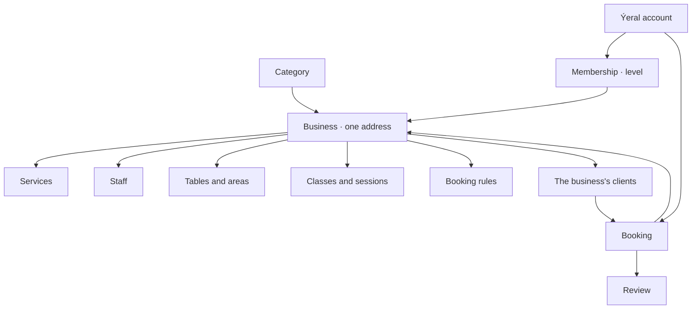
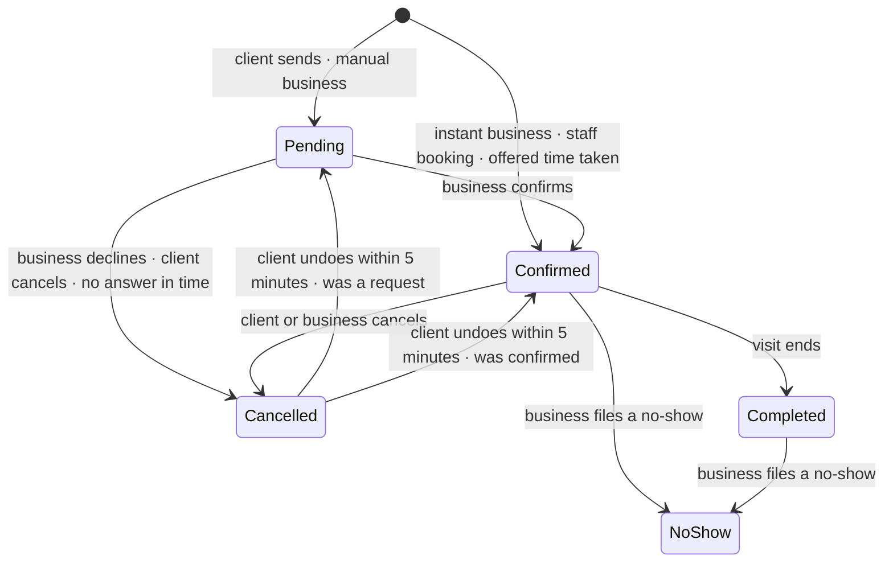

# 4. Objects and rules

The things Ýeral is made of, and the rules that tie them together. The numbers behind each rule are in chapter 5;
the step-by-step flows are in chapter 7.

## The objects

| Object | What it is |
|---|---|
| **Category** | a kind of business (13 seeded: *Gözellik*, *Dellekhana*, *Dyrnak*, *Spa we massaž*, *Diş lukmany*, *Saglyk*, *Restoran*, *Kafe we çaýhana*, *Sport*, *Okuw*, *Awtoulag*, *Öý haýwanlary*, *Öý hyzmatlary*; the first launch opens the 11 that take appointments, *Restoran* and *Kafe we çaýhana* come with tables, Q-030). It sets the booking type, the word for "specialist", the search filters and the starter services. Run by the Ýeral team. (ADR 0017) |
| **Business** (workspace) | one place at one address: profile, photos, hours, special days, booking rules, team, services, clients. Public only when verified. (business spec §1, §10) |
| **Ýeral account** | a person: phone, name, language, favourites. Books as a client and can be a member of several businesses. (business spec §10) |
| **Membership** | a person's access level in one business. (chapter 3) |
| **Staff** | everyone on the team, with or without a login. A bookable staff member is a "specialist" on the client site. (ADR 0018) |
| **Service** | what a client books: name, duration, price, who performs it, online on or off, optional extra break after it. (business spec §8) |
| **Table / area** | restaurant seating: tables with seats, areas like *Zal*, *Terrasa*, *VIP otag*. (business spec §20) |
| **Class / session** | a group class type and its sessions on the schedule, each with a capacity. (business spec §21) |
| **Booking** | one visit: who, where, when, what, its status and history. (ADR 0017) |
| **Client** (the business's) | the business's own record of a client: phone, name, notes, visits. Exists even when the client has no Ýeral account. (ADR 0018) |
| **Review** | the client's rating and text after a completed visit, with the business's reply. (business spec §15) |

## Booking types

One booking engine, three types designed and one later. (client spec §2) The MVP launches with appointments only;
tables and classes come after the MVP (Q-030, decided 18.10.2026). A business has one booking type, set by its
category; several types in one business come later (Q-022, decided 18.10.2026).

| Type | Turkmen | The client chooses | Used by |
|---|---|---|---|
| Appointment | *Wagt bellemek* | service(s) → specialist or "any" → date and time → send | barbers, salons, dentists, physio, tutors, mechanics, groomers, home services |
| Table (after the MVP) | *Stol bronlamak* | party size → date and time → seating area → send | restaurants, cafés, tea houses |
| Class (after the MVP) | *Topar sapagy* | a session from the schedule → seats → send | yoga, group fitness, courses |
| Resource (later) | *Ýer kärendesi* | a resource → a time range → send | pitches, saunas, studios |

- **Where it happens:** at the business only. A business that works from home can hide its exact address until a
  booking is confirmed; the map then shows a circle. At the client's address (home services) and online (tutors) are in
  the spec but come later. (client spec §2, business spec §7; Q-020, decided 18.10.2026)
- **Several services in one appointment** run back to back, with one specialist where possible; "any specialist" lets
  Ýeral pick per service. A time is free only if the whole chain fits. (client spec §2)
- **A solo business** skips the specialist step. (client spec §2)

## Services and prices

- **Price types:** fixed (`80 TMT`), from (`250 TMT-den`), free (*Mugt*), hidden ("*Baha ýerinde aýdylýar*", said at
  the place). A total that mixes hidden and priced services shows "from" the priced sum; a hidden-only total shows no
  amount. Restaurants show no average bill (Q-103). (client spec §2, ROUND6-ANSWERS B1)
- Every service shows its duration. (client spec §2)
- **No online payment and no deposits.** Clients pay at the place. (client spec §1)

## When a time is free

For appointments, a start time is offered only if all of this holds (ADR 0017, business spec §8):

1. it's inside the business's hours for that day, not in its break, not on a closed special day;
2. the specialist works then (their own hours inside the business's, their break, their days off) and isn't
   busy elsewhere (*Başga ýerde*: the specialist on a confirmed booking or a waiting request in another workspace, with
   its buffers; Q-272, decided 18.10.2026);
3. the whole service chain plus the break after it fits before closing and before the next booking;
4. it's on the business's time grid (every 15 or 30 minutes from opening);
5. it's at least the business's minimum notice from now, and not further ahead than its booking window;
6. no other booking, waiting request or waiting move holds it.

Tables: a time is free for a party if a table of the right size is free (the smallest fitting table is picked
automatically; VIP areas need 6 or more people). Classes: a session is bookable while it has seats left. (client spec §2,
business spec §20–§21)

A business may stay open past midnight: hours like 18:00–02:00, and a booking may cross midnight. (Q-105, decided
18.10.2026; ROUND6-ANSWERS E1 drew hours up to 24:00) A business day keeps everything after its midnight, up to 48:00:
free times after 24:00 are offered under the day that started, and a day's part past midnight must end by the next
day's opening. Late bookings of one day and early ones of the next still can't overlap for the same specialist or
table. (business-day model: Claude (delegated), 20.10.2026; code: `@yeral/domain/hours`, migration 0007)

## The life of a booking

Undo ("*Yzyna al*") only applies to the client's own cancel, within 5 minutes, and can fail (see "Changes after
booking" below).

| Status | Turkmen | Icon | Meaning |
|---|---|---|---|
| Pending | *Garaşylýar* | clock | sent, waiting for the business |
| Confirmed | *Tassyklandy* | check | the business accepted it (a phone booking adds a phone icon, a walk-in a person icon) |
| Completed | *Tamamlandy* | double check | the visit is over; set automatically |
| Cancelled | *Ýatyryldy* | x | by the client, by the business (declined or cancelled) or by the system (no answer in time) |
| No-show | *Gelmedi* | person with x | the client didn't come; the only red status |

(client spec §6, business spec §3)

Who cancelled shows everywhere: "*Siz ýatyrdyňyz*" (you cancelled), "*Biznes ýatyrdy*" / "*Biznes ret etdi*" (the business
cancelled / declined), "*Wagtynda jogap gelmedi*" (no answer in time, hourglass icon). (ROUND6-ANSWERS A2)

**Internal statuses** are optional team-only markers on top of the five (*Geldi* arrived, *Başlandy* started, or the
business's own, up to 5). Clients never see them and they never change the real status. Off by default; in the
MVP. (business spec §3; Q-031, decided 18.10.2026)

## Confirmation

- **By hand (default):** online bookings arrive as requests. The business confirms, or declines with a reason the client
  sees and up to 3 other times. (business spec §2)
- **Instant (a business setting):** online bookings are confirmed at once. (business spec §2)
- **Staff bookings** (by phone, walk-ins) are always confirmed. (ADR 0017)
- **Hold time:** a request holds its time for the business's hold time (default 30 minutes), counted only during the
  business's opening hours and never past the start. No answer by then: the system cancels it and offers the client 3
  other free times; if nothing is free, the SMS drops the times and says *Başga wagt saýlaň*. (business spec §2; Q-120,
  Q-252, decided 18.10.2026) (code: `holdUntil()`, `expiredSmsText()`)
- **Declined with offered times:** taking an offered time creates a confirmed booking at once (the business offered it).
  One declined request gives at most one booking; the other chips disappear. (ROUND6-ANSWERS A1)
- **Each offered or free time names one specialist** and is booked with that person only; if they're no longer free,
  the chip shows *Eýýäm eýelendi*. (Q-159, decided 18.10.2026) At the same time the client's specialist comes first;
  services nobody does alone are still split between people, and such a time names nobody (Claude (delegated),
  20.10.2026). (code: `jobs/run.ts` `alternativesFor`, `bookings/offers.ts`; the business's decline names one per
  offer: `requests/service.ts`, 20.10.2026)
- **Expired with free times:** taking one sends a new request (confirmed at once at an instant business). (ROUND6-ANSWERS A2)

## Changes after booking

- **Cancel:** free until the business's cancellation window (default 2 hours before the start); after that the client
  can only call. The business may ask for a reason. (client spec §4.8, business spec §8)
- **Undo a cancel** ("*Yzyna al*"): for 5 minutes, unless the time was taken, the class is full, the visit started or the
  request's answer time ran out. (ROUND6-ANSWERS A6)
- **Move (appointments only):** a move is a new request for the new time; the old time stays until the business
  answers. Declined or unanswered: the booking stays where it was. A second move replaces the first. Cancelling the
  booking withdraws its move. At an instant business the move happens at once. The time grid follows the chosen
  specialist; Ýeral never swaps the specialist silently. Same free window as cancelling. (ROUND6-ANSWERS A3, A5)
- **Tables and classes can't be moved:** the client cancels and books again ("*Gaýtadan ýazyl*" opens the flow
  prefilled). (ROUND6-ANSWERS A4)
- **Moves by the business** change the booking in place (drag in the calendar or "*Başga wagta geçir*") and tell the client
  by SMS when that box is ticked. (ADR 0017)
- **No back-dating:** staff can start a booking at the current time slot (11:20 → 11:15), never earlier. (ROUND6-ANSWERS E3)

## No-shows and complaints

- There's no "came" button: a visit completes by itself. The business files a complaint ("*Arz et*") instead: *Gelmedi*
  (no-show, sets the status), *Gijä galdy* (late), *Gödek gylyk* (rude), *Başga* (other). Complaints are team-only and
  go to the client's card. (business spec §3)
- After a set number of no-shows at one business (default 2), that client can book there only by phone.
  (business spec §3, §8) Reaching the number turns on the client card's switch *Diňe jaň arkaly ýazylyp biler*; the
  business can turn it off, and counting starts again from zero: only no-shows marked after that count. (Q-127,
  decided 18.10.2026) How: the switch is on by hand, or while the no-shows since the business last turned it off reach the limit; it's worked
  out from the bookings, so removing a wrong no-show (Q-207) or setting the limit to 0 lifts a block that came from the
  count (Claude (delegated), 20.10.2026; code: `modules/clients/online.ts`).
- There are no Ýeral-wide client blocks at launch; client karma comes later (F-241; Q-012, decided 18.10.2026).

## The business's clients

- A client record is created by the first booking (online, phone or walk-in) and matched by phone number. (ADR 0018)
- Visits, average bill, last visit and no-shows are counted from bookings. (ADR 0018)
- Segments: *Yzygiderli* (3+ visits in 6 months), *Täze* (first visit within 30 days), *Köpden bäri gelmedik* (60+ days
  away), *Arz edilen* (has complaints). (productContext)
- Notes are team-only; a note marked as an alert shows on every booking of that client. (ADR 0018)
- Deleting a client keeps their past bookings for reports, without the name. (ADR 0018)
- A client who deletes their Ýeral account: upcoming bookings are cancelled; the account, favourites and reviews are
  deleted; each business keeps its own visit records, no longer linked to a Ýeral account. (Q-172, decided 18.10.2026)

## Reviews

- Only after a completed visit, one per booking, editable for 7 days, shown with the first name and an initial
  ("Aýjemal G."), or the first name alone when there's no surname. (productContext; Q-156, decided 18.10.2026)
- There's no review ask: clients write reviews from *Ýazylyşlarym* (My bookings) and from the booking link after a
  completed visit. (Q-259, Q-170, decided 18.10.2026)
- The business can't delete a review. It can reply, edit or delete its reply, and report a review to the Ýeral team.
  (business spec §15)
- A reported review stays visible on both sides with "*Ýeral barlaýar · ortaça baha hasaplanmaýar*" and isn't counted in
  the rating until the team clears it. Removed means gone. (ROUND6-ANSWERS F2) The team decides within 48 hours;
  otherwise the review counts again. A cleared review can't be reported again. (Q-261, decided 18.10.2026)
  **Code differs:** there's no moderation yet; every review counts as soon as it's written.

## Verification

- A new business is *Barlagda* (in review) until the Ýeral team verifies it, usually within 24 hours. (business spec §7)
- Before that it can use the whole workspace, and it gets its link and QR, but visitors at the link see "*Bu sahypa entek
  açylmady*" and it isn't in search. The team sees its own page with a banner. (ROUND6-ANSWERS F1)

## Booking codes and sources

- Every booking has a short code like `YR-48213`, shown to the client and read out on the phone. It never opens
  anything by itself: SMS links carry a long random token on their own path. (productContext, ROUND6-ANSWERS; Q-168,
  decided 18.10.2026; code: `yeral.app/l/{token}`, one token per SMS, stored hashed, `bookings/links.ts`)
- Every booking remembers where it came from: online (web, later app), phone, walk-in. The workspace shows web and app as
  "*Onlaýn*". (ADR 0017)

> Open question Q-020: at the client's address and online services: in the MVP?

> Open question Q-172: what deleting an account removes.

> Open question Q-022: can one business offer several booking types at launch?
