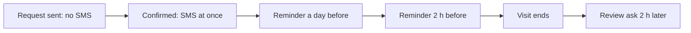

# 5. Limits and numbers

Every number in the product in one place: defaults, choices, limits, timers and sizes.

How to read the tables:

- **Value** shows the default first and the choices or the range in brackets: `30 min (15 min, 30 min, 1 h, 2 h, 6 h, 24 h)`.
- **Who can change it:** *Fixed* means nobody; it's part of the product. *Owner/admin* means the business owner, and the
  administrator when Rugsatlar allows it (allowed by default for settings, services and tables). *Client* means the person
  in their own profile or choices. *Ýeral team* means the team, through its admin tool.
- **Source** "code only" marks a number that exists only in the code. No design or spec mentions it, so the owner sees
  it here for the first time.
- **Conflict** in the Value cell means two sources say different things; a question follows the table.

## Login and accounts

| What | Value | Who can change it | Source |
|---|---|---|---|
| Phone number | +993 and 8 digits | Fixed | client spec §4.4; code: packages/domain/src/phone.ts |
| Numbers that get a login code | mobile only: starting with 6 or 7 | Fixed | ROUND6-ANSWERS C1; code: packages/domain/src/phone.ts |
| Login code | 4 digits | Fixed | client spec §4.4 |
| Code is valid for | 5 min | Fixed | code only: apps/api/src/modules/auth/codes.ts |
| "Send again" after | 59 s (timer 0:59) | Fixed | client spec §4.4; code: apps/api/src/modules/auth/codes.ts |
| Wrong tries | 3, then a 60 s lock; a new code is needed after it | Fixed | client spec §4.4; code: apps/api/src/modules/auth/codes.ts |
| Codes per phone | 5 an hour | Fixed | code only: apps/api/src/modules/auth/codes.ts |
| Codes per internet address | 20 an hour | Fixed | code only: apps/api/src/modules/auth/codes.ts |
| Test code outside production | `1234`; on the design canvases `0000` is wrong and any other code works | Fixed | ADR 0019, productContext |
| Name | asked once, at the first login; 1–80 characters | Client | client spec §4.7; length code only: packages/contract/src/account.ts |
| Staying signed in | 60 days, renewed to 60 whenever fewer than 30 are left | Fixed | code only: apps/api/src/modules/auth/session.ts |
| Changing the phone | a code goes to the new number; every other device is signed out | Client | client spec §4.8; sign-out code only: apps/api/src/modules/me/routes.ts |
| Deleting the account | upcoming bookings are cancelled; past ones stay with the businesses (the rest is open question Q-172) | Client | client spec §4.8; code: apps/api/src/modules/me/routes.ts |
| Accounts per person | 1, for booking and for business work | Fixed | business spec §1 |
| SMS switches | 4, all on: confirmation, reminder a day before, reminder 2 h before, review ask | Client | client spec §4.8; defaults code only: apps/api/src/db/schema/auth.ts |

> Open question Q-267: login code limits that only the code sets.

> Open question Q-269: how long a sign-in lasts, and signing out everywhere.

## Search and location

| What | Value | Who can change it | Source |
|---|---|---|---|
| Search radius | 5 km (1, 3, 5, 10, 25 km) | Client | client spec §5; code: packages/domain/src/geo.ts |
| Results per page | 12; *Ýene görkez* (show more) loads 12 more | Fixed | client spec §4.2; code: packages/contract/src/common.ts |
| Largest page the api returns | 50 | Fixed | code only: packages/contract/src/common.ts |
| Free times on a search card | up to 4, then "+N" | Fixed | client spec §4.2 ("3–4"); code: apps/api/src/modules/catalog/cards.ts |
| Home "free today near you" | 4 businesses, nearest first, 3 times each | Fixed | client spec §4.1 |
| Home category tiles | 13 | Ýeral team | client spec §4.1; code: apps/api/src/db/seed/categories.ts |
| Day filter | *Şu gün* (today) · *Ertir* (tomorrow) · *Şu hepde* (this week, 7 days) | Client | client spec §4.2; code: apps/api/src/modules/catalog/search.ts |
| Rating chip | 4,5 and up | Client | client spec §4.2 |
| Place suggestions in *Nirede?* | at most 6 | Fixed | client spec §5 |
| Suggestions in *Näme?* | at most 4 categories, 6 services, 6 businesses | Fixed | code only: packages/contract/src/catalog.ts |
| Search text | up to 80 characters | Fixed | code only: packages/contract/src/catalog.ts |
| Party size (restaurants) | 2 (1–7 and "8+", which shows times for 8) | Client | ROUND6-ANSWERS D2; Search screen; code: packages/contract/src/catalog.ts |
| Earliest time shown | now + the business's minimum notice | Owner/admin (minimum notice) | client spec §4.2 |
| Without location | no distances; sorted by rating × number of reviews | Fixed | client spec §5; code: packages/domain/src/geo.ts |

> Open question Q-112: how does the search party size meet each restaurant's own limit?

## Business page

| What | Value | Who can change it | Source |
|---|---|---|---|
| Gallery | 1 large + 4 small photos; *Ähli suratlar* (all photos) | Fixed | client spec §4.3 |
| Photos | 3 or more recommended; the first is the cover everywhere; no maximum and no file size set | Owner/admin | business spec §7, §8; client spec §11 |
| Typical answer time | "*Adatça 15 minudyň dowamynda tassyklaýar*"; worked out by the system, method not set | Fixed | client spec §4.3 |
| Rating | average with one decimal (`4,9`), count, bars 5 to 1 | Fixed | client spec §4.3; code: apps/api/src/modules/bookings/actions.ts |
| Rating shown from | the first review | Fixed | code only: apps/api/src/modules/bookings/actions.ts |
| Reviews under moderation | listed, not counted in the average, count or bars | Ýeral team | ROUND6-ANSWERS F2 |
| Reviews per page | 12 | Fixed | code only: packages/contract/src/common.ts |
| Similar places | 4 | Fixed | client spec §4.3; code: packages/contract/src/catalog.ts |
| Special days shown | the next 14 days | Fixed | code only: apps/api/src/modules/catalog/detail.ts |
| "Opens next" looks ahead | 7 days | Fixed | code only: packages/domain/src/hours.ts |
| Home-based business on the map | a circle of about 1 km until the booking is confirmed | Owner/admin (switch "*Öýde işleýärin*") | client spec §2; size code only: apps/api/src/modules/catalog/map.ts |
| Verification | usually within 24 h; until then visitors see "*Bu sahypa entek açylmady*" | Ýeral team | business spec §7; ROUND6-ANSWERS F1 |
| Page link | `yeral.app/tk/b/{slug}`; slug of lowercase letters, digits and dashes, up to 64 characters, never starting with "yr-" | Fixed | business spec §7; ROUND6-ANSWERS notes; length code only: packages/contract/src/common.ts |

**Code differs:** the typical answer time is a stored number per business that nothing works out
(code: apps/api/src/db/schema/business.ts). Slugs starting with "yr-" aren't refused yet (code: packages/contract/src/common.ts).

> Open question Q-113: how is the typical answer time worked out?

> Open question Q-114: show a rating from the first review?

> Open question Q-115: how many photos may a business upload, and how big?

## Appointment booking

| What | Value | Who can change it | Source |
|---|---|---|---|
| Services in one booking | at least 1; at most 10 | Fixed | client spec §4.4; maximum code only: packages/contract/src/bookings.ts |
| Date strip | 14 days, today first; arrows move a week | Fixed | client spec §4.4 |
| Start times | every 15 or 30 min from opening | Owner/admin | client spec §4.4, business spec §8 |
| Time groups | *Irden* before 12:00 · *Günortan* 12:00–17:00 · *Agşam* from 17:00 | Fixed | Booking screen |
| Nearest times when a time was just taken | 3, same day | Fixed | client spec §4.4; code: packages/domain/src/availability.ts |
| Service length | 5–240 min in 5-min steps | Owner/admin | B-Services screen; code: at least 5, no maximum |
| Service price | whole manats, up to 5 digits (99 999 TMT) | Owner/admin | B-Services screen; code: no maximum |
| Buffer after one service | the business's buffer, or its own: none, 5, 10, 15, 20, 30 min | Owner/admin | business spec §4, §8; B-Services screen |
| Note to the business | optional, up to 500 characters; editable while the request waits | Client | client spec §4.4, §4.8; length code only: packages/contract/src/bookings.ts |
| Staff bookings: earliest start | the slot that holds "now" (11:20 → 11:15 with a 15-min step) | Fixed | ROUND6-ANSWERS E3; code: packages/domain/src/availability.ts |
| Staff bookings: minimum notice and window | don't apply | Fixed | code only: packages/domain/src/availability.ts |

> Open question Q-116: how many services can one booking hold?

## Table booking

| What | Value | Who can change it | Source |
|---|---|---|---|
| Online party limit | 8 (2–12); chips 1 to the limit, then "{limit+1}+" with "*… we ondan köp adam bolsa, jaň ediň*" (call for more) | Owner/admin | ROUND6-ANSWERS D1; business spec §20; B-Tables screen |
| VIP area | 6 or more people | Owner/admin (each area's smallest and largest party) | client spec §4.5 |
| Table held after the booked time | 15 min (10, 15, 20, 30 min) | Owner/admin | business spec §20; B-Tables screen |
| Sitting time | 1–2 people 1 sag 30 min · 3–4 people 2 sag · 5 and more 2 sag 30 min (each 1–3 sag in 30-min steps) | Owner/admin | business spec §20; B-Tables screen |
| Last reservation of the day | **Conflict:** 1 h before closing, the table held until closing (B-Tables screen) · closing minus the sitting time, so 21:00 for a 23:00 close (code) | Fixed | B-Tables screen; code: packages/domain/src/availability.ts |
| Table for an online booking | the smallest free table that fits; staff can change it | Staff | business spec §22 |
| Two tables together | pairs marked as combinable, offered when no single table fits | Owner/admin (pairs), staff (use) | business spec §20; ROUND6-ANSWERS D3 |
| Party size for a staff reservation | 1–12 | Fixed | B-Tables screen |
| Special requests | chips set by the restaurant (demo: 4); at most 5 per booking, 40 characters each | Owner/admin | client spec §4.5; limits code only: packages/contract/src/bookings.ts |
| Start times | on the business's time step | Owner/admin | code: packages/domain/src/availability.ts |

**Code differs:** the online party limit is fixed at 8 for every restaurant (code: packages/domain/src/availability.ts);
one sitting time of 2 h applies to every party (code: apps/api/src/db/schema/business.ts); the table hold reuses the
appointment lateness number instead of its own setting (code: packages/domain/src/rules.ts).

> Open question Q-117: when is the last table reservation of the day?

## Class booking

| What | Value | Who can change it | Source |
|---|---|---|---|
| Seats per booking | 1 to 2, never more than the seats left | Fixed | client spec §4.6; code: packages/domain/src/availability.ts |
| Full session | "*Doly*" (full), can't be picked; waiting list later | Fixed | client spec §4.6 |
| Seats a staff member adds | 1, confirmed | Fixed | business spec §22 |
| Class length | 30, 45, 60, 75, 90 min or 2 sagat | Owner/admin | B-Classes screen |
| Session start | 07:00–21:00 in 15-min steps | Owner/admin | B-Classes screen |
| Repeats | every week or every two weeks | Owner/admin | B-Classes screen |
| Seats in a session | set per class (demo: 12 and 14); no limit set | Owner/admin | business spec §21 |
| Schedule days shown | 7 (up to 14) | Fixed | code only: packages/contract/src/availability.ts |
| Minimum notice | the business's setting applies | Owner/admin | code: packages/domain/src/availability.ts |
| Marking a no-show | only after the session starts | Fixed | business spec §22 |
| Request hold | the business's hold time, as for appointments | Owner/admin | business spec §22 |

## Business booking rules (settings)

All in *Sazlamalar → Ýazylyş düzgünleri* (settings → booking rules). (business spec §8, §11; ADR 0017; code:
packages/domain/src/rules.ts)

| What | Value | Who can change it | Source |
|---|---|---|---|
| Online booking (*Onlaýn ýazylyş*) | on (on, off) | Owner/admin | business spec §8; code: packages/domain/src/rules.ts |
| Confirmation (*Tassyklama*) | by hand (by hand, instant) | Owner/admin | business spec §2 |
| Who answers requests | both (*Administrator we eýesi*, *Her hünärmen özi*, *Ikisi hem*); hidden for a one-person business | Owner/admin | business spec §2 |
| Request hold (*Haýyş saklanýar*) | 30 min (15 min, 30 min, 1 h, 2 h, 6 h, 24 h), never past the start | Owner/admin | business spec §2, §8 |
| Minimum notice (*Iň az öňünden*) | 1 h (none, 30 min, 1 h, 2 h, 4 h, 24 h) | Owner/admin | business spec §8, §11 |
| Booking window (*Näçe gün öňünden açyk*) | 30 days (7, 14, 30, 60, 90); today counts as day 0 | Owner/admin | business spec §8; day 0 code only: packages/domain/src/rules.ts |
| Buffer (*Hyzmatdan soňky arakesme*) | 10 min (none, 5, 10, 15, 20, 30, or own 1–120 min) | Owner/admin | business spec §11 |
| Time step (*Wagt ädimi*) | 15 min (15, 30) | Owner/admin | business spec §8 |
| Free cancel and move (*Müşderi ýatyryp biler*) | 2 h before the start (any time, 1, 2, 6, 12, 24, 48 h); **Conflict:** the setup wizard offers any time, 1, 2, 4, 12, 24 h | Owner/admin | business spec §11; B-Settings and B-Onboarding screens |
| Ask for a cancel reason | on (on, off) | Owner/admin | business spec §8 |
| Phone-only after no-shows | 2 (none, 1–5) | Owner/admin | business spec §11 |
| Lateness allowed | 15 min (0–120); shown in the rules; no setting drawn | Fixed | client spec §7 (data model); demo rules; range code only: packages/domain/src/rules.ts |
| Internal statuses | off; up to 5; name up to 20 characters; 8 icons, 6 colours; ready-made *Geldi* (arrived), *Başlandy* (started) | Owner/admin | business spec §3, §8; B-Settings screen |

> Open question Q-118: should the lateness rule be a setting?

> Open question Q-119: which free-cancel choices does the setup wizard offer?

## Requests, holds and expiry

| What | Value | Who can change it | Source |
|---|---|---|---|
| A request holds its time | the business's hold time, ending at the visit start at the latest | Owner/admin | business spec §2, §11 |
| Hold counts | clock time, day and night | Fixed | code only: packages/domain/src/lifecycle.ts |
| Warning to staff before it runs out | 5 min before | Each person (notification settings) | business spec §16 |
| Request timer in the workspace | "*Jogap bermäge 18 min galdy*" (18 min left to answer) | Fixed | business spec §4 |
| No answer in time | cancelled by the system; the client gets 3 free times by SMS | Fixed | client spec §1, §6; business spec §2 |
| Free times after expiry | nearest on the same day first, then the next free days within the booking window; appointments only | Fixed | code only: apps/api/src/modules/jobs/run.ts |
| Expiry check | every minute; screens show the expiry on time | Fixed | code only: apps/api/src/modules/jobs/run.ts |
| Decline | a reason (4 chips; own text for *Başga sebäp*) and up to 3 offered times | Fixed | business spec §2, §4 |
| An offered time taken | confirmed at once if still free; one booking per declined request; all offers past: "*Teklip edilen wagtlaryň möhleti geçdi*" | Fixed | ROUND6-ANSWERS A1 |
| Move request | same hold time; no answer in time: dropped, the booking stays | Owner/admin (hold time) | ROUND6-ANSWERS A3; business spec §26 |
| Waiting requests per client | no limit | Fixed | code only |
| Demo businesses answer by themselves | after 20 s, outside production only | Fixed | code only: apps/api/src/modules/bookings/create.ts |

> Open question Q-120: does the hold time run while the business is closed?

> Open question Q-253: the answer time the client is shown.

> Open question Q-252: what an expired table or class request offers.

> Open question Q-159: which specialist an offered or free time is for.

> Open question Q-124: how many waiting requests may one client have?

## Cancel, move and undo

| What | Value | Who can change it | Source |
|---|---|---|---|
| Cancel a waiting request | any time, free | Fixed | client spec §4.8 |
| Cancel or move a confirmed booking | until the free-cancel window (default 2 h before the start); after it only *Jaň et* | Owner/admin (window) | client spec §4.8; ROUND6-ANSWERS A5 |
| What can be moved | appointments only; tables and classes: cancel and *Gaýtadan ýazyl* (book again) | Fixed | ROUND6-ANSWERS A4 |
| Moves waiting at once | 1; a second move replaces the first | Fixed | ROUND6-ANSWERS A3 |
| Undo a cancel (*Yzyna al*) | 5 min after the client's own cancel, and only before the visit starts | Fixed | ROUND6-ANSWERS A6; code: apps/api/src/modules/bookings/view.ts |
| A cancelled booking in *Gelýän* | stays, greyed, until the next page load | Fixed | client spec §4.8 |
| Cancel reason from the client | optional, up to 300 characters | Client | business spec §8; length code only: packages/contract/src/bookings.ts |
| Business cancels or moves | any time before the start | Owner/admin and specialists, by permission | business spec §3; code: packages/domain/src/lifecycle.ts |
| SMS to the client when the business moves | on by default (a box on the confirm popover) | Staff, per move | business spec §4 |
| Complaint (*Arz et*) | from the visit start; one per booking | Owner/admin and specialists, by permission | ADR 0017; code: packages/domain/src/lifecycle.ts |

**Code differs:** the move keeps the booking with any free specialist when the chosen one is busy; the decided rule is no
silent swap (code: apps/api/src/modules/bookings/create.ts). A booking with a waiting move doesn't offer a second move,
though a second move should replace the first (code: apps/api/src/modules/bookings/view.ts).

> Open question Q-125: can a class be cancelled online after the free window?

## Reviews

| What | Value | Who can change it | Source |
|---|---|---|---|
| Who can write | clients with a completed booking; one review per booking | Fixed | client spec §4.3, §4.8 |
| Stars | 1–5, required | Client | client spec §4.8 |
| Quick tags | 5 drawn (*Wagtynda kabul etdiler*, *Arassa*, *Ussat hünärmen*, *Mähirli*, *Bahasyna laýyk*); at most 6 per review, 40 characters each | Fixed | Account-Bookings screen; limits code only: packages/contract/src/bookings.ts |
| Text | optional, up to 500 characters | Client | client spec §4.8 |
| Editing | for 7 days after writing | Client | client spec §4.8; code: packages/domain/src/lifecycle.ts |
| Deadline to write one | none | Fixed | code only: apps/api/src/modules/bookings/actions.ts |
| Review ask by SMS | 2 h after the visit ends | Fixed | client spec §6 |
| Business reply | up to 500 characters; the business can edit or delete it | Owner/admin | business spec §15 |
| Reviews per page in the workspace | 20 | Fixed | business spec §15 |
| Report reasons | 5 | Fixed | business spec §15 |
| A reported review | visible on both sides, not counted until the Ýeral team clears it | Ýeral team | business spec §15; ROUND6-ANSWERS F2 |

**Code differs:** there's no moderation yet; every review counts as soon as it's written (code:
apps/api/src/modules/bookings/actions.ts).

> Open question Q-126: how long after a visit can a client write a review?

## Team and access

| What | Value | Who can change it | Source |
|---|---|---|---|
| Owners per workspace | exactly 1; handed over to an active member who logs in | Owner | business spec §1, §8 |
| Access levels | 3 (*Eýesi*, *Administrator*, *Hünärmen*) plus phone-only staff; no custom levels | Fixed | business spec §1 |
| Team size | no limit | Fixed | business spec §19 |
| Invite link | sent by SMS; valid 7 days; can be sent again; expired: "*Çakylygyň möhleti geçdi*" | Owner/admin | business spec §1, §8 |
| Phone-only staff | no SMS, active at once | Owner/admin | business spec §11 |
| Workspaces per person | no limit; one address each | Fixed | business spec §1 |
| Busy elsewhere shown | on | Each person (Profilim) | business spec §1 |
| Who answers requests | both (see booking rules); each person can be allowed to answer their own | Owner/admin | business spec §2, §8 |
| Rows in the permission matrix | 11 | Owner | business demo data (accessLevels) |

**Code differs:** invitations never expire, and an invited person joins at the first login without the accept or decline
step (code: apps/api/src/modules/auth/routes.ts).

## Clients (segments, no-show block)

| What | Value | Who can change it | Source |
|---|---|---|---|
| *Yzygiderli* (regular) | 3 or more visits in the last 6 months | Fixed | business spec §6; code: packages/domain/src/clients.ts |
| *Täze* (new) | first visit in the last 30 days | Fixed | business spec §6; code: packages/domain/src/clients.ts |
| *Köpden bäri gelmedik* (lapsed) | no visit for 60 days or more | Fixed | business spec §6; code: packages/domain/src/clients.ts |
| *Arz edilen* (reported) | at least one complaint | Fixed | business spec §6 |
| Phone-only after no-shows | 2 (none, 1–5); all no-shows ever count; also a switch on the client card | Owner/admin | business spec §3, §6, §11; counting code only: packages/domain/src/clients.ts |
| New client | only the phone is required | Fixed | business spec §6 |
| "Where they came from" choices | 5 (Instagram, a friend, Ýeral, walked by, other) | Fixed | business spec §6 |
| Deleted client | bookings stay in reports without a name | Owner/admin | business spec §6 |
| Full reports | after 30 bookings; returning clients after one full month | Fixed | business spec §14; B-Analytics screen |
| Insight sentences | at most 1 per report section | Fixed | business spec §14 |

> Open question Q-127: which no-shows count, and how does the phone-only limit end?

## Hours and special days

| What | Value | Who can change it | Source |
|---|---|---|---|
| Opening and closing pickers | starts 06:00–23:30, ends up to 24:00, in 30-min steps | Owner/admin | business spec §11, §26; ROUND6-ANSWERS E1 |
| Latest end of a day | 24:00; past midnight not designed | Fixed | ROUND6-ANSWERS E1 |
| Breaks | 1 per day, may differ per day; each staff member has their own | Owner/admin | business spec §11; ADR 0017 |
| Staff hours | the business's hours, or their own inside them | Owner/admin | business spec §10; ADR 0017 |
| "*Iş günleri birmeňzeş*" (same every weekday) | copies Monday to Tuesday–Friday | Owner/admin | business spec §11 |
| Special days | one day or a range; dated or every year; closed or other hours | Owner/admin | business spec §8 |
| Overlapping special days | dated beats yearly, shorter beats longer, closed beats other hours; a full tie keeps the existing one; a warning, never a block | Fixed | ROUND6-ANSWERS E2; code: packages/domain/src/hours.ts |
| A special day over existing bookings | keep them, or cancel them and offer each client 3 other times | Owner/admin | B-Settings screen |

> Open question Q-128: how early and how late can hours and classes start?

## Notifications and SMS timings

| What | Value | Who can change it | Source |
|---|---|---|---|
| Request sent | no SMS; on screen only | Fixed | client spec §6 |
| Confirmed | SMS at once | Client (switch) | client spec §6 |
| Declined | SMS at once, with the reason and a link | Fixed | client spec §6 |
| No answer in time | SMS at once, with 3 free times and a link | Fixed | client spec §6 |
| Cancelled by the business | SMS with the reason | Fixed | business spec §3; code: packages/i18n/src/messages/tk.json |
| Reminders | a day (24 h) before and 2 h before; skipped when the booking is made later than that | Client (switches); business ("*Ýatlatma SMS-lerini iberme*" per client) | client spec §6, business spec §6; skipping code only: apps/api/src/modules/bookings/confirm.ts |
| Review ask | 2 h after the visit ends | Client (switch) | client spec §6 |
| Client SMS at night | sent at any hour | Fixed | code only: apps/api/src/modules/jobs/run.ts |
| SMS that fail | tried 5 times, waiting 1, 2, 4 and 8 min | Fixed | code only: apps/api/src/modules/jobs/run.ts |
| Staff: new request | at once, in the browser with a sound; SMS only for a person without the app | Each person | business spec §2, §16 |
| Staff: request about to run out | 5 min before | Each person | business spec §16 |
| Staff: tomorrow's bookings | 20:00 (17:00–23:00) | Each person | business spec §16; B-Notifications screen |
| Staff: day summary | 08:00 (05:00–10:00) | Each person | business spec §16; B-Notifications screen |
| Staff quiet hours | 22:00–08:00 (start 19:00–00:00, end 05:00–10:00); no SMS at night | Each person | business spec §16; B-Notifications screen |
| Staff SMS | only for "new request" and "Ýeral" messages | Each person | business spec §22 |
| Staff channels on MVP | browser and SMS; "in the app" once the business app ships | Fixed | business spec §16 |

> Open question Q-285: client SMS at night.

> Open question Q-295: sMS length and cost.

## Technical limits

| What | Value | Who can change it | Source |
|---|---|---|---|
| Request limits | only on login codes (see Login); nothing else is limited | Fixed | code only: apps/api/src/lib/rate-limit.ts |
| Open screens refresh | every 10 s, when the window gets focus, and after the person's own action | Fixed | code only: packages/sdk/src/events.ts |
| Changes per refresh | up to 100 | Fixed | code only: apps/api/src/modules/events/routes.ts |
| Background work (expiries, completions, SMS) | every minute, up to 100 items a run | Fixed | code only: apps/api/src/modules/jobs/run.ts |
| Page size | 12 by default, at most 50 | Fixed | code only: packages/contract/src/common.ts |
| Free times in one request | 14 days by default, up to 31; classes 7, up to 14 | Fixed | code only: packages/contract/src/availability.ts |
| Booking code | "YR-" and 5 digits, never starting with 0; one more digit after repeated clashes | Fixed | code only: packages/domain/src/id.ts |
| Text lengths | name 80, note 500, cancel reason 300, review 500, search 80 characters | Fixed | code only: packages/contract/src |
| Environments | local and production only; no staging | Fixed | owner 16.10.2026; ADR 0020 |
