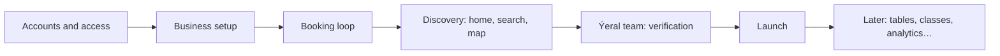

# 6. Features and MVP scope

Every feature Ýeral has, wants or once had, in one list (242 of them), each with a **proposed** place: in the
**MVP**, **Later**, or **Never**. The proposal is Claude's; the decision is the owner's. On the page, each row has an
MVP · Later · Never switch: click to move a feature, and the change is saved for Claude to write back here. The owner
placed F-001–F-116 and F-240 on 18.10.2026; every other feature keeps the proposal (the owner delegated it), except
F-133, which follows F-104 into the MVP.

## How the proposal was made

- **MVP** = what's needed for a real business to take real bookings (online and by phone) and run its day, and for a
  client to find a business, book, and manage the booking — plus the minimum the Ýeral team needs to make businesses
  public. Built for appointments first.
- **Later** = designed or useful, but not needed to launch. Ships in updates after launch, in an order we set then.
- **Never** = replaced by another decision (for example "a second address is a second workspace" replaces branches) or
  only in the old site and replaced by a better design.
- Where a question below decides a whole group (booking types at launch, the Ýeral team's tool), the proposal follows
  the recommended answer. If the owner picks differently, the group moves with it.

The order above is the recommended answer to Q-001 (one launch, built in pieces). Each piece ends with something that
works end to end.

> Open question Q-030: which booking types at launch.

> Open question Q-031: "Başga ýerde" and internal statuses at launch.

> Open question Q-032: can people in Turkmenistan open the site, and where do we host at launch?

> Open question Q-037: must personal data be stored in Turkmenistan?

> Open question Q-033: who writes the privacy policy and the terms?

> Open question Q-103: who sets a restaurant's average bill.

## Found while listing: design to fix

These are drawn but go against a decision. Since 20.10.2026 no redraw comes (Q-133, revised): the build follows the
book here, not the board.

- The client boards are drawn in Turkmen; the client site is built in English from them and this book (Q-101, Q-133,
  ADR 0022); the design system and the business app are drawn in English (export v0.6).
- Restaurant cards and the table flow show *Ortaça hasap* `≈ 150 TMT`; the average bill is dropped (Q-103).
- The business spec draws workspace links with `/tk/`; they carry no language (Q-100).
- Hours stop at 24:00; a business may be open past midnight (Q-105, F-109).
- No city choice is drawn, and addresses show no city (Q-107, F-240).
- The Home page still has an "app on your phone" block with store buttons (F-004), but native apps come later.
- The client footer still links to "Bahalar" (prices) on every screen (F-033), but Ýeral is free.
- The business landing page's FAQ promises card payment and prepayment "ýakynda" (soon) (F-176, F-219), which isn't
  planned.
- The search party filter offers 1–7 and "8+" while the table flow's limit is a business setting up to 12 (F-013,
  F-050).
- The answers of 18.10.2026 add their own fixes, each marked **Design to fix** in chapters 7a–7c. The main ones: the
  Ýeral team's admin tool (undrawn); *Wagty ýap* (block time) on an empty slot; the workspace in business links; the
  rejected-business banner; the client's review-ask switch and the *Başga ýerde* switch dropped; the finished-visit
  state of the booking link page; the "Is this you?" sign-in step; one shared code step with a visible button; the
  optional surname; hiding moves and free-time chips for a client who must call.

## Found while listing: code differs

What's already built and doesn't match a decision; fixed when coding resumes, not asked again.

- The online party limit is a fixed 8 in code; it's a business setting in the design (F-050).
- Only in code, never designed: "What?" search suggestions (F-007), the places list behind "Where?" (F-187), demo
  businesses that answer by themselves (F-200), the `ai` booking source (F-230).
- The answers of 18.10.2026 add **Code differs** lines across chapters 5 and 7a–7c; P2 step 3 works through them
  (chapter 10).

## Totals by area

| Area | MVP | Later | Never |
|---|---|---|---|
| Client · discovery (home, search, map, categories, business page) | 29 | 9 | 0 |
| Client · booking (per type) | 12 | 5 | 0 |
| Client · after booking (my bookings, cancel, move, reviews, SMS link page) | 13 | 4 | 1 |
| Client · account | 9 | 1 | 0 |
| Business · access (login, workspaces, invites, levels, permissions, ownership) | 12 | 2 | 0 |
| Business · setup (wizard, profile, services, hours, rules, link & QR) | 18 | 2 | 0 |
| Business · daily work (calendar, requests, bookings, walk-ins, moves, complaints, internal statuses) | 20 | 2 | 0 |
| Business · clients (CRM) | 8 | 1 | 0 |
| Business · tables | 0 | 6 | 0 |
| Business · classes | 0 | 6 | 0 |
| Business · reviews | 3 | 0 | 0 |
| Business · analytics | 0 | 6 | 0 |
| Business · notifications and help | 2 | 4 | 0 |
| Business · marketing (B2B landing) | 4 | 0 | 0 |
| Ýeral team (verification, moderation, categories, support, CMS modules) | 5 | 7 | 0 |
| System (jobs, SMS, live updates, search indexing, SEO, i18n) | 11 | 3 | 0 |
| Platform (hosting, own server, Storybook, monitoring) | 9 | 1 | 1 |
| Later and non-goals | 0 | 24 | 2 |
| **All** | **155** | **83** | **4** |

## Client · discovery (home, search, map, categories, business page)

| ID | Feature | What it is | Proposed | Design | Code | Notes |
|---|---|---|---|---|---|---|
| F-001 | Home page | Hero "Ýeriňi al." with the search card (what / where / when), category photo mosaic, how it works in 3 steps, Ýeral Biznes block and footer. | MVP | drawn (Home, Mobile 1) | not built (data: api built) | M3 first screen after the shells. |
| F-002 | "Free today near you" cards | Four nearest businesses with their next 3 free times; a time chip opens booking with it preselected. | MVP | drawn (Home) | api built (`/v1/search`, day free times) | Needs F-009 (geolocation). |
| F-003 | Category grid | The launch categories that take appointments as icon tiles linking to category pages: 11 of the 13 seeded; Restaurant and Café & tea house come with tables (Q-030). | MVP | drawn (Home, v0.5); built with the 11 tiles | api built (`/v1/categories`, 13 seeded) | Category list is seed data until the CMS catalogue (F-181). **Code differs:** the api lists all 13 categories and finds the seed's table and class examples (Bag kafe, Ojak, Aýdyň ýoga); the first launch shows appointments only (P2 step 6). |
| F-004 | App download block on Home | "Ýeral telefonyňyzda" with App Store / Google Play buttons. | Later | drawn (Home) | not built | **Conflict:** native apps are later (owner); round 6 removed the business app banner but this client block stayed. Store badges come with the native apps. |
| F-005 | Unknown-location prompt | Banner "Ýakynyňyzdaky ýerleri görkezeliň" (use my location / type an address) above a "popular places" list. | MVP | drawn (Home, States 2) | api built (popularity sort) |  |
| F-006 | Search results page | List of businesses with type-specific rows (slots, "Stol · 2 adam", seats left) next to a map; "Ýene görkez" loads 12 more. | MVP | drawn (Search) | api built (`/v1/search`, cursor paging) | Big. Map needs F-014. |
| F-007 | "What?" suggestions | Typing in "Näme?" suggests categories and business names. | Later | not designed | api built (`/v1/search/suggest`) | Code only; no dropdown is drawn. |
| F-008 | "Where?" place suggestions | Typing an address, district or landmark in "Nirede?" offers up to 6 places. | MVP | spec only (README §5) | api built (`/v1/places/suggest`, `places` table) | Places are seeded; nobody maintains them (see F-187). |
| F-009 | Near-me location and radius | Browser geolocation as "Ýakynymda" with a 1 / 3 / 5 / 10 / 25 km radius chip (5 km default). | MVP | drawn (Search) | built (domain geo, api) |  |
| F-010 | Location-denied fallback | The market's main city inside "Nirede?", distances hidden, sort by rating × reviews, help sheet to allow location. | MVP | drawn (States 3: an IP-based city) | api built (popularity sort, in the market's main city); the IP lookup removed (ADR 0024) | The city is a choice (Q-107, F-240); the main city is a market setting. |
| F-011 | Search filters and sort | Category chips, day toggle Şu gün / Ertir / Şu hepde, filters drawer (price, rating 4.5+, open now, booking type, women only) and sort nearest / rating / price. | MVP | drawn (Search chips); drawer contents spec only | api built (`cat`, `date`, `week`, `minPrice`, `maxPrice`, `minRating`, `openNow`, `type`, `womenOnly`, `sort`) | Results are limited to businesses with free time on the chosen day. |
| F-012 | Specialist gender filter | Beauty searches can filter by the specialist's gender. | Later | spec only (README §4.2) | schema only (`staff.gender`) | Not in the search api. |
| F-013 | Party-size filter for restaurants | "Adam sany: 2 ▾" chip (1–7, 8+) when the restaurant/café category is on; rows show times for that party. | Later | drawn (Search · party) | api built (`party` 1–8, default 2) | Round 6 D2 calls it new, but the api already has it; design range 1–7 + 8+ vs api max 8. |
| F-014 | Interactive map | Map with time pins; row hover highlights its pin, pin click scrolls to the row; "Bu ýerde gözle" re-runs the search for the visible area. | MVP | drawn (Search) | not built (api `bbox` built) | MapLibre + OpenFreeMap decided (owner 14.10). Also used by F-015, F-021, F-099. |
| F-015 | Phone map with card carousel | Under 1024 px the list has a floating "Karta" button opening a full-screen map with swipeable cards. | MVP | drawn (Mobile 3) | not built |  |
| F-016 | Category landing pages | `/{lang}/c/{category}` = search pre-filtered by category with a title and an SEO intro text. | MVP | spec only (pattern of Search) | schema only (`categories.intro`); page not built | SEO entry point (F-197). |
| F-017 | Business page | Gallery, name, rating, category, address + distance, open-now state, sticky booking card, tabs Services / Specialists / Reviews / About. | MVP | drawn (Venue, Mobile 4) | api built (`/v1/businesses/:slug`) | Big. |
| F-018 | Photo gallery viewer | "Ähli suratlar" opens a full-screen photo viewer over the business page. | MVP | spec only (pattern) | not built | Needs photo storage (F-101). |
| F-019 | Services and specialists tabs | Services grouped with filter chips and a select toggle feeding the summary card; specialists (avatar, role, rating) start booking with that person. | MVP | drawn (Venue) | api built |  |
| F-020 | Reviews on the business page | Average, count, 5→1 bars, list with business replies, "Ähli teswirler". | MVP | drawn (Venue) | api built (`/v1/businesses/:slug/reviews`) | Moderation part is F-162. |
| F-021 | About tab | Description, hours (today highlighted), map + directions, amenities, booking rules, pay at the place, typical confirmation time. | MVP | drawn (Venue) | api built | The typical answer time is worked out from the business's answers (Q-113, 20.10.2026). |
| F-022 | Nearby similar places | "Golaýdaky ýerler": 4 similar businesses at the bottom of the page. | Later | drawn (Venue) | api built (same category) |  |
| F-023 | Share business page | "Paýlaş" button on the business page. | MVP | drawn (Venue) | not built |  |
| F-024 | Favourite heart | Save a business; logged-out tap opens login first. | MVP | drawn (Venue, States 10) | api built (`/v1/me/favorites`) | List is F-080. |
| F-025 | Hidden exact address | Home-based businesses show only an approximate circle until the booking is confirmed. | MVP | spec only; switch drawn (B-Onboarding 3) | built (api) |  |
| F-026 | Hidden price display | "Baha ýerinde aýdylýar" instead of a price; mixed totals shown as "{sum} TMT-den". | MVP | drawn (Venue · selection, Booking · price, Mobile 17) | built (domain pricing, i18n fmt) | Round 6 B1; the copy is "Price at the place" (`fmt.price`). The restaurant average bill is dropped (Q-103; gone from the api 20.10.2026). |
| F-027 | Hours up to 24:00 | A day may end at 24:00: business end pickers go to 24:00, clients see "09:00–24:00" and "Häzir açyk · 24:00-a çenli". | MVP | drawn (Venue · hoursCase, B-Settings) | built (domain hours) | Round 6 E1. Past midnight: F-109. |
| F-028 | Table and class page variants | Restaurants get a table widget (party, date, time) in the sticky card; studios get "Indiki sapaklar" and a "Tertip" (schedule) tab. | Later | spec only (README §4.3) | api built (tables info, `/sessions`) |  |
| F-029 | Restaurant menu (PDF / photos) | Optional "Menýu" tab with a PDF or photos. | Later | spec only | not built (no schema) |  |
| F-030 | Online booking paused state | Business page shows that online booking is off and offers a call. | MVP | drawn (States "not bookable online", B-Settings preview) | built (api `onlineEnabled`) |  |
| F-031 | Phone-only client card | A client blocked from online booking sees a calm card "book by phone" + "Jaň et" instead of select buttons. | MVP | drawn (Venue · restricted, Booking · restricted, Mobile 16) | api built (refuses online booking); card not built | Round 6 A7. Offered times after a decline still work online. Needs F-144. |
| F-032 | Unverified business page | Visitors get "Bu sahypa entek açylmady" (404 + noindex); owner and team see their page with a "in review" banner, and the workspace shows "Sahypaňyz barlagda…". | MVP | drawn (States 11, Venue · ownerPreview, B-Shell) | api built (`in_review` 404 for visitors, `preview` for the team); the pages and banners with the apps | Round 6 F1. Needs F-179. |
| F-033 | Page chrome | Marketing header, search header with the what / where / when query bar, focused booking header, footer (links incl. "Biznes girişi", "Bahalar"). | MVP | drawn (all client screens) | partly: the marketing header and the footer on the client site (#110); QueryBar, CompactSearch, HeroSearch in `@yeral/ui`; the search and booking headers come with their slices | Footer link "Bahalar" (prices) survives on every client screen although there is no pricing in the free MVP. |
| F-034 | Static pages | About, help, privacy, terms: header + 720 px text column + footer. | MVP | spec only (pattern) | not built | Privacy and terms texts don't exist yet. |
| F-035 | Error, empty and loading states | 404, no results, closed today, network error toast, loading skeletons. | MVP | drawn (States) | built (ui: EmptyState, Skeleton, Toast) |  |
| F-036 | Legacy home sections | Browse by district, "Recommended" (top-rated) and "New on Ýeral" sections. | Later | not designed | legacy only | The new design names no city or district in copy. Owner: Later (18.10.2026). |
| F-037 | Instant-confirmation filter | Search filter for businesses that confirm at once. | Later | not designed | legacy only |  |
| F-240 | City choice | The person's location preselects a city; they can pick another; an address shows its city when it differs from the selected one. | MVP | not designed | api built (20.10.2026): the city list, the nearest city, search and places by city, the city on cards, pages and bookings, the city in reminder SMS outside the main city | Q-107 (decided 18.10.2026). |

## Client · booking (per type)

| ID | Feature | What it is | Proposed | Design | Code | Notes |
|---|---|---|---|---|---|---|
| F-038 | Appointment booking flow | Services → specialist → date & time (14-day strip, morning / afternoon / evening, "next free day") → confirm → sent, with a sticky summary and state kept in the URL. | MVP | drawn (Booking, Mobile 5) | api built (availability, `POST /v1/bookings`); ui built (DateStrip, TimeSlots) | Big. Core MVP flow. |
| F-039 | Multi-service booking | Several services back to back, with one specialist when possible. | MVP | spec only | built (domain availability) |  |
| F-040 | "Any specialist" | "Islendik hünärmen" picks the earliest time, splitting services between specialists if needed. | MVP | drawn (Booking · staff) | built (domain) |  |
| F-041 | Specialist word per category | "Hünärmen" becomes lukman, mugallym, tälimçi, ussa, stilist…; a solo business skips the step. | MVP | spec only | built (`categories.specialistWord`) |  |
| F-042 | Slot step, lead time, booking window | Starts every 15 or 30 min, never earlier than now + lead time (cards and flows), not beyond the window. | MVP | spec only | built (domain rules, api) | Settings: F-102. |
| F-043 | Inline login in the flow | Logged-out clients enter phone → SMS code → name on the confirm step. | MVP | drawn (Booking, Booking-Table, Booking-Class) | api built | Same as F-073. |
| F-044 | Note to the business | Optional note on the confirm step; the client can edit it until the business answers. | MVP | drawn (Booking · confirm) | built (api, `PATCH …/note`) |  |
| F-045 | Slot taken meanwhile | Banner "Bu wagt ýaňy alyndy" with the 3 nearest free times; sending stays disabled until a new time is picked. | MVP | drawn (Booking · slotTaken) | built (api 409 `slot_taken` + alternatives; database exclusion constraints) |  |
| F-046 | Sent screen | "Sent, waiting" with status, summary, hold-time sentence ("Jogap bermese, {N} minutdan soň…"); instant businesses show "Ýazylyş tassyklandy". | MVP | drawn (Booking · sent, confirmMode) | api built (status, hold); screen not built | Round 6 A2 sentence. |
| F-047 | Add to calendar | "Senenama goş" downloads an `.ics` file. | MVP | drawn (Booking · sent) | not built |  |
| F-048 | Instant confirmation | A business may confirm online bookings at once instead of by hand. | MVP | drawn (Booking · confirmMode, B-Settings) | built (domain, api) | Owner decision 14.10.2026. |
| F-049 | Table booking flow | Party size → date → time → area (Zal / Terrasa / VIP, VIP ≥ 6) → special-request chips → contact → "Stoly bronla"; the table is held 15 min after the time. | Later | drawn (Booking-Table) | api built (`/tables`, `POST /v1/bookings`, VIP minimum, `tableRequests`, hold) |  |
| F-050 | Party limit from business setting | Party chips go 1…max with a "{max+1}+ → call" chip; max comes from the business's setting. | Later | drawn (Booking-Table · maxParty) | not built (constant `MAX_ONLINE_PARTY = 8`) | Round 6 D1; known gap in progress.md. Setting: F-153. |
| F-051 | Automatic table assignment | Online reservations get the smallest free table that fits; staff can change it. | Later | spec only | built (domain `assignTable`) |  |
| F-052 | Class booking flow | Week schedule by day → session (time, trainer, level, price, seats left / full) → seats (max min(2, seats left)) → contact → "Ýer al". | Later | drawn (Booking-Class) | api built (`/sessions`, seat limits) | Same-day sessions past the free-cancel window show "Mugt ýatyrmak wagty geçdi…". |
| F-053 | Where the service happens | At the business, at the client's address (home services) or online (tutors, psychologists). | Later | spec only (README §2) | not built (no field) | No screen shows address entry for home visits. |
| F-054 | Human booking codes | Every booking has a code like `YR-48213`. | MVP | drawn (everywhere) | built (domain id) | Business slugs must never start with `yr-` (ROUND6 notes). |

## Client · after booking (my bookings, cancel, move, reviews, SMS link page)

| ID | Feature | What it is | Proposed | Design | Code | Notes |
|---|---|---|---|---|---|---|
| F-055 | My bookings list | Tabs Upcoming (soonest first) / Past (newest first) with photo, business, services, time, status and quick actions "Ýol görkez" / "Jaň et". | MVP | drawn (Account-Bookings, Mobile 6) | api built (`/v1/me/bookings`) |  |
| F-056 | Booking detail | Right drawer (bottom sheet on phones): summary, status timeline, address + map, actions by status, booking code. | MVP | drawn (Account-Bookings · drawer) | api built (timeline, hold, cancel deadline, actions) |  |
| F-057 | Status badges and canceller labels | Five statuses as icon + label (clock, check, check-check, x, user-x), with who cancelled: "Siz ýatyrdyňyz", "Biznes ýatyrdy" / "Biznes ret etdi", "Wagtynda jogap gelmedi" (hourglass). | MVP | drawn (all client screens, DS boards) | api built (`cancelledBy`, decline); ui StatusBadge built with the retired dot | Round 6 visual change, business side too. |
| F-058 | Cancel a booking | Cancel with an optional reason until the cancellation window (default 2 h); after it only "Jaň et". | MVP | drawn (Account-Bookings · cancel) | built (api, domain) | Cancelled row stays greyed in Upcoming until reload. |
| F-059 | Undo cancel | "Yzyna al" for 5 minutes; failures explained by one of four reasons + "Başga wagt saýla". | MVP | drawn (Account-Bookings · undo, undoFailed; Mobile 12) | api built (`restore`, each reason its own error) | Round 6 A6. |
| F-060 | Move an appointment | "Wagty üýtget" mode: services locked, current specialist preselected, old → new time, sends a move request (instant: moves at once). | MVP | drawn (Booking · mode=move, Mobile 13) | api built (`reschedule`) | A move books the chosen specialist only, never another one in their place (A5, Q-165; 20.10.2026). |
| F-061 | Waiting move | Booking stays confirmed with "Täze wagt soraldy…"; withdraw, declined, unanswered and accepted outcomes; a second move replaces the first. | MVP | drawn (Account-Bookings · move*) | api built for the client (waiting, replacing, withdrawing, the outcome and its SMS) | Round 6 A3. Business side: F-126. |
| F-062 | No move for tables and classes | Table and class bookings offer cancel + "Gaýtadan ýazyl" (flow prefilled) instead of a move. | Later | drawn (Account-Bookings, Mobile 6) | api built (`not_bookable`) | Round 6 A4; old open question 16 closed. Owner: Later (18.10.2026), with tables and classes (Q-030). |
| F-063 | Declined request with offered times | Client sees "Biznes ret etdi", the reason and up to 3 offered times; one tap creates a confirmed booking. | MVP | drawn (Account-Bookings · declined*, Mobile 7–9) | api built (`accept-alternative`, one booking per offer) | Round 6 A1; taken / expired chip states to build. |
| F-064 | Expired request with free times | An unanswered request shows "Wagtynda jogap gelmedi" and 3 free times; a tap sends a new request. | MVP | drawn (Account-Bookings · expired*, Mobile 10) | built (jobs + `accept-alternative`) | Round 6 A2. |
| F-065 | Phone bookings in the client's account | Bookings the business entered by phone show in the client's list as confirmed with a phone icon. | MVP | spec only (README rule 4) | built (api links phone bookings on login) |  |
| F-066 | Book again | "Gaýtadan ýazyl" from completed, cancelled or no-show bookings. | MVP | drawn (Account-Bookings) | not built |  |
| F-067 | Leave a review | Stars (required), quick tags, text up to 500 chars; one per completed booking, editable for 7 days, shown as "Aýjemal G.". | MVP | drawn (Account-Bookings · review) | built (api) | Only after a Completed booking. |
| F-068 | SMS link page | The SMS token link (Q-168) works signed out: booking card, status, offered times, inline login limited to the booking's masked phone. | MVP | drawn (Booking-Link, Mobile 14–15) | api built (`GET /v1/links/{token}`, sign-in limited to the booking's phone); page not built | Round 6 A1. |
| F-069 | Business-proposed new time | The business proposes another time and the client accepts or keeps the old one. | Later | not designed | legacy only | Design has decline-with-offers instead. Owner: Later (18.10.2026). |
| F-070 | "This isn't me" on phone bookings | A client reports a phone booking made with their number by mistake. | Later | not designed | legacy only |  |
| F-071 | Confirm visit the day before | After repeated no-shows the client must confirm the day before or lose the slot. | Never | not designed | legacy only | Design uses "phone only after N no-shows" instead (F-191). |
| F-072 | My reviews page | A list of the client's own reviews with edit / delete. | Later | not designed | legacy only |  |

## Client · account

| ID | Feature | What it is | Proposed | Design | Code | Notes |
|---|---|---|---|---|---|---|
| F-073 | Phone login | Phone (+993) → 4-digit SMS code (auto-submit, resend after 0:59, 3 wrong tries → 60 s lock) → name for new users, as a 400 px modal (bottom sheet on phones). | MVP | drawn (Auth) | built (api, ADR 0019, rate limits per phone and IP; `@yeral/features/auth-by-phone` in both apps, #102, #108, #114) | No passwords. Real codes need F-193. At the first launch the code shows on the screen, no SMS (Q-036). |
| F-074 | Mobile numbers only | Landlines refused with "Kod diňe mobil belgä iberilýär…". | MVP | drawn (Auth, B-Login · phoneLandline) | built (api `not_mobile`; the message in both logins, #102 and #114, names the market's mobile prefixes, #111) | Round 6 C1. |
| F-075 | One account for client and business | The same phone account books on yeral.app and works in business workspaces. | MVP | spec only (business §1) | built (shared users, cookie on the parent domain, sessions 60 days) |  |
| F-076 | Avatar menu and log out | Logged-in menu: My bookings · Favourites · Profile · Language · Log out. | MVP | drawn (Auth) | built with Log out (#110) and Profile (#118); My bookings and Favourites come with their pages, Language with a market's second language |  |
| F-077 | Profile and phone change | Edit name; change phone via an SMS code to the new number. | MVP | drawn (Account-Profile) | built (api `/v1/me`, `/v1/me/phone/*`; the client profile, #118) |  |
| F-078 | Language preference | TK / RU / EN saved to the profile and carried across sites. | MVP | drawn (Account-Profile) | built (api) |  |
| F-079 | SMS notification switches | Confirmation, reminder 1 day before, reminder 2 h before. | MVP | drawn (Account-Profile) | built (api, jobs honour them) | No review request: there are no review asks (Q-259). |
| F-080 | Favourites list | Grid of saved businesses with remove + undo. | MVP | drawn (Account-Profile · favourites) | api built |  |
| F-081 | Delete account | Danger action with a confirm modal. | MVP | drawn (Account-Profile) | built (api `DELETE /v1/me`; the client profile, #118) |  |
| F-082 | Client browser notifications | Browser notifications about answers, moves and reminders. | Later | not designed | legacy only | Client push comes with native apps (F-224). |

## Business · access (login, workspaces, invites, levels, permissions, ownership)

| ID | Feature | What it is | Proposed | Design | Code | Notes |
|---|---|---|---|---|---|---|
| F-083 | Business login and routing | business.yeral.app login with the same phone account → pending invite, or "no workspace yet", or the last used workspace. | MVP | drawn (B-Login, B-Mobile) | built (#102, #115) |  |
| F-084 | First-login profile | New person enters name and an optional photo after the code. | MVP | drawn (B-Login · name) | built without the photo (#102); the api takes it (`PUT /v1/me/photo`, 21.10.2026) |  |
| F-085 | Invites by SMS | Owner invites by phone with an access level; SMS link valid 7 days; accept / decline / expired; resend or revoke. | MVP | drawn (B-Login · invite, B-Team · invite) | api built (`/v1/w/{slug}/team/invites`, `/v1/me/invites`, accept / decline / expired / resend / cancel, the copied link; ADR 0025); the invite, decline and expired cards in the business login (#102, #115); sending invites comes with the team screens (slice 2); no SMS yet | At the first launch the invite shows at the invited phone's sign-in. |
| F-086 | No-workspace state | "Entek iş ýeriňiz ýok" with "Biznesimi döret" and how to ask an owner for an invite. | MVP | drawn (B-Login · empty) | built (#102) |  |
| F-087 | Workspace switcher | One person in several businesses, each with its own level and request count; the only switch in the app. | MVP | drawn (B-Shell) | built (api `/v1/me/workspaces`: level, request count, the last opened; the switcher, #113 and #119) | Round 6. |
| F-088 | Access levels | Fixed levels Eýesi / Administrator / Hünärmen; a Hünärmen may work without the app (F-113); no custom roles. | MVP | drawn (B-Team, B-Shell sidebars) | built (levels on the team rows, the fixed table in `@yeral/domain/permissions`; ADR 0025) | Business endpoints that enforce it come with P2 step 4. |
| F-089 | Permissions matrix | Owner switches what Administrator and Hünärmen may do (none / own / all / view) across 11 rows. | Later | drawn (B-Team · permissions) | the fixed table is built with the 11 rows and their defaults (ADR 0025); editing it isn't | The MVP uses the defaults. |
| F-090 | Hidden, not disabled | What a level can't use is hidden; opening it by URL lands on the calendar with a toast. | MVP | spec only | built: the api answers 403 to a level that can't use an endpoint and the live events follow the level; the business app leaves out what a level can't open and sends its address to the calendar with "This section is closed to you" (#119) | The api enforces and leaves out what a level can't see (ADR 0025); the business endpoints follow in P2 step 4. |
| F-091 | Who answers requests | Setting: owner & admin / each specialist / both (default); per-person override; read-only footer for others. | MVP | drawn (B-Settings rules, B-Team staff) | built (`requestAnswerers`, `canAnswerOwn`, `canAnswerRequest()`; the switcher counts by it); the answering endpoints come in P2 step 4 | Round 6. Hidden for one-person businesses. |
| F-092 | Ownership transfer | Owner hands the business to an active member and becomes Administrator. | Later | drawn (B-Team · transfer) | not built |  |
| F-093 | Profilim | Name, photo, phone change, specialization per workspace (read-only), "Bu biznesden çyk" (leave, not for the owner). | MVP | drawn (B-Shell drawers) | built without the photo and the specializations (api; My profile, #121) |  |
| F-094 | Busy elsewhere | A person in two workspaces shows as "Başga ýerde" in the other calendar; online booking can't use that time. | MVP | drawn (B-Calendar) | api built (free times and every booking write, 20.10.2026; the calendar's `elsewhere` blocks); the calendar screen comes with slice 4 | Different from the code's "Bes" redaction for own-visibility specialists. Owner: MVP (18.10.2026); shows only a reserved gap, never details from the other workspace (Q-031, Q-271, Q-272). |
| F-095 | Open as client | "Müşderi hökmünde aç" jumps from the workspace to yeral.app with the same account. | MVP | drawn (B-Shell user menu) | built: "Open as a client" in the account menu and More (#119) |  |
| F-096 | Installable business app (PWA) | business.yeral.app installable on phones. | MVP | not designed | not built | Planned in systemPatterns / M5. Owner: MVP (18.10.2026). |

## Business · setup (wizard, profile, services, hours, rules, link & QR)

| ID | Feature | What it is | Proposed | Design | Code | Notes |
|---|---|---|---|---|---|---|
| F-097 | Setup wizard | 8 steps: phone, business, address, hours, services, team, booking rules, ready (link + QR + "Barlagda" + quality checklist); "Soňra dowam et" saves and exits. | MVP | drawn (B-Onboarding) | api built (`/v1/setup`, `/v1/me/setup`, `/v1/w/{slug}/setup…`, 21.10.2026) | Big. Business can use the calendar at once; not public until verified (F-179). |
| F-098 | Category sets booking type | Choosing a category sets appointment / table / class and offers starter services. | MVP | drawn (B-Onboarding 2) | schema only (`categories.bookingTypes`, `starterServices` seeded) | Table/class wizard: F-116. |
| F-099 | Address with map pin | Address search, draggable pin, "Girelge nirede?" entrance note. | MVP | drawn (B-Onboarding 3, B-Settings) | api built for the address and pin (`location` in the profile, 20.10.2026), "Floor, room" (`floor`, 21.10.2026), and the SMS to clients with a booking ahead when the business moves (Q-215); the address search with the map (F-014) | Needs F-014. One address per workspace: a second place is a new business, a move changes the address (Q-215). |
| F-100 | Business profile | Logo, name, category, description TK/RU/EN, photos (reorder, first = cover), phone, amenities, "Sahypany gör". | MVP | drawn (B-Settings · profile) | api built for the texts, phone, amenities, category and address (20.10.2026); logo and photos with uploads |  |
| F-101 | Photo upload and storage | Upload, reorder and store business and staff photos. | MVP | spec only (upload preview not designed) | api built (the gallery, a person's and a team member's photo on the server's disk behind a storage port, served at `/media/up/…`; 21.10.2026) | The apps make photos smaller before they send them; the logo isn't built. |
| F-102 | Booking rules | Online on/off, manual / instant, hold time, lead time, window, buffer, slot step, cancel window, ask cancel reason, no-show block. | MVP | drawn (B-Settings · rules) | built (domain `rules` + options, schema) | Endpoints: `GET`/`PATCH /v1/w/{slug}/settings/rules` (20.10.2026). |
| F-103 | Late tolerance | How late a client may be; shown in the business's rules. | Later | spec only (client README §7) | fixed 15 min for everyone (`LATE_MINUTES`, 20.10.2026); the stored column waits for the setting | Not on the business settings screen. Q-118 (decided 18.10.2026) shapes it: a setting next to the cancel window, none to 30 min, default 15. The owner placed it Later, so in the MVP every business shows the fixed 15 min. |
| F-104 | Internal statuses | Up to 5 team-only markers (presets Geldi, Başlandy; name, icon, colour); off by default. | MVP | drawn (B-Settings · statusModal, B-Calendar · internal) | api built (20.10.2026: `…/settings/statuses`) | Round 6. Owner: MVP (18.10.2026); Q-031. |
| F-105 | Weekly opening hours | Day on/off, from–to, one break per day; "same every weekday" shortcut. | MVP | drawn (B-Settings · hours, B-Onboarding 4) | api built (`/v1/w/{slug}/settings/hours`, 20.10.2026) |  |
| F-106 | Special days | Holidays and special hours, one day or a range, yearly repeat. | MVP | drawn (B-Settings · exceptionModal) | api built (`/v1/w/{slug}/settings/hours`, 20.10.2026) |  |
| F-107 | Special day over existing bookings | Adding a closure over bookings asks: cancel and offer 3 times, or keep them. | MVP | drawn (B-Settings) | api built (`bookings_affected`, keep or cancel with offered times; 20.10.2026) |  |
| F-108 | Overlapping special days warning | Warning naming which special day wins; saving is allowed. | MVP | drawn (B-Settings · exceptionOverlap) | rule built (domain); warning not built | Round 6 E2. |
| F-109 | Open past midnight | A business day that runs into the next date, and bookings that cross midnight. | MVP | not designed | built (domain hours and free times to 48:00, open state after midnight, `weekHoursErrors`; the database refuses overlaps across midnight; migration 0007) | Q-105 (decided 18.10.2026); the business-day model, chapter 4. |
| F-110 | Service catalogue | Groups, services (duration, price type, buffer override, who performs, online switch), service drawer. | MVP | drawn (B-Services) | api built (`/v1/w/{slug}/services…`, 20.10.2026) |  |
| F-111 | Team management | Team table (bookable vs management), levels, schedule summary, invite states, drag order in which clients see specialists. | MVP | drawn (B-Team) | schema only (`staff`, `memberships`, `staff.sort`) |  |
| F-112 | Staff schedules | Own shifts inside business hours, one break per day (may differ by day), personal days off. | MVP | drawn (B-Team staff drawer) | api built (20.10.2026: `…/team/{staffId}/schedule`, bookings outside asked about) |  |
| F-113 | Specialist without the app | An option on *Hünärmen*, not a level: "uses the app" off; phone number required; bookable at once; the owner and administrators handle their requests; switching the app on sends the usual invite. | MVP | drawn (B-Team) | api built (`/v1/w/{slug}/team/phone-only`; switching the app on sends the invite; a phone is required) | Owner, Q-216 (decided 18.10.2026): kept, but as an option, not a separate level; the phone links the person later. |
| F-114 | Disable a staff member | Reassign future bookings, keep them, or cancel with 3 offered times; reactivate later. | MVP | api built (20.10.2026: remove with move, keep or cancel with 3 offered times; reactivate) |  |
| F-115 | Link and QR | Public link `yeral.app/b/{slug}` (opens in the visitor's language), QR as PNG/SVG, share to WhatsApp, IMO, Telegram or SMS. | MVP | drawn (B-Settings · link, B-Onboarding 8) | not built | "Real QR generation" was listed as not designed in round 4. |
| F-116 | Table / class setup wizard | Setup steps for restaurants and studios (areas, tables, class types). | Later | not designed | not built | Q-201; they set up in Settings after the appointment wizard. |

## Business · daily work (calendar, requests, bookings, walk-ins, moves, complaints, internal statuses)

| ID | Feature | What it is | Proposed | Design | Code | Notes |
|---|---|---|---|---|---|---|
| F-117 | Calendar · day, all staff | One column per bookable specialist, 15-min rows, status-coloured blocks with icons, now line; cancelled bookings hidden unless "Ýatyrylanlary görkez". | MVP | drawn (B-Calendar · dayAll) | not built | Big. Owner/admin default. |
| F-118 | Calendar · day, one staff | One wide column; a Hünärmen always sees only her own column and own earnings. | MVP | drawn (B-Calendar · dayOne, role) | not built |  |
| F-119 | Calendar · week views | All staff = load bars per day; one staff = textless 7-day grid. | MVP | drawn (B-Calendar · weekAll, weekOne) | not built |  |
| F-120 | Calendar layers | Outside hours, breaks, blocked time, buffers (hatched), busy elsewhere. | MVP | drawn (B-Calendar, DS-Business) | built (domain hours, breaks, buffers) |  |
| F-121 | Blocked time | A staff member's closed interval inside a day, e.g. "Ýapyk · Okuw". | MVP | drawn (B-Calendar) | api built (20.10.2026: `…/calendar/blocks`, weekly repeat, never over a booking) | Whole days off are the schedule's (B-47). |
| F-122 | Day summary | "16 ýazylyş · 3 haýyş · planned revenue 1 410 TMT" (revenue only with permission). | MVP | drawn (B-Calendar) | built (domain `daySummary`) |  |
| F-123 | Request alerts | Sidebar count, "N haýyş" chip, dashed blocks with a timer, toast + sound on arrival. | MVP | drawn (B-Calendar, B-Shell) | not built | Browser notifications: F-170. |
| F-124 | Request drawer | Timer, client facts (visits, no-shows, alert notes), services, time; Confirm / Decline; most urgent first with a pager. | MVP | drawn (B-Calendar · request, B-Bookings) | api built (`GET /v1/w/{slug}/requests`, confirm; 20.10.2026; the client's alert notes and card link 21.10.2026) |  |
| F-125 | Decline with offered times | Reason chips (+ text) the client sees, plus up to 3 offered times. | MVP | drawn (B-Calendar · decline) | api built (`POST …/requests/{code}/decline`, 20.10.2026) |  |
| F-126 | Move request handling | A client's move arrives as a "Wagt üýtgetmek" request: row, drawer (old → new), ghost block, confirm / decline. | MVP | drawn (B-Calendar, B-Bookings · move-request) | api built (moves among the requests, confirm and decline; 20.10.2026); the ghost block with the calendar | Round 6 A3. |
| F-127 | Booking drawer | Status + source, client block with call, services, internal note (autosave), last 3 visits, actions (move, cancel, complaint, "Gaýtadan ýaz" = book again for this client). | MVP | drawn (B-Calendar · booking) | schema only (`internalNote`) |  |
| F-128 | Phone-first new booking | Phone field first → known client (visits, alert note) → services → staff → nearest free times → "Ýazyp goý" with SMS switch. | MVP | drawn (B-Calendar · new, B-Mobile) | api built (`/v1/w/{slug}/free-times`, `/v1/w/{slug}/bookings`; 20.10.2026); the prefix matches with the client card | Clients mostly call (round 6). |
| F-129 | Walk-in booking | "Gelip ýazyldy" switch: today, starting at the slot containing now (11:20 → 11:15, never earlier), no SMS, walk-in icon. | MVP | drawn (B-Calendar, B-Bookings, B-Tables) | api built (`source: walkin`, 20.10.2026) | Round 6 E3: no back-dated bookings on MVP. |
| F-130 | Drag to move | Drag a block, confirm "14:30 → 16:00 · SMS to client"; conflicts refused with a reason. | MVP | drawn (B-Calendar · move) | api built (`POST /v1/w/{slug}/bookings/{code}/move`, 20.10.2026; domain `planRefusal`) |  |
| F-131 | Business cancel | Cancel with a reason; the client is notified. | MVP | drawn (B-Calendar) | api built (`POST /v1/w/{slug}/bookings/{code}/cancel`, 20.10.2026) |  |
| F-132 | Complaint ("Arz et") | No-show / late / rude / other; no-show sets the status; goes to the client card. | MVP | drawn (B-Calendar · complaint) | api built (`POST`/`DELETE /v1/w/{slug}/bookings/{code}/complaint`, 20.10.2026) | No "came" button. |
| F-133 | Internal status on a booking | Set a team-only marker from the drawer; shows as a chip on the block. | MVP | drawn (B-Calendar · internal) | api built (20.10.2026: `…/bookings/{code}/internal-status`; the chip comes with the calendar day view) | Needs F-104, so it moved to the MVP with it (18.10.2026). |
| F-134 | Status legend | "Reňkler we nyşanlar" popover explaining statuses, sources and layers; opens itself on first visit. | MVP | drawn (B-Calendar · legend, B-Bookings, B-Tables, B-Classes) | not built |  |
| F-135 | Bookings and requests list | Tabs Requests / Today / Upcoming / Past / Cancelled with filters, row drawers, bulk confirm / decline and CSV export; no bulk move (Q-209). | MVP | drawn (B-Bookings) | api built (`GET /v1/w/{slug}/bookings`, `…/bookings/export`, 21.10.2026) |  |
| F-136 | Global search | Find clients, phones and booking codes from the top bar (⌘K). | Later | drawn (B-Shell top bar) | not built |  |
| F-137 | Phone layout of the workspace | Bottom tab bar, "Köp" sheet, one-staff day with staff chips, bottom sheets, quick booking sheet. | MVP | drawn (B-Mobile) | not built | No "download the app" banner. |
| F-138 | Multi-booking move | Move several bookings at once. | Later | not designed | not built | Listed as not designed in round 4. |

## Business · clients (CRM)

| ID | Feature | What it is | Proposed | Design | Code | Notes |
|---|---|---|---|---|---|---|
| F-139 | Client list and segments | Search by name/phone; chips Regular, New, Lapsed, Reported; visits, last visit, total, next booking. | MVP | drawn (B-Clients) | api built (`GET /v1/w/{slug}/clients`, 21.10.2026) |  |
| F-140 | Client card | Stats (visits, average bill, last visit, no-shows), upcoming, history, complaints. | MVP | drawn (B-Client) | api built (`GET /v1/w/{slug}/clients/{id}`, 21.10.2026) | Money figures: Q-134. |
| F-141 | Team notes and alert notes | Notes with author and date; "show when booking" notes appear on blocks and drawers. | MVP | drawn (B-Client · composer) | api built (read in the card, drawer lookup, requests, calendar; `POST /v1/w/{slug}/clients/{id}/notes`; 21.10.2026) |  |
| F-142 | Add a client by hand | Only the phone is required; name, birthday, source, tags, note; "save and book". | MVP | drawn (B-Clients · modal) | api built (`POST /v1/w/{slug}/clients`, 21.10.2026) |  |
| F-143 | No reminder SMS for a client | Switch when the client asked not to get reminders. | MVP | drawn (B-Client) | built (jobs honour `noRemindersSms`; the card's switch 21.10.2026) |  |
| F-144 | Phone-only client | "Diňe jaň arkaly ýazylyp biler": manual block, or automatic after N no-shows. | MVP | drawn (B-Client) | built (domain, api; the card's switch 21.10.2026) | Client side: F-031. |
| F-145 | Delete a client | Removes the record; booking history stays anonymous in reports. | MVP | drawn (B-Client) | schema built (snapshots), ADR 0018 |  |
| F-146 | Link client to Ýeral user | A client record and phone bookings attach to the Ýeral account with the same number. | MVP | not designed | built (api on login) | Code only. |
| F-147 | Client export | Export the client list to CSV. | Later | drawn (B-Clients) | not built | Hidden for specialists. |

## Business · tables

| ID | Feature | What it is | Proposed | Design | Code | Notes |
|---|---|---|---|---|---|---|
| F-148 | Table timeline | Rows = tables by area, columns = time; reservation bars, requests with timers, walk-ins, hold tails, now line. | Later | drawn (B-Tables · timeline) | not built | Big. Build after appointments. |
| F-149 | Floor plan | Top-down layout per area, each table coloured by its current state; click → today's reservations. | Later | drawn (B-Tables · floor) | not built (no layout in schema) |  |
| F-150 | Reservation drawer | Party, time, table (auto-suggest), client, requests, note; confirm/decline, seat now, move table, cancel, complaint, free the table early. | Later | drawn (B-Tables · reservation, request) | not built |  |
| F-151 | Walk-in seating | "Gelip oturdy" seats a party at the current slot. | Later | drawn (B-Tables · walkin) | not built |  |
| F-152 | Combine tables | Join combinable tables when no single table fits, also when creating a reservation. | Later | drawn (B-Tables · new8) | not built (no combinable pairs in schema) | Round 6 D3. |
| F-153 | Table settings | Areas and hours, tables (seats min–max, combinable with), turn time by party size, hold, online party max. | Later | drawn (B-Tables · settings) | schema partly (areas min/max, table seats, one sitting time) | Online max feeds F-050. |

## Business · classes

| ID | Feature | What it is | Proposed | Design | Code | Notes |
|---|---|---|---|---|---|---|
| F-154 | Class week schedule | Week grid of sessions with trainer and a seats bar; trainer filter. | Later | drawn (B-Classes · week) | schema only (`class_sessions`) | Build after appointments. |
| F-155 | Session drawer and attendees | Details, attendee list with status and source, capacity bar, "Müşderi goş" (manual add = 1 seat, confirmed, SMS). | Later | drawn (B-Classes · session, add) | not built |  |
| F-156 | Class attendance | Completed by default after the session; mark individual no-shows only after it starts (undo possible). | Later | drawn (B-Classes) | not built |  |
| F-157 | Cancel or move a session | Cancel with a reason (attendees notified + other sessions offered) or move everyone to a new time. | Later | drawn (B-Classes · cancel) | not built |  |
| F-158 | Class catalogue | Class types: name, description TK/RU/EN, duration, capacity, price, level, trainers, online switch. | Later | drawn (B-Classes · catalog) | not built (sessions only) |  |
| F-159 | Recurring schedule | "Every Monday and Wednesday 18:30" with start/end dates and exceptions; clash checks on trainer and room. | Later | drawn (B-Classes · catalog) | not built | No rooms in schema. |

## Business · reviews

| ID | Feature | What it is | Proposed | Design | Code | Notes |
|---|---|---|---|---|---|---|
| F-160 | Reviews page | Average, distribution, "unanswered" count, filters (unanswered, stars, specialist), newest first, 20 per page. | MVP | drawn (B-Reviews) | api built (`GET /v1/w/{slug}/reviews`, 21.10.2026) | Specialists read reviews about them. |
| F-161 | Reply to a review | Public reply (500 chars), edit or delete own reply. | MVP | drawn (B-Reviews · composer) | api built (`PUT`/`DELETE /v1/w/{slug}/reviews/{id}/reply`, 21.10.2026) | Business can't delete reviews. |
| F-162 | Report a review | Report to Ýeral (false / didn't come, insulting, other business, spam, other); shown as "Barlanýar" and not counted until cleared. | MVP | drawn (B-Reviews · report, Venue) | api built (`POST /v1/w/{slug}/reviews/{id}/report`, the 48-hour recount; Ýeral's decision in the admin tool's api; 21.10.2026) | Round 6 F2. Needs F-180. An author's edit after Ýeral kept a review makes it reportable again. |

## Business · analytics

| ID | Feature | What it is | Proposed | Design | Code | Notes |
|---|---|---|---|---|---|---|
| F-163 | Analytics overview | Revenue, bookings, average bill, returning clients with deltas, daily revenue chart vs previous period, week / month / year, CSV export; "Hasabatlar taýýarlanýar · 12 / 30" until 30 bookings. | Later | drawn (B-Analytics) | not built | Revenue = prices of completed visits (no checkout). |
| F-164 | Staff analytics | Revenue, bookings, average bill, return %, no-shows per specialist; one-specialist drill-down. | Later | drawn (B-Analytics · staff) | not built |  |
| F-165 | Service analytics | Revenue, count, revenue per hour, share per service. | Later | drawn (B-Analytics · services) | not built | One-service page not drawn. |
| F-166 | Client analytics | New vs regular vs returning per week, retention, visits per client, sources of new clients. | Later | drawn (B-Analytics · clients) | not built |  |
| F-167 | Insight sentences | One generated plain-language observation per section. | Later | drawn (B-Analytics) | not built |  |
| F-168 | Money by permission | Money only with "Girdejini görmek"; a specialist sees her own earnings, no export or client lists. | Later | drawn (B-Analytics · role) | not built (permission exists in domain) |  |

## Business · notifications and help

| ID | Feature | What it is | Proposed | Design | Code | Notes |
|---|---|---|---|---|---|---|
| F-169 | Notification settings | 10 events, one sentence each ("Haçan…", "Kim alýar…"), channel chips Browser / SMS (App later). | Later | drawn (B-Notifications) | not built |  |
| F-170 | Browser notifications and sound | New requests and changes as browser notifications with sound; permission banner. | MVP | drawn (B-Shell toast); the permission banner moves to the shell in design round 3 | not built | Settings are Later (F-169): each level's defaults apply. |
| F-171 | SMS to staff | SMS only for critical events (new request, Ýeral notices), never at night; Ýeral pays. | MVP | spec only (business §16, §22) | not built | Cost on Ýeral while free. |
| F-172 | Quiet hours and summaries | Quiet hours 22:00–08:00, evening "tomorrow's bookings" and morning daily summary. | Later | drawn (B-Notifications) | not built |  |
| F-173 | Help centre | Search, categories, popular articles, article page with "was this helpful?"; "?" buttons in settings open the article in a drawer (spec only). | Later | drawn (B-Help) | not built | Articles come from the CMS (F-182). |
| F-174 | Support chat | Right-drawer chat with Ýeral support ("usually 10 min", working hours). | Later | drawn (B-Help · chat) | not built | Needs F-183. Support phone and Telegram are placeholders (open). |

## Business · marketing (B2B landing)

| ID | Feature | What it is | Proposed | Design | Code | Notes |
|---|---|---|---|---|---|---|
| F-175 | B2B landing page | business.yeral.app logged out: hero with calendar mock, who it's for, 6 features, 3 steps, FAQ, CTA band; "Mugt başla" opens the setup wizard, "Giriş" the login. | MVP | drawn (B-Landing) | not built |  |
| F-176 | "Free" band | "Ýeral Biznes mugt": all features, unlimited staff, free SMS reminders, no card; no future pricing. | MVP | drawn (B-Landing) | not built | Legacy for-business page still shows three paid plans. FAQ says card payment and prepayment come "ýakynda" (F-219). Promises free SMS reminders; there are none at the first launch (Q-036). |
| F-177 | Business entry points on yeral.app | "Biznes üçin" header link and the Ýeral Biznes block on Home. | MVP | drawn (Home, headers) | partly: "For business" in the client header and footer (#110); the Home block comes with Home (slice 5) |  |
| F-242 | Business app demo | "Try the business app" opens a shared demo workspace with seeded clients, without signing in; it resets every night. | MVP | not designed | not built | Q-004 (decided 18.10.2026). Visitors' own bookings at example businesses never show there. |

## Ýeral team (verification, moderation, categories, support, CMS modules)

| ID | Feature | What it is | Proposed | Design | Code | Notes |
|---|---|---|---|---|---|---|
| F-178 | CMS app and team accounts | cms.yeral.app with its own staff accounts and a second factor. | MVP | not designed | api built for the team's accounts: a login, a password and an authenticator code, setup links, invites, resets (ADR 0026, 21.10.2026); the tool itself with P4 | Part of the launch (Q-001, Q-002); what it holds at launch is Q-010. Cloudflare Access went with ADR 0024 (DNS only); the second factor stands without it. |
| F-238 | Add a business for its owner | The Ýeral team creates a business in the CMS for an owner it has met. | MVP | not designed | api built (21.10.2026): a draft on the owner's phone, their account made if they've never signed in; their sign-in reopens the wizard; the admin tool with P4 | Q-002 (decided 17.10.2026). |
| F-179 | Business verification | Review new businesses within 24 h; verify or reject with a reason; hide or un-verify a live business, with a reason to the owner (Q-012, Q-275). | MVP | spec only (business §7, ADR 0018) | api built (the queue, a business to check, verify, send back with a reason, hide and show, a move checked again, the owner's send again, the owner told on screen and by SMS; 21.10.2026); the admin tool with P4 | Without it nothing becomes public (F-032). |
| F-180 | Review moderation | Queue of reported reviews; clear (counted again) or remove. | MVP | spec only (business §15) | api built (`/v1/admin/reviews`, clear and remove; 21.10.2026); the admin tool with P4 | Pairs with F-162. A removed review stays editable by its author, out of every count. |
| F-181 | Category catalogue | Icons, TK/RU/EN names, booking types, specialist word, starter services, SEO intro; new categories without a release. | Later | spec only | schema only (13 seeded) |  |
| F-182 | Help articles authoring | Write and update help-centre articles. | Later | spec only (business §22) | not built |  |
| F-183 | Support inbox | Answer businesses' support chats. | Later | spec only | not built |  |
| F-184 | Users and businesses admin | Find, edit or block users and businesses. | Later | not designed (projectbrief) | not built |  |
| F-185 | Complaints handling | Handle complaints about businesses or clients. | Later | not designed (projectbrief "complaints") | not built | Scope unclear. |
| F-186 | Site content | Landing texts, banners and SEO texts kept in the database. | Later | not designed (ADR 0008) | not built |  |
| F-187 | Places catalogue | Landmarks and districts behind "Where?" suggestions. | Later | not designed | schema only (`places`, seeded) | Code only. |
| F-188 | Ýeral notices to businesses | "Ýeral: barlag we täzelikler" (verification result and news) as a notification event. | MVP | spec only (B-Notifications event) | not built | On MVP the verification result shows as the shell's status banners (In review, Not approved, hidden) and a browser notification; news waits for a notifications list (Later). |

## System (jobs, SMS, live updates, search indexing, SEO, i18n)

| ID | Feature | What it is | Proposed | Design | Code | Notes |
|---|---|---|---|---|---|---|
| F-189 | Request expiry | Unanswered requests are cancelled at the hold time (never past the start) with 3 free times and an SMS. | MVP | spec only | built (jobs runner every minute, domain `holdUntil`) | Hold time options 15 min – 24 h. Unanswered move requests just lapse. |
| F-190 | Automatic completion | Confirmed visits become Completed after their end time. | MVP | spec only | built (jobs) |  |
| F-191 | No-show block | After N no-shows (default 2) the client books that business only by phone. | MVP | spec only | built (domain, api) |  |
| F-192 | Client SMS | Confirmed, declined (+reason), expired (+3 times), reminders 1 day and 2 h before; none on send; no review ask (Q-259). | MVP | spec only (README §6) | built (i18n texts, jobs; log adapter) | Messages only go to the log until F-193. |
| F-193 | Production SMS gateway | A real SMS provider and sender name. | Later | not designed | not built | No SMS at the first launch: the code shows on the screen (Q-036, decided 18.10.2026). Comes with the Turkmenistan launch. |
| F-194 | Live updates | Open screens refresh from an events feed polled every 10 s, on focus and on demand. | MVP | not designed | built (api `/v1/events`, sdk) | A push channel can replace polling later. |
| F-195 | Availability engine | Free times for appointments (hours, shifts, breaks, buffers, chains), tables and classes; database constraints stop double booking. | MVP | spec only | built (domain, api exclusion constraints) |  |
| F-196 | Search index | Verified-only listing with geo, popularity, open-now and has-free-time filters, on Postgres. | MVP | spec only | built (api) | No separate search engine. |
| F-197 | SEO basics | Server-rendered pages, titles, hreflang, JSON-LD, sitemap, noindex for unverified. | MVP | not designed (repo plan) | partly: server-rendered pages with title, description, canonical, hreflang and x-default, and noindex on the login, account and 404 pages (#110); JSON-LD and the sitemap come with slice 5 | M3. |
| F-198 | Link previews | OG images for business and category pages. | Later | not designed | not built | M7. |
| F-199 | Languages and formats | English while building; each market adds its languages with `/{lang}` links (Turkmenistan: Turkmen, Russian); number formats follow the language (`4.9` in English, `4,9` in Turkmen and Russian); money, phone rules and time zone come from the market (Turkmenistan: `40 TMT`, +993, Asia/Ashgabat). | MVP | spec only (README §8) | built (`@yeral/i18n` English first, market settings `@yeral/domain/market`, contract error messages) | Q-101, Q-104 decided; ADR 0022. |
| F-200 | First-launch mode | Example businesses from the design's demo data, marked "Example" and confirming at once; the sign-in code shown on the screen instead of an SMS; no SMS sent. | MVP | not designed | api built: example businesses in production (`EXAMPLE_BUSINESSES`, 21.10.2026), the sign-in code on the screen (`SIGN_IN_CODE_ON_SCREEN`, 20.10.2026), appointments only in lists (`BOOKING_TYPES`, 21.10.2026); no SMS gateway | Q-004, Q-036 (decided 18.10.2026). The examples have no team anyone signs in to, so visitors' bookings show only in their own *Ýazylyşlarym*. |
| F-201 | Client installable app (PWA) | yeral.app installable from the browser. | Later | not designed | not built | M7; legacy shows an "add to home screen" hint. |
| F-202 | Booking source tracking | Each booking records web / app / phone / walk-in / ai. | MVP | spec only | built (domain, schema) | Shown in the workspace as Onlaýn / Telefon / Gelip. |

## Platform (hosting, own server, Storybook, monitoring)

| ID | Feature | What it is | Proposed | Design | Code | Notes |
|---|---|---|---|---|---|---|
| F-203 | Cloudflare services | DNS, Storybook and R2 for backups; the api and the sites run on the own server, not on Workers (ADR 0023, revised 19.10.2026). | MVP | not designed | built: DNS, Storybook; the api's Workers and Neon path removed (ADR 0024) | Workers, Hyperdrive and Neon dropped for the api (owner, 19.10.2026). No staging (ADR 0020). |
| F-204 | Docker stack | Postgres + api + Caddy in Compose, run locally, in CI and on the server. | MVP | not designed | built (`infra/docker`, `infra/server`; ADR 0024) |  |
| F-205 | Own server | The owner's netcup VPS 1000 in the EU runs every app of the first launch behind a shared Caddy, with Cloudflare for DNS; the Turkmenistan launch gets a second server inside the country. | MVP | not designed | built (`infra/server`, set up 19.10.2026; not public yet) | Moved from Later (owner, 19.10.2026); chapter 10, "The server: when and what". |
| F-206 | CI/CD and releases | GitHub Actions checks, deploy with smoke check, rollback, OpenAPI docs at `/docs`; releases (Changesets) paused until the MVP works and back before the first launch (ADR 0009). | MVP | not designed | built | Playwright end-to-end flows planned with M3, not built. |
| F-207 | Storybook design system | `@yeral/ui` (38 components) with stories tested in Chromium with axe, at storybook.yeral.app. | MVP | drawn (DS boards) | built |  |
| F-208 | Design system v0.5 components | ~50 new primitives and ~70 domain components from `COMPONENTS.md`. | MVP | drawn (DS-Patterns, DS-Business) | not built | Big. Screens are built only from components with stories. |
| F-209 | Error tracking and alerts | Sentry for sites and api; uptime checks that alert on failures. | MVP | not designed | not built | Sentry planned (techContext); only a deploy smoke check today. |
| F-210 | Page analytics | Cloudflare Web Analytics now, Umami on the own server. | Later | not designed | not built | Planned. |
| F-211 | Backups | Regular database and photo backups with a restore drill. | MVP | not designed | not built | Nightly to Cloudflare R2 (chapter 10, P2 step 7); needs the owner's R2 token. |
| F-212 | Domain and brand in config | Domains, cookie domain and brand name come from configuration. | MVP | not designed | built (`@yeral/lib/site`) | Final name/domain = Q-003. |
| F-213 | Legacy site | The first Next.js marketplace (beauty only, Russian, mock data) still serves yeral.app. | Never | not designed | built (`apps/legacy`) | Deleted when M3 replaces it. |

## Later and non-goals

| ID | Feature | What it is | Proposed | Design | Code | Notes |
|---|---|---|---|---|---|---|
| F-214 | Plans and billing | Ýeke (free, 1 specialist) and Topar (paid per business), invoices, bank transfer, company details. | Later | later board (`screens/later/B-Billing`) | not built | Marked later by owner 16.10.2026 ("free for now"). |
| F-215 | Commission on new clients | % of the first completed visit of a new client found through Ýeral search. | Later | later board | not built | Marked later by owner 16.10.2026. Would need F-216. |
| F-216 | Search vs own-link attribution | Remember whether a client came from Ýeral search or the business's own link/QR. | Later | spec only (productContext) | not built | Only needed for commission; legacy tracked marketplace / direct / phone. |
| F-217 | Branches | Several addresses under one brand. | Never | not designed (removed in round 6) | not built | Round 6: each address is its own workspace; ADR 0018, API.md and progress.md still mention branches. |
| F-218 | Custom roles | Owner-defined roles with their own permissions. | Never | not designed (removed in round 6) | removed (ADR 0025) |  |
| F-219 | Online payment | Pay for a booking by card online. | Later | spec only ("later", README §1, §12) | not built | Projectbrief non-goal; B-Landing FAQ promises card payment "ýakynda". |
| F-220 | Deposits | Prepayment on booking; a hidden row is reserved in summaries. | Later | spec only ("later") | not built | Projectbrief non-goal. |
| F-221 | Checkout / POS | Record what the client actually paid at the visit. | Later | not designed | not built | Business §0: only checkout is still out of scope; revenue = prices of completed visits. |
| F-222 | Class waitlist | "Sanawa ýazylmak" for full classes. | Later | drawn as disabled "ýakynda" (Booking-Class, B-Classes) | not built | README §12 later. |
| F-223 | Resource booking type | Book a pitch, sauna, studio or room by time range. | Later | spec only ("later", README §2) | not built (type not in enum) | Projectbrief non-goal. |
| F-224 | Native client app | iOS / Android client app. | Later | not designed (old mobile designs removed) | not built | Projectbrief non-goal; Home still advertises store apps (F-004). |
| F-225 | Native business app | Business app; adds the "Programmada" notification channel. | Later | not designed | not built | Business §16, §25. |
| F-226 | Push notifications | App and web push instead of SMS where possible. | Later | not designed | not built | Projectbrief "Then". |
| F-227 | Gift cards | Sell gift cards. | Later | not designed | not built | README §12, projectbrief non-goal. |
| F-228 | Loyalty | Rewards for returning clients. | Later | not designed | not built | README §12, projectbrief non-goal. |
| F-229 | In-app chat with the business | Client ↔ business messages. | Later | not designed | not built | README §12, projectbrief non-goal. |
| F-230 | AI-assistant bookings | Bookings made through an AI assistant. | Later | not designed | schema only (`ai` source) | README §12, projectbrief non-goal. |
| F-231 | Paid promotion in search | Businesses pay to rank higher. | Later | not designed | not built | README §12, projectbrief non-goal. |
| F-232 | Booking button widget | "Ýazylyş düwmesi" to embed on a website or Instagram. | Later | drawn as "ýakynda" (B-Settings · link) | not built | Business §8 later. |
| F-233 | Bulk SMS to clients | Send a template SMS to selected clients. | Later | drawn as disabled "ýakynda" (B-Clients) | not built | Business §6 later. |
| F-234 | Win-back reminders | "Ýatlatma iber" to clients who haven't come for 60+ days. | Later | drawn as "ýakynda" (B-Analytics) | not built |  |
| F-235 | Message all class attendees | One message to everyone in a session. | Later | spec only ("later", business §21) | not built |  |
| F-236 | Review photos | Clients attach photos to reviews. | Later | spec only ("later", business §15) | not built |  |
| F-237 | Notify me when booking reopens | Client asks to be told when a paused business takes online bookings again. | Later | not designed | legacy only |  |
| F-239 | Menu | A restaurant's or café's menu on its page. | Later | not designed | not built | Owner, Q-103: "maybe in some future". |
| F-241 | Client karma | No-shows and floods of bookings lower a client's karma across Ýeral; below a set level the client can't book online, and each business chooses the lowest karma it accepts. | Later | not designed | not built | Owner's idea on Q-012 (18.10.2026). Needs first: a way to dispute a no-show (Q-166), karma that recovers over time, and a screen that tells the client why they're limited. |
