# 7a. Client flows

This chapter walks through everything a client does on yeral.app, one scenario at a time, from the first visit to deleting the account. Each flow says what is decided and where that decision lives. Where the sources disagreed, the flow points to its question (Q-150 to Q-172); all of them are decided (18.10.2026), and the flows state the answers.

## Who the client is

The client is anyone who books time at a business through yeral.app: a haircut, a dentist visit, a restaurant table, a seat in a yoga class. They use the site on a phone or a computer, in their own language: English while Ýeral is built; Turkmen, Russian and English in Turkmenistan (ADR 0022). They pay at the place; there is no online payment yet (client spec §1).

**Signed out**, a client can see the home page, search, open business pages, read reviews and go through a booking up to its last step. Logging in is needed only to send a booking, to save favourites and to open *Ýazylyşlarym* (My bookings). Login is by phone only: a +993 mobile number and a 4-digit SMS code, no password (client spec §4.7, ADR 0019). The page an SMS link opens also works signed out; the link carries a long random token on a path of its own, never the booking code (client spec §14; Q-168, decided 18.10.2026).

**Signed in**, the header shows the avatar menu: *Ýazylyşlarym* (My bookings) · *Halanlarym* (Favourites) · *Profil* · *Dil* (Language) · *Çykmak* (Log out) (client spec §3). One Ýeral account serves both sides: the same person can be a client and a team member of a business (CHANGELOG v0.5 part A).

Rules that run through every flow:

- **The business confirms by hand by default.** A sent booking is *Garaşylýar* (Pending) and the copy says "sent", never "booked". A business may switch on instant confirmation; then the booking is *Tassyklandy* (Confirmed) at once (client spec §1, ADR 0017).
- **Hold time.** An unanswered request expires after the business's hold time (15 min to 24 h, default 30 min, never past the visit start) and the client is offered 3 other times (client spec §1, ROUND6-ANSWERS A2). The hold runs only during the business's opening hours (Q-120, decided 18.10.2026).
- **Appointments first.** The MVP takes appointments only; tables and classes come after it, so the table and class parts of these flows (C-16, C-17, C-32 and the table and class lines elsewhere) apply then. One business has one booking type at launch (Q-030, Q-022, decided 18.10.2026).
- **Money** is whole manats, shown `40 TMT`; payment at the place. **No city name** ever appears in the copy (client spec §1, §8).
- **Ýeral is free** for businesses and clients for now (owner, activeContext 2026-10-16).

## The five statuses

| Status | Turkmen | Icon | What it means for the client |
|---|---|---|---|
| Pending | *Garaşylýar* | clock | Sent; the business hasn't answered yet |
| Confirmed | *Tassyklandy* | check | The business accepted; the visit is booked |
| Completed | *Tamamlandy* | check-check | The visit time has passed (automatic) |
| Cancelled | *Ýatyryldy* | x | Cancelled by the client, the business or the system |
| No-show | *Gelmedi* | user-x | The business reported that the client didn't come |

Every badge is an icon plus a label, the same on the client site and in the business workspace (client spec §5 note, round 6). A booking made by phone at the business is *Tassyklandy* with a phone icon, not a separate status (client spec §1).

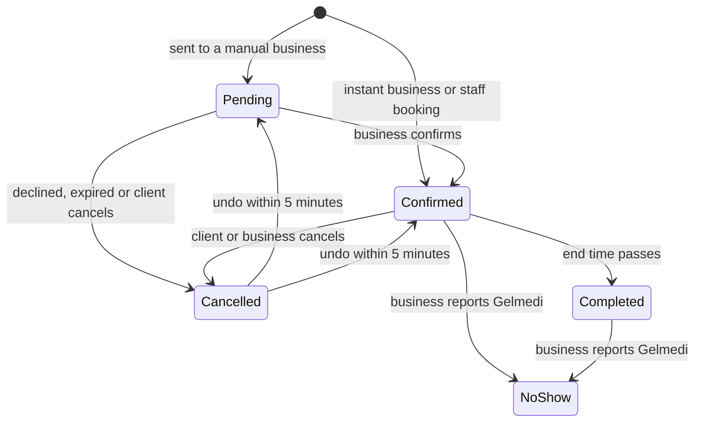

A cancelled booking always says who cancelled it (ROUND6-ANSWERS A2):

- "Siz ýatyrdyňyz" (You cancelled) with a person icon.
- "Biznes ýatyrdy" (The business cancelled) or "Biznes ret etdi" (The business declined, when it was never confirmed) with a building icon.
- "Wagtynda jogap gelmedi" (No answer in time) with an hourglass, when the hold time ran out.

## How to read the flows

- Examples use the design's demo: client Aýjemal Gurbanowa (`+993 65 90 11 22`), Glow Studio, Bag kafe, Aýdyň ýoga, and the demo clock Wednesday 14 October 2026, 11:20 (`docs/design/demo-data.json`).
- Sources in brackets: "client spec" = `docs/design/README.md`; "business spec" = `docs/design/business/README.md`; "A1…H" = `docs/design/ROUND6-ANSWERS.md`; screen names (Booking, Venue, Account-Bookings…) = `docs/design/screens/client/*.dc.html`, with the tweak that shows the state; "code" = the repo.
- **Status line.** "Design" says whether the flow is drawn, described in text only, or not designed. "Code" is about the api and the booking rules (`apps/api`, `packages/domain`): the client site itself (`apps/client`) isn't built yet, it comes with milestone M3. So "built (api)" means the server already supports the flow and only the screens are missing.
- **Code differs** marks places where the code does something other than a decided rule. Those are not questions: the coders fix them.

## Finding a place

### C-01 · Share location on the first visit

**Goal:** let the site show places near the client.

**Starts from:** any page with a *Nirede?* (Where?) field or a "near you" list, when the site doesn't know the client's location yet.

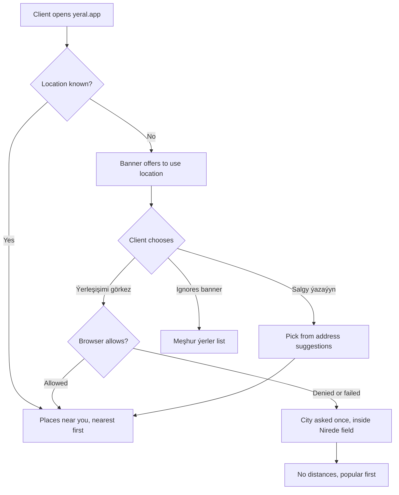

**Steps**

1. The site never asks for location when a page loads; only the button does (States tile 02).
2. While the location is unknown, a banner sits above the list: "Ýakynyňyzdaky ýerleri görkezeliň" (Let us show places near you) and "Brauzer ýerleşişiňizi soraýar — diňe aralygy hasaplamak üçin." (The browser will ask for your location, only to work out distances), with "Ýerleşişimi görkez" (Show my location) and "Salgy ýazaýyn" (I'll type an address). Below it: *Meşhur ýerler* (Popular places), "Reýting we teswir sany boýunça" (by rating and number of reviews), without distances (States tile 02, client spec §4.1).
3. Location allowed: *Nirede?* shows *Ýakynymda* (Near me), radius 5 km with a chip for 1 / 3 / 5 / 10 / 25 km; lists sort nearest first; distances read `1,2 km`, or `850 m` under a kilometre (client spec §5).
4. Location denied or failed: the client picks a city, asked once and remembered; until then the market's main city is the guess (no lookup by internet address since ADR 0024, and many people use a VPN anyway), and they can pick another city any time (Q-107, decided 18.10.2026). The city appears only inside the *Nirede?* field, with "Ýerleşiş ýapyk — şäher boýunça görkezilýär" (Location off — showing by city). Distances are hidden, rows show category and street, and lists sort by rating × number of reviews. "Sazlamalary aç" (Open settings) opens a short help sheet on allowing location in the browser (client spec §5, States tile 03).
5. Typing in *Nirede?*: an address, district or landmark, with up to 6 suggestions (client spec §5).

**Edge cases**

- No city picked and no location: the field starts at the market's main city and the popular list shows. There is no lookup by internet address: the api left Cloudflare, which added the caller's city to each request, and first-launch visitors come through a VPN, where it would find the VPN's city (ADR 0024; chapter 10, P2 step 0). A lookup on the own server (a city database by address) can come with the Turkmenistan launch if it's wanted.
- A city name is never written into titles, cards or the footer; the city shows only as data: inside the field, and in an address whose city differs from the selected one (client spec §5, §8; Q-107).
- After moving the map, the client can search the visible area instead (C-04).

**Design to fix:** the one-time city choice when location is denied or failed, and picking another city later (Q-107, F-240).

**Status:** Design: drawn (States · tiles 02, 03); the location help sheet is text only · Code: built (api) — search by position and radius, by city (the market's main city without either), the city list with the one a position is in (Q-107); the IP place removed (ADR 0024).

### C-02 · Use the home page

**Goal:** get from the front page to a place, a category or a search.

**Starts from:** `yeral.app`.

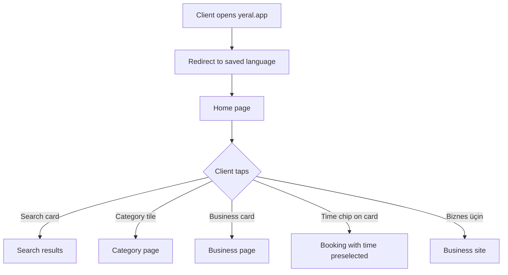

**Steps**

1. `/` redirects to the saved language (cookie, then the profile), else to the phone's or browser's language if Ýeral has it, else to the country's main language (ADR 0016; Q-132, decided 18.10.2026).
2. The hero explains the name: "Ýeriňi al." (Take your place) and "Dellegiň kreslosy, restoranyň stoly ýa-da ýoga sapagyndaky ýer — boş wagty görüň we bir minutda ýazylyň." Below it, the search card *Näme?* (What?) / *Nirede?* (Where?, default *Ýakynymda*) / *Haçan?* (When?) and "Boş wagtlary görkez" (Show free times) (Home).
3. "Golaýyňyzda şu gün boş" (Free today near you): 4 cards, nearest first, each with its next free times, "Ýerleşişiňiz boýunça · üýtget" and "Ählisini gör" (See all) (client spec §4.1).
4. Then the 13 category tiles, "Nähili işleýär?" (How it works: *Gözläň* · *Wagt saýlaň* · *Tassyklama alyň*), the Ýeral Biznes block, app links and the footer.
5. A time chip on a card opens the booking flow with that time preselected; a card opens the business page; a category tile opens `/tk/c/{category}`; "Biznes üçin" leaves for business.yeral.app (client spec §4.1).

**Edge cases**

- Location unknown: the banner and *Meşhur ýerler* replace the "near you" list (C-01).
- No place nearby has a free time today: not drawn; the nearest drawn pattern is the search empty state (States tile 01).
- On phones the search field opens a full-screen search sheet: what, then where, then when (Mobile 1).
- Design differs from the owner's direction: the Ýeral Biznes block says "Ýeke işleýän hünärmenler üçin mugt." (Free for solo specialists) and links to *Bahalar* (Prices), and the footer links to *Bahalar* too. The owner decided Ýeral is free for everyone now (activeContext 2026-10-16; business spec §25). Home was not updated in v0.5, so this copy has to change; the drawn free wording is the B-Landing "Mugt" band.

**Status:** Design: drawn (Home; Mobile 1) · Code: built (api) — the "free today" list uses `GET /v1/search`.

### C-03 · Search, filter, sort and page through results

**Goal:** find a place with a free time that fits.

**Starts from:** the home search card, the header query bar, or a category tile.

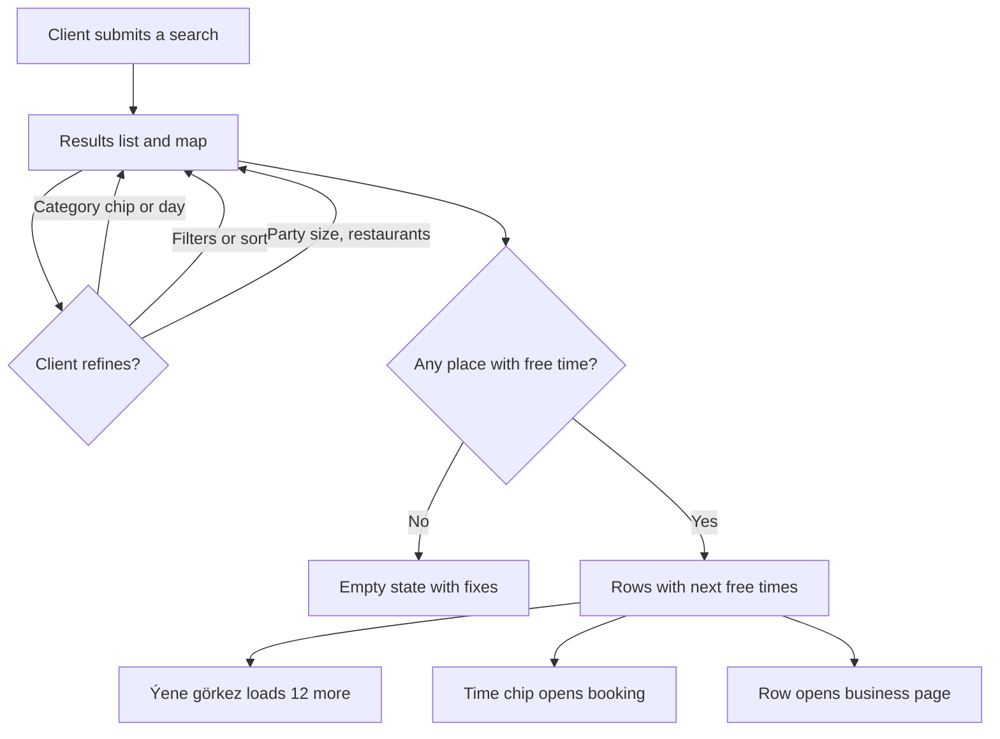

**Steps**

1. The route is `/tk/search?what=&cat=&near=&r=&date=&sort=` (client spec §3). The title is "Golaýyňyzdaky ýerler" (Places near you) or "{category} — golaýyňyzda", with the count "{N} ýer · şu gün boş wagty bar" ({N} places · free time today) (Search).
2. Refining: category chips; the day toggle *Şu gün* / *Ertir* / *Şu hepde* (Today / Tomorrow / This week); *Süzgüçler* (Filters: price range, rating, open now, booking type, specialist gender for beauty, *Diňe aýallar üçin* — women only); *Bahasy* (Price); *Reýting 4,5+* (client spec §4.2).
3. For restaurants and cafés a chip "Adam sany: 2 ▾" (Party size) appears; its popover offers 1–7 and "8+" ("8+" = times for 8), a bottom sheet on phones; rows then show "Stol · {n} adam" and times for that party (D2; Search · `party`).
4. Sort: *Ýakynlygy boýunça* (Nearest, default) / *Reýting* / *Baha* (client spec §4.2).
5. Each row shows photo, name, rating and `category · street · distance`, then by type: appointment → service line and the next 3–4 times plus "+N"; table → "Stol · 2 adam" and times; class → the next session and "3 ýer galdy" (3 seats left). A time is never earlier than now plus the business's lead time (client spec §4.2).
6. "Ýene görkez" (Show more) loads 12 more (client spec §4.2).

**Edge cases**

- Nothing found: "Bu ýerde boş wagt ýok" (No free time here) and "Aralygy ulaldyň, başga güni saýlaň ýa-da süzgüçleri aýyryň.", with "Aralygy 10 km et" (widens the radius one step) and "Süzgüçleri arassala" (Clear filters); below, up to 2 rows of the same search for tomorrow and "Ählisini gör", which switches the day to *Ertir* (States tile 01).
- Only places with a free time on the chosen day are listed, so a fully booked place, one that paused online booking or one that takes phone bookings only doesn't appear (Search count line; code: `catalog/search.ts`; Q-150, decided 18.10.2026).
- A restaurant whose online party limit is below the chosen party stays in the list with *Jaň et* instead of times (Q-112, decided 18.10.2026).
- Location denied: no distances, sorted by rating × reviews (C-01).
- Loading: skeleton rows in the real row shape (200 × 150 photo, 3 lines, 3 time pills), shown only after 300 ms (States tile 08).
- Phones: list only, with a floating "Karta" (Map) button; the filter button opens *Süzgüçler* with the sort as a sheet; rows drop the street (Mobile 2).
- The filters drawer itself isn't drawn; it follows the booking-detail drawer pattern (design `CLAUDE.md`, "When something isn't drawn").

> Open question Q-150: places without free time in search.

**Code differs**

- There is no specialist-gender filter (staff have no such field), and *Bahasy* is a maximum price only, not a range (code: `packages/contract/src/catalog.ts`, `maxPrice`).
- The party filter accepts 1–8 for every restaurant; the business's own online limit (D1) isn't used yet (code: `MAX_ONLINE_PARTY`).

**Status:** Design: drawn (Search · `party`; States 01, 08; Mobile 2); filters drawer text only · Code: built (api) — `GET /v1/search`; no specialist-gender filter.

### C-04 · Search on the map

**Goal:** find places by area rather than by distance from the client.

**Starts from:** search results.

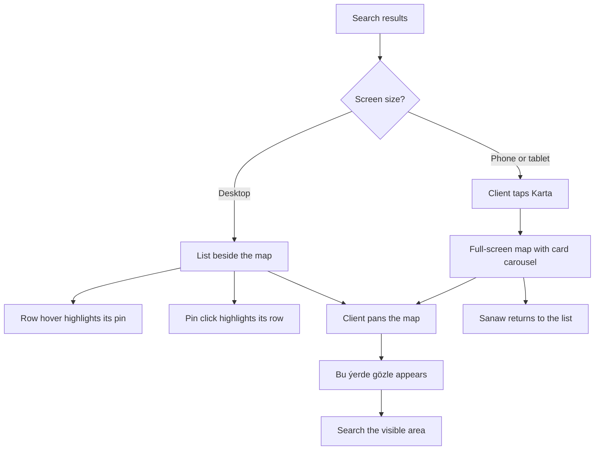

**Steps**

1. On desktop the list and the map sit side by side; hovering a row highlights its pin, clicking a pin scrolls to and highlights its row (client spec §4.2).
2. Under 1024 px the page shows the list only; the floating "Karta" opens a full-screen map with a sideways card carousel. Tapping a pin snaps its card; "Sanaw" (List) returns to the list at the same scroll position (Mobile 3).
3. After the map moves, "Bu ýerde gözle" (Search this area) appears and runs the search for the visible area (client spec §4.2).
4. Maps are MapLibre with OpenFreeMap tiles (owner, 14.10.2026; H).

**Edge cases**

- A business that hides its address shows only an approximate point (C-08).
- No places in the visible area: the search empty state (States tile 01).

**Status:** Design: drawn (Search; Mobile 3) · Code: built (api) — search by map area (`bbox`).

### C-05 · Open a category page

**Goal:** browse one category; the page also serves as a landing page for search engines.

**Starts from:** a category tile on Home, the footer "Kategoriýalar", or a search engine.

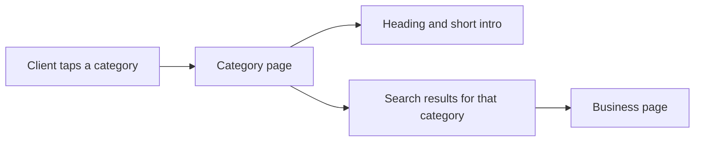

**Steps**

1. `/tk/c/{category}` is the search page with the category preselected, a heading "{category} — golaýyňyzda" and a short intro text under it (client spec §3; Client-Map).
2. The category decides what the client sees and filters by: a restaurant category adds the party chip, a class category shows sessions (client spec §1 rule 6).
3. There are 13 launch categories; new ones come from the CMS without a release (ADR 0017).

**Edge cases**

- Unknown category: the 404 page (States tile 09).
- Category pages follow the same "free time only" rule as search (C-03; Q-150, decided 18.10.2026).

**Status:** Design: text only (pattern of Search) · Code: built (api) — categories with their intro text, search by category.

## The business page

### C-06 · Look at a business page

**Goal:** decide whether to book here and what.

**Starts from:** a card, a search row, a search suggestion, a shared link or a QR code.

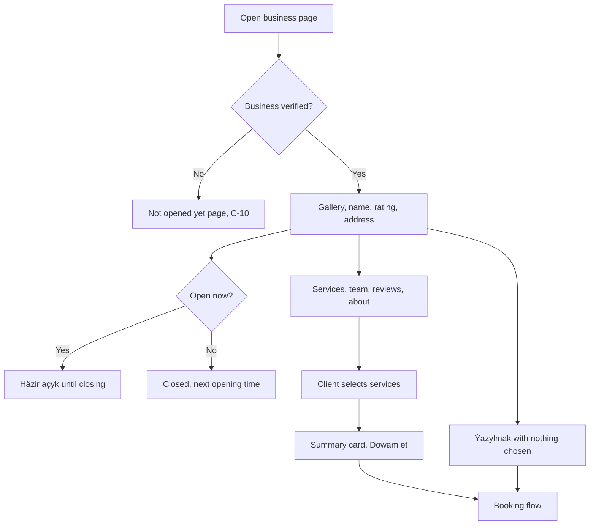

**Steps**

1. The top: a gallery (one large and four small photos, "Ähli suratlar · 5" opens a full-screen viewer), name, rating "4,9 · 96 teswir", category, address and distance, the open state, the heart "Halanlara goş" (Add to favourites) and "Paýlaş" (Share) (client spec §4.3; Venue).
2. A sticky card on the right: "Indiki boş wagt" (Next free time, e.g. "Şu gün 15:30"), the primary "Ýazylmak" (Book), today's hours, address and phone. Once services are chosen it becomes the summary: "Saýlanan hyzmatlar", "Jemi" (Total), "Dowam et" (Continue), "Arassala" (Clear), "Töleg ýerinde · tassyklanandan soň SMS" (Pay at the place · SMS after confirmation) (Venue).
3. Tabs: *Hyzmatlar* (Services) · *Hünärmenler* (Specialists) · *Teswirler* (Reviews) · *Barada* (About). Services are grouped, with chips that filter the list (*Ählisi* = all); each row has name, duration, price, an optional description and a "Saýla" / "Saýlandy ✓" toggle (client spec §4.3).
4. Specialists: photo, name, role, rating and "Indiki boş: …"; their "Ýazylmak" opens the booking flow with that person preselected (screens README, Venue).
5. About: description, the hours table with today highlighted, map, address and "Ýol görkez" (Directions), amenities, booking rules ("Ýazylyşy 2 sagat öňünden mugt ýatyryp ýa-da üýtgedip bilersiňiz." · "15 minutdan köp gijä galsaňyz, ýazylyş ýatyrylyp bilner." · "Töleg ýerinde: nagt ýa-da kart."), and the typical answer time "Adatça 15 minudyň dowamynda tassyklaýar" with "Her ýazylyşy Glow Studio özi tassyklaýar. Tassyklanandan soň size SMS ibereris." (Venue).
6. "Golaýdaky ýerler" (Places nearby): 4 similar places and "Ählisini gör" (client spec §4.3).
7. Open state: "Häzir açyk · 20:00-a çenli" (Open now · until 20:00). A day may end at midnight: hours read "09:00–24:00" and the line "Häzir açyk · 24:00-a çenli" (E1; Venue · `hoursCase=midnight`). Closed today by a special day: "Şu gün ýapyk · Baýramçylyk · Ertir 09:00-da açylýar"; the hours table says "Ýapyk · Baýramçylyk" (States tile 06).
8. Table and class businesses use the same page; the sticky card holds the table widget (party size, date, time) or "Indiki sapaklar" (Next sessions), and the Services tab becomes "Menýu" or "Tertip" (Schedule) (client spec §4.3).
9. On phones the gallery is a swipeable carousel and a bottom bar shows "Şu gün 15:30-dan boş" and "Ýazylmak", then the selection and "Dowam et" (Mobile 4).

**Edge cases**

- Businesses open past midnight are not designed (E1; Q-105). The api offers their times after 24:00 under the day that started (`01:00` under Friday for a bar open 18:00–02:00 on Friday), and the open state after midnight reads "open until 02:00" (chapter 4).
- Reviews under moderation are shown but not counted (C-07).
- Heart while signed out: log in first (C-19).
- A business has one booking type at launch, so the client never picks one; several types in one business (a gym with classes and personal training) come later (Q-022, decided 18.10.2026).
- The typical answer time is the median answer time over the last 30 days, rounded (15 min, 1 sagat …), and hidden until the business has answered 5 requests (client spec §4.3; Q-113, decided 18.10.2026).

> Open question Q-022: several booking types in one business.

> Open question Q-253: the answer time the client is shown.

**Code differs:** the typical answer time is a stored number per business that nothing works out (code: `apps/api/src/db/schema/business.ts`).

**Status:** Design: drawn (Venue · `selection`, `hoursCase`; States 06; Mobile 4); the table and class page variants are text only · Code: built (api) — `GET /v1/businesses/{slug}`.

### C-07 · Read reviews

**Goal:** judge a place by what other clients said.

**Starts from:** the rating on the business page or the *Teswirler* tab.

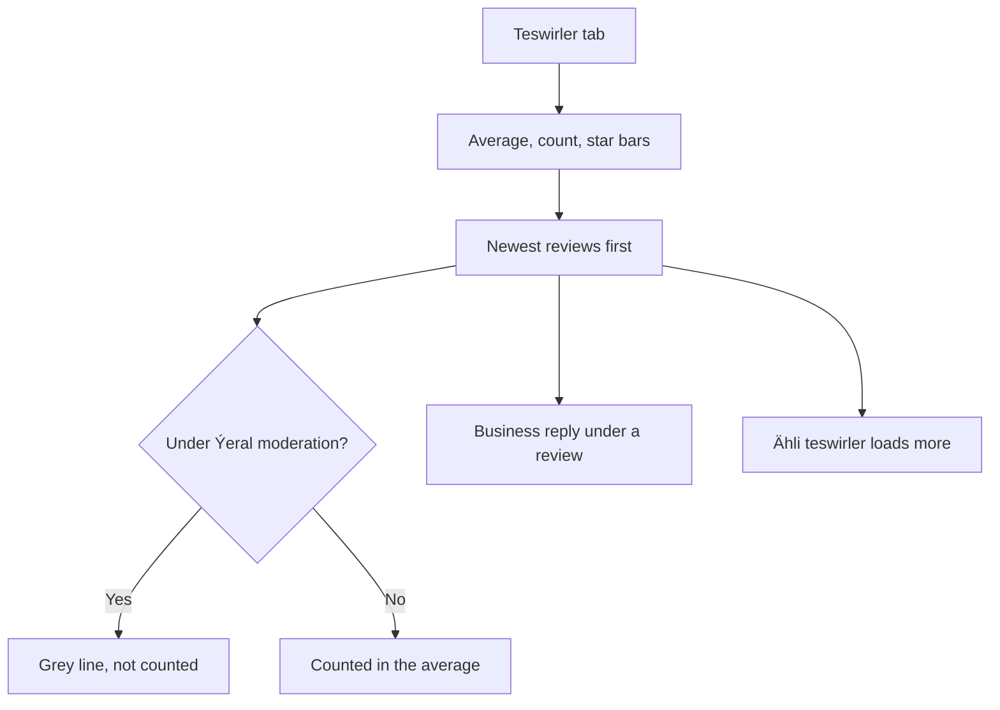

**Steps**

1. The summary: average, count and 5-to-1 star bars (client spec §4.3).
2. Each review: name as first name plus surname initial ("Gülälek N."), stars, date ("2 gün öň"), service · specialist, text, and the business's reply ("Glow Studio-nyň jogaby") (Venue).
3. "Ähli teswirler" (All reviews) loads more. A line explains: "Diňe ýazylyp gelen müşderiler baha berip bilýär." (Only clients who booked and came can rate) (Venue).
4. A review the business reported stays in the list with a grey line and an info icon: "Ýeral barlaýar · ortaça baha hasaplanmaýar" (Ýeral is checking · not counted in the average). It isn't counted in the average, the count or the bars until Ýeral clears it; if Ýeral removes it, it disappears (F2; business spec §15). Ýeral decides within 48 hours, otherwise the review counts again; a cleared review can't be reported again (Q-261, decided 18.10.2026).

**Edge cases**

- The business can reply to a review under moderation (business spec §15).
- A business with no reviews yet: not drawn.

**Code differs**

- There is no moderation yet: every review counts as soon as it's written and the list has no moderation flag (F2 "code has no moderation yet"; code: `catalog/routes.ts`). The pipeline report → not counted → cleared or removed comes with the business reviews page and the CMS.

**Status:** Design: drawn (Venue, with the Anonim 1★ review under moderation) · Code: partly — reviews list and counts built; moderation not built.

### C-08 · A business that hides its exact address

**Goal:** see roughly where a home-based business is, and the exact address once booked.

**Starts from:** the page of a business that works from home.

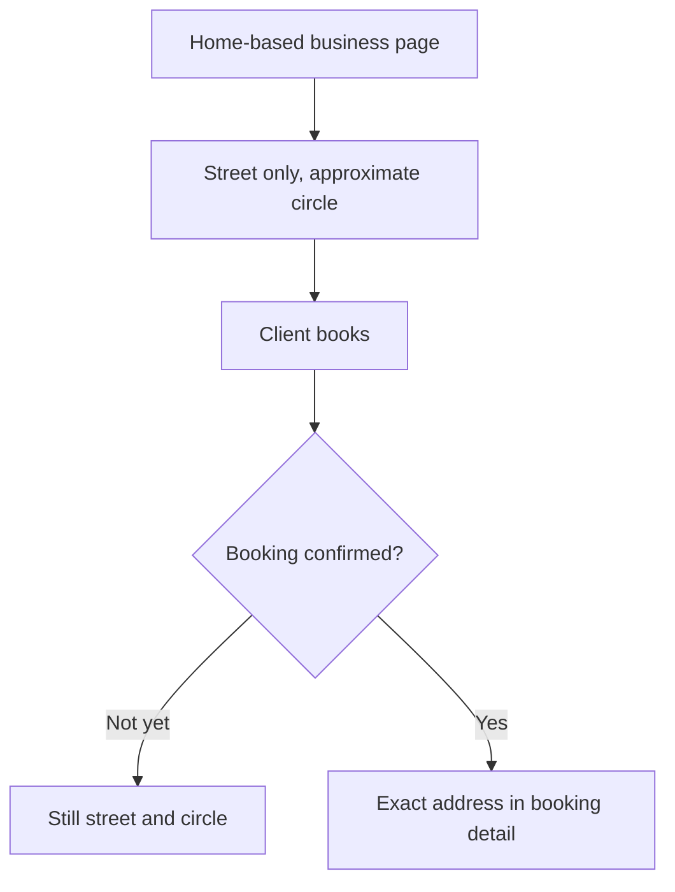

**Steps**

1. A home-based business can hide its exact address until a booking is confirmed; the map then shows only an approximate circle (client spec §2).
2. The business turns this on in setup: "Öýde işleýärin — takyk salgyny diňe tassyklanandan soň görkez" (business spec §7).
3. Once the booking is *Tassyklandy*, the booking detail shows the full address, entrance note and exact map point.

**Edge cases**

- On search and map the pin is the approximate point too (code: `catalog/map.ts`, about 1 km).
- After the visit (completed) the exact address stays visible; after a cancel it goes back to the street (code: `bookings/view.ts`).
- No client screen draws the approximate circle or a line explaining it.

**Status:** Design: text only (client spec §2; the business setup switch is drawn) · Code: built (api) — street and rounded point until confirmed.

### C-09 · A business that paused online booking

**Goal:** tell the client to call instead.

**Starts from:** the business page.

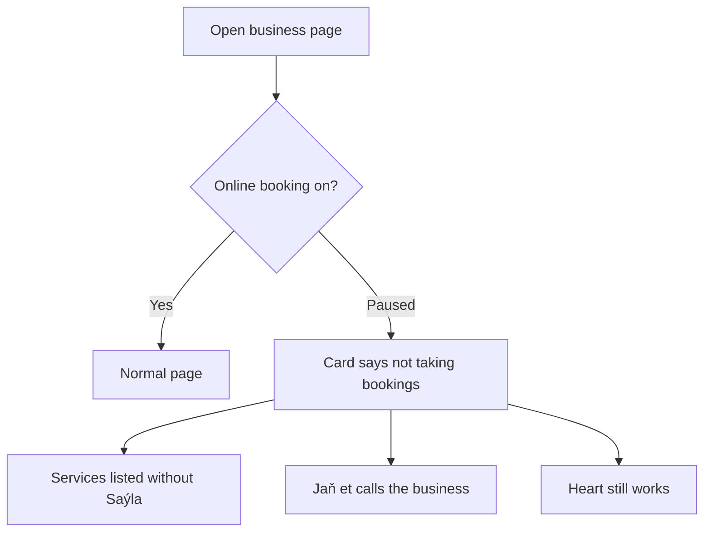

**Steps**

1. The business switched off "Onlaýn ýazylyş" (business spec §8; ADR 0017 `onlineEnabled`).
2. The sticky card says "Bu ýer häzir onlaýn ýazylyşy kabul etmeýär" (This place isn't taking online bookings now) and "Jaň edip ýazylyp bilersiňiz." (You can book by calling), with "Jaň et +993 12 45 67 89" as a phone link and "Halanlara goş" (States tile 05).
3. Services stay listed without "Saýla"; cards show no time chips. On phones the bottom bar becomes "Jaň et" and the heart (States tile 05).

**Edge cases**

- The business disappears from search, which lists only places with free time (C-03, Q-150).
- Opening a booking link directly: the api refuses with "Bu ýer häzir onlaýn ýazylyşy kabul etmeýär" (code: `online_disabled`); the flow screen for this isn't drawn.
- Existing bookings stay as they are. While the business is paused, their detail hides "Başga wagta geçir" and the free-time chips after an expiry and shows the "Jaň et" card; only decline offers stay bookable online (Q-154, decided 18.10.2026; C-11).

**Status:** Design: drawn (States 05) · Code: built (api) — no times and no sending while paused.

### C-10 · Open the link of a business still in review

**Goal:** a visitor gets a friendly page; the owner and team see their own page.

**Starts from:** a shared link or the QR code of a new business that Ýeral hasn't verified yet.

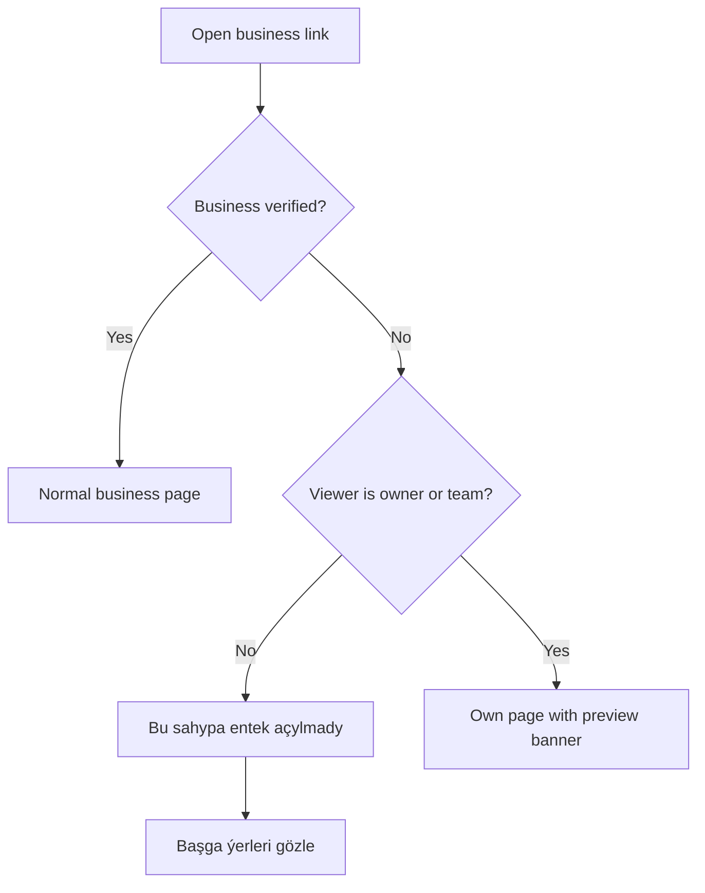

**Steps**

1. A visitor sees "Bu sahypa entek açylmady" (This page hasn't opened yet) and "Biznes Ýeral-a täze goşuldy we barlagdan geçýär. Adatça 24 sagat çekýär." (The business just joined Ýeral and is being checked. It usually takes 24 hours), with one way out: "Başga ýerleri gözle" (Search other places). No name, photo, address or phone. The page answers HTTP 404, is never cached and isn't indexed (F1; States tile 11).
2. The signed-in owner and team see their own page with the banner "Sahypaňyz barlagda — häzir ony diňe siz we toparyňyz görýärsiňiz. Barlagdan soň gözlegde we salgyňyzda hemmä açylar." (Venue · `ownerPreview`).
3. A removed business, or a slug that never existed, gets the plain 404 page (States tile 09).

**Edge cases**

- An unverified business never shows in search, suggestions or favourites (code: `catalog/search.ts`, `me/routes.ts`).
- A business whose verification was rejected (`rejected`, business spec §10): visitors keep seeing "Bu sahypa entek açylmady"; the owner sees a banner with the reason and a way to fix and send again (Q-274, decided 18.10.2026). The Ýeral team verifies businesses in a small admin tool designed for launch (Q-010, decided 18.10.2026).
- No bookings before verification: the preview shows the booking buttons disabled (Q-153, decided 18.10.2026).

> Open question Q-153: booking on a page that is still in review.

**Design to fix:** the owner preview (Venue · `ownerPreview`) with "Ýazylmak", "Saýla" and the time chips disabled (Q-153).

**Code differs**

- Everyone, the owner included, gets a plain "not found" for an unverified business: no friendly variant, no preview (F1 "kept (not found)"; code: `catalog/detail.ts`).

**Status:** Design: drawn (States 11; Venue · `ownerPreview`) · Code: partly — visitors get a 404; the friendly page and the owner preview are not built.

### C-11 · A client who may book a business only by phone

**Goal:** tell the client, calmly and without blame, to call this business.

**Starts from:** the business page or its booking flow, signed in.

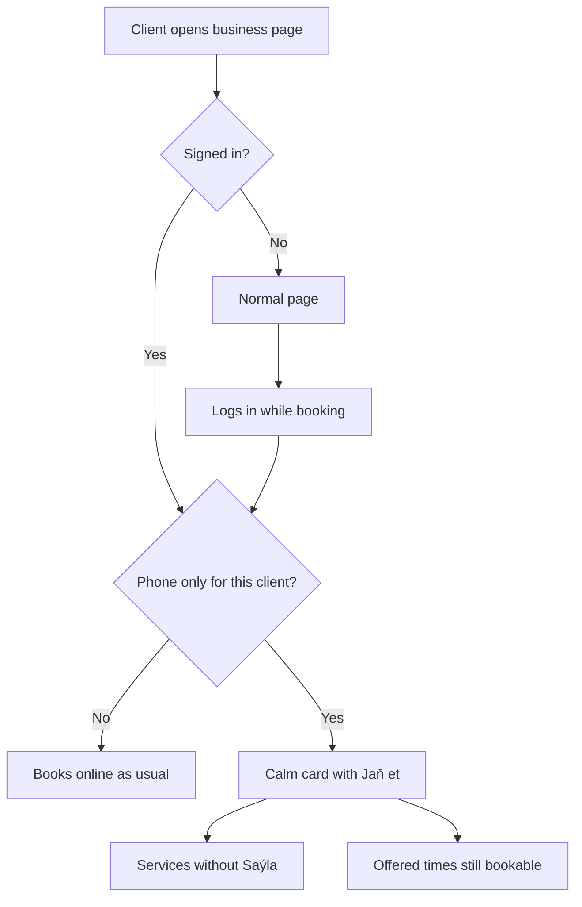

**Steps**

1. A client becomes phone-only at one business when the business marks them "Diňe jaň arkaly ýazylyp biler", or automatically after a number of no-shows there (default 2, setting 0–5) (business spec §3; ADR 0017). Reaching that number switches the mark on; the business can switch it off, and counting starts again from zero (Q-127, decided 18.10.2026).
2. That client sees a calm card instead of the booking bar: "Bu biznese telefon arkaly ýazylyp bilersiňiz" (You can book this business by phone) and "Biznes siziň bilen ýazylyşlary jaň arkaly ylalaşmagy haýyş etdi." (The business asked to arrange bookings with you by phone), with "Jaň et" and the number. No blame, no talk of no-shows (A7; Mobile 16).
3. Service rows keep their information but lose "Saýla"; the booking flow opened directly shows the same card (A7).
4. Signed out, the page is normal until the client logs in, then the card appears (A7).
5. The exception: times the business offered after declining a request can still be taken online (A7; C-25).

**Edge cases**

- If the client logs in at the confirm step of a booking, the card replaces the send button there (A7 "normal until login, then the card").
- A move or the free times after an unanswered request are new online requests too, so for this client, and while the business is paused, the booking detail and the link page hide "Başga wagta geçir" and the free-time chips and show the "Jaň et" card; only decline offers stay bookable online (Q-154, decided 18.10.2026).

> Open question Q-154: moves and free times for a client who must call.

**Design to fix:** the booking detail and the link page for a phone-only client or a paused business: no "Başga wagta geçir", no free-time chips, the "Jaň et" card instead (Q-154).

**Code differs**

- The business page doesn't know the client is phone-only (it's a public page); the api only refuses at sending, and its message "Bu ýere diňe jaň edip ýazylyp bilersiňiz." differs from the calm card (code: `bookings/create.ts`, `online_blocked`; `packages/i18n` `tk.json`).

**Status:** Design: drawn (Venue · `restricted`; Booking · `restricted`; Mobile 16) · Code: partly — refusal at sending built; the card on the page is not.

## Booking

### C-12 · Book an appointment for one service

**Goal:** send a booking for one service with a specialist at a chosen time.

**Starts from:** the business page ("Saýla" then "Dowam et", "Ýazylmak", a specialist's "Ýazylmak") or a time chip on a card.

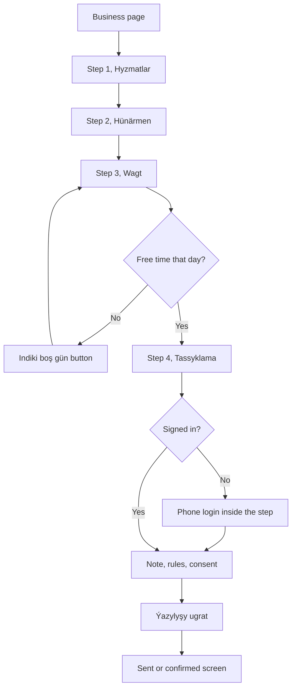

**Steps**

1. The flow has a focused header: back, step indicator, close (×); no menu and no footer. The main column sits next to a sticky summary card. Step, services, specialist, date and time stay in the URL; each step scrolls to the top (client spec §3, §4.4).
2. **Hyzmatlar** (Services): "Hyzmatlary saýlaň" and "Birnäçe hyzmat saýlap bilersiňiz."; the same grouped list as the business page; at least one is needed ("Iň az bir hyzmat saýlaň.") (Booking · `step=services`).
3. **Hünärmen** (Specialist): "Hünärmeni saýlaň"; "Islendik hünärmen" (Any specialist) comes first and is the default ("«Islendik hünärmen» saýlasaňyz, iň ir boş wagty görkezeris."), then the specialists who do all chosen services, each with rating and "Indiki boş wagt: ertir 10:00". The category renames the word: *lukman* (doctor), *mugallym* (tutor), *tälimçi* (trainer), *ussa* (mechanic), beauty roles (client spec §2, §4.4).
4. **Wagt** (Time): "Wagty saýlaň"; a date strip of 14 days from today with closed days disabled and arrows paging by week; times grouped *Irden* / *Günortan* / *Agşam* (morning / afternoon / evening). Starts come every 15 or 30 minutes (business setting); a time is free only if the whole visit fits; nothing earlier than now plus the lead time, nothing beyond the business's booking window (7–90 days, default 30) (client spec §4.4; ADR 0017).
5. A day without free times: "Bu gün boş wagt ýok", "Başga gün saýlaň ýa-da indiki boş güne geçiň." and a button "Indiki boş gün: Anna, 16 oktýabr" (Booking).
6. **Tassyklama** (Confirmation): "Ýazylyşy tassyklaň"; login if needed (C-18); "Biznese bellik (hökman däl)" (Note to the business, optional); the booking rules; "Töleg ýerinde: nagt ýa-da kart."; the consent line "«Ýazylyşy ugrat» düwmesine basyp, Ulanyş şertleri we Gizlinlik syýasaty bilen ylalaşýarsyňyz."; the summary "Ýazylyşyňyz" with service, duration, price, specialist, time and "Jemi" (Booking · `step=confirm`).
7. "Ýazylyşy ugrat" (Send booking) leads to the sent screen (C-21) or, at an instant business, the confirmed screen (C-22).
8. × or "Yza" on step 1 returns to the business page; leaving mid-flow asks nothing (client spec §3, §4.4).

**Edge cases**

- The time was taken meanwhile (C-20).
- A specialist chosen on the business page arrives preselected (`/book?staff={id}`) (screens README).
- A time chip on a card stands for one service: the code uses the service matching the search words, else the first in the menu (code: `catalog/cards.ts`).
- Network failure while sending: a toast with retry (C-48).
- Phones: the summary card becomes a bottom bar that opens as a sheet; taken times stay visible, struck through (Mobile 5).
- A client may hold overlapping bookings at different places; businesses handle no-shows with "Arz et" (Q-155, decided 18.10.2026).

> Open question Q-155: two bookings at the same time.

**Status:** Design: drawn (Booking · `step`, `loggedIn`; Mobile 5) · Code: built (api) — free times, specialists' next times, `POST /v1/bookings`.

### C-13 · Book several services in one visit

**Goal:** one visit with several services back to back.

**Starts from:** the business page or step 1 of the booking flow.

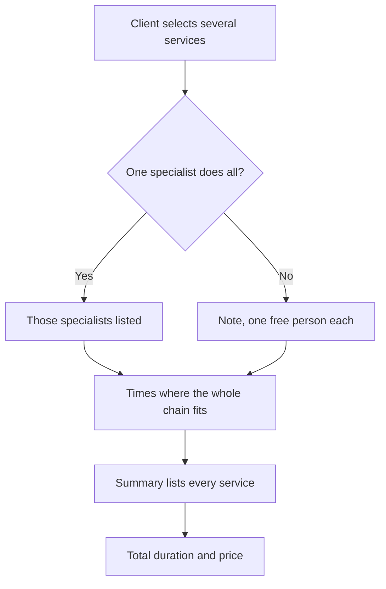

**Steps**

1. Several services run back to back, with one specialist if possible; "Islendik hünärmen" lets the system pick a person per service (client spec §2).
2. Step 2 lists only specialists who do every chosen service; others carry "Saýlanan hyzmatlaryň hemmesini etmeýär". When nobody does them all: "Saýlanan hyzmatlary bir hünärmen ýerine ýetirmeýär — her hyzmat üçin boş hünärmen bellener." (Booking · `step=staff`).
3. A time shows only if the whole chain fits the schedules (screens README, "Availability").
4. The summary shows each service with its duration and price, then "Jemi · {total duration}" (Venue · `selection=two`).

**Edge cases**

- Up to 10 services in one booking (code: `packages/contract/src/bookings.ts`).
- A "from" price anywhere makes the total "from": `250 TMT-den` (client spec §2; C-15).
- A rest gap after each specialist's part is kept by the system and isn't shown to the client (ADR 0017).

**Status:** Design: drawn (Booking · `step=staff`; Venue · `selection=two`) · Code: built (api) — chains, with a split per service.

### C-14 · Let Ýeral pick the specialist, or book a one-person business

**Goal:** book without choosing a person.

**Starts from:** step 2 of the appointment flow.

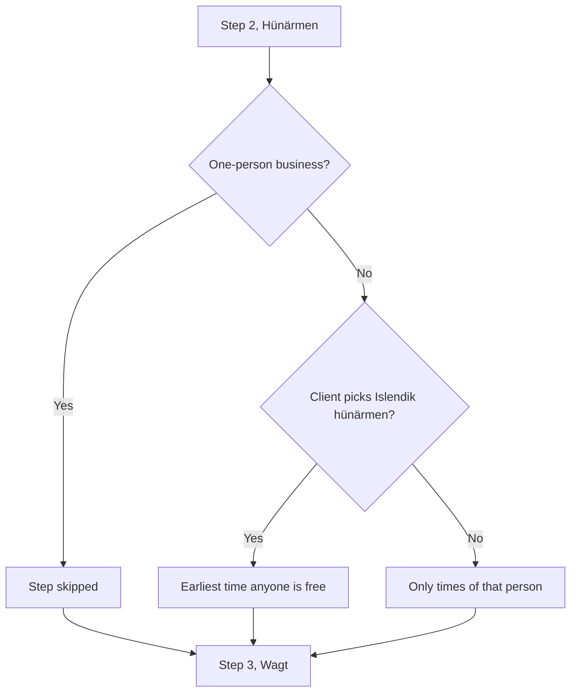

**Steps**

1. "Islendik hünärmen" shows the earliest time any qualified specialist, or a combination per service, is free (screens README, "Availability").
2. A business with one specialist skips the step; the flow then has three steps (client spec §2).
3. A chosen specialist's grid shows only that person's free times.

**Edge cases**

- Which person was assigned under "Islendik" isn't said on the screens; the api returns the assigned person for each service (code: `bookings/view.ts`), and the sent screen has a "Hünärmen" row (Booking · `step=sent`).

**Status:** Design: drawn for "Islendik" (Booking · `step=staff`); the solo skip is text only · Code: built (api).

### C-15 · See hidden and "from" prices

**Goal:** understand the price, also when the business doesn't show it.

**Starts from:** the business page or the booking flow.

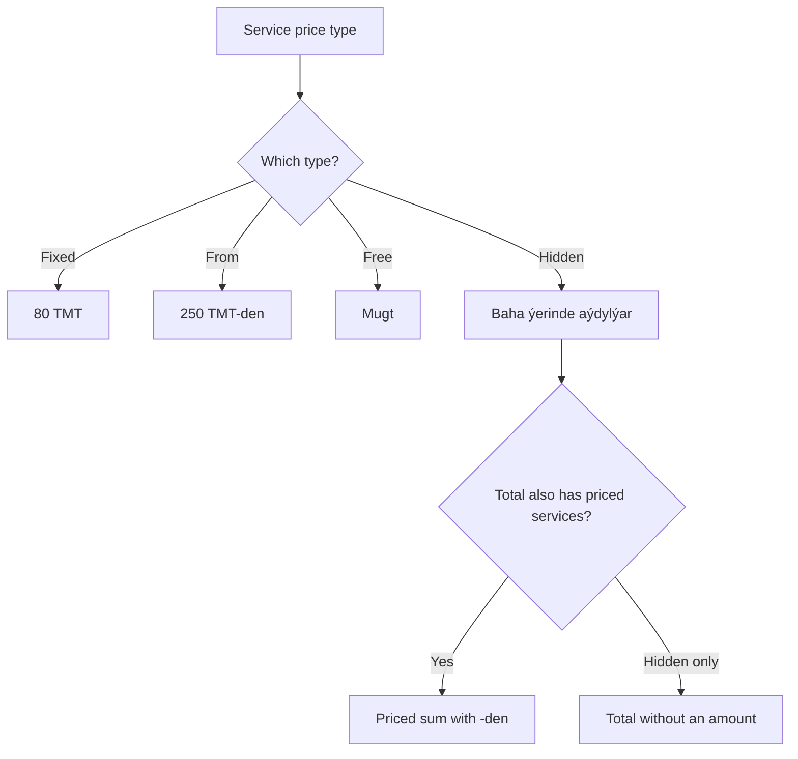

**Steps**

1. Prices are fixed (`80 TMT`), from (`250 TMT-den`), free (*Mugt*) or hidden (client spec §2). Restaurants show no average bill (Q-103).
2. A hidden price reads "Baha ýerinde aýdylýar" (The price is told at the place) in the row, the flow, the summary and the booking detail (B1).
3. A total that mixes hidden and priced services is the priced sum with "-den": "60 TMT-den"; a total of hidden services only shows no amount, just "Baha ýerinde aýdylýar" (B1; Mobile 17).

**Edge cases**

- A card's "from" price ignores hidden services (code: `catalog/map.ts`).
- The amount of a hidden price never leaves the server (code: `publicPrice`).
- The average bill is dropped (Q-103): the design's "Ortaça hasap" lines and the demo's `[AVG BILL]` go.

**Status:** Design: drawn (Venue · `selection` hidden, mixed; Booking · `price`; Mobile 17) · Code: built (api).

### C-16 · Book a table

**Goal:** reserve a table for a party.

**Starts from:** a restaurant or café page ("Ýazylmak" or its table widget) or a time chip in search.

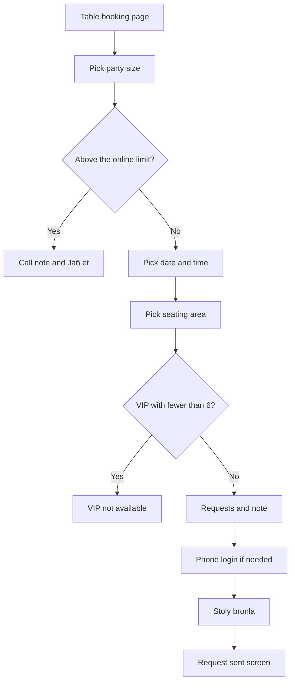

**Steps**

1. One page with a business strip ("Bag kafe · 4,8 (119) · Kafe · 0,9 km · Andalyp köçesi 8 · Her gün 09:00–23:00") and one form (client spec §4.5; Booking-Table).
2. *Adam sany* (Party size): chips from 1 to the business's online limit, then "{limit+1}+". With the default limit 8 that is 1–8 and "9+". Choosing it disables sending and shows "9 we ondan köp adam bolsa, jaň ediň" (Call for 9 or more) with "Jaň et" (D1; Booking-Table · `maxParty`).
3. *Sene* (Date) strip and *Wagt* (Time) chips; changing the day clears a time that isn't free that day (screens README).
4. "Nirede oturmak isleýärsiňiz?" (Where would you like to sit?): Zal "Kondisionerli · boş", Terrasa "Açyk howada · Az galdy", VIP otag "6–10 adam · Diňe 6 we has köp adam üçin" (VIP rooms need 6 or more) (Booking-Table).
5. "Goşmaça islegler" (Special requests) chips: Doglan gün, Çaga oturgyjy, Penjiräniň ýanynda, Sessiz ýer, with "Kafe mümkin boldugyça göz öňünde tutar."; "Bellik (hökman däl)" (Booking-Table).
6. Rules: "Stol 15 minut saklanýar" (The table is held 15 minutes) and "{time}-e çenli gelmeseňiz, stol boşadylyp bilner."; "Töleg ýerinde" (pay at the place); the drawn "Ortaça hasap ≈ … TMT" goes (Q-103) (Booking-Table).
7. Login if needed (C-18), then "Stoly bronla" (Book the table) and the sent screen "Stol bronlamak haýyşy ugradyldy" (C-21).

**Edge cases**

- Online bookings get the smallest free table that fits; staff can change it (business spec §20).
- How long the table stays the party's (turn time by party size) is a business setting the client doesn't see (business spec §20).
- The time was taken meanwhile: the nearest free times in the same area (C-20).

**Code differs**

- The online party limit is fixed at 8 for every business (code: `packages/domain` `MAX_ONLINE_PARTY`); D1 says the chips follow each business's own limit (2–12, default 8).

**Status:** After the MVP (Q-030) · Design: drawn (Booking-Table · `maxParty`, `sent`, `loggedIn`) · Code: partly — tables, areas, VIP, requests built; the per-business limit isn't.

### C-17 · Book a seat in a class

**Goal:** take one or two seats in a class session.

**Starts from:** a studio page ("Ýazylmak" or "Indiki sapaklar") or a search row.

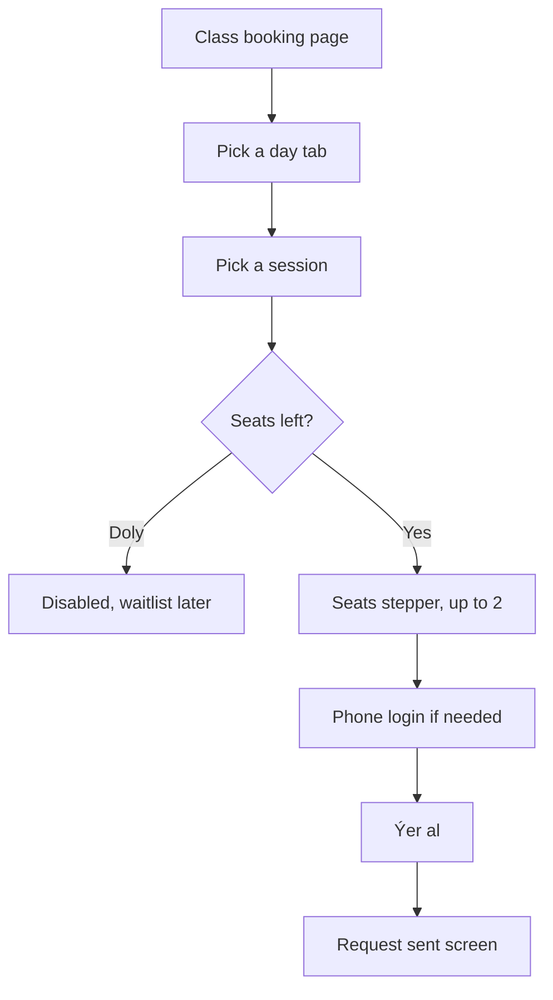

**Steps**

1. "Sapaga ýazylmak" (Book a class): the business strip and "Sapak tertibi" (Schedule) by day tabs; trainers listed (client spec §4.6; Booking-Class).
2. Each session: time, name, trainer, level, duration, price and seats: "3 ýer galdy", "Diňe 1 ýer galdy" or "Doly" (Full). Full sessions are disabled with "Sanawa ýazylmak — ýakynda" (waitlist later) (client spec §4.6; screens README).
3. "Ýer sany" (Seats) stepper from 1 to the smaller of 2 and the seats left, "Bir ýazylyşda 2 ýere çenli"; "Jemi" (Booking-Class).
4. Rules: "Sapakdan 12 sagat öň mugt ýatyryp bilersiňiz." and the studio's note, e.g. "Düşegiňizi alyp geliň ýa-da ýerinde 10 TMT-e alyň." (Booking-Class).
5. Login if needed (C-18), "Ýer al" (Take a seat), then "Sapaga ýazyldyňyz — tassyklanyşyna garaşylýar" (C-21).

**Edge cases**

- Two clients take the last seat at once: the second gets "Sapak doly." (code: `session_full`).
- Sessions sooner than the business's lead time can't be booked online (code: `availability/routes.ts`).
- A same-day session past the free-cancel window shows a line saying so instead of the rule line: once confirmed, it can be cancelled only by calling the studio, as for every booking type (Q-162, Q-125, decided 18.10.2026). The drawn "Mugt ýatyrmak wagty geçdi — ýatyrsaňyz, studiýa habar beriler." (client spec §4.6) reads as if an online cancel stays possible, so it's reworded.

**Design to fix:** reword the class line past the free-cancel window so it says only a call can cancel (Q-162).

**Status:** After the MVP (Q-030) · Design: drawn (Booking-Class · `sent`, `loggedIn`) · Code: built (api) — sessions and seats, counted under a lock.

### C-18 · Log in inside a booking

**Goal:** confirm the phone number at the last step and send.

**Starts from:** the confirm step of any booking flow, signed out.

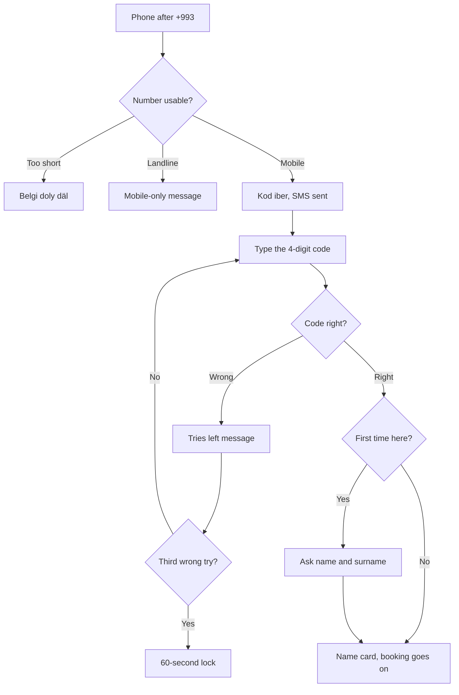

**Steps**

1. "Siziň maglumatlaryňyz" (Your details) and "Ýazylyşy ugratmak üçin telefon belgiňizi tassyklaň. Parol gerek däl." (Confirm your phone to send. No password needed) (Booking).
2. "Telefon belgiňiz" with a fixed +993 and 8 digits; "Kod iber" (Send code), "Size 4 sanly SMS kod ibereris" (client spec §4.4).
3. A short number: "Belgi doly däl: 8 san bolmaly."; a landline: "Kod diňe mobil belgä iberilýär. +993 6… ýa-da 7… bilen başlaýan belgi ýazyň." (Codes go only to mobile numbers) (C1).
4. "Kod +993 … belgä iberildi" and "Belgini üýtget" (Change number); four boxes, numeric keyboard, the phone can fill the code from the SMS, pasting fills all, it checks by itself on the fourth digit, and "Tassykla" stays visible as a fallback; "Täzeden iber (0:59)" unlocks after 59 seconds (client spec §4.4; screens README). This is the one code step shared by every login (Q-157, decided 18.10.2026).
5. A wrong code: "Kod nädogry. Ýene 2 synanyşyk galdy." (Wrong code. 2 tries left). After the third wrong code the input locks for 60 seconds with one lock message, the same in every login; Booking draws it as "Synanyşyklar gutardy. 60 sekuntdan soň täzeden synanyşyň." The code is then used up: after the lock the screen offers to send a new one (Q-157, Q-268, decided 18.10.2026).
6. First time: "Belgiňiz tassyklandy. Ilkinji gezek ýazylýarsyňyz — adyňyzy ýazyň.", "Adyňyz" (Your name), "Biznes sizi şu at bilen görer." (The business will see you under this name), "Dowam et". The table and class flows say "Kafe…" and "Studiýa…" (Booking, Booking-Table, Booking-Class). Like the login modal (C-19), the step also asks for the surname, optional; name and surname are stored as two fields (Q-156, decided 18.10.2026).
7. A returning client sees a card with name, phone and "Üýtget"; the booking keeps everything chosen (Booking · `loggedIn`).

**Edge cases**

- A code is valid for 5 minutes (ADR 0019). An expired code: "Koduň wagty geçdi. Täze kod alyň." (code `tk.json`; not drawn).
- Too many code requests (5 per number or 100 per internet address in an hour): the message says how many minutes to wait (Q-267, decided 18.10.2026; see the limits chapter).
- At the first launch no SMS goes out: the sign-in code shows on the screen (Q-036, decided 18.10.2026). Outside production the code is always `1234` (ADR 0019).
- The client turns out to be phone-only at this business: the calm card replaces sending (C-11).
- Logging in links the phone bookings businesses made under this phone, if upcoming or from the last 6 months: they appear in "Ýazylyşlarym" with a phone icon (client spec §1 rule 4; Q-270, decided 18.10.2026).
- A recycled number: when a phone signs in to an account unused for 6 months, Ýeral first asks "Is this you?" with the account's first name; "No" starts a fresh account and leaves the old history unlinked. There is no password (Q-270, decided 18.10.2026).

> Open question Q-156: asking for a surname.

> Open question Q-157: the code step, after the lock, and the "Tassykla" button.

**Design to fix:** one shared code step for every login (Booking, Booking-Table, Booking-Class, Auth, Booking-Link, the phone change): a visible "Tassykla", one lock message, a "send a new code" button after the lock, and the wait in minutes when too many codes were asked for (Q-157, Q-267, Q-268).

**Design to fix:** the optional surname in the inline name step, and the "Is this you?" step for an account unused for 6 months (Q-156, Q-270).

**Code differs**

- One internet address may ask for 20 codes an hour, not 100, and the message "Haýyş köp boldy. Biraz garaşyň." gives no wait (code: `auth/codes.ts`).
- The api keeps one name field and splits it at the first space (code: `auth/routes.ts`).

**Status:** Design: drawn (Booking, Booking-Table, Booking-Class inline login · `loggedIn`; Auth) · Code: built (api) — `POST /v1/auth/code`, `POST /v1/auth/verify`.

### C-19 · Log in from the header or a heart

**Goal:** sign in without booking, or to finish an account-only action.

**Starts from:** "Giriş" in the header, a heart while signed out, or an account page opened signed out.

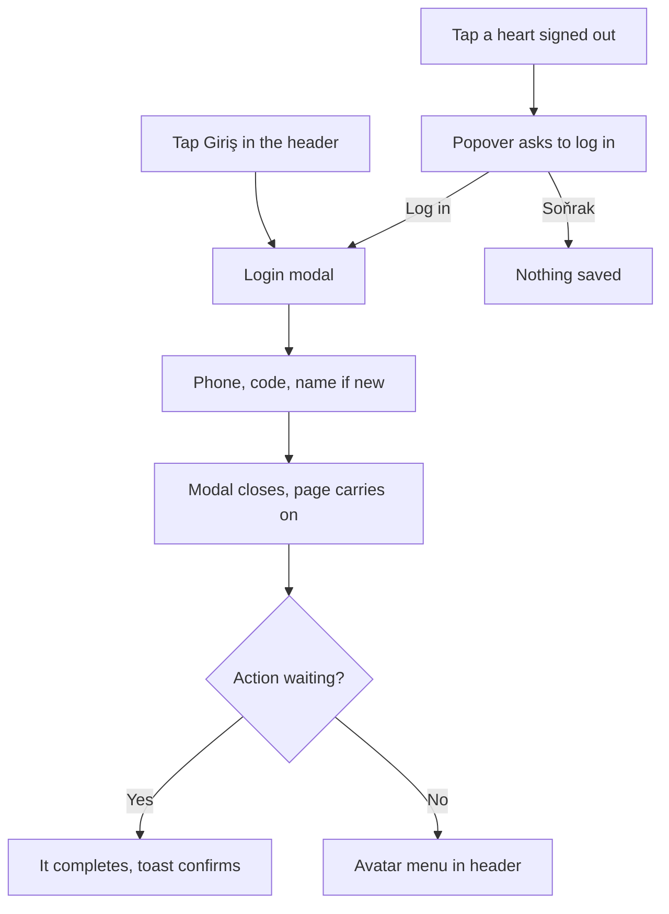

**Steps**

1. The login modal (400 px; a bottom sheet on phones): "Ýeral-a giriň" and "Ýazylyşlaryňyzy dolandyrmak üçin telefon belgiňizi ýazyň.", "Kod iber", the consent line, "Dil: Türkmençe" (Auth). `/tk/login` is the fallback route (client spec §3).
2. "SMS kody ýazyň": four boxes; the modal checks the code by itself on the fourth digit (Auth) and, as the shared code step, also shows "Tassykla" (C-18; Q-157, decided 18.10.2026).
3. A new user: "Hoş geldiňiz!", "Biz size nähili ýüzlenmeli?", "Adyňyz", "Familiýaňyz (hökman däl)" (surname, optional), "Dowam et" (Auth).
4. Wrong code and the 60-second lock as in C-18, with the same lock message and a new code after the lock; Auth draws its own lock line, "Köp synanyşyk. 60 sekuntdan soň gaýtadan synanyşyň." (Auth; Q-157, decided 18.10.2026).
5. A heart while signed out opens a popover: "Halanlaryňyzy saklamak üçin giriň", "Diňe telefon belgiňiz gerek.", "Soňrak" (Later). After login the heart is saved by itself and a toast says "Halanlaryňyza goşuldy" with "Görkez" (Show) (States tile 10).
6. Language and favourites carry over to the account (client spec §4.7). The header then shows the avatar menu (Auth).

**Edge cases**

- The page under the modal keeps its state, a started booking included (Auth, step 3 caption).
- An account unused for 6 months asks "Is this you?" first, as in C-18 (Q-270).

**Status:** Design: drawn (Auth; States 10) · Code: built (api).

### C-20 · The time was taken while booking

**Goal:** recover when someone else took the time first.

**Starts from:** the confirm step after "Ýazylyşy ugrat", in any booking type.

```mermaid
flowchart TD
  A["Client taps send"] --> B{"Time still free?"}
  B -->|"Yes"| C["Sent or confirmed"]
  B -->|"No"| D["Banner with nearest free times"]
  D --> E{"Client picks"}
  E -->|"A nearby time"| F["Banner clears, send enabled"]
  F --> A
  E -->|"Another day"| G["Back to the time step"]
```

**Steps**

1. A banner appears on the confirm step: "Bu wagt ýaňy alyndy. Golaý boş wagtlar:" (This time was just taken. Free times nearby:) and up to 3 nearest free times of the same day (client spec §4.4, §11).
2. "Ýazylyşy ugrat" stays disabled until a new time is picked; picking one keeps everything entered; the taken time shows disabled in the grid (States tile 04; screens README).
3. "Başga gün" (Another day, States 04) or "Başga wagt saýla" (Booking) goes back to the time step.

**Edge cases**

- No free time left that day: the banner has no chips (not drawn; the api returns an empty list).
- Tables: nearby times in the same area (code: `bookings/create.ts`). Classes: a session that filled up answers "Sapak doly." without alternatives (code).

**Status:** Design: drawn (Booking · `slotTaken`; States 04) · Code: built (api) — `409 slot_taken` with up to 3 alternatives.

## After sending

### C-21 · Request sent to a business that confirms by hand

**Goal:** the client knows the request is sent, not booked yet, and what happens next.

**Starts from:** a successful send at a business with manual confirmation.

```mermaid
flowchart TD
  A["Send succeeds"] --> B["Ýazylyş ugradyldy screen"]
  B --> C["Badge Garaşylýar"]
  B --> D["Answer and hold-time sentence"]
  B --> E["What happens next timeline"]
  B --> F{"Client taps"}
  F -->|"Ýazylyşlaryma geç"| G["My bookings"]
  F -->|"Senenama goş"| H["Calendar file downloads"]
  F -->|"Baş sahypa"| I["Home"]
```

**Steps**

1. Title "Ýazylyş ugradyldy" (Booking sent), badge *Garaşylýar* with a clock (Booking · `step=sent`).
2. The sentence: "Glow Studio ýazylyşyňyzy tassyklanda SMS ibereris. Biznes adatça 15 minudyň içinde jogap berýär. Jogap bermese, 30 minutdan soň size başga wagtlary hödürläris." — the first number is the business's typical answer time (A2). The second part shows the real deadline as a clock time instead of the hold time, since the hold never runs past the visit start and runs only during opening hours; Claude writes the sentence in English and the owner checks it (Q-253, Q-120, decided 18.10.2026).
3. The summary: business, services, specialist, time, address, "Jemi · Töleg ýerinde", and "Ýazylyş belgisi: YR-48213" (booking code).
4. "Indi näme bolar?" (What happens now?): *Ugradyldy* (Sent, "Şu gün, 11:20") → *Biznes tassyklar* ("Adatça 15 minudyň dowamynda. Size SMS geler.") → *Ýatlatma: 1 gün öň* → *Siz gelýärsiňiz*. Under it: "Tassyklanýança ýazylyşy mugt ýatyryp bilersiňiz." (Booking).
5. Buttons: "Ýazylyşlaryma geç" (Go to my bookings), "Senenama goş" (Add to calendar, downloads an `.ics` file: "Senenama faýly (.ics) ýüklendi."), "Baş sahypa" (Home) (client spec §4.4).
6. No SMS is sent for a request; it's on screen only (client spec §6).
7. Tables: "Stol bronlamak haýyşy ugradyldy", "Bag kafe haýyşyňyzy tassyklanda … belgä SMS ibereris.", steps "Kafe tassyklar", "Ýatlatma: 2 sagat öň"; classes: "Sapaga ýazyldyňyz — tassyklanyşyna garaşylýar", "Studiýa tassyklar" (Booking-Table, Booking-Class · `sent`).

**Edge cases**

- When the visit is close, the reminder step reads "Wagt ýakyn — ýatlatma iberilmeýär." (Too close — no reminder) (Booking-Table, Booking-Class).
- A request sent shortly before the visit expires at the visit start, sooner than the hold time; the clock time in the sentence shows that real deadline (ADR 0017; Q-253).

**Design to fix:** the sent screen's sentence gives the real deadline as a clock time instead of "30 minutdan soň" (Q-253).

**Status:** Design: drawn (Booking · `step=sent`, `confirmMode=manual`; Booking-Table, Booking-Class · `sent`) · Code: built (api) — the business's hold and typical answer time come with the page data.

### C-22 · Confirmed at once by an instant business

**Goal:** the client knows the visit is booked right away.

**Starts from:** a successful send at a business with instant confirmation.

```mermaid
flowchart TD
  A["Send succeeds"] --> B{"Business confirms instantly?"}
  B -->|"No"| C["Sent screen, C-21"]
  B -->|"Yes"| D["Ýazylyş tassyklandy screen"]
  D --> E["Badge Tassyklandy"]
  D --> F["No waiting step"]
  D --> G["Reminders planned"]
```

**Steps**

1. The same screen with title "Ýazylyş tassyklandy" (Booking confirmed), badge *Tassyklandy* with a check, and no "waiting" step in the timeline (client spec §1, §4.4; Booking · `confirmMode=instant`).
2. The rule line: "Ýazylyşy 2 sagat öňünden mugt ýatyryp ýa-da üýtgedip bilersiňiz." (Booking).
3. Reminders are planned as for any confirmed booking (C-33).
4. The confirmed SMS goes too, since it carries the booking link (Q-287, decided 18.10.2026; C-24).

**Edge cases**

- Table and class sent screens are drawn for manual confirmation only; the spec says they follow the appointment's sent state (client spec §4.5, §4.6).

> Open question Q-287: confirmed SMS at an instant business.

**Status:** Design: drawn (Booking · `confirmMode=instant`) · Code: built (api).

### C-23 · Wait for the business's answer

**Goal:** see the request's state; change the note or cancel while waiting.

**Starts from:** "Ýazylyşlarym" or the booking detail of a pending request.

```mermaid
flowchart TD
  A["Request Garaşylýar"] --> B{"What happens?"}
  B -->|"Business confirms"| C["Tassyklandy, C-24"]
  B -->|"Business declines"| D["Biznes ret etdi, C-25"]
  B -->|"Hold time runs out"| E["Wagtynda jogap gelmedi, C-26"]
  B -->|"Client edits the note"| F["Note saved"]
  F --> A
  B -->|"Client cancels"| G["Siz ýatyrdyňyz, C-28"]
```

**Steps**

1. The row: badge *Garaşylýar* and "Biznesiň tassyklamagyna garaşylýar" (Waiting for the business to confirm); in the detail: "{typical}. Ýatyrmak mugt." (Account-Bookings).
2. The timeline: "Haýyş ugradyldy" (Request sent) → "Tassyklama garaşylýar" with "Tassyklananda SMS bilen habar bereris" (Account-Bookings).
3. "Belligi üýtget" (Edit note) opens "Biznese belligiňiz" with a counter "/ 300", "Ýatyr" and "Ýatda sakla"; a toast says "Bellik ýatda saklandy" (Account-Bookings).
4. "Ýazylyşy ýatyr" cancels at no cost at any time while pending (client spec §4.8; C-28).
5. Open screens update by themselves when the business answers (code: `GET /v1/events`).

**Edge cases**

- A pending request can't be moved; the client cancels it and books another time (client spec §4.8 table).
- The business answers after the hold time ran out: refused, the request has already expired (code: `request_expired`).
- Outside production, demo businesses with no team confirm by themselves after 20 seconds (code: `bookings/create.ts`).

**Code differs**

- The api accepts a note of up to 500 characters; the design counts to 300 (Account-Bookings).

**Status:** Design: drawn (Account-Bookings · `view=drawer`) · Code: built (api) — note, cancel, live updates.

### C-24 · The business confirms

**Goal:** the client knows the visit is booked.

**Starts from:** a pending request that the business confirms.

```mermaid
flowchart TD
  A["Business taps Tassykla"] --> B["Status Tassyklandy"]
  B --> C["SMS with the booking link"]
  B --> D["Reminders planned"]
  B --> E["Row shows confirmed time"]
  E --> F["Detail shows what can change"]
```

**Steps**

1. The client gets "Ýeral: {business} ýazylyşyňyzy tassyklady. {weekday}, {date}, {time}. Üýtgetmek: yeral.app/b/{id}" unless they switched it off (client spec §6; C-45).
2. The row reads "Tassyklandy · ertir 14:30"; the detail adds "Ýatlatmany 1 gün we 2 sagat öň SMS bilen ibereris." and the timeline step "Bellenen wagt" (Account-Bookings).
3. Actions: "Başga wagta geçir" (appointments only), "Ýazylyşy ýatyr", "Ýol görkez", "Jaň et" (client spec §4.8; A4).
4. A home-based business now shows its exact address (C-08).

**Edge cases**

- Who in the business may confirm (owner, administrator, the specialist) is the business chapter's subject (business spec §2).

**Status:** Design: drawn (Account-Bookings) · Code: partly — confirming, its SMS and reminders are built; the business's confirm button comes with the workspace (M5).

### C-25 · Declined, with offered times

**Goal:** book one of the times the business offered, in one tap.

**Starts from:** the decline SMS, "Ýazylyşlarym" or the SMS link page.

```mermaid
flowchart TD
  A["Business declines with reason"] --> B["SMS with reason and link"]
  B --> C["Row says Biznes ret etdi"]
  C --> D{"Offered times?"}
  D -->|"None"| E["Gaýtadan ýazyl"]
  D -->|"All past"| F["Offers expired, pick another"]
  D -->|"Some ahead"| G["Client taps a time"]
  G --> H["Confirm, Ýazyl or Yza"]
  H --> I{"Still free?"}
  I -->|"No"| J["Chip shows Eýýäm eýelendi"]
  I -->|"Yes"| K["New booking, Tassyklandy at once"]
  K --> L["Declined row moves to Geçen"]
```

**Steps**

1. SMS: "Ýeral: {business} {date} {time} ýazylyşyny kabul edip bilmedi: {reason}. Başga wagt saýlaň: {link}" (client spec §6).
2. The row: badge *Ýatyryldy*, "Biznes ret etdi" with a building icon, "Sebäbi: Bu wagt boş däl" (reasons: *Bu wagt boş däl* · *Hünärmen ýok* · *Bu hyzmaty edip bilmeýäris* · *Başga sebäp* with text), and the business's note in quotes, e.g. "«Aýna 17:00-da başga müşderide bolar — şu wagtlaryň birini saýlaň.»" (A1; ADR 0017).
3. "Teklip edilen wagtlar" (Offered times): up to 3 chips with short day and time, and "Bir basyşda ýazylyň — biznes bu wagtlary özi teklip etdi." (Book in one tap — the business offered these times itself) (A1).
4. A tap asks once: "{time} · {service} · {staff} — şu wagta ýazylmalymy?" with "Yza" and "Ýazyl" (A1; Mobile 8).
5. "Ýazyl" creates a new booking that is *Tassyklandy* at once, because the business offered the time; a toast says "Ýazyldyňyz: Penşenbe, 15 okt · 18:00". The other chips go; the declined row moves to *Geçen* with "Teklip edilen wagt kabul edildi → YR-48231". One declined request makes at most one booking (A1; Mobile 9).
6. While an offered time is still ahead, declined rows stay on top of *Gelýän* (Mobile 7).

**Edge cases**

- Each offered time belongs to one named specialist and is booked with that person only. A chip taken meanwhile, or whose specialist is no longer free: disabled, struck through, "Eýýäm eýelendi" (Already taken) (A1; Account-Bookings · `view=declinedTaken`; Q-159, decided 18.10.2026).
- All offered times passed: "Teklip edilen wagtlaryň möhleti geçdi" and "Başga wagt saýla" (A1; `view=offersExpired`). An offered time counts as past once it's earlier than now plus the business's lead time (Q-264, decided 18.10.2026).
- A phone-only client can still take offered times (A7).
- Table declines can offer times too (B-Tables decline modal "Başga wagt teklip et"); class declines don't (B-Classes).

> Open question Q-159: which specialist an offered or free time is for.

**Code differs**

- Declined rows go straight to *Geçen*; Mobile 7 keeps them on top of *Gelýän* while an offer is ahead (code: `bookings/routes.ts`).
- Times offered after a decline name nobody until the business's decline is built (P2 step 4): taking one goes to anyone free (code: `bookings/actions.ts`, `offerTarget`).
- Offered times after a table decline can't be taken: the api re-books appointments only, and the booking detail leaves them out (code: `bookings/offers.ts`).
- The business's decline and the decline SMS come with the workspace (M5); reading and taking offers is built.

**Status:** Design: drawn (Account-Bookings · `view` declined, declinedConfirm, declinedTaken, offersExpired; Mobile 7–9) · Code: partly — taking offers built for appointments; declining comes with M5.

### C-26 · The request expired, with free times

**Goal:** send a new request at a free time after the business didn't answer.

**Starts from:** the expiry SMS, "Ýazylyşlarym" or the SMS link page.

```mermaid
flowchart TD
  A["Hold time runs out"] --> B["System cancels the request"]
  B --> C["SMS with 3 free times"]
  C --> D["Row says Wagtynda jogap gelmedi"]
  D --> E["Client taps a free time"]
  E --> F["Confirm question"]
  F --> G{"Still free?"}
  G -->|"No"| H["Chip shows Eýýäm eýelendi"]
  G -->|"Yes"| I{"Business confirms instantly?"}
  I -->|"No"| J["New request Garaşylýar"]
  I -->|"Yes"| K["New booking Tassyklandy"]
```

**Steps**

1. When the hold time runs out, the system cancels the request (ADR 0017).
2. SMS: "Ýeral: {business} wagtynda jogap bermedi. Şu boş wagtlar bar: {t1}, {t2}, {t3} — {link}" (client spec §6).
3. The row: badge *Ýatyryldy*, an hourglass and "Wagtynda jogap gelmedi"; the lead line "{business} {hold} minudyň içinde jogap bermedi. Şu boş wagtlaryň birini saýlaň:" and the chips "Boş wagtlar" (A2; Account-Bookings · `view=expired`).
4. A tap and confirm send a **new request**: *Garaşylýar* (YR-48242) with the toast "Täze haýyş ugradyldy", or *Tassyklandy* at an instant business. The old row says "Täze haýyş ugradyldy → YR-48242" (A2; Mobile 10).
5. One expired request makes at most one booking; the other chips go (Q-265, decided 18.10.2026).

**Edge cases**

- The free times are found for the same services: that day first, then the next free days (code: `jobs/run.ts`). Each belongs to one named specialist and is booked with that person only (Q-159, decided 18.10.2026).
- A chip taken meanwhile, or whose specialist is no longer free: "Eýýäm eýelendi" (`view=expiredTaken`; Q-159).
- Between the expiry and the next minute's job run, the row already shows "Wagtynda jogap gelmedi" but its chips arrive a moment later (code: `domain/lifecycle.ts`, jobs every minute).
- A phone-only client or a paused business: the free-time chips are hidden and the "Jaň et" card shows instead (Q-154, decided 18.10.2026; C-11).
- No free time found: the SMS drops the times and says "Başga wagt saýlaň" (Q-252, decided 18.10.2026).
- Tables get the 3 nearest times for the same party size and area; classes get the next 3 sessions of the same class with seats. This applies when tables and classes come (Q-252, Q-030).

> Open question Q-252: what an expired table or class request offers.

**Code differs**

- Table and class requests get no free times (code: `jobs/run.ts`); they come after the MVP (Q-252, Q-030).

**Status:** Design: drawn (Account-Bookings · `view=expired`, `expiredTaken`; Booking-Link · `expired`; Mobile 10) · Code: built (api) for appointments — expiry job, SMS, taking a time.

### C-27 · The business moves or cancels a confirmed booking

**Goal:** the client learns about a change the business made.

**Starts from:** a confirmed booking the business changes.

```mermaid
flowchart TD
  A["Confirmed booking"] --> B{"Business action"}
  B -->|"Moves it"| C["Booking shows the new time"]
  C --> D{"SMS box ticked?"}
  D -->|"Yes"| E["Client gets an SMS"]
  D -->|"No"| F["Seen in My bookings only"]
  B -->|"Cancels it"| G["Ýatyryldy, Biznes ýatyrdy"]
  G --> H["SMS with the reason"]
  H --> I["Gaýtadan ýazyl"]
  B -->|"Cancels the class session"| J["Attendees told with alternatives"]
```

**Steps**

1. A move by the business (drag in the calendar or "Başga wagta geçir") changes the booking in place and texts the client if "Müşderä SMS iberilsin" is ticked (ADR 0017; B-Calendar).
2. A cancel by the business asks for a reason; the client is told by SMS with the reason ("Müşderä SMS bilen habar bereris we sebäbini görkezeris.", B-Calendar) and sees "Biznes ýatyrdy: {reason}" with a building icon (client spec §4.8).
3. The client can book again (client spec §4.8).
4. The profile switch "Tassyklama we üýtgeşmeler (SMS)" covers confirmations, time changes and cancels by the business (Account-Profile; Q-286, decided 18.10.2026).
5. The studio cancels a whole class session: it works like a decline with offered times. The client sees "Biznes ýatyrdy" with the reason and up to 3 sessions as chips; one tap books a confirmed seat (Q-161, decided 18.10.2026). This applies when classes come (Q-030).

**Edge cases**

- The SMS for a move by the business has no text among the templates (client spec §6); Claude writes it in English with the market's translations, and the owner checks it (Q-288, decided 18.10.2026).

> Open question Q-161: the studio cancels a whole class session.

**Design to fix:** the client's row, detail and link page for a class session the studio cancelled, with the session chips (Q-161).

**Status:** Design: text only on the client side (business side drawn: B-Calendar, B-Classes) · Code: not built — business actions come with M5 (the cancel SMS text exists: `sms.cancelled`).

## Changing a booking

### C-28 · Cancel a booking

**Goal:** cancel a request or a confirmed booking, within the business's rules.

**Starts from:** the booking detail in "Ýazylyşlarym".

```mermaid
flowchart TD
  A["Booking detail"] --> B{"Status?"}
  B -->|"Garaşylýar"| C["Ýazylyşy ýatyr, free"]
  B -->|"Tassyklandy"| D{"Before the cancel deadline?"}
  D -->|"Yes"| C
  D -->|"No"| E["Only Jaň et"]
  C --> F["Confirm modal, optional reason"]
  F --> G["Hawa, ýatyr"]
  G --> H["Row greyed, toast Yzyna al"]
  H --> I["Moves to Geçen on reload"]
```

**Steps**

1. A pending request can be cancelled any time, at no cost (client spec §4.8).
2. A confirmed booking can be cancelled until its deadline: the start minus the business's cancel window (default 2 hours; options any time, 1, 2, 6, 12, 24 or 48 hours) (screens README "Account"; business spec §11).
3. The modal: "Ýazylyşy ýatyrmalymy?" (Cancel the booking?) and "{business} · {service} · {date}. Ýatyrmak mugt, biznese derrew habar bereris." (Cancelling is free; we'll tell the business at once). Optional reason "Sebäbi (hökman däl)" with chips *Meýilnamam üýtgedi* · *Başga wagt gerek* · *Başga ýer tapdym* · *Başga sebäp*. For an appointment a hint: "Wagty üýtgetmek isleseňiz, ýatyrmagyň deregine başga wagta geçiriň." If a move is waiting: "Wagt üýtgetmek haýyşy hem yzyna alnar." Buttons "Yza" and the solid danger "Hawa, ýatyr" (Account-Bookings · `view=cancel`).
4. After: the row is greyed with *Ýatyryldy* and "Siz ýatyrdyňyz" (person icon); a toast "Ýazylyş ýatyryldy" with "Yzyna al" (Undo). The row stays in *Gelýän* until the next page load, then moves to *Geçen* (client spec §4.8, §11).
5. Past the deadline the detail shows "Ýatyrmak möhleti geçdi. Üýtgeşme gerek bolsa, biznese jaň ediň." and "Ýatyrmak üçin wagt geçdi — biznese jaň ediň." with "Jaň et · {phone}" (Account-Bookings · `late`).

**Edge cases**

- Tables and classes: "Ýatyr" opens a confirm sheet on phones (Mobile 6); class rule example "Sapakdan 12 sagat öň mugt ýatyryp bilersiňiz.".
- Cancelling a booking with a waiting move also withdraws the move (A3; C-31).
- A booking made after its deadline had already passed (a same-day class, an instant booking an hour ahead) can't be cancelled online once confirmed: only "Jaň et", for every booking type; the class line is reworded to say so (Q-162, decided 18.10.2026; code: `domain/lifecycle.ts`; C-17).
- The business setting "Ýatyrylanda sebäp sora" (ask for a reason) decides the reason section: on, the modal shows the reason chips, still optional; off, the modal has no reason section (Q-163, decided 18.10.2026).

> Open question Q-162: cancelling a booking made after the free-cancel deadline.

> Open question Q-163: what "Ýatyrylanda sebäp sora" changes for the client.

**Design to fix:** the cancel modal without the reason section, for a business that switched "Ýatyrylanda sebäp sora" off (Q-163).

**Code differs:** the cancel ignores the business's "Ýatyrylanda sebäp sora" setting (ADR 0017 `askCancelReason`).

**Status:** Design: drawn (Account-Bookings · `view=cancel`, `late`; Mobile 6) · Code: built (api).

### C-29 · Undo a cancel

**Goal:** take back a cancel made by mistake.

**Starts from:** the toast or the greyed row right after cancelling.

```mermaid
flowchart TD
  A["Client cancelled"] --> B["Toast and greyed row"]
  B --> C{"Yzyna al within 5 minutes?"}
  C -->|"No"| D["Undo no longer offered"]
  C -->|"Yes"| E{"Can it come back?"}
  E -->|"Yes"| F["Back to its former status"]
  E -->|"No"| G["Yzyna alyp bolmady with reason"]
  G --> H["Başga wagt saýla"]
```

**Steps**

1. "Yzyna al" works for 5 minutes after the client's own cancel; after that the greyed row has no "Yzyna al" (A6).
2. A confirmed booking comes back *Tassyklandy*; a request comes back *Garaşylýar* with the hold time it had left (code: `bookings/actions.ts`).
3. When it can't come back, the toast and the row say "Yzyna alyp bolmady — {sebäbi}." (Couldn't undo — {reason}.) with "Başga wagt saýla", which opens the business page. The four reasons: "bu wagt eýýäm başga müşderä berildi" (time given to another client) · "sapakda boş ýer galmady" (no seats left in the class) · "ýazylyş wagty başlandy" (the visit time has started) · "haýyşyň jogap wagty gutardy" (the request's answer time ran out) (A6; Mobile 12).

**Edge cases**

- A cancel by the business or the system can't be undone by the client (code).
- Undoing brings the booking back, but not a move request the cancel withdrew; the client asks for the move again if they still want it (Q-266, decided 18.10.2026; code).

> Open question Q-266: undo after a cancel that withdrew a waiting move.

**Code differs**

- "Visit started", "answer time ran out" and "5 minutes passed" all come back as one error, "Yzyna almak wagty geçdi." (`restore_expired`); A6 needs each reason told apart. "Time taken" and "no seats" are separate already (code: `bookings/actions.ts`).

**Status:** Design: drawn (Account-Bookings · `view=undoFailed`, `undo`; Mobile 12) · Code: partly — undo built; the reasons aren't all told apart.

### C-30 · Move an appointment to another time

**Goal:** ask for, or get, another time for a confirmed appointment.

**Starts from:** "Başga wagta geçir" in the booking detail.

```mermaid
flowchart TD
  A["Başga wagta geçir"] --> B{"Before the change deadline?"}
  B -->|"No"| C["Only Jaň et"]
  B -->|"Yes"| D["Move mode, Wagty üýtget"]
  D --> E["Specialist step, current preselected"]
  E --> F["Times of the chosen person"]
  F --> G["Old time and new time"]
  G --> H{"Business confirms instantly?"}
  H -->|"Yes"| I["Wagty üýtget, moved at once"]
  H -->|"No"| J["Täze wagty sora"]
  J --> K["Waiting move, old time kept"]
```

**Steps**

1. Only appointments can be moved (A4). The move is allowed within the same free-change window as cancelling (A5).
2. Move mode opens at `/tk/b/{slug}/book?move={id}` with the title "Wagty üýtget" (Change the time) and the booking code; steps *Hünärmen* · *Wagt* · *Tassykla* (A5; Booking · `mode=move`).
3. Services are locked: "Hyzmatlary üýtgetmek üçin ýazylyşy ýatyryp täzeden ýazylyň." (To change services, cancel and book again) (A5).
4. The current specialist is preselected and marked "Häzirki" (Current), with "Islendik hünärmen" also offered. The time grid shows only the chosen person's free times (anyone's for "Islendik"); the system never swaps the specialist silently. The current time is marked "öňki wagtyňyz" (A5 rule change; Mobile 13).
5. "Täze wagty saýlaň", then "Täze wagty tassyklaň" with "Öňki wagt: Penşenbe, 15 okt · 14:30" → "Täze wagt: …" and "Biznes tassyklaýança öňki wagtyňyz saklanýar." (Your old time is kept until the business confirms) (Booking).
6. A manual business: the button "Täze wagty sora" (Ask for the new time), then "Wagt üýtgetmek haýyşy ugradyldy" and the line "Täze wagt soraldy: {new} · jogap garaşylýar" (C-31). An instant business: the button "Wagty üýtget" and the booking moves at once, "Wagt üýtgedildi" (A3, A5).

**Edge cases**

- A second move replaces a waiting one (C-31).
- Table and class bookings can't be moved (C-32).
- A phone-only client or a paused business: "Başga wagta geçir" is hidden and the "Jaň et" card shows instead (Q-154, decided 18.10.2026; C-11).
- A new time may overlap the current one: the booking's own time doesn't count as busy for its move (Q-165, decided 18.10.2026).

> Open question Q-165: moving to a time that overlaps the current one.

**Design to fix:** in move mode, times that overlap "öňki wagtyňyz" show as free with the same specialist (Q-165).

(code: `rebookQuery()` books the chosen specialist only, or anyone free for «Islendik hünärmen»; the free times in move mode come from `GET /v1/businesses/{slug}/availability?move={code}`; a move's items share the booking's `family`, so the database lets them overlap its own time)

**Status:** Design: drawn (Booking · `mode=move`, `confirmMode`; Mobile 13) · Code: built (api).

### C-31 · Follow a waiting move

**Goal:** see what happens to a move the business hasn't answered yet.

**Starts from:** a confirmed booking with a waiting move.

```mermaid
flowchart TD
  A["Move waits for the business"] --> B{"What happens?"}
  B -->|"Business accepts"| C["Booking takes the new time"]
  C --> D["Toast and SMS with new time"]
  B -->|"Declined or no answer"| E["Booking stays at the old time"]
  B -->|"Client withdraws"| F["Haýyşy yzyna al"]
  B -->|"Client moves again"| G["New ask replaces the old"]
  B -->|"Client cancels booking"| H["Move withdrawn too"]
```

**Steps**

1. The booking stays *Tassyklandy*; the row adds an amber clock line "Täze wagt soraldy: Şenbe, 17 okt · 11:30 · jogap garaşylýar" (New time asked · waiting for an answer) (A3; Mobile 7).
2. The detail shows "Wagt üýtgetmek haýyşy" (Request to change the time): old → new, "Biznes tassyklaýança öňki wagtyňyz saklanýar." and "Haýyşy yzyna al" (Withdraw the request); withdrawing shows "Wagt üýtgetmek haýyşy yzyna alyndy" (A3; Account-Bookings · `view=moveWaiting`).
3. Accepted: the booking takes the new time; toast or SMS "Täze wagt tassyklandy: Şenbe, 17 okt · 11:30"; timeline "Täze wagt tassyklandy" (Mobile 11; `moveAccepted`).
4. Declined or unanswered within the business's hold time: "Täze wagt kabul edilmedi — ýazylyşyňyz öňki wagtynda galýar." (The new time wasn't accepted — your booking stays at its old time), with "Sebäbi: …" when the business gave one (A3; `moveDeclined`, `moveUnanswered`). A move's deadline never runs past the original visit's start either (Q-263, decided 18.10.2026).
5. A second move replaces the first: "Öňki haýyşyňyz ({time}) täzesi bilen çalşylar." with "Yza" and "Dowam et" (A3).
6. Cancelling the booking also withdraws the move: "Wagt üýtgetmek haýyşy hem yzyna alnar." (A3).
7. On the business side it arrives as a request of type "Wagt üýtgetmek", answered under the same "who answers requests" rule and hold time (business spec §26).

**Edge cases**

- A declined or unanswered move sends the client an SMS with "Täze wagt kabul edilmedi — ýazylyşyňyz öňki wagtynda galýar." and the link (Q-289, decided 18.10.2026).

(code: "Haýyşy yzyna al" is `POST /v1/me/bookings/{code}/withdraw-move`, which works for a paused business and a phone-only client too; the booking detail's `moveRefused` carries a declined or lapsed move; a lapse sends the SMS from `jobs/run.ts`)

**Code differs**

- The business's decline of a move comes with the workspace (P2 step 4); its SMS will be the same one.

**Status:** Design: drawn (Account-Bookings · moveWaiting, moveDeclined, moveUnanswered, moveAccepted; Mobile 11) · Code: built (api) for the client: waiting, replacing, withdrawing, the outcome and its SMS; the business's decline with P2 step 4.

### C-32 · Table or class: cancel and book again instead of moving

**Goal:** get another time for a table or class booking, which can't be moved.

**Starts from:** a confirmed table or class booking.

```mermaid
flowchart TD
  A["Confirmed table or class booking"] --> B["No Başga wagta geçir"]
  B --> C["Ýazylyşy ýatyr"]
  B --> D["Gaýtadan ýazyl"]
  D --> E{"Booking type"}
  E -->|"Table"| F["Table flow, party and area filled"]
  E -->|"Class"| G["Same class schedule"]
```

**Steps**

1. Table and class bookings show "Ýazylyşy ýatyr" and "Gaýtadan ýazyl" (Book again), never "Başga wagta geçir" (A4).
2. "Gaýtadan ýazyl" opens the table flow with party size and area filled in, or the same class (Mobile 6).
3. The rule text says only "…2 sagat öňünden mugt ýatyryp bilersiňiz." (Mobile 6; A4).

**Edge cases**

- Past the cancel deadline only "Jaň et" remains (C-28).

**Status:** After the MVP (Q-030) · Design: drawn (Account-Bookings; Mobile 6) · Code: built (api) — moves refused for tables and classes (`not_bookable`); filling in the flow is a screen job.

## Around the visit

### C-33 · Get reminders

**Goal:** the client doesn't forget the visit.

**Starts from:** a confirmed booking.

```mermaid
flowchart TD
  A["Booking confirmed"] --> B{"Reminder time still ahead?"}
  B -->|"No"| C["No reminder sent"]
  B -->|"Yes"| D{"Reminder switch on?"}
  D -->|"No"| E["No SMS"]
  D -->|"Yes"| F["SMS a day and 2h before"]
  F --> G{"Booking moved later?"}
  G -->|"Yes"| H["Reminders follow the new time"]
```

**Steps**

1. SMS one day and two hours before the visit: "Ýatlatma: ertir {time} {business}, {address}." (client spec §6).
2. Each has its own profile switch: "Ýatlatma: 1 gün öň" and "Ýatlatma: 2 sagat öň" (Account-Profile).
3. A booking made too close to the visit gets none; the sent screen says "Wagt ýakyn — ýatlatma iberilmeýär." (Booking-Table, Booking-Class). A reminder whose time has already passed is skipped, since the confirmed SMS has just told the client (Q-257, decided 18.10.2026).
4. Only confirmed bookings get reminders; a business can switch reminders off for one client (business spec §10, `noRemindersSms`).
5. A reminder that would fall between 22:00 and 08:00 goes at 21:30 the evening before (Q-285, decided 18.10.2026).

**Edge cases**

- The 2-hour reminder keeps the code's own text with "şu gün" (today); client spec §6 had one template with "ertir" (tomorrow) for both (Q-293, decided 18.10.2026).

**Code differs:** reminders go at any hour, also at night (code: `bookings/confirm.ts`).

**Status:** Design: text only (client spec §6; the sent-screen timeline is drawn) · Code: built (api).

### C-34 · After the visit: completed and review

**Goal:** close the visit and let the client rate it.

**Starts from:** the end time of a confirmed booking.

```mermaid
flowchart TD
  A["Visit end time passes"] --> B["Status Tamamlandy"]
  B --> C["Teswir ýaz in My bookings or the link page"]
  C --> D["Review modal"]
  D --> E["Pick stars"]
  E --> F["Tags and text, optional"]
  F --> G["Teswiri ugrat"]
  G --> H["Shown on the business page"]
  D -->|"Soňrak"| I["Teswir ýaz stays on the row"]
```

**Steps**

1. A visit counts as *Tamamlandy* by default after its end time, unless the business reports a no-show (client spec §1 rule 3).
2. No review ask: no SMS asks for a review (owner: no aggressive asking). The client writes one from "Teswir ýaz" in *Ýazylyşlarym* (My bookings) or on the booking's link page after a completed visit (C-38); a specialist may ask in person (Q-259, decided 18.10.2026). The drawn review SMS "{business}-da bolşuňyz nähili boldy? Baha beriň: {link}" and the profile switch "Teswir haýyşy" go (client spec §6; Account-Profile; C-45).
3. The modal: "Bolşuňyz nähili boldy?" (How was it?), stars required (words *Erbet* · *Gowy däl* · *Orta* · *Gowy* · *Ajaýyp*; "Ýyldyz saýlaň" until picked); "Näme gowy boldy?" chips *Wagtynda kabul etdiler* · *Arassa* · *Ussat hünärmen* · *Mähirli* · *Bahasyna laýyk*; "Teswiriňiz (hökman däl)" up to 500 characters; "Teswiriňiz adyňyz we familiýaňyzyň ilkinji harpy bilen görkeziler: Aýjemal G."; "Soňrak" and "Teswiri ugrat" (Account-Bookings · `view=review`).
4. A toast says "Sag boluň! Teswiriňiz çap edildi."; the row then shows "5 · Baha berdiňiz" (Account-Bookings).
5. Only a completed booking can be reviewed, once, up to 30 days after the visit (client spec §4.8; Q-126, decided 18.10.2026).

**Edge cases**

- On the link page a completed booking adds "Teswir ýaz", which logs in with the masked phone and opens the review (Q-170, decided 18.10.2026; C-38).
- A review written before the business marks a no-show stays (Q-254, decided 18.10.2026; C-36).

**Code differs**

- A review can be written at any time after the visit, with no 30-day limit (code: `bookings/actions.ts`).

**Status:** Design: drawn (Account-Bookings · `view=review`) · Code: built (api).

### C-35 · Edit a review

**Goal:** change a review shortly after writing it.

**Starts from:** a reviewed booking in *Geçen*.

```mermaid
flowchart LR
  A["Reviewed booking"] --> B{"Within 7 days?"}
  B -->|"Yes"| C["Edit stars, tags, text"]
  C --> D["Average updates"]
  B -->|"No"| E["Review locked"]
```

**Steps**

1. A review can be edited for 7 days (client spec §4.8).
2. After that the api answers "Teswiri üýtgetmek wagty geçdi." (code `tk.json`).

**Edge cases**

- How the client opens the edit isn't drawn; the row shows "{stars} · Baha berdiňiz" (Account-Bookings).
- Deleting one's own review isn't designed and the api has no such action.

**Status:** Design: text only (client spec §4.8) · Code: built (api) — `PATCH /v1/me/bookings/{code}/review`.

### C-36 · Marked as a no-show

**Goal:** the client sees that the business reported them as not coming.

**Starts from:** a booking the business marked *Gelmedi*.

```mermaid
flowchart TD
  A["Business reports Gelmedi"] --> B["Status Gelmedi"]
  B --> C["Row shows the business note"]
  C --> D["Gaýtadan ýazyl"]
  B --> E{"No-shows reach the limit?"}
  E -->|"Yes"| F["Phone only at that business"]
```

**Steps**

1. The business reports it through "Arz et" (Complain) from the visit's start time until 24 hours after its end, also after the visit was auto-completed; a review the client wrote before stays (business spec §3; Q-206, Q-254, decided 18.10.2026; code: `domain/lifecycle.ts`).
2. The client sees badge *Gelmedi* (user-x icon), "Gelmediňiz diýlip bellendi" (Marked as not come) and the business's note, e.g. "Size 11:15-de jaň etdik, jogap bolmady. Täze wagta ýazylyp bilersiňiz." (client spec §4.8; Account-Bookings, YR-43108).
3. "Gaýtadan ýazyl" is offered (client spec §4.8).
4. At the business's limit (default 2) the client can book there only by phone (C-11).

**Edge cases**

- No SMS tells the client about a no-show or the phone-only limit: both show on screen only (client spec §6; Q-290, decided 18.10.2026).
- No dispute in the MVP: a client who thinks the mark is wrong calls the business, or writes to Ýeral support from the help pages (Q-166, decided 18.10.2026).
- The business can remove a mistaken no-show from the booking drawer within 7 days: the status goes back to *Tamamlandy*, the no-show count drops, and the client gets no message (Q-207, decided 18.10.2026).

> Open question Q-166: disputing a no-show.

**Code differs:** "Gelmedi" can be marked at any time after the start, with no end (code: `domain/lifecycle.ts`).

**Status:** Design: drawn (Account-Bookings) · Code: partly — the status and the phone-only rule are built; the business's "Arz et" comes with M5.

### C-37 · Book again

**Goal:** repeat a past visit quickly.

**Starts from:** a completed, cancelled or no-show booking.

```mermaid
flowchart TD
  A["Past or cancelled booking"] --> B["Gaýtadan ýazyl"]
  B --> C{"Booking type"}
  C -->|"Appointment"| D["Appointment flow"]
  C -->|"Table"| E["Table flow, party and area"]
  C -->|"Class"| F["Same class"]
```

**Steps**

1. "Gaýtadan ýazyl" is offered for *Tamamlandy*, *Ýatyryldy* and *Gelmedi* (client spec §4.8; code `bookAgain`).
2. Tables open with party and area filled in; classes open on the same class (Mobile 6).
3. An appointment opens with the same services and specialist, at the time step (Q-167, decided 18.10.2026).

**Edge cases**

- Services or people no longer offered are dropped, and the flow opens at the first step that needs a choice (Q-167).

> Open question Q-167: what "Gaýtadan ýazyl" fills in for an appointment.

**Status:** Design: drawn (the button; Mobile 6 for tables and classes) · Code: built (api) — the flag; filling in is a screen job.

## The SMS link page

### C-38 · Open a booking from an SMS link

**Goal:** see one booking from an SMS without hunting for it.

**Starts from:** a booking link in an SMS: a long random token on a path of its own, never the booking code (Q-168, decided 18.10.2026).

```mermaid
flowchart TD
  A["Tap the link in an SMS"] --> B{"Link valid?"}
  B -->|"No"| C["Bu salgy işlemeýär"]
  B -->|"Yes"| D["Booking card, logo-only header"]
  D --> E{"Booking state"}
  E -->|"Confirmed or pending"| F["Read-only, directions and call"]
  E -->|"Declined or expired"| G["Offered time chips, C-39"]
  E -->|"Offers all past"| H["Başga wagt saýla"]
  F --> I["Changes only in Ýazylyşlarym"]
```

**Steps**

1. The page has a logo-only header and one card: business, category and address, what and when (the asked time struck through for a declined or expired request), the badge with who cancelled and why, the business's note, the typical answer line, a waiting move line (Booking-Link; Mobile 14).
2. Confirmed or pending: read only, with "Ýol görkez" and "Jaň et", and "Ýatyrmak ýa-da üýtgetmek üçin Ýazylyşlarym bölümine giriň." (To cancel or change, go to My bookings) (Booking-Link · `state=confirmed`, `pending`).
3. Declined or expired: the offered or free time chips, taken as in C-39 (A1).
4. All offers past: "Teklip edilen wagtlaryň möhleti geçdi" and "Başga wagt saýla" (Booking-Link · `state=offersExpired`).
5. A bad or old link: "Bu salgy işlemeýär" (This address doesn't work) and "Baglanyşyk nädogry ýa-da köne bolup biler. Ýazylyşlaryňyzy hasabyňyzda görüp bilersiňiz.", with "Ýazylyşlaryma geç" and "Baş sahypa" (Booking-Link · `state=notFound`).
6. At the bottom: "Ýazylyş belgisi" (booking code) and the footer links (Booking-Link).

**Edge cases**

- The design drew the link as `/b/{code}` next to business links `/b/{slug}` (ADR 0015), hence the rule that business slugs never start with "yr-" (ROUND6-ANSWERS notes). Booking links now use a path of their own (Q-168).
- Booking codes are 5 random digits, easy to guess, so the link carries a long random token instead. The YR code is still shown on the page and read out on the phone, but never opens anything by itself (Q-168, decided 18.10.2026).
- The page is drawn only for a signed-out visitor. Signed in as the booking's owner, the link opens "Ýazylyşlarym" with that booking's detail; signed in as someone else, it shows the signed-out page with the masked-phone login (Q-169, decided 18.10.2026).
- Completed, cancelled-without-offers and no-show bookings show the booking card with its status. A completed booking adds "Teswir ýaz", which logs in with the masked phone and opens the review; the others add "Gaýtadan ýazyl" (Q-170, decided 18.10.2026).

> Open question Q-168: can a stranger open someone's booking from its code?

> Open question Q-169: opening an SMS link while signed in.

> Open question Q-170: the link page for completed, cancelled and no-show bookings.

**Design to fix:** the link page's finished-visit state with "Teswir ýaz" (masked-phone login, then the review form), and its cancelled and no-show states with "Gaýtadan ýazyl" (Q-170).

(code: SMS links are `yeral.app/l/{token}`, one token per SMS, stored hashed, valid until 90 days after the visit; `GET /v1/links/{token}` reads the booking signed out, with the masked phone and `owner` for Q-169)

**Status:** Design: drawn (Booking-Link · `state`; Mobile 14) · Code: built (api); the page comes with the client site.

### C-39 · Take an offered time from the link while signed out

**Goal:** take an offered or free time straight from the SMS, logging in with the booking's own phone.

**Starts from:** the SMS link page of a declined or expired request, signed out.

```mermaid
flowchart TD
  A["Tap an offered chip"] --> B["Confirm question"]
  B --> C["Login inside the card"]
  C --> D["Booking phone, masked, fixed"]
  D --> E["Kod al"]
  E --> F["Type the 4-digit code"]
  F --> G{"Code right?"}
  G -->|"No"| H["Tries left or lock"]
  G -->|"Yes"| I{"Declined or expired?"}
  I -->|"Declined"| J["Ýazylyş tassyklandy"]
  I -->|"Expired"| K["Täze haýyş ugradyldy"]
  J --> L["Ýazylyşlaryma geç"]
  K --> L
```

**Steps**

1. A tap on a chip asks the same question as in My bookings (C-25, C-26).
2. Login opens inside the card with the booking's own phone, masked and not editable: "Telefon belgiňiz +993 65 •• •• 22" and "Kod diňe ýazylyşdaky belgä iberilýär." (The code goes only to the number on the booking), "Kod al" (Get code), "Yza" (A1; Mobile 15).
3. "Kod +993 65 •• •• 22 belgä iberildi", "SMS kod", "Tassykla", "Täzeden iber (0:59)"; a wrong code "Kod nädogry. Ýene {N} synanyşyk galdy."; the lock "Synanyşyklar gutardy. 60 sekuntdan soň täzeden synanyşyň." (Booking-Link · `loginStep`). It is the shared code step of C-18, with its one lock message and a new code after the lock (Q-157, decided 18.10.2026).
4. Success: "Ýazylyş tassyklandy" for a decline offer, or "Täze haýyş ugradyldy" for an expired request's free time; the summary (service, specialist, time, address, "Bahasy · Töleg ýerinde"), "Ýatlatmany 1 gün we 2 sagat öň SMS bilen ibereris." or "Biznes tassyklanda SMS bilen habar bereris.", and "Ýazylyşlaryma geç", "Senenama goş" (Booking-Link · `state=success`).
5. A phone-only client may still take a decline offer here (A7).

**Edge cases**

- The phone belongs to someone without a Ýeral account (a phone booking made by the business): logging in creates the account (code: `auth/routes.ts`) and asks for the name and the optional surname, as in C-18 (Q-156, decided 18.10.2026).

**Design to fix:** the name step on the link page, with the optional surname (Q-156).

**Status:** Design: drawn (Booking-Link · `loginCode`, `loginStep`, `success`; Mobile 15) · Code: built (api): `POST /v1/links/{token}/code` sends the code only to the booking's phone, `…/verify` signs in with it, then the offered time is taken as in "my bookings".

## Account

### C-40 · See my bookings

**Goal:** see every booking, coming and past, in one place.

**Starts from:** the avatar menu "Ýazylyşlarym", a link, or `/tk/account/bookings`.

```mermaid
flowchart TD
  A["Avatar menu, Ýazylyşlarym"] --> B{"Signed in?"}
  B -->|"No"| C["Login modal first"]
  B -->|"Yes"| D["Tabs Gelýän and Geçen"]
  C --> D
  D --> E{"Any upcoming?"}
  E -->|"No"| F["Empty state, Gözlege geç"]
  E -->|"Yes"| G["Rows, soonest first"]
  G --> H["Row opens the detail"]
  D --> I["Geçen, newest first"]
```

**Steps**

1. Tabs *Gelýän* (Upcoming) and *Geçen* (Past). Upcoming soonest first; past newest first (client spec §4.8).
2. Each row: photo, business, services, specialist, date and time, the status badge (icon + label), and quick actions "Ýol görkez" and "Jaň et" (client spec §4.8).
3. Declined and expired rows with an offered time still ahead stay on top of *Gelýän* (Mobile 7).
4. A row cancelled here stays greyed in *Gelýän* until the next page load (client spec §4.8).
5. Empty: "Gelýän ýazylyşyňyz ýok", "Ýakynyňyzdaky ýerleri açyň — boş wagtlar şu ýerde görüner." and "Gözlege geç" (Account-Bookings · `empty`).
6. Bookings the business made by phone appear too, with a phone icon, if upcoming or from the last 6 months (client spec §1 rule 4; Q-270, decided 18.10.2026).

**Edge cases**

- A deep link `/tk/account/bookings/{id}` opens the detail over the list (client spec §3).
- The list pages by 12 (code default).
- Someone else's booking code: not found (code).

**Status:** Design: drawn (Account-Bookings · `view=list`, `empty`) · Code: built (api) — except keeping offers on top (C-25).

### C-41 · Booking detail

**Goal:** see everything about one booking and what can be done with it.

**Starts from:** a row in "Ýazylyşlarym".

```mermaid
flowchart TD
  A["Open a booking"] --> B["Summary and status timeline"]
  B --> C["Address, map, contact"]
  B --> D{"Status"}
  D -->|"Garaşylýar"| E["Edit note, cancel"]
  D -->|"Tassyklandy"| F["Move, cancel or call"]
  D -->|"Tamamlandy"| G["Review, book again"]
  D -->|"Ýatyryldy"| H["Book again or take offers"]
  D -->|"Gelmedi"| I["Book again, business note"]
```

**Steps**

1. A right drawer (480 px) on desktop, a bottom sheet on phones (client spec §4.8, §11; Mobile 6).
2. Summary: business, category and distance, "Sene we wagt", duration, price, "Ýerinde — nagt ýa-da kart"; the status timeline (sent → confirmed …); address with map and "Ýol görkez"; contact; "Ýazylyş belgisi" (booking code); the rule line (Account-Bookings).
3. Actions by status follow the table in client spec §4.8: pending → cancel, edit note; confirmed → move (appointments), cancel until the deadline, then "Jaň et" only; completed → review, book again; cancelled → book again (or offers, C-25, C-26); no-show → book again, the business's note.

**Edge cases**

- A deep link opens the detail over the list; on phones it is a sheet closed by dragging down, tapping the dimmed area or × (Mobile 6).
- A home-based business shows its exact address only once confirmed (C-08).
- A waiting move shows its own block with "Haýyşy yzyna al" (C-31).

**Status:** Design: drawn (Account-Bookings · `view=drawer`) · Code: built (api) — actions per status come with the booking.

### C-42 · Favourites

**Goal:** keep places to come back to.

**Starts from:** a heart on a card or business page, or "Halanlarym" in the avatar menu.

```mermaid
flowchart TD
  A["Tap a heart"] --> B{"Signed in?"}
  B -->|"No"| C["Log in first, C-19"]
  B -->|"Yes"| D["Saved to Halanlarym"]
  C --> D
  D --> E["Favourites grid"]
  E --> F["Heart removes a place"]
  F --> G["Toast with Yzyna al"]
  E --> H{"Any saved?"}
  H -->|"No"| I["Halanlaryňyz ýok"]
```

**Steps**

1. `/tk/account/favorites` opens the favourites pane of the profile page: a grid of business cards with their times or seats (Account-Profile · `pane=favorites`).
2. A heart removes a place, with a toast "{name} halanlardan aýryldy" and "Yzyna al" (Account-Profile).
3. Empty: "Halanlaryňyz ýok", "Ýürek belgisine basyp, ýerleri ýatda saklaň." and "Gözlege geç" (Account-Profile).

**Edge cases**

- A place that is no longer public drops out of the grid (code: `me/routes.ts`).

**Status:** Design: drawn (Account-Profile · `pane=favorites`; States 10) · Code: built (api).

### C-43 · Edit name and language

**Goal:** keep the name businesses see, and the language of the site and SMS.

**Starts from:** "Profil" in the avatar menu.

```mermaid
flowchart TD
  A["Profil we sazlamalar"] --> B["Edit name or surname"]
  A --> C["Pick a language"]
  B --> D["Save bar appears"]
  C --> D
  D --> E["Ýatda sakla"]
  E --> F["Toast, changes saved"]
```

**Steps**

1. "Şahsy maglumatlar" (Personal details): "Ýazylyşlaryňyzda bizneslere şu at görünýär." (Businesses see this name on your bookings); "Adyňyz" (required: "Adyňyzy ýazyň.") and "Familiýaňyz" (Account-Profile).
2. Language TK / RU / EN: "Saýt we SMS habarnamalar şu dilde bolar." (Account-Profile). The header switcher and the footer change it too; signed in, it is saved to the profile (client spec §3, §8).
3. A sticky bar "Üýtgeşmeleri ýatda saklaň?" with "Ýatda sakla"; a toast "Üýtgeşmeler ýatda saklandy" (Account-Profile).

**Edge cases**

- A business keeps the name it already has for the client; past bookings keep the name they were made with (code: `bookings/create.ts`; ADR 0018).

**Code differs**

- The api keeps one name field and splits it at the first space; the decided rule stores name and surname as two fields, and a review shows "Aýjemal G.", or "Aýjemal" without a surname (Q-156, decided 18.10.2026; code: `auth/routes.ts`).

**Status:** Design: drawn (Account-Profile) · Code: built (api) — `PATCH /v1/me`.

### C-44 · Change the phone number

**Goal:** move the account to a new number.

**Starts from:** "Telefon · Üýtget" in the profile.

```mermaid
flowchart TD
  A["Telefon, Üýtget"] --> B["Type the new number"]
  B --> C{"Number usable?"}
  C -->|"Short or landline"| D["Error under the field"]
  C -->|"Has another account"| E["Belongs to another account"]
  C -->|"Yes"| F["Code sent to new number"]
  F --> G["Tassykla"]
  G --> H["Phone changed"]
  H --> I["Other devices logged out"]
```

**Steps**

1. "Täze belgä SMS kod ibereris.", "Täze telefon belgisi", "8 san. SMS kod şu belgä geler.", "Ýatyr" and "Kod iber" (Account-Profile).
2. "Kody +993 … belgä iberdik. Täzeden iber: 0:59", the code, "Tassykla" (Account-Profile). Same code rules as login (C-18).
3. After the change, the client stays signed in here and is logged out on other devices (ADR 0019).

**Edge cases**

- A number that already has a Ýeral account is refused: "Bu belgi başga hasaba degişli." (code `phone_taken`; not drawn).
- Client records follow the Ýeral account: the change updates the phone on every business's record of this person, so their history, no-show count and phone-only mark stay (Q-171, decided 18.10.2026).
- A business that already keeps a record for the new number gets the two made into one: bookings and notes join, tags add up, a phone-only or no-reminder mark stays, and the no-show count runs from the earlier restart. Phone bookings made for the new number in the last 6 months join the account, as at a sign-in (Q-270).
- The bookings ahead reach the new number; past ones keep the number they were made with. Booking SMS go to the account's phone, and links sent to the old number stop working (code: `bookingRecipient()`).
- Team rows that carried the old number take the new one. Invites to the old number are cancelled, not moved, so no business sees a number it wasn't given (code: `me/account.ts`).

> Open question Q-171: changing the phone number and the businesses' client records.

**Status:** Design: drawn (Account-Profile) · Code: built (api) — `POST /v1/me/phone/code`, `/verify`.

### C-45 · Choose SMS notifications

**Goal:** decide which SMS the client gets.

**Starts from:** "Habarnamalar" in the profile.

```mermaid
flowchart TD
  A["Habarnamalar section"] --> B["Tassyklama we üýtgeşmeler"]
  A --> C["Ýatlatma 1 gün öň"]
  A --> D["Ýatlatma 2 sagat öň"]
  B --> F["Ýatda sakla"]
  C --> F
  D --> F
```

**Steps**

1. "SMS {phone} belgä gelýär." and three switches (Account-Profile):
  - "Tassyklama we üýtgeşmeler (SMS)": "Biznes ýazylyşyňyzy tassyklanda, wagtyny üýtgedende ýa-da ýatyranda habar bereris."
  - "Ýatlatma: 1 gün öň": "Ýazylyşyňyzdan bir gün öň SMS ibereris."
  - "Ýatlatma: 2 sagat öň": "Ýazylyşyňyzdan 2 sagat öň SMS ibereris."
2. Saved with the same save bar as C-43.
3. The drawn fourth switch, "Teswir haýyşy" ("Ýazylyşyňyz tamamlanandan 2 sagat soň baha bermegi haýyş ederis."), goes: there are no review asks (Q-259, decided 18.10.2026; C-34).

**Edge cases**

- Login codes are always sent.
- Decline and expiry SMS always go, since they carry the offered times; the first switch covers confirmations, time changes and cancels by the business (Q-286, decided 18.10.2026).

**Design to fix:** drop the "Teswir haýyşy" switch from Account-Profile (Q-259).

**Code differs**

- The first switch silences only the "confirmed" SMS today; SMS for business moves and cancels don't exist yet (M5).
- The api's `notifications.reviewAsk` stays in /v1 as always false and is ignored on update (code: `packages/contract/src/account.ts`).

**Status:** Design: drawn (Account-Profile) · Code: partly.

### C-46 · Log out

**Goal:** sign out on this device.

**Starts from:** the avatar menu or the profile.

```mermaid
flowchart LR
  A["Avatar menu, Çykmak"] --> C["Session ends"]
  B["Profile, Hasap, Çykmak"] --> C
  C --> D["Header shows Giriş"]
```

**Steps**

1. "Çykmak" in the avatar menu, or in the profile's "Hasap" block: "Bu enjamdan çykyň ýa-da hasabyňyzy doly öçüriň." (Log out of this device or delete your account) (Auth; Account-Profile).

**Edge cases**

- Where the page goes after logging out isn't drawn.

**Status:** Design: drawn (Auth avatar menu; Account-Profile) · Code: built (api) — `POST /v1/auth/logout`.

### C-47 · Delete the account

**Goal:** remove the Ýeral account for good.

**Starts from:** "Hasaby öçür" in the profile.

```mermaid
flowchart TD
  A["Hasaby öçür"] --> B["Confirm modal"]
  B -->|"Yza"| C["Nothing changes"]
  B -->|"Hawa, öçür"| D["Upcoming bookings cancelled"]
  D --> E["Businesses told"]
  E --> F["Account removed, logged out"]
```

**Steps**

1. "Hasaby öçür" with "Ähli ýazylyşlaryňyz we teswirleriňiz pozular. Bu yzyna gaýtarylmaýar." (All your bookings and reviews will be deleted. This can't be undone) (Account-Profile).
2. The modal: "Hasaby öçürmelimi?" and "Gelýän 3 ýazylyşyňyz ýatyrylar we bizneslere habar bereris. Ähli ýazylyşlaryňyz, teswirleriňiz we halanlaryňyz pozular. Bu yzyna gaýtarylmaýar." with "Yza" and the solid danger "Hawa, öçür" (Account-Profile).
3. Every upcoming booking is cancelled, those past their cancel deadline included, and the businesses are told (Account-Profile copy; code: `me/routes.ts`).
4. The account, its favourites and its reviews are deleted (Q-172, decided 18.10.2026).

**Edge cases**

- Businesses keep their own visit records of this person, without a link to a Ýeral account, so the drawn copy that says every booking is deleted is adjusted (Q-172).

> Open question Q-172: what deleting an account removes.

**Design to fix:** the "Hasaby öçür" line and the modal copy say that upcoming bookings are cancelled and the account, favourites and reviews deleted, while businesses keep their visit records (Q-172).

**Code differs:** the api keeps the reviews, signed "Aýjemal G." (code: `me/routes.ts`).

**Status:** Design: drawn (Account-Profile) · Code: built (api) — `DELETE /v1/me`; it keeps the reviews.

## Errors and empty pages

### C-48 · Lose the connection

**Goal:** the client understands a failure and can retry without losing what's on screen.

**Starts from:** any action or list.

```mermaid
flowchart TD
  A["Action or list load"] --> B{"Network OK?"}
  B -->|"Yes"| C["Normal result"]
  B -->|"Action failed"| D["Toast with Gaýtala"]
  B -->|"First list load failed"| E["Sanawy ýükläp bolmady"]
  E --> F["Gaýtadan ýükle"]
  D --> G["Retry the action"]
```

**Steps**

1. A failed action (send, favourite, cancel): an ink toast "Baglanyşyk ýok. Gaýtadan synanyşyň." with one "Gaýtala" (Retry), bottom-left on desktop, bottom-centre on phones; it stays while offline (States tile 07).
2. A list whose first load failed: "Sanawy ýükläp bolmady", "Internet baglanyşygyňyzy barlaň." and "Gaýtadan ýükle" (States tile 07).
3. Content already on screen is never cleared (States tile 07).
4. Loading: skeletons for lists after 300 ms, never spinners; buttons show an inline spinner, keep their width and ignore taps (States tile 08).

**Edge cases**

- A server error: "Näsazlyk ýüze çykdy. Gaýtadan synanyşyň." (code `tk.json`; not drawn).
- Retrying a send whose answer was lost can send the same booking twice; the api has no guard against that (code).

**Status:** Design: drawn (States 07, 08) · Code: built (api) — error codes and messages; the screens aren't built.

### C-49 · Page not found and dead links

**Goal:** a wrong or old link ends somewhere useful.

**Starts from:** any link.

```mermaid
flowchart TD
  A["Open a link"] --> B{"What is behind it?"}
  B -->|"Unknown page or removed business"| C["404, Sahypa tapylmady"]
  B -->|"Business in review"| D["Bu sahypa entek açylmady"]
  B -->|"Bad SMS link"| E["Bu salgy işlemeýär"]
  C --> F["Baş sahypa or Gözleg"]
  D --> G["Başga ýerleri gözle"]
  E --> H["Ýazylyşlaryma geç"]
```

**Steps**

1. Any unknown route or removed business: "404", "Sahypa tapylmady" (Page not found), "Salgy üýtgän ýa-da sahypa aýrylan bolmagy mümkin.", with "Baş sahypa" (primary) and "Gözleg"; marketing header and footer; HTTP 404 (States tile 09).
2. A business still in review: the friendly page (C-10).
3. A bad SMS link: "Bu salgy işlemeýär" (C-38).

**Edge cases**

- Someone else's booking in the account area: the api answers not found (code); no screen draws it, so it follows the 404 page.

**Status:** Design: drawn (States 09, 11; Booking-Link · `notFound`) · Code: partly — the api answers 404; the friendly variants aren't built.
