# 7b. Business flows

This chapter walks through everything a business does in **Ýeral Biznes**, the workspace at `business.yeral.app`: getting in, setting up, the daily calendar, requests, clients, team, settings, reviews, and the table and class workspaces. Each scenario is numbered **B-01, B-02…** so other chapters can point at it. The client side of each exchange is in the client flows chapter (7a); notifications and SMS texts are in the system flows chapter.

Sources, strongest first: the owner's direction (Ýeral is free for now: no plans, billing or commission) → design export v0.6: the business spec `docs/design/business/README.md` (§27 wins for login, setup, shell, calendar, bookings and phones; §25 and §26 win where older sections disagree), `ROUND6-ANSWERS.md` (the owner's final decisions), the screens in `docs/design/screens/business/` → older spec sections → ADRs and the memory bank → code. Where a rule is decided, its source is in brackets. Where it isn't, there is an open question.

## How to read a flow

- **Goal** and **Who**: what the person wants and which access levels can do it.
- **Diagram**, **Steps** (what the person does and sees), **Edge cases** (what happens when things go sideways).
- **Status**, in one line:
  - Design: *drawn* (screen · tweak that shows the state), *text only* (in the spec, not drawn), or *not designed*.
  - Code: *built* (works in the api today), *rule only* (the rule exists in the shared domain package, but there is no business screen or endpoint), *schema only* (the database has a place for it), or *not built*.
- The business workspace app itself doesn't exist yet. So no business screen is built; at most the rules and the database are ready.
- "Code differs" lines mark places where today's code does something other than the decided rule. Those are fixes, not questions.

## Who uses the workspace

One Ýeral account (phone + SMS code) is used both to book on yeral.app and to work in businesses (business spec §1). A **workspace** is one business at one address with its own calendar, team, clients and settings. There are **no branches**: a second address is a second workspace (§1, §25.2). One person can belong to several workspaces with a different access level in each. The demo person Aýna is a specialist in Glow Studio and the owner of her own home studio.

| Access level | Turkmen | Logs in | What they see and do by default |
|---|---|---|---|
| Owner | *Eýesi* | yes | Everything, including money, team and permissions. Exactly one per workspace. |
| Administrator | *Administrator* | yes | All calendars, bookings and clients; replies to reviews; analytics without money; settings. Team is view-only. |
| Specialist | *Hünärmen* | yes | Own column, own bookings and requests, own clients (with phone), reviews about them (read only), own analytics with own earnings. No settings. |
| Phone-only specialist | *Programmasyz hünärmen* | no | Bookable online, but never logs in. The owner and administrators handle their bookings and requests. |

The levels are fixed: there are no custom roles (§25.3). The owner can change what Administrator and Specialist may do in the permission matrix (B-49). Anything a level can't use is **hidden, not disabled** (§1).

Default permissions (business demo data `accessLevels`; the owner column is always "yes" and can't change):

| Permission | Turkmen | Administrator | Specialist |
|---|---|---|---|
| See every staff member's calendar | *Ähli işgärleriň senenamasyny görmek* | yes | no |
| Answer requests | *Haýyşlara jogap bermek* | yes | own (follows the "who answers" setting) |
| Add, move, cancel bookings | *Ýazylyş goşmak, geçirmek, ýatyrmak* | yes | own |
| Mark no-shows and complain | *Gelmedi bellemek we arz etmek* | yes | own |
| See clients with phone numbers | *Müşderileri görmek (telefon bilen)* | yes | own |
| Reply to reviews | *Teswirlere jogap bermek* | yes | no (reads reviews about them) |
| See revenue | *Girdejini görmek* | no | own (own earnings) |
| Analytics | *Hasabatlar* | yes | own |
| Change services and prices | *Hyzmatlary we bahalary üýtgetmek* | yes | no |
| Change business settings | *Biznes sazlamalaryny üýtgetmek* | yes | no |
| Manage team and permissions | *Topary we rugsatlary dolandyrmak* | view only | no |

### Who answers a request

With manual confirmation (the default), each new online booking arrives as a request (*haýyş*, status *Garaşylýar*, Pending). Who may confirm or decline it is set in Booking rules → *Haýyşlara kim jogap berýär?* (Who answers requests?) (§2, §25.4):

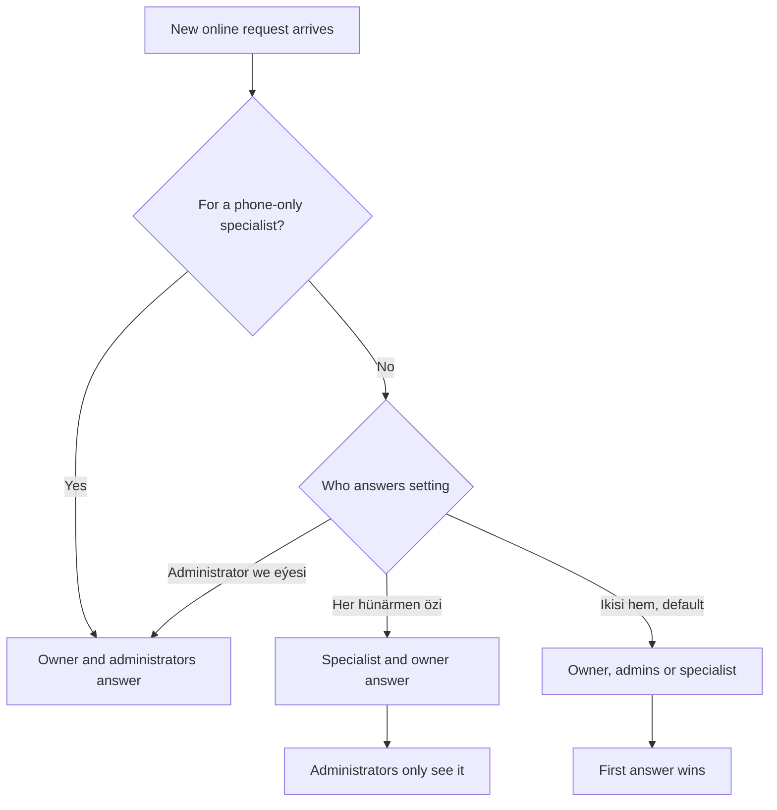

- *Administrator we eýesi* (Administrator and owner): specialists see their own requests but can't answer.
- *Her hünärmen özi* (Each specialist themself): each specialist answers their own; administrators only see.
- *Ikisi hem* (Both, the default): whoever answers first. The others see the answer within about 10 seconds (Q-273).
- The owner can always answer (B-Settings caption "Eýesi hemişe jogap berip bilýär").
- A per-person switch in the staff drawer, *Öz haýyşlaryna jogap berip biler* (Can answer own requests), can take the right away from one specialist (B-48).
- In a one-person workspace the setting is hidden: the owner answers everything.
- With instant confirmation there are no requests, so the setting is hidden too.
- Someone who can't answer sees a read-only footer instead of the buttons: "Haýyşlara administrator we eýesi jogap berýär — siz diňe görýärsiňiz." or "Aýna öz haýyşlaryna özi jogap berýär — siz diňe görýärsiňiz."

### Words used in this chapter

Request = *haýyş*. Booking = *ýazylyş*. Confirm = *Tassykla*. Decline = *Ret et*. Move = *Başga wagta geçir*. Complaint = *Arz et*. The five statuses, each with one icon everywhere (§3, §25.5): *Garaşylýar* (Pending, clock), *Tassyklandy* (Confirmed, check), *Tamamlandy* (Completed, double check), *Ýatyryldy* (Cancelled, x), *Gelmedi* (No-show, crossed person). Sources: *Onlaýn* (online), *Telefon* (phone), *Gelip ýazyldy* (walk-in).

Code differs (whole chapter): the levels, the fixed permission table, the "who answers requests" setting, the per-person override and invites with a 7-day expiry follow v0.5 since 19.10.2026 (ADR 0025); the business endpoints aren't built yet (chapter 10, P2 step 4), and internal statuses don't exist yet (step 3); "busy elsewhere" is in the booking engine since 20.10.2026, its calendar block comes with step 4.

## 1. Getting in and setting up

### B-01 · Discover Ýeral Biznes

**Goal** — A business owner learns what Ýeral Biznes is and starts for free.
**Who** — Anyone, signed out.

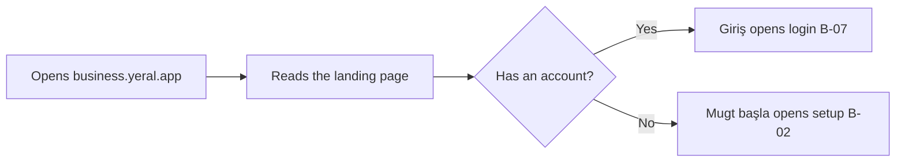

**Steps**

1. The person arrives from the yeral.app header link *Biznes üçin* (For business), a search, or a shared link.
2. The landing page shows: a header (*Mümkinçilikler* Features, *Nähili başlamaly* How to start, *Kömek* Help, *Giriş* Log in, primary *Mugt başla* Start free); a hero with a drawn calendar; *Kimler üçin* (who it's for: 10 categories including restaurants, cafés and yoga); six features; three start steps; the free band; a FAQ; a final call to action (§19).
3. The free band says "Ýeral Biznes mugt": all features, unlimited staff, SMS reminders free too, no card needed. It never says "for now" and shows no future prices (§19, §25.1).
4. The FAQ answers "Ýeral Biznes mugtmy?" (Is it free?) first: yes. It also explains that each address is its own workspace under one login, and that new businesses are checked by the Ýeral team within 24 hours.
5. *Mugt başla* or *Biznesimi döret* opens the setup wizard (B-02). *Giriş* opens login (B-07).

**Edge cases**

- Someone already signed in on yeral.app with the same phone: the wizard still starts at the phone step; the account is the same (B-02).
- Support phone and Telegram links are placeholders in the design (§24 lists them as open owner items).

**Status** — Design: drawn (B-Landing) · Code: not built.

### B-02 · Sign up: phone, code and name

**Goal** — A new business owner proves their phone and gets a Ýeral account (wizard step 1).
**Who** — Anyone. The person becomes the owner of the new workspace.

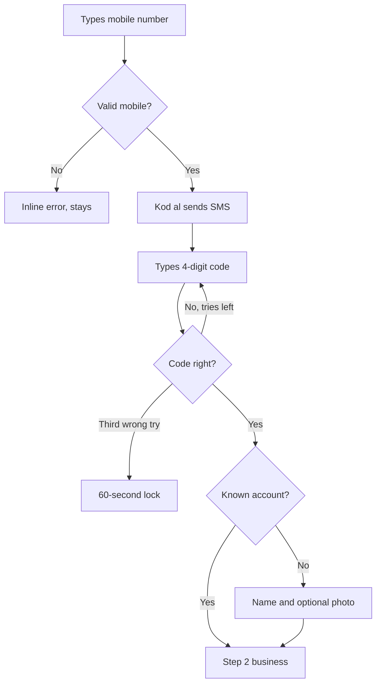

**Steps**

1. The wizard opens at `/tk/signup` with a left step list ("8 ädim · takmynan 5 minut · mugt") (§7).
2. Step 1 *Telefon*: "Telefon belgiňizi ýazyň — size 4 sanly SMS kod ibereris. Parol gerek däl." Hint: "Ýeral-y müşderi hökmünde ulanýan bolsaňyz, şol belgini ýazyň — bir hasap ikisi üçin hem ýeterlik." (use the same number as on yeral.app; one account covers both).
3. *Kod al* (Get code) sends a 4-digit SMS code. The code field auto-checks on the 4th digit; resend is possible after 0:59. At the first launch no SMS goes out: the sign-in code shows on the screen (Q-036, decided 18.10.2026).
4. A new person is asked their name (required), surname (optional) and an optional photo: "Ýeral hasabyňyz üçin — toparyňyz sizi şu at bilen görer. Siz biznesiň eýesi bolarsyňyz." (the team sees this name; you'll be the owner) (§11: the name is asked after the code).
5. The wizard moves to step 2 (B-03).
6. *Soňra dowam et* (Continue later) saves progress with the toast "Ýatda saklandy. Şu belgi bilen girip, galan ýerinden dowam edersiňiz." (log in with this number to continue where you left off).

**Edge cases**

- Short number: "Belgi doly däl: 8 san bolmaly." Landline: "Kod diňe mobil belgä iberilýär. +993 6… ýa-da 7… bilen başlaýan belgi ýazyň." (ROUND6-ANSWERS C1).
- Wrong code: "Kod nädogry. Ýene N synanyşyk galdy." After 3 wrong tries a 60-second lock: "Synanyşyklar gutardy. 60 sekuntdan soň täzeden synanyşyň."
- A person who already has an account skips the name step.
- "Eýýäm hasabyňyz barmy? Giriş" sends people with a workspace to login (B-07).
- A half-finished setup: the business exists as a draft from step 2. At the next login the wizard reopens at the saved step instead of the no-workspace card, and the draft joins the workspace switcher only when it's finished (Q-200, decided 18.10.2026).

> Open question Q-200: where a half-finished setup continues.

**Status** — Design: drawn (B-Onboarding · `step`) · Code: built for the phone, code, lock and landline rules (shared login, ADR 0019); the wizard is not built.

### B-03 · Describe the business: name, category, address

**Goal** — Name the business, pick its category and put it on the map (wizard steps 2–3).
**Who** — The new owner.

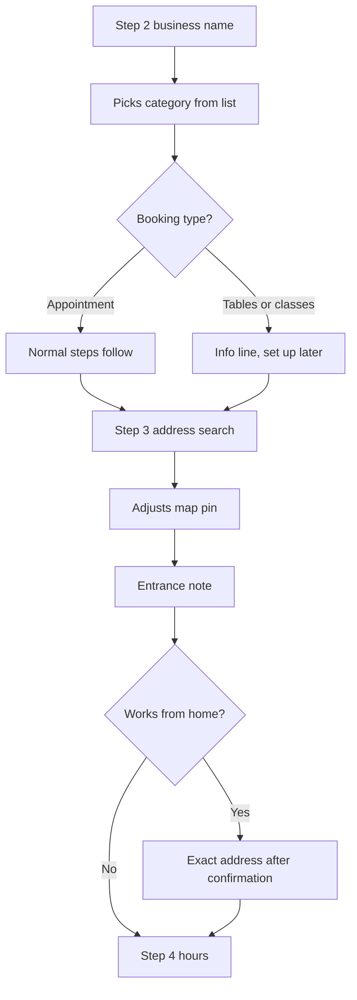

**Steps**

1. Step 2 *Biznes*: "Müşderiler sizi şu at we kategoriýa boýunça tapar. Kategoriýa başlangyç hyzmatlary hem teklip eder." The person types the business name; the page address preview appears ("Sahypaňyz: …").
2. They pick a category from a searchable, grouped list (Gözellik, Saglyk, Sport, Okuw, Awtoulag, Iýmit, Başga). The category sets the booking type (business demo data `categoriesForSignup`).
3. Table categories (*Restoran*, *Kafe we çaýhana*) carry the tag *Stol bronlamak*; class categories (*Fitnes studiýasy*, *Ýoga we stretçing*) carry *Topar sapaklary*. Picking one shows an info line that tables or classes are set up after the wizard in Sazlamalar → *Stollar* / *Sapaklar* (§7).
4. No match: "Kategoriýa tapylmady" + a button to pick "Başga — hyzmatlary özüm ýazaryn" (Other, I'll write my services).
5. Step 3 *Salgy* (Address): "Müşderiler sizi nirede tapar?" The person searches the address, then drags the map pin onto the entrance.
6. *Girelge nirede?* (Where is the entrance?) is an optional note that helps clients find the door.
7. Switch *Öýde işleýärin* (I work from home): "Takyk salgy diňe ýazylyş tassyklanandan soň görkeziler; kartada takmynan ýer görner." (the exact address shows only after a booking is confirmed; the map shows an approximate area) (§7).

**Edge cases**

- Name empty: "Biznesiň adyny ýazyň." No category: "Kategoriýa saýlaň." Address not from the list: "Salgyny sanawdan saýlaň."
- Table and class businesses skip the services step and the specialist part of the team step; step 8 ends with a checklist pointing to *Stollar* or *Sapaklar*, and online booking opens once at least one table or class exists (Q-201, decided 18.10.2026). This applies when tables and classes come, after the MVP (Q-030).

**Design to fix:** when tables and classes come, the wizard's table and class path: the skipped steps and the step 8 checklist (Q-201).

> Open question Q-201: setup for table and class businesses.

**Status** — Design: drawn (B-Onboarding · `step`, `homeBased`) · Code: schema only (business, category, address, hide-exact-address fields).

### B-04 · Set hours, services and team

**Goal** — Give the business its opening hours, a starter service list and its people (wizard steps 4–6).
**Who** — The new owner.

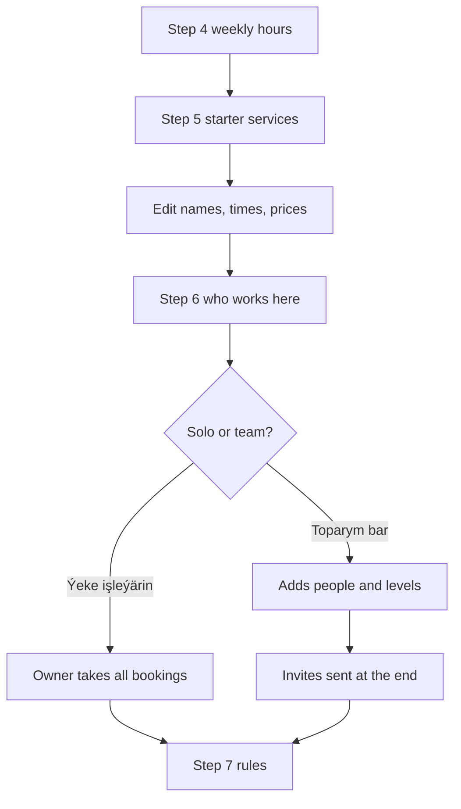

**Steps**

1. Step 4 *Iş wagty* (Hours): a weekly table with open/closed per day, from–to and an optional break. Shortcut *Iş günleri birmeňzeş* copies Monday to Tuesday–Friday (§11). Caption: staff shifts are added later; special days (holidays, leave) later in Sazlamalar.
2. Step 5 *Hyzmatlar* (Services): a starter list from the category with checkboxes and editable name, duration and price, plus *Hyzmat goş* (Add service). Who does which service, descriptions and photos come later in Sazlamalar → Hyzmatlar.
3. Step 6 *Topar* (Team): "Kim bilen işleýärsiňiz?" Two choices:
  - *Ýeke işleýärin* (I work alone): "Müşderiler hünärmen saýlamaz — ähli ýazylyşlar size geler." (clients don't pick a specialist; every booking comes to you).
  - *Toparym bar* (I have a team): each person gets a name, a phone and a level: *Hünärmen* (own calendar, own requests), *Administrator* (all calendars and clients, no money), or *Programmasyz* (no login, bookable online; you or an administrator answer their requests).
4. Caption for the team: "Her işgäre SMS bilen çakylyk salgysyny ibereris — 7 gün güýjünde." (each person gets an SMS invite link, valid 7 days). Phone-only people get no SMS. Invites go out from the final step (§11).

**Edge cases**

- No day open: "Iň az bir gün açyk bolmaly." Closing before opening: "Ýapylýan wagt açylýan wagtdan soň bolmaly." Break outside the day: "Arakesme iş wagtynyň içinde bolmaly."
- No service selected: "Iň az bir hyzmat saýlaň." A category without a starter list: "Bu kategoriýa üçin taýýar sanaw entek ýok. Hyzmatlaryňyzy aşakdan goşuň — 2–3 hyzmat başlamak üçin ýeterlik."
- Team chosen but nobody added: "Işgär goşuň ýa-da «Ýeke işleýärin» saýlaň." Missing name or phone: "Her işgäriň adyny we 8 sanly belgisini ýazyň."
- Table and class categories skip step 5 and the specialist part of step 6 (Q-201, decided 18.10.2026; after the MVP, Q-030).

> Open question Q-201: setup for table and class businesses.

**Status** — Design: drawn (B-Onboarding · `step`) · Code: rule only for hours (domain: weekly hours, breaks, special days); schema only for services and staff; invites not built.

### B-05 · Choose how bookings arrive

**Goal** — Decide between confirming each booking by hand or instantly, and set the matching rules (wizard step 7).
**Who** — The new owner.

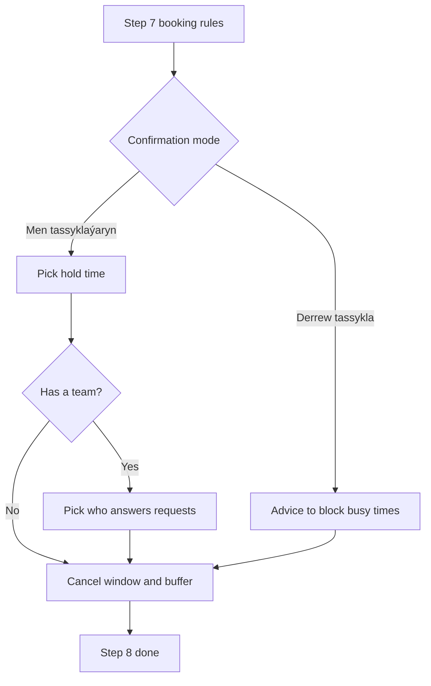

**Steps**

1. "Ýazylyşlar nähili gelsin?" Two cards: *Men tassyklaýaryn* (I confirm; recommended; each new booking arrives as a request) or *Derrew tassykla* (Confirm instantly; the client is booked as soon as they pick a time) (§2).
2. Manual: "Haýyşa näçe wagtda jogap berersiňiz?" Hold time 15 min, 30 min (default), 1, 2, 6 or 24 hours. "Bu wagtda jogap bermeseňiz, haýyş ýatyrylar we müşderä başga wagtlar hödürlener." (unanswered requests are cancelled and the client is offered other times).
3. Manual with a team: *Haýyşlara kim jogap berýär?* with the three options (see "Who answers a request" above). Caption: "Siz hemişe jogap berip bilýärsiňiz." (you can always answer).
4. Instant: "Müşderi derrew «Ýazylyş tassyklandy» görer. Boş däl wagtlaryňyzy senenamada ýapyp goýuň." (block your busy times in the calendar).
5. *Müşderi ýatyryp biler* (Client may cancel until…), with the same choices as in settings: any time, 1, 2, 6, 12, 24 or 48 hours before (Q-119, decided 18.10.2026); and *Hyzmatdan soňky arakesme* (buffer after a service; default 10 min, "Arakesme ýok" for none).
6. "Bularyň ählisini soňra Sazlamalarda üýtgedip bilersiňiz." (everything can be changed later).

**Edge cases**

- Busy times are blocked with *Wagty ýap* from an empty calendar slot (B-18, Q-204).

**Design to fix:** the wizard draws the cancel choices any time, 1, 2, 4, 12, 24 hours; it takes the settings list (§11, code): any time, 1, 2, 6, 12, 24, 48 hours (Q-119).

> Open question Q-119: free-cancel choices in the setup wizard and in settings.

**Status** — Design: drawn (B-Onboarding · `step=7`) · Code: rule only (domain: booking rules and their allowed values); no request-handling field yet.

### B-06 · Finish setup: link, QR and review

**Goal** — See the result, get the page link and QR code, and understand that the page opens after Ýeral checks it (wizard step 8).
**Who** — The new owner.

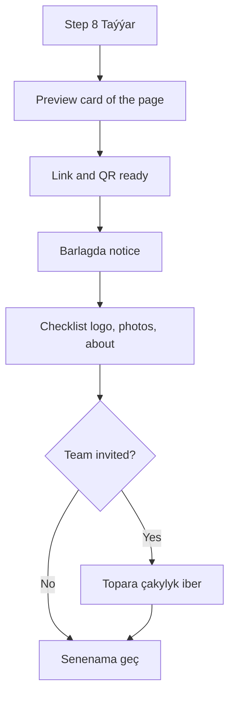

**Steps**

1. A preview card shows how clients will see the business after the check ("Barlagdan soň müşderiler sizi şeýle görer").
2. The page address `yeral.app/b/{slug}` with *Göçür* (Copy) and a QR code with *QR-y ýükle* (Download QR): "Salgyňyz we QR kodyňyz taýýar — barlagdan soň müşderiler üçin açylar." (ROUND6-ANSWERS F1).
3. The review notice: "Sahypaňyz barlagda — häzir ony diňe siz we toparyňyz görýärsiňiz. Barlagdan soň gözlegde we salgyňyzda hemmä açylar. Adatça 24 sagat çekýär."
4. "Senenamany häzirden ulanyp bilersiňiz: jaň edip ýa-da gelip ýazylanlary goşuň. Onlaýn ýazylyş barlagdan soň açylar." (use the calendar now for phone and walk-in bookings; online booking opens after the check).
5. A checklist "Profilyňyzy güýçlendiriň" (0 / 3): logo, 3+ photos, a description.
6. With a team: *Topara çakylyk iber* sends the SMS invites ("N işgäre SMS çakylyk iberildi · 7 gün güýjünde"). Then *Senenama geç* opens the calendar.

**Edge cases**

- Created from the workspace switcher (B-10): "Täze iş ýeri çep menýunyň ýokarsyndaky iş ýeri çalyşyjysynda peýda bolar — Glow Studio-a şol ýerden gaýdyp bilersiňiz." (the new workspace appears in the switcher).
- QR codes are not generated for real in the design (§11 "real QR generation" not designed).
- Table and class businesses (after the MVP): step 8 ends with a checklist pointing to *Stollar* or *Sapaklar* (Q-201, B-03).

**Status** — Design: drawn (B-Onboarding · `step=8`, `fromSwitcher`) · Code: rule only (the api already hides unverified businesses from the public); the step is not built.

### B-07 · Log in

**Goal** — A team member gets into the right workspace with phone and SMS code.
**Who** — Owner, Administrator, Specialist. Phone-only specialists never log in.

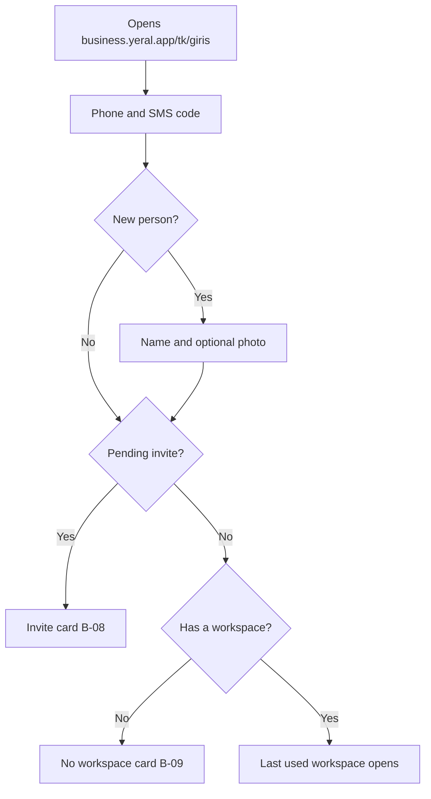

**Steps**

1. Login page *Ýeral Biznes-e giriň*: same phone step as sign-up, with "Biznesiňiz entek ýokmy? Mugt başlaň" for newcomers (B-Login).
2. Code step: "SMS kody ýazyň", *Belgini üýtget* (change number), resend countdown, auto-check on the 4th digit.
3. A new person gives a name: "Adyňyz näme? Belgiňiz tassyklandy. Ýeral hasabyňyz üçin adyňyzy ýazyň — toparyňyz sizi şu at bilen görer."
4. Routing (§1): a pending invite first (B-08); a half-finished setup → the wizard at its saved step (Q-200, decided 18.10.2026); no workspace → B-09; otherwise the **last used workspace** opens with "Glow Studio açylýar…", the person's level and address.
5. With several workspaces: "Siziň 2 iş ýeriňiz bar. Soňky işlän ýeriňizi açýarys; beýlekisini çep menýunyň ýokarsyndan saýlap bilersiňiz." A button *Garaşman, senenamany aç* skips the wait.

**Edge cases**

- Landline, short number, wrong code, lock: as in B-02 (C1; "Synanyşyklar gutardy. Täze kod alyň.").
- An expired invite shows the expired card (B-08).
- Someone who only books as a client and has no workspace and no invite sees B-09, which also links to yeral.app.

> Open question Q-200: where a half-finished setup continues.


**Status** — Design: drawn (B-Login · `step` phone, phoneLandline, code, name, routing) · Code: built for phone login (api, ADR 0019); workspace routing not built.

### B-08 · Accept or decline an invite

**Goal** — An invited person joins the team, or says no.
**Who** — The invited person, after logging in with the invited phone.

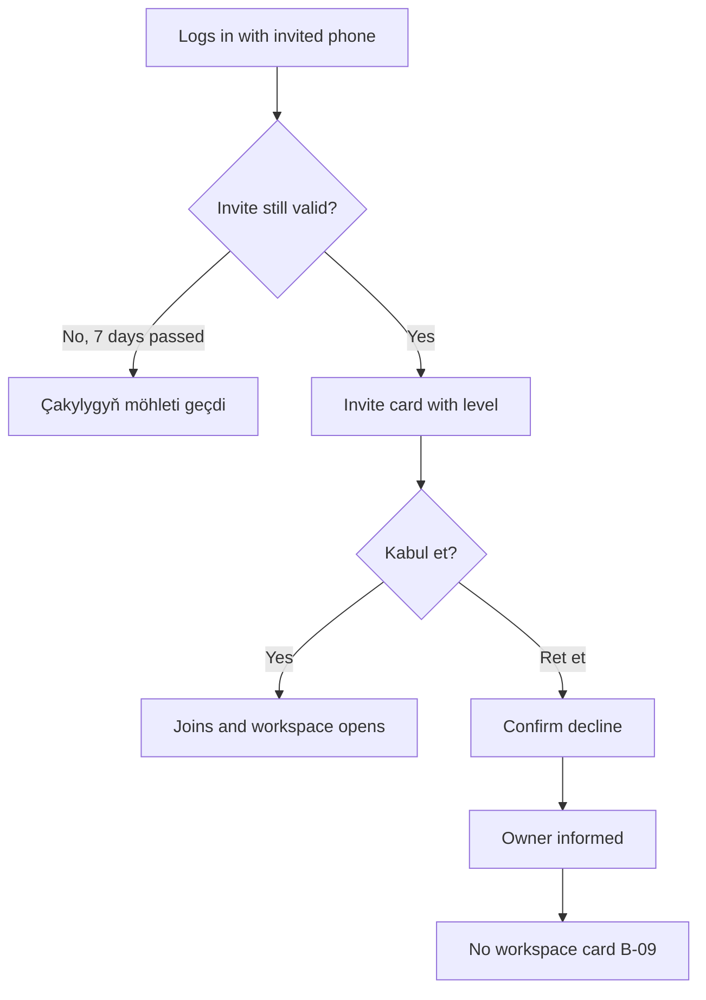

**Steps**

1. The card shows the business logo, name, category and address: "Glow Studio sizi topara çagyrýar", "Maýsa Annaýewa sizi **Hünärmen** hökmünde goşdy".
2. Three lines explain what the level can do, for example "Öz senenamaňyzy we ýazylyşlaryňyzy görersiňiz", "Öz haýyşlaryňyza jogap berip bilersiňiz", "Öz müşderileriňizi we girdejiňizi görersiňiz", and "Rugsatlary biznesiň eýesi sazlaýar." (the owner sets permissions).
3. "Çakylyk 19 oktýabra çenli işleýär" (valid until). Buttons *Kabul et* (Accept) and *Ret et* (Decline).
4. Accept: the person joins with the invited level and the workspace opens (COMPONENTS InviteCard). The owner's notification *Topar* says the invite was accepted.
5. Decline asks once: "Çakylygy ret edýärsiňizmi? Maýsa Annaýewa habar alar. Soňra goşulmak isleseňiz, täze çakylyk gerek bolar." *Hawa, ret et* / *Yza*.
6. After declining, the no-workspace card shows with "Glow Studio-nyň çakylygyny ret etdiňiz." on top.

**Edge cases**

- Expired: "Çakylygyň möhleti geçdi. Her çakylyk 7 gün işleýär. Glow Studio-nyň 12 oktýabrda iberen çakylygy 19 oktýabrda gutardy. Eýesinden täzeden ibermegini haýyş ediň — täze çakylyk şu ýerde peýda bolar."
- Wrong account on this device: "Siz: … · Başga belgi bilen gir" (log in with another number).
- The invite was for a number the person no longer uses: only the owner can send a new invite to the new number (B-45).
- Several pending invites at once: not drawn.

**Status** — Design: drawn (B-Login · `step=invite`, `inviteExpired`) · Code: schema only (memberships have an "invited" status, no expiry date) · not built.

### B-09 · No workspace yet

**Goal** — Someone with an account but no workspace either creates one or asks to be invited.
**Who** — Any signed-in person without workspaces or invites.

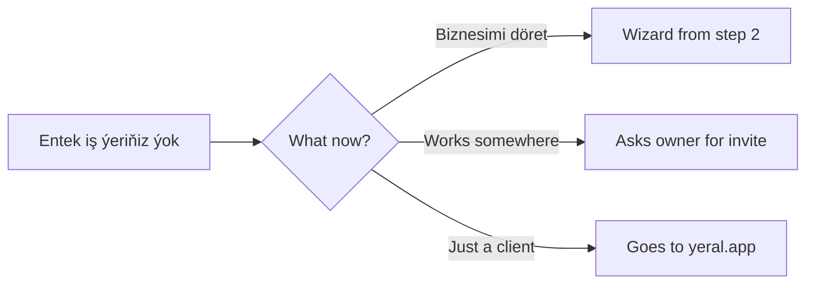

**Steps**

1. Card: "Entek iş ýeriňiz ýok. Biznesiňizi açyň: senenama, onlaýn ýazylyş we müşderi bazasy — mugt."
2. *Biznesimi döret* opens the setup wizard from step 2, already signed in (§1).
3. Info: "Bir biznesde işleýärsiňizmi? Eýesinden telefon belgiňize çakylyk ibermegini haýyş ediň — çakylyk şu ýerde peýda bolar."
4. Link: "Ýeral-da müşderi hökmünde ýazylmak · yeral.app".

**Edge cases**

- A person who left their only workspace (B-15) lands here at the next login.

**Status** — Design: drawn (B-Login · `step=empty`) · Code: not built.

### B-10 · Switch workspace or create another one

**Goal** — Move between workspaces, or open a new business at another address.
**Who** — Anyone who logs in. Creating a new workspace makes the person its owner.

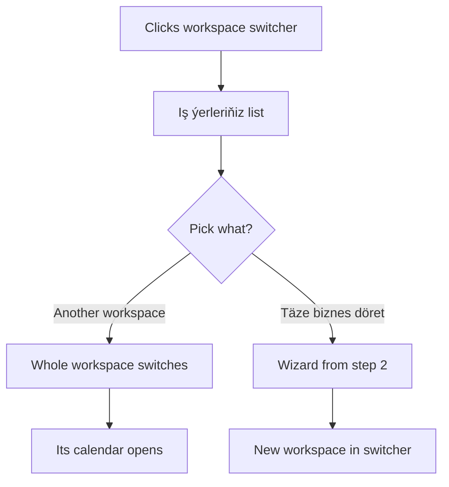

**Steps**

1. The switcher sits at the top of the sidebar: logo, name, the person's level (§9). It is the only switch in the app (§1).
2. The popover *Iş ýerleriňiz* lists each workspace with "level · address" and an amber count of unanswered requests this person can answer there; the current one has a check.
3. Picking a row changes everything: calendar, team, clients, settings, numbers, and the person's level (B-Shell). Its calendar opens. Every page address names the workspace, for example `/tk/w/{slug}/calendar`, so links, tabs and notifications always open the right workspace; the switcher just changes the address (Q-202, decided 18.10.2026).
4. *+ Täze biznes döret* opens the wizard from step 2, already signed in ("Her iş ýeri — bir biznes we bir salgy… Hasabyňyz şol bir galýar, siz täze biznesiň eýesi bolarsyňyz."). The left panel says "7 ädim".
5. On a tablet the logo at the top of the icon rail opens the switcher; on a phone it sits in the top strip (§9).

**Edge cases**

- A request in another workspace raises only the count in the switcher; toasts and sounds are for the current workspace (B-Shell).
- The bottom user block is a menu, not a switcher (§1).
- A new workspace is a new business, so it goes through the Ýeral check again (B-11).

**Design to fix:** the screens draw workspace pages without the workspace (`/tk/calendar`, `/tk/settings/…`); every page address carries it (`/tk/w/{slug}/…`, Q-202).

> Open question Q-202: does the page address name the workspace.

**Status** — Design: drawn (B-Shell · switcher; B-Onboarding · `fromSwitcher`; B-Mobile) · Code: schema only (one person can have memberships in several businesses) · not built.

### B-11 · Verification as the business sees it

**Goal** — The business understands that its page is in review, what works already, and what opens later.
**Who** — Everyone in a new workspace.

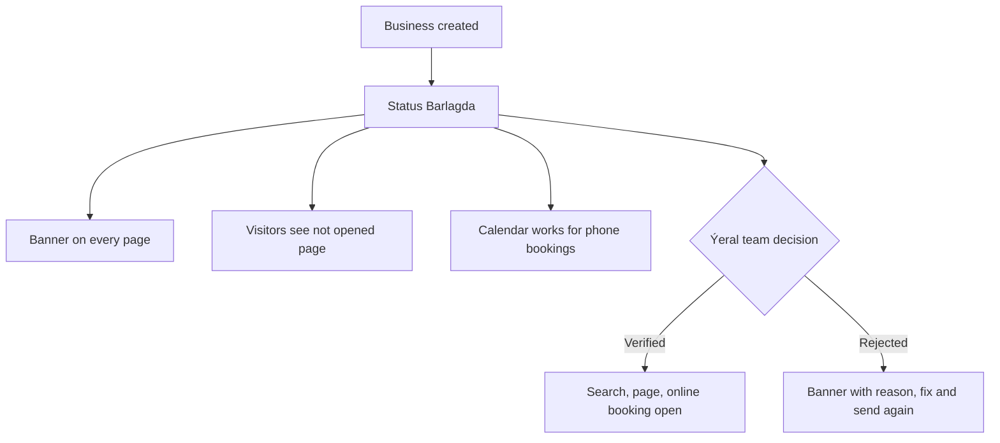

**Steps**

1. A new business has status *Barlagda* (In review). The Ýeral team checks new businesses, usually within 24 hours (§7): a call to the business phone, then a look at the name, the address on the map, the category and the photos (Q-276, decided 18.10.2026).
2. A banner sits above every page until verified and can't be dismissed: "Sahypaňyz barlagda — häzir ony diňe siz we toparyňyz görýärsiňiz. Barlagdan soň gözlegde we salgyňyzda hemmä açylar. Senenamany häzirden ulanyp bilersiňiz." (§26 F1, B-Shell).
3. Until then: the business is not in search; a visitor at the link sees "Bu sahypa entek açylmady" with "Biznes Ýeral-a täze goşuldy we barlagdan geçýär. Adatça 24 sagat çekýär." and *Başga ýerleri gözle*, with no business details (F1). The owner and team see their own page with the preview banner.
4. Online booking opens only after the check; the calendar works at once for phone and walk-in bookings (B-Onboarding step 8).
5. When verified, the owner gets the notification *Ýeral: barlag we täzelikler* ("sahypaňyz barlagdan geçende") (§16). The settings show "Barlandy · sahypaňyz gözlegde görünýär" (COMPONENTS VerificationStatus).

**Edge cases**

- Rejected verification (the data model's "rejected" status with a reason, §10): the workspace shows a banner with the reason and a way to fix and send again; visitors keep seeing "Bu sahypa entek açylmady" (Q-274, decided 18.10.2026).
- The Ýeral team verifies businesses in a small admin tool designed for launch (Q-010, decided 18.10.2026).

**Design to fix:** the rejected-business banner with the reason and a way to fix and send again (Q-274); the launch admin tool for the Ýeral team, built on the business app's patterns (Q-010, revised 20.10.2026).

> Open question Q-010: what the Ýeral team can do at launch, and with which tool.

> Open question Q-274: what a rejected business sees.

> Open question Q-276: what the Ýeral team checks before verifying.

**Status** — Design: drawn (B-Shell · verification banner; Venue · `ownerPreview`; States tile 11) · Code: the api answers visitors `in_review` and gives the team its page as a `preview` with the owner's reason (F-032); the banner, the pages and the review process come with the apps and the admin tool.

## 2. My account

### B-12 · Profilim: name, photo and the person menu

**Goal** — See and edit one's own account, which is the same in every workspace.
**Who** — Anyone who logs in.

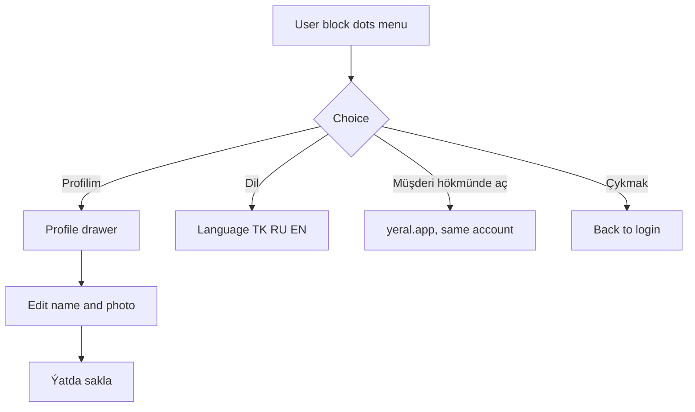

**Steps**

1. The bottom of the sidebar shows the person: avatar, name, phone and a "…" button (§9). The menu: *Profilim* · *Dil* (Language) · *Müşderi hökmünde aç* (Open as client, goes to yeral.app with the same account) · *Çykmak* (Log out, back to `/tk/giris`).
2. *Profilim* opens a right drawer (a bottom sheet on phones): "Profilim · Ýeral hasabyňyz — ähli iş ýerleriňizde birmeňzeş" (your Ýeral account, the same in all workspaces).
3. Name and photo: "Toparlaryňyz sizi şu at bilen görýär." Saved with *Ýatda sakla*.
4. Phone with *Belgini üýtget* (B-13).
5. *Iş ýerlerim* (My workspaces): each workspace with the person's level and specialization. The specialization is read-only: "Hünäriňizi her iş ýeriniň eýesi Topar bölüminde belleýär." (each owner sets it in Topar).
6. Leaving a workspace (B-15) sits at the bottom. The drawn busy-elsewhere switch is dropped: "Başga ýerde" always applies (B-14, Q-271).

**Edge cases**

- The name in the account is the person's own; the name clients see on the booking site is set by the owner per workspace (B-44).

**Status** — Design: drawn (B-Shell · user menu, Profilim; B-Mobile) · Code: built for name and language on the account (api `/me`); photo, workspaces list and specializations not built.

### B-13 · Change my phone number

**Goal** — Move the account to a new phone number.
**Who** — Anyone who logs in, for themself only.

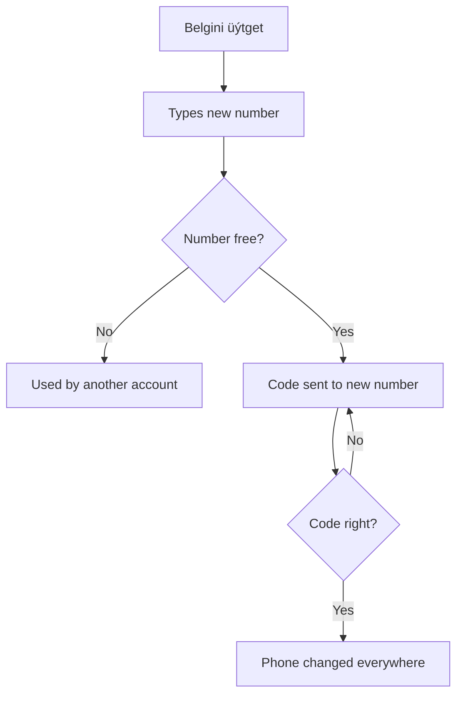

**Steps**

1. In Profilim, *Belgini üýtget* expands in place: "Şu belgi bilen Ýeral Biznes-e we yeral.app-a girýärsiňiz. Täze belgä SMS kod ibereris."
2. Step 1 *Täze belgi*: new number, *Kod iber* (Send code) or *Ýatyr*.
3. Step 2 *SMS kod*: the code goes to the **new** number; it checks itself on the 4th digit. "Täze belgi tassyklanýança köne belgi bilen girip bilersiňiz." (until confirmed, the old number still works).
4. Done: the row collapses and the toast says "Telefon belgisi üýtgedildi". The login phone changes for every workspace and for yeral.app; teams see the new number (B-Shell).

**Edge cases**

- The number belongs to another Ýeral account: "Bu belgi başga hasapda ulanylýar".
- Wrong code and lock: as in B-02.
- An owner can't change a team member's login phone: "Bu belgi — onuň Ýeral hasaby. Belgini işgäriň özi SMS kody bilen üýtgedýär." (B-Team).
- Code: changing the phone also signs the person out on other devices (ADR 0019); the design doesn't mention this.

**Status** — Design: drawn (B-Shell · Belgini üýtget) · Code: built (api: phone change by SMS code).

### B-14 · Show my other bookings as "Başga ýerde"

**Goal** — A person who works in two workspaces never gets double-booked across them. Part of the MVP (Q-031, decided 18.10.2026).
**Who** — Anyone who is bookable in two or more workspaces.

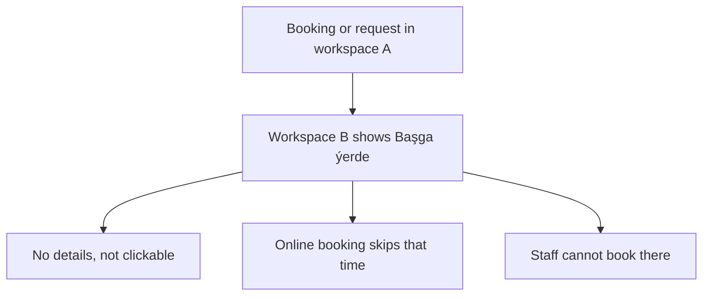

**Steps**

1. There is no switch: "Başga ýerde" always blocks the time and never shows details. The drawn Profilim switch "Beýleki iş ýerlerimdäki wagtymy «Başga ýerde» görkez" is dropped (Q-271, decided 18.10.2026).
2. What blocks: confirmed bookings and waiting requests where she is the specialist, with their buffers, and nothing else (Q-272, decided 18.10.2026).
3. In the other workspace's calendar that time appears as a dashed grey block with a briefcase, "Başga ýerde": a reserved gap that nobody can book, with nothing from the other workspace, no client, service or business (§4 layers; Q-031).
4. Clicking an empty slot under it, or dropping a booking there, is refused with a toast: "Aýna 19:00–20:00 aralygynda başga ýerde işleýär — bu wagta ýazylyş goşup bolmaýar." (for herself: "Siz … başga ýerde işleýärsiňiz").
5. Online booking and the "nearest free times" in the new-booking drawer skip those times.

**Edge cases**

- Her waiting requests in the other workspace block too (Q-272); the demo data shows only her confirmed 19:00–20:00 booking as "Başga ýerde", not her pending 20:15–21:00 request.

**Design to fix:** drop the Profilim switch and its caption (B-Shell, ProfileDrawer); show her waiting requests and the buffers as "Başga ýerde" too, still with no details (Q-271, Q-272).

> Open question Q-271: what the «Başga ýerde» switch controls.

> Open question Q-272: which bookings block a person elsewhere.

**Status** — Design: drawn (B-Shell; B-Calendar · Aýna 19:00–20:00; B-Mobile) · Code: not built (availability doesn't look at other workspaces).

### B-15 · Leave a workspace

**Goal** — A team member stops working in one workspace and keeps their account.
**Who** — Administrator, Specialist. The owner can't leave until they transfer ownership.

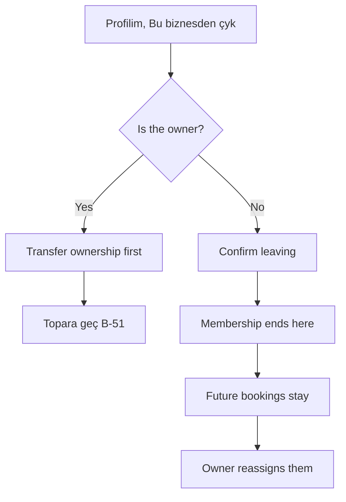

**Steps**

1. In Profilim, *Bu biznesden çyk* (Leave this business) applies to the current workspace only.
2. Confirm: "Glow Studio-dan çykýarsyňyzmy?" *Hawa, çyk* / *Yza*.
3. The account and other workspaces stay. Leaving works like *Işgäri öçür* with *Bolşy ýaly galdyr* (B-50): she is no longer bookable, her future bookings stay in her column, and the owner gets a notification that opens the remove flow to move or cancel them (Q-203, decided 18.10.2026).
4. The owner instead sees: "Siz Glow Studio-nyň eýesi. Biznesden çykmak üçin ilki eýeçiligi başga adama geçiriň: Topar → «Eýeçiligi geçir»." with *Topara geç*.

**Edge cases**

- Leaving the only workspace: the next login shows "Entek iş ýeriňiz ýok" (B-09).
- Until the owner acts, her bookings stay as they are for the clients (Q-203).

**Design to fix:** the owner's notification that someone left, which opens the remove flow (B-50) for their future bookings (Q-203).

> Open question Q-203: what happens to bookings when a specialist leaves.

**Status** — Design: drawn (B-Shell · Profilim, Aýna) · Code: not built.

## 3. The calendar

### B-16 · Read the day: all staff

**Goal** — See today's work for everyone at a glance and act on it.
**Who** — Owner and Administrator by default (permission "see every staff member's calendar"). Specialists see their own column (B-17).

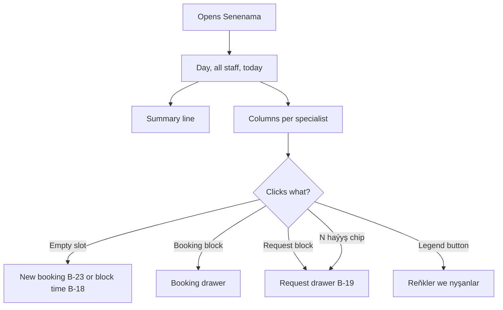

**Steps**

1. Header (§4): date navigation (*Şu gün* Today, ‹ ›, date picker), view *Gün / Hepde* (Day / Week), staff *Ähli işgärler / Bir işgär* (All staff / One staff), the chip "N haýyş" (opens the most urgent request), the toggle *Ýatyrylanlary görkez* (Show cancelled), the legend button, and the primary *Täze ýazylyş* (New booking).
2. Summary line: "16 ýazylyş · 3 haýyş · Girdeji (meýilleşdirilen): 1 410 TMT". The count is every booking that isn't cancelled, including requests and no-shows. Planned revenue = prices of confirmed, pending and completed bookings, shown only with "See revenue" (§4).
3. One column per bookable specialist (minimum 200 px, scrolls sideways when there are many). Column head: avatar, name, role, "5 ýazylyş"; phone-only staff marked "programmasyz".
4. The grid shows 08:00–21:00 and scrolls to the rest; 15-minute rows. A violet "now" line with the time in the gutter.
5. Booking blocks start with the status icon, then time, client and service; a phone or person icon for phone or walk-in bookings; a warning icon when the client has an alert note; the internal status chip when used (B-29) (§3, §4).
6. Requests are dashed with a timer pill ("18 min"); cancelled bookings are outline-only with the name struck and hidden unless *Ýatyrylanlary görkez* is on; selection is an ink ring (§25.5).
7. Layers (§4): outside working hours = flat light grey; break *Arakesme* = grey with a coffee icon; blocked time *Ýapyk* = grey with a lock and the reason ("Ýapyk · Okuw"); buffer after a service = diagonal hatching ("Hyzmatdan soňky arakesme · 10 min"), not bookable; a staff day off = the whole column shaded with *Dynç güni*; *Başga ýerde* = dashed grey with a briefcase (B-14).
8. The legend *Reňkler we nyşanlar* explains statuses, sources, layers and (when on) internal statuses. It opens by itself on the first visit; *Düşnükli* closes it (§3).
9. A new request arrives as a toast at the bottom left, "Täze haýyş: Ejegyz T. · Aýna · şu gün 15:30" with *Aç*, a soft sound, and a browser notification when the tab is in the background (B-Shell).

**Edge cases**

- Administrator without "See revenue": the summary has no money (§4).
- Empty grid slots are not keyboard stops; keyboard users use *Täze ýazylyş* (§11).
- Opening a day with special hours or closed (*Ýapyk · Täze ýyl*) shades the columns with the name.
- Drawers open on the right (480 px) and keep the calendar usable; one at a time; Esc closes (§4, §11).

**Status** — Design: drawn (B-Calendar · `view=dayAll`, `role`, `legend`) · Code: rule only (domain: day summary, staff working day, breaks, special days); no screen.

### B-17 · One staff, week views and the phone layout

**Goal** — Focus on one person, or look at the week's load.
**Who** — Owner and Administrator for any staff; a Specialist always sees only their own column (§4, round 6).

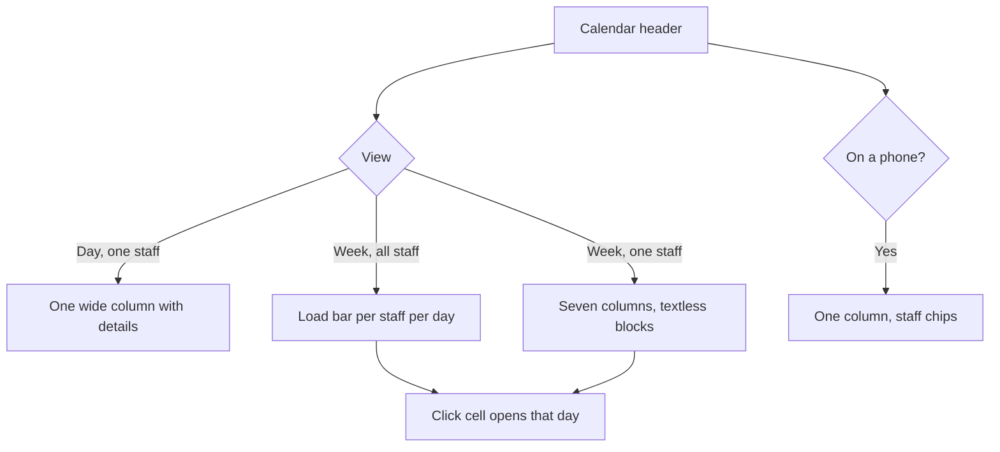

**Steps**

1. *Bir işgär* (One staff) + a staff picker: one wide column with room for notes and client info in blocks (§4).
2. A specialist always gets this view of their own column. Their summary shows their own planned earnings, not the business revenue (§4).
3. *Hepde · Ähli işgärler* (Week, all staff): rows = staff, columns = 7 days; each cell = a load bar (booked minutes / working minutes) and "5 ýazylyş · 1 haýyş"; clicking a cell opens that day. Caption: "Zolak — iş wagtynyň näçe bölegi ýazylyşlar bilen dolandygyny görkezýär."
4. *Hepde · Bir işgär* (Week, one staff): 7 day columns with textless blocks (status colour only); clicking opens that day.
5. Phone (under 768 px): bottom tab bar *Senenama · Ýazylyşlar · Müşderiler · Köp*; the day calendar shows one staff column at a time with staff chips (amber dot when they have requests); a date strip; it opens at one hour before now; swiping changes the day; tapping the round "+" opens the quick booking sheet (B-24); tapping an empty slot first offers *Täze ýazylyş* or *Wagty ýap*, as on a computer (Q-204). Tablets get a 72 px icon rail (§1, §9).

**Edge cases**

- A specialist with "see every staff member's calendar" switched on by the owner gets the all-staff views like an administrator.
- ADR 0018 plans to send other people's bookings as "busy" without details to a person who can't see them; the v0.5 screens instead show a specialist only their own column.

**Status** — Design: drawn (B-Calendar · `view=dayOne`, `weekAll`, `weekOne`, `role=specialist`; B-Mobile) · Code: not built.

### B-18 · Block time in the calendar

**Goal** — Close part of a day for one person ("Ýapyk · Okuw", a training, a personal errand) so nobody books it.
**Who** — The same people who may add bookings: Owner, Administrator; a Specialist for themself (Q-204, decided 18.10.2026).

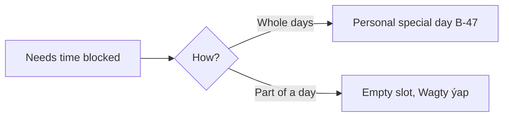

**Steps**

1. The calendar draws blocked time as a grey block with a lock and a reason, part of the staff schedule (§4: "Ýapyk · Okuw", Jeren 16:30–17:30).
2. The setup wizard tells instant-confirmation businesses "Boş däl wagtlaryňyzy senenamada ýapyp goýuň." (block your busy times in the calendar).
3. Clicking an empty slot offers *Täze ýazylyş* (New booking) or *Wagty ýap* (Block time). Block time asks for the person, from–to, a reason and an optional repeat (Q-204, decided 18.10.2026). Whole days off stay personal special days (B-47).

**Edge cases**

- A block can't cover existing bookings (Q-204).

**Design to fix:** the empty-slot choice *Täze ýazylyş* / *Wagty ýap* and the block-time form: person, from–to, reason, optional repeat (Q-204).

> Open question Q-204: how to block time in the calendar.

**Status** — Design: text only (layer drawn, creation not designed) · Code: api built (20.10.2026): `GET`/`POST /v1/w/{slug}/calendar/blocks`, `DELETE …/blocks/{id}` (one, or the rest of its weekly repeat); a block is busy time for every free-time search, a move onto it is `cannot_move` (`blocked`), one over a booking is `block_over_bookings`.

### B-19 · Answer a booking request

**Goal** — Confirm a client's online request before its hold time runs out.
**Who** — Depends on the "who answers" setting and the per-person override (see the intro); the owner can always answer.

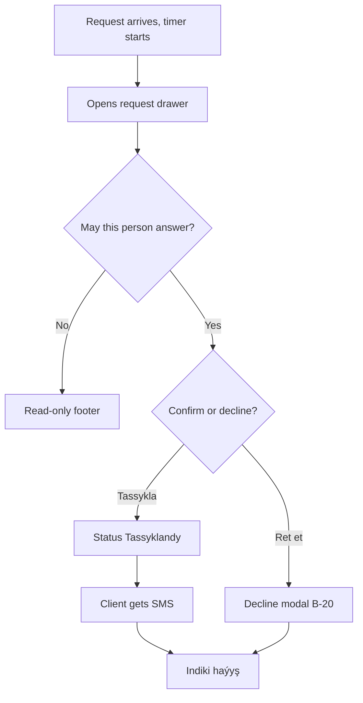

**Steps**

1. Requests show everywhere they matter: sidebar badge on *Ýazylyşlar*, the "N haýyş" chip, dashed blocks, the toast and sound, the browser notification (§2).
2. The request drawer opens the most urgent request first (least time left); a pager "1 / 5" steps through them (§11).
3. The drawer shows: the timer "Jogap bermäge 18 min galdy"; the client (name, phone, "3-nji gelşi" or *Täze müşderi*, no-show count if any, alert notes); services with duration and total price; specialist; date and time; the client's note; "Jogap berilmese, haýyş {time} awtomatik ýatyrylar we müşderä 3 başga wagt teklip ediler."; link *Müşderiniň kartyna geç* (§4).
4. *Tassykla* (Confirm): the booking becomes *Tassyklandy*; toast "Ýazylyş tassyklandy · müşderä SMS iberildi". The client gets "Ýeral: {business} ýazylyşyňyzy tassyklady…" (client spec §6).
5. After answering, an *Indiki haýyş* (Next request) button appears when more are waiting (§11).
6. With *Ikisi hem*, whoever answers first wins; the others see the answer within about 10 seconds (B-Settings; Q-273).

**Edge cases**

- The viewer may not answer: the footer reads "Haýyşlara administrator we eýesi jogap berýär — siz diňe görýärsiňiz." or "Aýna öz haýyşlaryna özi jogap berýär — siz diňe görýärsiňiz." In the list such rows show "Jogap: administrator" or "Jogap: Aýna" instead of buttons.
- A phone-only specialist's request: only the owner and administrators can answer.
- The hold time ran out while the drawer was open: the request is already cancelled by the system (B-22). Code: answering an expired request is refused.
- The timer pill turns "hot" at 15 minutes or less; the notification "Haýyşyň wagty gutarýar" comes 5 minutes before (§16).
- Two requests for overlapping times with the same specialist can't both exist: a request holds its slot (ADR 0017).

Code differs: outside production, demo businesses answer their own requests automatically. At the first launch, example businesses confirm at once instead (Q-004, decided 18.10.2026).

> Open question Q-004: who the first launch is for.

**Status** — Design: drawn (B-Calendar · `panel=request`, `answers`; B-Bookings; B-Mobile) · Code: api built (`GET /v1/w/{slug}/requests`, `POST …/requests/{code}/confirm`, 20.10.2026): the requests each person may see, most urgent first, with the client's visits and no-shows and whether they may answer; alert notes come with the client card.

### B-20 · Decline a request with offered times

**Goal** — Say no to a request with a reason the client sees, and offer up to 3 other times the client can take in one tap.
**Who** — Same as B-19.

```mermaid
flowchart TD
  A["Ret et"] --> B["Picks a reason chip"]
  B --> C{"Başga sebäp?"}
  C -->|"Yes"| D["Writes short text"]
  C -->|"No"| E{"Offer other times?"}
  D --> E
  E -->|"Yes"| F["Picks up to 3 slots"]
  E -->|"No"| G["Ret et confirms"]
  F --> G
  G --> H["Cancelled by business"]
  H --> I["Client SMS with reason"]
```

**Steps**

1. *Ret et* opens the decline modal "Haýyşy ret etmek": "Müşderi sebäbi görer." (the client will see the reason) (§2).
2. Reason chips: *Bu wagt boş däl* (This time isn't free), *Hünärmen ýok* (No specialist), *Bu hyzmaty edip bilmeýäris* (We can't do this service), *Başga sebäp* (Other reason). "Başga sebäp" opens a text box: "Sebäbini gysgaça ýazyň — müşderi görer" (§4, §11).
3. Optional switch *Başga wagt teklip et* (Offer another time): "Müşderi teklip edilen wagty bir basyşda kabul edip biler". Slot chips computed from free times; "1 / 3 wagt saýlandy"; "Iň köp 3 wagt saýlap bilersiňiz" (§11).
4. The danger button *Ret et* finishes. Toast: "Haýyş ret edildi · müşderä sebäbi we 2 başga wagt iberildi".
5. The booking is *Ýatyryldy*, cancelled by the business. The client sees "Biznes ret etdi", the reason, and the offered times as chips. Tapping one creates a booking that is **confirmed at once** (ROUND6-ANSWERS A1).

**Edge cases**

- An offered time gets taken before the client taps it: the client sees "Eýýäm eýelendi" on that chip (A1).
- All offered times have passed: the client sees "Teklip edilen wagtlaryň möhleti geçdi" + *Başga wagt saýla* (A1). An offered time counts as past once it's earlier than now plus the lead time, like any other booking (Q-264, decided 18.10.2026).
- One booking per declined request: after the client takes one time, the other chips go (A1).
- A client blocked to phone-only (B-35) can still take times the business offered (A7).
- Bulk decline from the list asks one reason for all and offers no times (B-31).

> Open question Q-264: when an offered time counts as past.

**Status** — Design: drawn (B-Calendar · `panel=decline`; B-Bookings; B-Mobile) · Code: api built (`POST /v1/w/{slug}/requests/{code}/decline`, 20.10.2026): the reason, "other" in words, up to 3 offered times each checked free for its specialist and ahead by the lead time, the SMS with the reason.

### B-21 · Answer a move request (Wagt üýtgetmek)

**Goal** — Accept or refuse a client's request to move a confirmed booking to a new time.
**Who** — Same rule as new requests (§26 A3).

```mermaid
flowchart TD
  A["Client asks new time"] --> B["Original stays confirmed"]
  A --> C["Ghost block Täze wagt?"]
  B --> D["Move request drawer"]
  C --> D
  D --> E{"Fits and answer?"}
  E -->|"Täze wagty tassykla"| F["Booking moves, SMS sent"]
  E -->|"Ret et"| G["Reason only, stays put"]
  E -->|"No answer in time"| H["Request dropped, stays put"]
```

**Steps**

1. At a business with manual confirmation, a client's move arrives as a request of type *Wagt üýtgetmek* (Change time). At an instant business the booking simply moves (A3).
2. In the list (Haýyşlar tab) the row reads "Anna 16 · 10:00 → Şenbe 17 · 11:30" with a *Tassyklandy* badge, a dashed tag "Wagt üýtgetmek", the timer and the accept and decline buttons (§26).
3. In the calendar the original block stays where it is, confirmed, with a timer and "→ Şenbe 17 · 11:30?". A dashed ghost block *Täze wagt?* holds the asked slot. Hovering or selecting either rings both. The original can't be dragged while the request is open (COMPONENTS BookingBlock).
4. The drawer "Wagt üýtgetmek haýyşy" shows *Öňki wagt* (old) → *Täze wagt* (new), each with *Görkez* (Show), the line "Ýazylyş: Tassyklandy · öňki wagty haýyş jogaplanýança saklanýar", and a fit line: "Maral täze wagtda boş — tassyklap bolýar." or "… boş däl — tassyklap bolmaýar." (then the accept button is disabled).
5. "Tassyklasaňyz, ýazylyş täze wagta geçer we müşderä SMS gider. Ret etseňiz, öňki wagtynda galar."
6. *Täze wagty tassykla*: the booking moves; toast "Täze wagt tassyklandy: …".
7. *Ret et*: the decline modal "Täze wagty ret etmek" has reasons only, without offered times; toast "Täze wagt ret edildi · ýazylyş öňki wagtynda galýar · müşderä sebäbi iberildi".

**Edge cases**

- No answer within the hold time: the request is dropped and the booking stays; the client sees "Täze wagt kabul edilmedi — ýazylyşyňyz öňki wagtynda galýar." (A3). A move's deadline never runs past the original visit's start (Q-263, decided 18.10.2026).
- The client asks a second move: it replaces the first (A3).
- The client cancels the booking: the waiting move is withdrawn too (A3).
- The client withdraws the request (*Haýyşy yzyna al*): the ghost disappears.
- Same specialist only: no silent swap to someone else (A5).
- Only appointments can be moved by the client; table and class bookings can't (A4).
- The ghost counts in "N haýyş" and blocks its slot for other bookings.

Code differs: today a client's move can land on another free specialist when the chosen one is busy; A5 forbids this silent swap.

> Open question Q-263: a waiting move that outlives the original time.

**Status** — Design: drawn (B-Calendar · `panel=move-request`; B-Bookings · `panel=move-request`; B-Mobile) · Code: api built (20.10.2026): moves appear among the requests (`kind: move`, with the old time); confirming moves the booking; declining keeps it, records the reason and texts the client.

### B-22 · A request runs out of time

**Goal** — Make sure no request waits forever: unanswered requests end on their own and the client gets other times.
**Who** — The system. Everyone who can see the request sees the result.

```mermaid
flowchart TD
  A["Request with hold time"] --> B["Timer counts down"]
  B --> C["5 minutes left notice"]
  C --> D{"Answered in time?"}
  D -->|"Yes"| E["Normal answer B-19"]
  D -->|"No"| F["Cancelled by system"]
  F --> G["Client SMS with 3 times"]
  F --> H["Ýatyrylan tab, hourglass"]
```

**Steps**

1. Each request holds its slot until the business's hold time ends (15 min – 24 h, default 30 min), never past the visit start (§2, §11). The hold runs only during the business's opening hours (Q-120, decided 18.10.2026).
2. Five minutes before the end, people who answer get *Haýyşyň wagty gutarýar* (§16).
3. Unanswered: the booking becomes *Ýatyryldy* with "cancelled by system"; the slot frees up (§2).
4. The client gets an SMS with 3 free times: "Ýeral: {business} wagtynda jogap bermedi. Şu boş wagtlar bar: …" (client spec §6). Tapping a time sends a **new request** (or a confirmed booking at an instant business) (A2).
5. In the business list it moves to *Ýatyrylan* with "Ulgam ýatyrdy — haýyşa wagtynda jogap berilmedi" and the hourglass: "Wagt geçdi (jogapsyz)" (B-Bookings, ROUND6-ANSWERS notes).

**Edge cases**

- A move request that runs out: dropped, no offered times; the booking stays (B-21).
- A request made shortly before the visit: its hold ends at the visit start.
- A request sent while the business is closed: its hold starts counting when the business opens.

The hold counts the business's opening hours only, special days included and breaks not (code: `holdUntil()` in `@yeral/domain/lifecycle`; Q-120).

> Open question Q-120: hold time while the business is closed.

**Status** — Design: drawn (B-Bookings · cancelled-by-system row; legend) · Code: built (api: a job every minute cancels expired requests, picks 3 free times and sends the SMS).

### B-23 · New booking by phone

**Goal** — Write down a booking for a client who calls. Most clients call (§4, §25.6).
**Who** — Owner, Administrator; a Specialist for themself ("add, move, cancel bookings: own").

```mermaid
flowchart TD
  A["Täze ýazylyş or empty slot"] --> B["Types client phone"]
  B --> C{"Known client?"}
  C -->|"Yes"| D["Client card with alerts"]
  C -->|"No"| E["New client, name optional"]
  D --> F["Picks services"]
  E --> F
  F --> G["Picks specialist"]
  G --> H["Nearest free time chips"]
  H --> I["SMS switch on"]
  I --> J["Ýazyp goý, confirmed"]
```

**Steps**

1. *Täze ýazylyş*, or *Täze ýazylyş* in an empty slot's choice (B-18, Q-204), opens the drawer; a slot pre-fills staff and time (§4).
2. The source switch on top: *Telefon jaňy* (Phone call, default) / *Gelip ýazyldy* (Walk-in, B-25).
3. **Phone first**: "Belgini ýazyň — müşderi bazada bar bolsa, ady we bellikleri özi doldurylar." From 3 digits, up to 3 matching clients appear; at 8 digits a known client's card shows (name, visits, average bill, alert note box, "Diňe jaň arkaly" tag if blocked), or "Bu belgi bazada ýok — täze müşderi hökmünde goşular. Müşderä SMS şu belgä gider." with *Ady · hökman däl* (name, optional). *Ady boýunça gözle* switches to search by name (COMPONENTS NewBookingDrawer).
4. Services: grouped checkbox rows with durations and prices, and a total.
5. Specialist: only those who do all chosen services; "Islendik" (any) is not offered here — staff chooses (§4). A specialist booking for themself sees a fixed card "Stilist · ýazylyş size goşular".
6. *Iň ýakyn boş wagtlar* (Nearest free times): up to 4 chips over the next 14 days for those services, respecting hours, breaks, buffers and "Başga ýerde"; or *Başga sene we wagt* with a date strip and slots grouped morning / afternoon / evening.
7. Internal note (team only), and *Müşderä SMS bilen habar ber* ("Sene, wagt we salgy iberiler"), on by default.
8. *Ýazyp goý* (Save): the booking is created **confirmed**, source *Telefon*, with a phone icon (§3); toast "Ýazylyş goşuldy".

**Edge cases**

- Incomplete number: "Belgi doly däl: 8 san bolmaly."
- No specialist does all chosen services: "Saýlanan hyzmatlary bir hünärmen etmeýär — olar üçin aýry ýazylyş dörediň."
- No free time in two weeks: "Ýakyn iki hepdede boş wagt ýok." A day with nothing free: "Bu gün boş wagt ýok — başga gün saýlaň."
- No start earlier than the current slot today: no back-dated bookings (§26 E3).
- A client blocked from online booking can still be booked by phone; that's the point of the block (B-35).
- The client asked for no reminder SMS (client card switch): reminders aren't sent (§6).

**Status** — Design: drawn (B-Calendar · `panel=new`; B-Bookings; B-Clients) · Code: api built (`GET /v1/w/{slug}/free-times`, `POST /v1/w/{slug}/bookings`, 20.10.2026): the nearest four free times with their specialist, a day's starts with who is free, the 14-day strip; the booking confirmed at once with the client found or added by the phone; the SMS with the date, time and address once the undo is over. The prefix matches and the known client's card come with the client card.

### B-24 · Quick booking on a phone

**Goal** — Book a caller in a few taps on a phone.
**Who** — Same as B-23.

```mermaid
flowchart TD
  A["Round plus or empty slot"] --> B["Phone keypad opens"]
  B --> C{"8th digit typed"}
  C -->|"Known"| D["Client card"]
  C -->|"Unknown"| E["New client"]
  D --> F["Service chips"]
  E --> F
  F --> G["Nearest times grid"]
  G --> H["Ýazyp goý"]
  H --> I["Toast with Yzyna al, 6 s"]
  I --> J["SMS after toast closes"]
```

**Steps**

1. The round "+" button opens a bottom sheet (B-Mobile 5a–5c); an empty slot first offers *Täze ýazylyş* (this sheet) or *Wagty ýap* (block time, B-18) (Q-204, decided 18.10.2026).
2. The phone field opens with the number keypad; the client card shows on the 8th digit (with any alert), or *Täze müşderi* with an optional name.
3. Service chips: this client's usual services first, *Başga hyzmat* for the full list.
4. *Iň ýakyn boş wagtlar* as a 3-column grid (time, "day · staff"); *Başga wagt saýla* for any time.
5. SMS switch and *Içerki bellik goş* (add internal note). Footer: price, summary, *Ýazyp goý*.
6. Saved: the sheet closes, the calendar stays; toast "Ýazyldy: Gülälek N. · ertir 11:00, Aýna · Yzyna al" for 6 seconds. The client SMS leaves only after the toast closes, so an undo never sends a wrong SMS.

**Edge cases**

- *Yzyna al* (Undo) deletes the booking; no SMS goes out.

**Status** — Design: drawn (B-Mobile · quick booking frames) · Code: api built (20.10.2026): the same endpoints, and *Yzyna al* (`POST /v1/w/{slug}/bookings/{code}/undo`) for 10 seconds, the client's SMS waiting until then. The client's usual services come with the client card.

### B-25 · Walk-in client

**Goal** — Record a client who is standing at the desk, starting now.
**Who** — Same as B-23.

```mermaid
flowchart LR
  A["Switch Gelip ýazyldy"] --> B["Today, current slot"]
  B --> C["SMS switched off"]
  C --> D["Client, services, staff"]
  D --> E["Ýazyp goý, person icon"]
```

**Steps**

1. In the new-booking drawer, switch to *Gelip ýazyldy* (Walk-in) (§26 E3).
2. The date becomes today and the start the slot that contains now: at 11:20 with 15-minute steps that's 11:15. Caption: "Müşderi ýanyňyzda — ýazylyş häzirki wagtdan (11:15) başlap biler, öňe süýşürip bolmaýar." (the client is here; the booking can start from the current slot, not earlier).
3. The SMS switch turns off (the client is present).
4. Client, services and specialist as in B-23. The nearest-time chips start from the current slot.
5. *Ýazyp goý*: confirmed, source walk-in, with a person icon (§3).

**Edge cases**

- The specialist is busy now: pick the next free start or another specialist.
- No back-dating: a visit that already happened can't be entered on MVP (E3).

**Status** — Design: drawn (B-Calendar · walk-in switch, current slot 11:15) · Code: api built (`POST /v1/w/{slug}/bookings` with `source: walkin`, 20.10.2026): the business day that holds now (last night's while it runs past midnight), from the step that holds now, no booking SMS unless the team asks.

### B-26 · Move a booking

**Goal** — Change a confirmed booking's time or specialist.
**Who** — Owner, Administrator; a Specialist for their own bookings ("add, move, cancel bookings").

```mermaid
flowchart TD
  A["Drag block or Başga wagta geçir"] --> B["Ghost at new place"]
  B --> C{"Fits the rules?"}
  C -->|"No"| D["Drop refused, toast says why"]
  C -->|"Yes"| E["Confirm popover"]
  E --> F{"SMS to client?"}
  F -->|"Yes, default"| G["Moved and client told"]
  F -->|"No"| H["Moved silently"]
```

**Steps**

1. Drag the block in the day view, or press *Başga wagta geçir* in the booking drawer, which turns the grid into move mode: "{service} — täze wagty saýlaň ýa-da blogy süýräň" (§4).
2. On drop, a ghost shows the new place and a popover asks: "14:30 → 16:00, Aýna · Müşderä SMS iberilsin" (checkbox on) + *Tassykla* / *Yza*.
3. Confirm: the booking changes in place; toast "Ýazylyş geçirildi: …"; the client gets an SMS if the box was on (ADR 0017).
4. Moving to another column changes the specialist, if that person does the service.

**Edge cases**

- Refused with a toast (§4, §11): the specialist doesn't do the service ("… bu hyzmaty etmeýär — başga hünärmene geçirip bolmaýar"); it doesn't fit with the buffer ("Bu wagta sygmaýar — … we arakesme gerek"); outside hours; day off (*Dynç güni*); "Başga ýerde" ("… aralygynda başga ýerde işleýär — ýazylyşy bu wagta geçirip bolmaýar"); overlap with another booking.
- Only confirmed bookings that haven't started can be moved (B-Calendar).
- A booking with an open move request can't be dragged (B-21).
- Bookings move one at a time; there is no bulk move on MVP (Q-209, decided 18.10.2026; B-31).
- Table bookings move between tables (B-62); classes move as a whole session (B-69).

**Status** — Design: drawn (B-Calendar · `panel=move`) · Code: api built (`POST /v1/w/{slug}/bookings/{code}/move`, 20.10.2026): a confirmed booking before its start, to a new time and another specialist's column; a refusal is `cannot_move` with the reason the toast names (`staff_cannot_do`, `staff_off`, `outside_hours`, `elsewhere` with the busy time, `overlap`, `buffer`); a booking with the client's move waiting is `move_waiting`; the SMS unless the team unticks it.

### B-27 · Cancel a booking

**Goal** — Cancel a confirmed booking and tell the client why.
**Who** — Owner, Administrator; a Specialist for their own bookings.

```mermaid
flowchart TD
  A["Ýatyr in booking drawer"] --> B["Picks a reason"]
  B --> C{"Which reason?"}
  C -->|"Client called to cancel"| D["Recorded as client cancel"]
  C -->|"Specialist cannot work"| E["Recorded as business cancel"]
  C -->|"Başga sebäp"| E
  D --> F["Client gets SMS"]
  E --> F
```

**Steps**

1. *Ýatyr* (Cancel) opens "Ýazylyşy ýatyrmak": "Müşderä SMS bilen habar bereris we sebäbini görkezeris." (§3, §4).
2. Reason chips: *Müşderi jaň edip ýatyrdy* (Client called to cancel), *Hünärmen işe çykyp bilmeýär* (Specialist can't come in), *Başga sebäp* (Other).
3. The danger button *Ýatyr*. Toast: "Ýazylyş ýatyryldy · müşderä habar berildi".
4. "Client called to cancel" is recorded as cancelled by the client, so the client sees "Siz ýatyrdyňyz"; the other reasons are cancelled by the business, and the client sees "Biznes ýatyrdy: {reason}" (B-Calendar logic; A2 canceller labels).
5. The slot frees up. Cancelled blocks are hidden unless *Ýatyrylanlary görkez* is on.

**Edge cases**

- A booking that has started can't be cancelled; use *Arz et* instead (B-28).
- Requests aren't cancelled; they're declined (B-20).
- Unlike a decline, a cancel offers no other times. Closing a day (B-40) or removing a specialist (B-50) can cancel many bookings with 3 offered times.

**Status** — Design: drawn (B-Calendar · cancel modal; B-Bookings) · Code: api built (`POST /v1/w/{slug}/bookings/{code}/cancel`, 20.10.2026): the three reasons ("Other" in words); "The client called to cancel" is the client's cancel with no undo from the app; the others show the client the reason; a waiting move goes with it; the SMS with the reason.

### B-28 · Complaint and no-show (Arz et)

**Goal** — Record that a client didn't come, came late or behaved badly. One button replaces "came / didn't come" (§3).
**Who** — Owner, Administrator; a Specialist for their own clients ("mark no-shows and complain: own").

```mermaid
flowchart TD
  A["Arz et in booking drawer"] --> B["Näme boldy?"]
  B --> C{"Type"}
  C -->|"Gelmedi"| D["Status Gelmedi"]
  C -->|"Gijä galdy or Gödek gylyk"| E["Status unchanged"]
  C -->|"Başga"| F["Short text"]
  F --> E
  D --> G["Saved on client card"]
  E --> G
  G --> H{"No-shows reach limit?"}
  H -->|"Yes"| I["Client phone-only B-35"]
```

**Steps**

1. *Arz et* opens "Näme boldy?" (What happened?) with four choices: *Gelmedi* (Didn't come; "Ýazylyş «Gelmedi» bolar"), *Gijä galdy* (Came late; "Ýazylyş üýtgemeýär"), *Gödek gylyk* (Rude), *Başga* (Other; short text) (§3).
2. Caption: "Müşderiniň kartyna ýazylar we diňe topar görer. 2 gezek gelmedik müşderi diňe jaň arkaly ýazylyp biler." (goes to the client card, team only; after 2 no-shows the client can book only by phone).
3. Save. Toast: "«Gelmedi» bellendi · müşderiniň kartyna ýazyldy" or "Arz müşderiniň kartyna ýazyldy".
4. *Gelmedi* changes the status to No-show; the client sees "Gelmediňiz diýlip bellendi" (client spec §4.8). Other complaint types stay team-only.
5. The complaint shows on the client card's complaints list and the client enters the *Arz edilen* segment (§6).
6. Visits count as *Tamamlandy* automatically after the end time unless marked *Gelmedi* (§3).

**Edge cases**

- *Gelmedi* and *Gijä galdy* can be chosen only from the start time; *Gödek gylyk* and *Başga* any time on a confirmed or completed booking; *Gelmedi* takes the place of an earlier complaint of another type (Q-206, decided 18.10.2026, revised 20.10.2026). Classes allow "Gelmedi" only after the session starts (§22).
- A no-show can be marked until 24 hours after the end; a review the client wrote before stays (Q-254, decided 18.10.2026).
- A mistaken complaint: the team can remove it from the booking drawer within 7 days. A no-show goes back to *Tamamlandy*, the no-show count drops, and the client gets no message (Q-207, decided 18.10.2026). The class drawer removes a class mark (B-67).
- Code: one complaint per booking.

The rule is in `canComplain` (`@yeral/domain/lifecycle`); the business's endpoint comes with P2 step 4.

**Design to fix:** the design offers *Arz et* with *Gelmedi* on confirmed bookings that haven't started; before the start *Gelmedi* isn't offered (Q-206). The booking drawer needs a way to remove a complaint within 7 days (Q-207).

> Open question Q-206: when "Arz et" is allowed on an appointment.

> Open question Q-207: undo a mistaken no-show on an appointment.

> Open question Q-254: how long after a visit a no-show can be marked.

**Status** — Design: drawn (B-Calendar · `panel=complaint`; B-Bookings) · Code: rule only (domain: complaint once, from the start); schema has complaint type and text; no business endpoint.

### B-29 · Internal statuses

**Goal** — Mark a booking with a team-only marker such as *Geldi* (Arrived) or *Başlandy* (Started), without changing its real status. Part of the MVP (Q-031, decided 18.10.2026).
**Who** — The owner sets them up (settings); anyone who can open a confirmed booking sets one.

```mermaid
flowchart TD
  A["Booking rules, Ýazylyş ýagdaýlary"] --> B["Switch on presets"]
  A --> C["Ýagdaý goş, up to 5"]
  B --> D["Booking drawer select"]
  C --> D
  D --> E["Chip on calendar block"]
  E --> F["Clients never see it"]
```

**Steps**

1. Sazlamalar → Ýazylyş düzgünleri → *Ýazylyş ýagdaýlary* (Booking statuses) lists the five system statuses, locked: "Müşderiler görýär · üýtgedip bolmaýar" (§8).
2. *Içerki ýagdaýlar* (Internal statuses): "Diňe topar görýär: meselem, müşderi geldi ýa-da hyzmat başlandy… Ulgam ýagdaýyny üýtgetmeýär." Presets *Geldi* (person-check, green) and *Başlandy* (play, violet), off by default (§3).
3. *Ýagdaý goş* opens a modal: name up to 20 characters, 8 icons, 6 token colours, a preview. "Bu at eýýäm bar — başga at saýlaň." for duplicates. At most 5; then "Iň köp 5 içerki ýagdaý bolup biler".
4. In the booking drawer of a confirmed booking: *Içerki ýagdaý* select (*Ýok* or a status). Caption "Diňe topar görýär · ýazylyşyň ýagdaýy üýtgemeýär".
5. The block shows a small chip; the legend lists the enabled internal statuses.

**Edge cases**

- Switching a status off hides it everywhere without losing history; presets can't be deleted, custom ones can (COMPONENTS StatusSettings).

**Status** — Design: drawn (B-Settings · `statusModal`; B-Calendar · `internal`) · Code: not built.

## 4. Bookings and requests list

### B-30 · Find bookings and requests

**Goal** — Work through requests in a list and find any booking by client, phone or code.
**Who** — Everyone; a Specialist sees only their own rows.

```mermaid
flowchart TD
  A["Opens Ýazylyşlar"] --> B{"Tab"}
  B -->|"Haýyşlar"| C["Requests, least time first"]
  B -->|"Şu gün, Gelýän, Geçen"| D["Bookings by date"]
  B -->|"Ýatyrylan"| E["Cancelled with who cancelled"]
  C --> F["Accept or decline inline"]
  D --> G["Filters and search"]
  G --> H["Row opens same drawer"]
  F --> H
```

**Steps**

1. Tabs (§5): *Haýyşlar* (Requests, with count) · *Şu gün* (Today) · *Gelýän* (Upcoming) · *Geçen* (Past) · *Ýatyrylan* (Cancelled).
2. Columns: checkbox · *Müşderi* (client + phone, "Täze" pill for a first visit) · *Hyzmat* · *Hünärmen* · *Wagt* · *Çeşme* (*Onlaýn* / *Telefon* / *Gelip*) · *Ýagdaý* (status with icon) · row menu.
3. The Haýyşlar tab adds a *Jogap* column: timer and accept and decline buttons, or "Jogap: administrator" when the viewer can't answer. Sorted with the least time left on top. Move requests show "Anna 16 · 10:00 →" and the new time (B-21).
4. Cancelled rows say who cancelled: *Müşderi ýatyrdy* (client), *Biznes ýatyrdy* (business), *Ulgam ýatyrdy* (system, hourglass "Wagt geçdi (jogapsyz)").
5. Filters: search (client, phone or booking code), specialist, service, date range. *Süzgüçleri arassala* clears them.
6. A row opens the same drawers as the calendar (§5). The row menu: *Haýyşy aç* / *Ýazylyşy aç*, *Başga wagta geçir* (goes to the calendar), *Arz et*, *Ýatyr*, *Gaýtadan ýaz* (book again), *Müşderiniň kartyna geç*.

**Edge cases**

- No requests: "Täze haýyş ýok — Hemme haýyşlara jogap berildi. Täze haýyş gelende size habar bereris." + *Senenamany aç*.
- Nothing matches: "Hiç zat tapylmady. Gözlegi ýa-da süzgüçleri üýtgedip görüň."
- With *Administrator we eýesi*, a specialist gets no request count in the sidebar (B-Shell).

**Status** — Design: drawn (B-Bookings · `tab`, `panel`, `role`, `answers`) · Code: not built (only the client's own booking list exists).

### B-31 · Bulk actions and export

**Goal** — Answer several requests at once, or export bookings.
**Who** — Bulk answer: only rows the viewer may answer. Export: Owner and Administrator; hidden for a Specialist (design v0.6 round 2; Claude, delegated 20.10.2026).

```mermaid
flowchart TD
  A["Selects rows"] --> B["Ink bar N saýlandy"]
  B --> C{"Action"}
  C -->|"Tassykla"| D["All confirmed, SMS each"]
  C -->|"Ret et"| E["One reason for all"]
  C -->|"Eksport"| G["CSV file"]
```

**Steps**

1. Ticking rows shows an ink bar "2 saýlandy" with *Tassykla* · *Ret et* · *Eksport (CSV)* (§5). There is no bulk move on MVP: bookings move one at a time (Q-209, decided 18.10.2026).
2. *Tassykla*: "2 haýyş tassyklandy · müşderilere SMS iberildi".
3. *Ret et*: a modal "2 haýyşy ret etmek" with reason chips and an optional note to clients; no offered times; "2 haýyş ret edildi · müşderilere SMS iberildi".
4. *Eksport*: "CSV faýl taýýarlandy · N setir".

**Edge cases**

- Rows the viewer can't answer are left out of bulk answers (COMPONENTS BookingRow).

**Design to fix:** drop *Başga wagta geçir* from the bulk bar; in the screen it only links to the calendar (Q-209).

> Open question Q-209: bulk move in the bookings list.

**Status** — Design: drawn (B-Bookings · `selected`) · Code: not built.

## 5. Clients

### B-32 · Client list and segments

**Goal** — Find a client and see groups worth attention.
**Who** — Owner, Administrator; a Specialist sees their own clients ("see clients with phone numbers: own").

```mermaid
flowchart LR
  A["Opens Müşderiler"] --> B["Search name or phone"]
  A --> C["Segment chips"]
  B --> D["Client rows"]
  C --> D
  D --> E["Row opens client card B-34"]
```

**Steps**

1. Search by name or phone and the chips (§6): *Ählisi* (All) · *Yzygiderli* (Regular: 3+ visits in 6 months) · *Täze* (New: first visit within 30 days) · *Köpden bäri gelmedik* (Not seen for 60+ days) · *Arz edilen* (Has complaints).
2. Columns: name + tags, phone, *Gelşi* (visits), *Soňky gelşi* (last visit), *Jemi* (total of completed visits, only with "See revenue"), *Indiki ýazylyş* (next booking).
3. Row menu: *Kartyny aç* (Open card), *Ýazyl* (Book), *Belgini göçür* (Copy number).
4. Bulk: *SMS iber (ýakynda)* (Send SMS, coming later) and *Eksport*.

**Edge cases**

- Nothing found: "Müşderi tapylmady. Belgini doly ýazyň ýa-da täze müşderi goşuň." + *Täze müşderi goş*.
- Analytics hides client lists and export from a specialist (§22); the clients page shows a specialist their own clients.
- Visits, average bill, last visit and no-shows are computed from bookings, not typed in (ADR 0018).

**Status** — Design: drawn (B-Clients · `filter`) · Code: rule only (domain: client stats and the four segments); no business endpoint.

### B-33 · Add a client

**Goal** — Put a client into the base before or without a booking.
**Who** — Owner, Administrator (clients permission).

```mermaid
flowchart TD
  A["Täze müşderi"] --> B["Types phone"]
  B --> C{"Already in base?"}
  C -->|"Yes"| D["Link to their card"]
  C -->|"No"| E["Optional name, birthday, source"]
  E --> F["Tags and team note"]
  F --> G{"Save how?"}
  G -->|"Ýatda sakla"| H["Client added"]
  G -->|"Ýatda sakla we ýazyl"| I["New booking opens"]
```

**Steps**

1. *Täze müşderi* opens a modal; **only the phone is required** (§6): "8 san. Bazada bar bolsa, kartyny görkezeris."
2. Optional: name, *Doglan güni* (birthday), *Nireden geldi* (source: Instagram / Tanyş maslahat berdi / Ýeral / Köçeden / Başga), tags, *Topar üçin bellik* (team note: "Allergiýa, endikler, kime gatnaýar — ähli topar görýär, müşderi görmeýär").
3. *Ýatda sakla* saves; *Ýatda sakla we ýazyl* saves and opens a new booking for this client. Toast "Müşderi goşuldy · {name}".

**Edge cases**

- The phone is already in the base: instead of "Bu belgi bazada ýok — täze müşderi" the modal links to that client's card ("… kartyna geç"); no duplicate (one client per phone per business, ADR 0018).
- No name: the client shows as *Atsyz müşderi* (Unnamed client).
- A client also gets added automatically when they book online or are booked by phone (ADR 0018).

**Status** — Design: drawn (B-Clients · `modal`) · Code: schema only (one client per business and phone).

### B-34 · Client card and notes

**Goal** — See one client's history and keep team notes, including alerts that pop up when they book.
**Who** — Owner, Administrator; a Specialist for their own clients.

```mermaid
flowchart TD
  A["Opens client card"] --> B["Stats and history"]
  A --> C["Bellik goş"]
  C --> D{"Alert note?"}
  D -->|"Ýazylanda görkez"| E["Shows on blocks and drawers"]
  D -->|"No"| F["Note in list only"]
  A --> G["Settings switches"]
  A --> H["Ýazyl, Jaň et, Üýtget"]
```

**Steps**

1. Header: name, phone, tags, since ("mart 2024-den bäri"); buttons *Ýazyl* (Book), *Jaň et* (Call), *Üýtget* (Edit) (§6).
2. Stats: *Gelşi* (visits), *Ortaça çek* (average bill, from completed visits), *Soňky gelşi* (last visit), *Gelmedik sany* (no-shows).
3. *Bellikler* (Notes): each with author and date ("Aýna bellik etdi"). *Bellik goş* adds one; the checkbox *Ýazylanda görkez (duýduryş)* makes it an alert: "Duýduryş bellikleri senenamadaky ýazylyşda we ýazylyş penjiresinde görünýär. Bellikleri diňe topar görýär."
4. Upcoming bookings, history (date, service · specialist, price, status; *Ýene görkez* for more), complaints list.
5. Settings: *Ýatlatma SMS-lerini iberme* (Don't send reminder SMS; "Müşderi haýyş eden bolsa açyň.") and *Diňe jaň arkaly ýazylyp biler* (Can book only by phone) (B-35).
6. Edit modal: name, phone, birthday, source, tags ("«Yzygiderli» we «Täze» awtomatik goýulýar." — those two tags are automatic). *Müşderini poz* (B-36).

**Edge cases**

- Alert notes show in the request drawer, booking drawer, new-booking client card, and as an icon on the calendar block (§4).
- The client never sees notes or complaints.

**Status** — Design: drawn (B-Client · `edit`, `composer`) · Code: schema only for notes with the alert flag; stats rule only (domain).

### B-35 · Phone-only clients after no-shows

**Goal** — Stop a client who keeps not coming from booking online; they can still book by calling.
**Who** — Automatic after N no-shows; the owner or an administrator can switch it on or off on the client card.

```mermaid
flowchart TD
  A["Client marked Gelmedi"] --> B{"No-shows reach N?"}
  B -->|"No"| C["Nothing changes"]
  B -->|"Yes"| D["Diňe jaň arkaly on"]
  D --> E["Client sees call card online"]
  D --> F["Staff still books by phone"]
  D --> G{"Business lifts it?"}
  G -->|"Yes"| H["Online booking open again"]
```

**Steps**

1. Booking rules set N: *Gelmedikden soň onlaýn ýazylyşy ýap*, 0–5, default 2; 0 = *Ýok* ("Öçük: gelmedik müşderiler hem onlaýn ýazylyp biler.") (§8, §11).
2. When a client reaches N no-shows, the card switch *Diňe jaň arkaly ýazylyp biler* turns on by itself ("2 gezek gelmedik müşderilerde awtomatik açylýar"). Caption in the rules: "Müşderi 2 gezek gelmese, indiki gezek diňe jaň arkaly ýazylyp biler. Müşderiniň kartyndan gaýtadan açyp bilersiňiz." (you can reopen it from the client card).
3. The business can also switch it on by hand for any client; toast "Indi diňe jaň arkaly ýazylyp biler".
4. Online, the client sees a calm card "Bu biznese telefon arkaly ýazylyp bilersiňiz" + *Jaň et* (A7). The team sees the tag "Diňe jaň arkaly" on the client wherever they appear.
5. Switching it off: toast "Onlaýn ýazylyş açyldy". The no-show count starts again from zero (Q-127, decided 18.10.2026).

**Edge cases**

- Times the business offered after a decline can still be taken online by a blocked client (A7).
- After the business lifts the block, it comes back by itself only when the client reaches N new no-shows (Q-127).

> Open question Q-127: what counts as a no-show and how the limit ends.

Code differs: the client card and *Arz et* have no endpoints yet (P2 step 4); the block, the count from zero and the switch are built (code: `modules/clients/online.ts`).

**Status** — Design: drawn (B-Client · settings; Venue and Booking · `restricted`) · Code: the rule and the switch (api `modules/clients/online.ts`); the client card's endpoint comes with P2 step 4.

### B-36 · Delete a client

**Goal** — Remove a client and their notes from the base.
**Who** — Owner, Administrator (clients permission).

```mermaid
flowchart LR
  A["Müşderini poz"] --> B["Confirm modal"]
  B --> C["Client and notes deleted"]
  C --> D["History stays, anonymous"]
```

**Steps**

1. On the client card, *Müşderini poz* (Delete client), "Ýazylyş taryhy hasabatlarda atsyz galar" (§6).
2. Confirm: "Müşderini pozmalymy? {name} we onuň bellikleri pozular. Ýazylyş taryhy hasabatlarda atsyz galar." (the client and their notes are deleted; booking history stays in reports without a name).
3. Past bookings keep their dates and prices for analytics, with the client link removed and the name blanked (ADR 0018).

**Edge cases**

- The client has upcoming bookings or waiting requests: deleting isn't allowed; the modal asks to cancel them first (Q-208, decided 18.10.2026).
- The client books online again later: a new client record is created from their phone (ADR 0018).

**Design to fix:** the delete modal's state for a client with upcoming bookings or waiting requests, asking to cancel them first (Q-208).

> Open question Q-208: deleting a client with upcoming bookings.

**Status** — Design: drawn (B-Client · delete modal) · Code: schema only (bookings keep a name and phone copy that can be blanked).

## 6. Business settings

Settings live under *Sazlamalar* with a left menu (a chip row on phones): *Biznes profili · Ýazylyş düzgünleri · Iş wagty · Hyzmatlar* (or *Stollar* / *Sapaklar*) · *Topar · Rugsatlar · Salgy we QR* · *Habarnamalar*. No branches, no billing (§8, §25.1). Hidden entirely for a Specialist. Changes use a sticky save bar "Üýtgeşmeleri ýatda saklaňmy?" (*Ýatyr* / *Ýatda sakla*), except special days, which save from their own modal (§11).

### B-37 · Business profile

**Goal** — Keep the public page right: logo, name, category, description, photos, contacts, address.
**Who** — Owner; Administrator ("change business settings", on by default).

```mermaid
flowchart TD
  A["Biznes profili"] --> B["Logo, name, category"]
  A --> C["Description TK RU EN"]
  A --> D["Photos, first is cover"]
  A --> E["Phone and amenities"]
  A --> F["Address block"]
  F --> G{"Second location?"}
  G -->|"Yes"| H["Täze biznes döret"]
  G -->|"No"| I["Change address, pin, entrance"]
  B --> J["Save bar"]
```

**Steps**

1. Logo (square, at least 400 × 400 px); name ("Müşderiler gözlegde, ýazylyşda we SMS-lerde şu ady görýär."); category ("Kategoriýa müşderileriň sizi nädip tapjakdygyny we ýazylyş görnüşini kesgitleýär") (§8).
2. Description per language (TK / RU / EN tabs): "Näme edýärsiňiz we näme üçin size gelmeli — 2–3 sözlem ýeterlik." Empty RU or EN falls back to Turkmen ("Doldurylmasa, türkmençe görkeziler"). Any one language is required, and a missing one shows the one written (Q-102, decided 18.10.2026). **Design to fix:** the tabs follow the market's languages and the caption names no fixed fallback.
3. Photos: grid, drag to reorder, the first is the cover in search and on the page ("Esasy et" makes one the cover); 3+ recommended; up to 20 photos, each up to 10 MB (JPG, PNG or WebP), made smaller on upload (Q-115, decided 18.10.2026).
4. *Habarlaşmak telefony* (contact phone; the page's *Jaň et* calls it) and amenities (shown in the page's *Barada* section).
5. Address block with map preview and *Salgyny üýtget*: "Her iş ýeri — bir salgy. Başga salgyda hem işleýän bolsaňyz, ony aýry iş ýeri hökmünde dörediň:" + *Täze biznes döret*. Home-based switch: "Takyk salgyny diňe ýazylyş tassyklanandan soň görkez".
6. *Sahypany gör* opens the public page (with the preview banner before verification).

**Edge cases**

- Switching to a table category: "Bu kategoriýa stol bronlamak bilen işleýär — zallary we stollary «Stollar» bölüminde gurnaň."
- A business that moves may change its address and keeps everything, perhaps with a new Ýeral check; only a second, simultaneous location needs a new workspace (Q-215, decided 18.10.2026). Every client with a booking ahead hears the new address by SMS, and the booking and the business page say "New address" (owner, 20.10.2026; chapter 8). **Design to fix:** the address block's save says that clients with bookings ahead will get an SMS, and how many.
- No self-service delete on MVP: switching online booking off pauses the business (B-41), and closing a workspace goes through the Ýeral team: the owner contacts them (help page contacts) and cancels the future bookings, each client getting an SMS; the team hides the page in the admin tool (Q-012), and the data is kept (Q-213, decided 18.10.2026).

> Open question Q-215: a business moves to a new address.

> Open question Q-213: closing or deleting a workspace.

**Status** — Design: drawn (B-Settings · `pane=profile`, `dirty`) · Code: api built for the texts, phone, amenities, category and address (`GET`/`PATCH /v1/w/{slug}/settings/profile`, 20.10.2026); the logo and photos come with uploads (F-084, F-101).

### B-38 · Services and groups

**Goal** — Keep the service menu: groups, names, durations, prices, buffers, who does what, and what's bookable online.
**Who** — Owner; Administrator ("change services and prices", on by default).

```mermaid
flowchart TD
  A["Hyzmatlar"] --> B["Groups with services"]
  B --> C["Hyzmat goş or edit"]
  C --> D["Name and description, 3 languages"]
  D --> E["Duration and buffer"]
  E --> F["Price type"]
  F --> G["Kim edýär staff"]
  G --> H["Online switch"]
  H --> I["Ýatda sakla"]
  B --> J["Drag to reorder"]
```

**Steps**

1. The catalog is grouped (*Topar goş* adds a group: "Topar müşderiler üçin bölüm ady bolup görünýär."). Rows show name, duration, price, buffer override, who performs, online switch (§8). Drag to reorder; "Müşderiler şu tertipde görýär".
2. *Hyzmat goş* / a row opens the service drawer: name in three languages ("RU we EN ady boş — müşderä türkmençe ady görkeziler."), description per language, group. Q-102 decided otherwise: any one language is enough, and a missing language shows the one written.
3. Duration and *Hyzmatdan soňky arakesme* (buffer after it): "Bu hyzmatdan soň hünärmen şu wagt boş däl — arassalamak we taýýarlanmak üçin." Default follows the rule ("Umumy düzgün · 10 min").
4. Price type *Baha görnüşi*: *Kesgitli* (fixed), *-den başlap* (from; "Iň pes bahasy"), *Mugt* (free), *Görkezme* (hidden: "Baha müşderä görkezilmeýär, ýöne girdeji hasabynda ulanylýar." — the client sees "Baha ýerinde aýdylýar", B1).
5. *Kim edýär* (Who does it): staff chips. "Müşderi diňe saýlanan hünärmenleriň boş wagtyny görýär." None picked: "Hünärmen saýlanmady — müşderiler bu hyzmata ýazylyp bilmez."
6. *Onlaýn ýazylmak bolýar* (Bookable online). Off: "Hyzmat sahypaňyzda görünmez — diňe jaň arkaly ýazyp bilersiňiz."
7. *Ýatda sakla*: "… ýatda saklandy".

**Edge cases**

- *Hyzmaty poz* (Delete service) shows a toast with *Yzyna al* (Undo).
- A group can be deleted only when empty: "Ilki hyzmatlary başga topara geçiriň ýa-da pozuň".
- Past bookings keep a copy of the service name and price (code: services are archived, bookings keep snapshots).
- Deleting a service with future bookings is allowed: they stay as they are with the copied name and price, the delete step warns how many there are, and the service disappears from new bookings (Q-210, decided 18.10.2026).

**Design to fix:** a warning before deleting a service that says how many future bookings it has; the screen has only the undo toast (Q-210).

> Open question Q-210: deleting a service with future bookings.

**Status** — Design: drawn (B-Services · `drawer`) · Code: api built (`/v1/w/{slug}/services…`, 20.10.2026): groups, services with every language, who does each, the order, delete with undo; the limits are `serviceErrors` (`@yeral/domain/services`).

### B-39 · Weekly hours and breaks

**Goal** — Set when the business is open and when the daily break is.
**Who** — Owner; Administrator ("change business settings").

```mermaid
flowchart LR
  A["Iş wagty"] --> B["Day open switch"]
  B --> C["From and to"]
  C --> D["Optional break"]
  D --> E["Save bar"]
```

**Steps**

1. Weekly table: day, open switch (*Açyk* / *Ýapyk · dynç güni*), from–to, one optional break per day (§8, §11). Caption: "Müşderiler diňe şu wagtlarda onlaýn ýazylyp bilýär." and "Hünärmenleriň smenalary şu wagtyň içinde bolýar." (staff shifts sit inside these hours).
2. Time pickers: from 00:00 in 30-minute steps (Q-128, decided 18.10.2026); ends may go to **24:00** (§26 E1). Clients then see "09:00–24:00" and "Häzir açyk · 24:00-a çenli".
3. Save with the sticky bar.

**Edge cases**

- Closing before opening: "Ýapylýan wagt açylýan wagtdan soň bolmaly." Break outside the day: "Arakesme iş wagtynyň içinde bolmaly."
- Open past midnight (for example 18:00–02:00): not designed (E1; covered in the limits chapter).
- Existing bookings that fall outside the new hours: on save, the affected bookings are listed with *Ýazylyşlary galdyr* (Keep bookings) or *Ýatyr we müşderilere 3 başga wagt hödürle* (Cancel and offer clients 3 other times), as for special days (B-40). New bookings follow the new hours either way (Q-211, decided 18.10.2026).

**Design to fix:** the list of affected bookings with the two choices when hours (here) or a staff shift (B-47) change (Q-211); start pickers that begin at 00:00, not 06:00 (Q-128).

> Open question Q-211: changing hours or a shift with bookings outside.

> Open question Q-105: businesses open past midnight.

**Status** — Design: drawn (B-Settings · `pane=hours`) · Code: api built (`GET`/`PUT /v1/w/{slug}/settings/hours`, 20.10.2026): the week in 30-minute steps (`weekHoursErrors`); bookings ahead the change leaves outside the hours make it `bookings_affected` with the list, sent again with keep or cancel (each cancelled with up to 3 free times under the new hours, "The opening hours changed").

### B-40 · Special days

**Goal** — Close the business, or open it on other hours, on holidays and unusual days.
**Who** — Owner; Administrator ("change business settings").

```mermaid
flowchart TD
  A["Aýratyn gün goş"] --> B["Name, dates, yearly"]
  B --> C{"Closed or other hours?"}
  C --> D{"Overlaps another day?"}
  D -->|"Yes"| E["Warning shows the winner"]
  D -->|"No"| F{"Bookings on those days?"}
  E --> F
  F -->|"No"| G["Saved at once"]
  F -->|"Yes"| H{"Keep or cancel?"}
  H -->|"Galdyr"| G
  H -->|"Ýatyr"| I["Clients get 3 free times"]
  I --> G
```

**Steps**

1. *Aýratyn günler* lists holidays and exceptions ("Baýramçylyklar we adaty bolmadyk günler…"). *Aýratyn gün goş* opens the modal (§8).
2. Name ("Ýazylyş ýatyrylmaly bolsa, müşderi şu ady görer" — clients see it if a booking is cancelled), one day or several (*Bir gün* / *Birnäçe gün*), dates, *Her ýyl gaýtala (baýramçylyk)* (repeat yearly).
3. *Şol gün*: *Ýapyk* (Closed) or *Başga iş wagty* (Other hours, with from–to).
4. Overlap with an existing special day: a warning, not a block: "Bu seneler «{name}» bilen gabat gelýär. Şol günler üçin «{winner}» ulanylar." + the rule "Senesi bellenen gün ýyllyk günden, gysga aralyk uzyn aralykdan, «Ýapyk» «Başga iş wagtyndan» öň durýar." A full tie keeps the existing day (§26 E2).
5. Bookings on those days: "Şu günlere 3 ýazylyş bar — Aýna 2, Maral 1" (or "Täze iş wagtyndan daşarda 3 ýazylyş bar" for other hours) with *Ýazylyşlary galdyr* (Keep bookings) or *Ýatyr we müşderilere 3 başga wagt hödürle* (Cancel and offer clients 3 other times). The SMS: "«{name}» sebäpli Glow Studio ýazylyşyňyzy ýatyrdy" + 3 free times.
6. Saved straight from the modal: "Aýratyn gün goşuldy · 3 müşderä SMS iberildi". Delete with undo.

**Edge cases**

- A past date: "Geçen güni saýlap bolmaýar." End before start: "Soňy başlangyçdan öň bolup bilmeýär."
- One specialist's leave belongs on their own schedule, not here (B-47; help article tip).

**Status** — Design: drawn (B-Settings · `exceptionModal`, `exceptionOverlap`) · Code: api built (the same endpoint, 20.10.2026): special days saved with the week (the modal sends the list), checked (`specialDayErrors`; a new one-off day not in the past); bookings on them listed ("Aýna 2, Maral 1") and kept or cancelled with 3 offered times under the day's name, the SMS listing them. The overlap warning is drawn from the domain's rule on the screen.

### B-41 · Booking rules

**Goal** — Decide how and when clients can book, cancel, and what happens to no-shows.
**Who** — Owner; Administrator ("change business settings").

```mermaid
flowchart TD
  A["Ýazylyş düzgünleri"] --> B["Online booking on or off"]
  A --> C["Manual or instant"]
  C --> D["Hold time and who answers"]
  A --> E["Lead time, window, buffer, step"]
  A --> F["Cancel window and reason"]
  A --> G["No-show limit"]
  A --> H["Booking statuses B-29"]
  B --> I["Live client preview"]
```

**Steps**

1. *Onlaýn ýazylyş* switch. Off: "Onlaýn ýazylyş ýapyk. Sahypaňyz açyk galýar, ýöne müşderiler diňe jaň edip ýazylyp biler. Öňki ýazylyşlar üýtgemeýär." The client page shows "Bu ýer häzir onlaýn ýazylyşy kabul etmeýär · Jaň edip ýazylyp bilersiňiz: …" (§8).
2. *Ýazylyşlar nähili gelýär*: *Men tassyklaýaryn* (each booking arrives as a request; the client sees *Garaşylýar*) or *Derrew tassykla* (the client is confirmed at once). Caption: "Özüňiz ýazan ýazylyşlar (telefon ýa-da gelip ýazylan) hemişe derrew tassyklanýar." (§2).
3. Manual only: *Haýyş saklanýar* (hold time) 15 min · 30 min · 1 h · 2 h · 6 h · 24 h, and *Haýyşlara kim jogap berýär?* (B-42).
4. *Iň az öňünden* (lead time; 0 = *Çäk ýok*), *Senenama näçe gün öňünden açyk* (7 / 14 / 30 / 60 / 90 days), *Hyzmatdan soňky arakesme* (buffer: *Ýok*, presets, *Başga…* 1–120 min; service overrides listed), *Wagt ädimi* (start every 15 or 30 min: "Müşderilere boş wagtlar şeýle görkezilýär: 10:00, 10:15, 10:30…") (§11).
5. *Müşderi ýatyryp biler* (client may cancel until): any time, 1, 2, 6, 12, 24, 48 hours before. "Şundan giç müşderi onlaýn ýatyryp bilmeýär — size jaň etmeli bolar." *Ýatyrylanda sebäp sora* (ask the reason when the client cancels). The lateness rule shows a fixed 15 minutes in the MVP; a setting next to the cancel window (none, 5, 10, 15, 20 or 30 min) comes with F-103 after the MVP (Q-118, decided 18.10.2026).
6. *Gelmedikden soň onlaýn ýazylyşy ýap* (0–5) (B-35). *Ýazylyş ýagdaýlary* (B-29).
7. A side preview *Müşderi nähili görýär* shows the client's sent screen for the current mode; "Düzgünleri üýtgedeniňizde bu ýer derrew täzelenýär."

**Edge cases**

- Online booking off: existing bookings and requests don't change.
- Switching manual to instant (or changing the hold time) while requests are waiting: they stay requests with their original timers; only new bookings follow the new setting (Q-205, decided 18.10.2026).

> Open question Q-205: changing confirmation settings while requests wait.

**Status** — Design: drawn (B-Settings · `pane=rules`, `dirty`) · Code: api built (`GET`/`PATCH /v1/w/{slug}/settings/rules`, 20.10.2026); the client preview is the app's.

### B-42 · Who answers requests (setting)

**Goal** — Decide who in the team may confirm or decline online requests.
**Who** — Owner; Administrator ("change business settings"). Shown only in manual mode and when two or more people log in.

```mermaid
flowchart TD
  A["Haýyşlara kim jogap berýär?"] --> B{"Choice"}
  B -->|"Administrator we eýesi"| C["Specialists only see"]
  B -->|"Her hünärmen özi"| D["Admins only see"]
  B -->|"Ikisi hem, default"| E["First answer wins"]
  C --> F["Override per person B-48"]
  D --> F
  E --> F
```

**Steps**

1. Three cards (§2, §25.4): *Administrator we eýesi* ("Hünärmenler öz haýyşlaryny görýär, ýöne jogap bermeýär"); *Her hünärmen özi* ("Hünärmen öz haýyşlaryna özi jogap berýär; administrator diňe görýär"); *Ikisi hem* ("Kim ilki jogap berse — şol. Beýlekiler jogaby derrew görýär"), the default.
2. Caption: "Ýeke işleýän biznesde bu sazlama görünmeýär — ähli haýyşlara eýesi jogap berýär. Programmasyz hünärmenleriň haýyşlaryna hemişe eýesi we administrator jogap berýär." Link *Her işgär üçin aýratyn → Topar*.
3. The permission matrix shows the result read-only in the "Answer requests" row and links back here (B-49).
4. The same rule covers move requests (B-21) and the request count in the sidebar and switcher.

**Edge cases**

- Instant mode: the setting is hidden (no requests).
- The owner always can answer, whatever the setting.

**Status** — Design: drawn (B-Settings · rules pane; B-Calendar and B-Bookings · `answers`) · Code: the setting is built (`requestAnswerers` in the rules endpoint, 20.10.2026); answering requests by it comes with the requests endpoints (P2 step 4).

### B-43 · Link and QR

**Goal** — Send clients straight to the booking page.
**Who** — Owner; Administrator.

```mermaid
flowchart LR
  A["Salgy we QR"] --> B["Copy, share, SMS link"]
  A --> C["QR as PNG or SVG"]
  A --> D["Booking button, later"]
```

**Steps**

1. *Sahypaňyzyň salgysy* `yeral.app/b/{slug}` with *Göçür* (Copy), *Paýlaş* (Share), *SMS bilen iber*. "Instagram profiliňize, WhatsApp statusyna ýa-da wizit kartyňyza goýuň — müşderiler göni ýazylyp biler." (§8).
2. QR: "Kassanyň ýanyna goýuň — müşderi telefonynda açar"; *PNG ýükle* (for print), *SVG ýükle* (for a designer).
3. *Ýazylyş düwmesi · ýakynda* (a booking button for websites, later).

**Edge cases**

- Before verification the link and QR exist but visitors see "Bu sahypa entek açylmady" (B-11).
- Page addresses must never start with `yr-`, which is reserved for booking codes (ROUND6-ANSWERS notes).

**Status** — Design: drawn (B-Settings · `pane=link`) · Code: built for the public page at the slug (verified businesses only); the settings pane is not built.

## 7. Team and access

The team page *Topar* splits people into *Hünärmenler* (bookable, shown to clients, drag to set the order clients see: "Müşderiler hünärmenleri şu tertipde görýär") and *Dolandyryş* (owner and administrators who don't take bookings: "Dolandyryş işgärleri müşderilere görünmeýär"). Columns: name, *Dereje* (access level), services count, schedule summary, status *Işjeň* / *Çagyryldy* / *Öçürilen* (§8, §11). Only the owner manages the team by default; administrators see it read-only (§1).

### B-44 · Invite a team member

**Goal** — Bring a new person into the workspace with a level and their services.
**Who** — Owner ("manage team and permissions"). Administrators see the team read-only by default.

```mermaid
flowchart TD
  A["Işgär çagyr"] --> B["Step 1 phone, names, level"]
  B --> C{"Level"}
  C -->|"Hünärmen without the app"| D["Added at once, no invite"]
  C -->|"Hünärmen or Administrator"| E["Step 2 services"]
  E --> F["Step 3 check and send"]
  F --> G["SMS link, 7 days"]
  G --> H["Row Çagyryldy until accepted"]
  H --> I["Accepts at login B-08"]
```

**Steps**

1. *Işgär çagyr* (Invite staff) opens three steps (§8).
2. Step 1: phone ("Bu belgä SMS bilen çakylyk salgysy gider — 7 gün güýjünde. Ol şu belgi bilen Ýeral-a girer."), *Müşderilere görkezilýän ady* (name clients see), *Doly ady* (full name, optional, team only), *Hünäri* (specialization), *Dereje* (Administrator / Hünärmen / Programmasyz hünärmen) with a summary of what that level does.
3. Step 2: services ("Müşderi ony diňe şu hyzmatlarda görer."). For an administrator this is optional: "Administrator üçin hökman däl — saýlasaňyz, müşderiler ony hem saýlap biler." (picking services makes them bookable).
4. Step 3: check and send: "Gülnar SMS bilen çakylyk salgysyny alar. Salgy 7 gün güýjünde — 21 oktýabra çenli." and "Gülnar öz telefon belgisi bilen Ýeral-a girer (müşderi hasaby bar bolsa, şol hasap) we çakylygy kabul eder. Kabul edýänçä ýagdaýy «Çagyryldy» bolar." → *Çakylyk iber*. Toast "Çakylyk iberildi: …".
5. The person accepts at their next login (B-08). The owner gets the *Topar* notification and the row turns *Işjeň* ("… topara goşuldy").

**Edge cases**

- Invited people can't become owner and don't appear on the client site until they accept (COMPONENTS InviteRow).
- A landline can't receive the SMS link or log in (C1); the invite form doesn't draw this error.
- The invited phone already has a Ýeral account (for example as a client): they use that same account.

**Status** — Design: drawn (B-Team · `panel=invite`) · Code: schema only (memberships keep the invited phone; no expiry, no SMS) · not built.

### B-45 · Manage a pending invite

**Goal** — Resend, cancel or renew an invite that hasn't been accepted.
**Who** — Owner.

```mermaid
flowchart TD
  A["Row Çagyryldy, until date"] --> B{"Action"}
  B -->|"Täzeden iber"| C["New SMS, 7 days restart"]
  B -->|"Çakylygy ýatyr"| D["Invite cancelled"]
  A --> E{"7 days passed?"}
  E -->|"Yes"| F["Row Möhleti geçdi"]
  F --> C
```

**Steps**

1. The row shows "Çagyryldy · 19 oktýabra çenli" (until) with an inline *Täzeden iber* (Resend) (§8).
2. Resend restarts the 7 days: "Çakylyk täzeden iberildi: +993 64 21 55 90 · 21 oktýabra çenli".
3. The row menu: *Üýtget* (Edit) · *Täzeden iber* · *Çakylygy ýatyr* (Cancel invite, danger): "… çakylygy ýatyryldy".
4. Expired: "Möhleti geçdi · 19 oktýabrda gutardy" + *Täzeden iber* (COMPONENTS InviteRow; the expired row is drawn on the board only).
5. If the person declines, the owner is told (B-08).

**Edge cases**

- The invited person opens an expired link: "Çakylygyň möhleti geçdi" (B-08).

**Status** — Design: drawn (B-Team · invite states; DS-Business InviteRow) · Code: not built.

### B-46 · Add a specialist without the app

**Goal** — Make someone bookable online who doesn't use Ýeral yet: a *Hünärmen* with "uses the app" switched off (Q-216, decided 18.10.2026).
**Who** — Owner.

```mermaid
flowchart LR
  A["Işgär çagyr"] --> B["Hünärmen, app off"]
  B --> C["Services and schedule"]
  C --> D["Işgäri goş, active now"]
  D --> E["Owner and admins answer"]
```

**Steps**

1. In the invite steps, pick *Hünärmen* and switch off "uses the app": "programma girmeýär, SMS iberilmeýär. Müşderiler oňa derrew onlaýn ýazylyp biler." (§11: added without SMS, active immediately).
2. The phone number is required, so the person can start using the app or open their own workspace with it later: "Programmasyz işgär girmeýär. Belgi diňe size we administratora görünýär." (Q-216)
3. Pick services; *Işgäri goş* (Add staff).
4. In the calendar their column head says "programmasyz". Their requests always go to the owner and administrators (§2).

**Edge cases**

- They are not in the permission matrix and can't become owner (B-49, B-51).
- Switching the app on sends the normal 7-day invite; until they accept they keep working without it (bookable, requests go to the owner and administrators), and their bookings stay with them (Q-212, decided 18.10.2026).
- **Design to fix:** *Programmasyz hünärmen* is drawn as a level in the *Dereje* select; it becomes a "uses the app" switch on *Hünärmen*, with the phone required (Q-216).

> Open question Q-212: turning a phone-only specialist into a login user.

> Open question Q-216: specialists who don't use the app.

**Status** — Design: drawn (B-Team · invite with Programmasyz; staff drawer) · Code: schema only (staff "has app" flag).

### B-47 · Staff schedule and days off

**Goal** — Set one person's working hours, breaks and personal days off.
**Who** — Owner ("manage team and permissions" covers schedules: "Işgär çagyrmak, derejesini we iş wagtyny üýtgetmek"). Administrators see it read-only by default.

```mermaid
flowchart TD
  A["Staff drawer, Iş wagty"] --> B{"Schedule type"}
  B -->|"Business hours"| C["Follows business hours"]
  B -->|"Own shift"| D["Hours per weekday"]
  C --> E["Break per day"]
  D --> E
  E --> F["Personal special days"]
  F --> G{"Bookings on those days?"}
  G -->|"Move to free colleague"| H["Clients told by SMS"]
  G -->|"Keep them"| I["No new bookings"]
```

**Steps**

1. The staff drawer has tabs for profile, services, schedule and access (§8).
2. Schedule: *Biznes açyk wagty işleýär* (works the business hours) or *Her gün üçin öz wagty* (own hours per day). "Biznesiň iş wagty esasy: biznes ýapyk bolsa, şahsy smena ýazylyş açmaýar." (a shift never opens time when the business is closed).
3. One break per day, which can differ per day (§11: Aýna Wednesday 14:00–14:40, Thursday 13:30–14:10).
4. *Şahsy aýratyn günler* (personal special days): "Rugsat, doglan gün we ş.m. Diňe biznesiň içinde görünýär." Start, end, *Her ýyl gaýtalanýar*. The calendar shows such a day as the column shaded with the reason.
5. A day off over existing bookings: "{dates}: N ýazylyş bar" with *Başga hünärmene geçir (boş bolsa)* ("Boş hünärmen tapylmasa, müşderä 3 başga wagt hödürläris.") or *Ýazylyşlary galdyr — {name} diňe şolara gelýär* ("Täze ýazylyş kabul edilmez.").
6. *Ýatda sakla*: "… üýtgeşmeler ýatda saklandy".

**Edge cases**

- End before start: "Gutarýan senesi başlaýan senesinden öň bolup bilmez."
- Changing a shift so existing bookings fall outside it: the same list and choices as for business hours (B-39); new bookings follow the new shift either way (Q-211, decided 18.10.2026).

> Open question Q-211: changing hours or a shift with bookings outside.

**Status** — Design: drawn (B-Team · `panel=staff`) · Code: api built (20.10.2026): `GET`/`PUT /v1/w/{slug}/team/{staffId}/schedule` (the owner saves, administrators read); bookings ahead it leaves outside the day are asked about first (409 `bookings_affected`), then `move` (each to a free colleague who does its services, else 3 other times) or `keep`; a booking being made checks the specialist's day under the business's lock.

### B-48 · Change access level and request override

**Goal** — Give a person a different level, or stop one specialist from answering their own requests.
**Who** — Owner. Administrators see it disabled.

```mermaid
flowchart TD
  A["Staff drawer, Dereje"] --> B["Pick level"]
  B --> C["Summary of rights"]
  C --> D{"Rule lets specialists answer?"}
  D -->|"Yes"| E["Switch Öz haýyşlaryna jogap berip biler"]
  D -->|"No"| F["Switch hidden"]
  E --> G["Ýatda sakla"]
  F --> G
```

**Steps**

1. *Dereje* select: Administrator / Hünärmen, plus a "uses the app" switch for a *Hünärmen* (Q-216), with a generated summary such as "Diňe öz senenamasyny görýär, öz haýyşlaryna jogap berýär … öz gazanjyny görýär." and *Rugsatlary gör* (see permissions) (COMPONENTS AccessLevelField).
2. "Bir derejedäki ähli işgärleriň rugsatlary birmeňzeş." (everyone at one level has the same permissions).
3. *Öz haýyşlaryna jogap berip biler* (Can answer own requests): shown only for people who log in and when the rule lets specialists answer. Default caption: "Umumy düzgün boýunça: «Ikisi hem» — kim ilki jogap berse. Öçürseňiz, {name} öz haýyşlaryny görer, ýöne jogap bermez." When changed: "… üçin aýratyn sazlandy."
4. The owner's own row shows a lock box: "Eýesi — ähli rugsatlar, şol sanda topar we rugsatlar. Bir iş ýerinde bir eýe bolýar." + *Eýeçiligi geçir* (B-51).

**Edge cases**

- Phone-only: "Programmasyz hünärmen programma girmeýär. Onuň haýyşlaryna eýesi we administrator jogap berýär."
- Switching the app on for a specialist who works without it sends the normal 7-day invite; they keep working without it until they accept (Q-212, Q-216, decided 18.10.2026).
- At the first launch no SMS goes out (Q-036): an invited person signs in at business.yeral.app with the invited phone and finds the invite there, so the owner tells them in person.

**Status** — Design: drawn (B-Team · `panel=access`) · Code: not built (code has per-business editable roles instead).

### B-49 · Permissions matrix

**Goal** — Decide what Administrator and Specialist may do in this workspace.
**Who** — Owner edits; Administrator sees it read-only.

```mermaid
flowchart TD
  A["Rugsatlar"] --> B["Rows of permissions"]
  B --> C["Owner column locked on"]
  B --> D["Administrator column"]
  B --> E["Specialist column"]
  D --> F["Switch or Ýok, own, all"]
  E --> F
  F --> G["Save bar, applies to level"]
```

**Steps**

1. Sazlamalar → *Rugsatlar*: rows = permissions (see the defaults table in the intro), columns = Eýesi (locked, always on), Administrator, Hünärmen, with people counts (§8).
2. Cells are switches, or *Ýok* / *Diňe özüniňki* / *Hemmesi* (None / Own only / All) for rows that can be "own", or *Ýok* / *Diňe görmek* / *Dolandyrmak* (None / View / Manage) for the team row.
3. "Diňe özüniňki — öz ýazylyşlary, müşderileri we gazanjy" (own bookings, clients and earnings). "Rugsat ýok bolsa, şol bölüm işgäre görünmeýär." (no permission = the section is hidden).
4. *Haýyşlara jogap bermek* is read-only here ("«Haýyşlara kim jogap berýär?» sazlamasyndan: Ikisi hem") with *Ýazylyş düzgünlerinde üýtget*.
5. Save bar "1 üýtgeşme ýatda saklanmady" · *Ýatyr* / *Ýatda sakla*. "Rugsatlar ýatda saklandy · derejedäki ähli işgärlere degişli". Leaving with unsaved changes asks first.
6. A specialist always reads reviews about themself; replying is for the owner and administrators (B-Shell).

**Edge cases**

- Phone-only staff are not in the matrix.
- After an ownership transfer the old owner becomes an administrator and sees this read-only (B-51).

In the MVP the table is fixed at these defaults (`@yeral/domain/permissions`, ADR 0025); the owner editing it is Later (F-089).

**Status** — Design: drawn (B-Team · `tab=permissions`; B-Shell · default matrix) · Code: not built as designed (old role model in domain and schema).

### B-50 · Remove or reactivate a staff member

**Goal** — Take someone off the team and decide what happens to their future bookings.
**Who** — Owner. The owner can't be removed.

```mermaid
flowchart TD
  A["Işgäri öçür"] --> B{"Future bookings?"}
  B -->|"None"| C["Removed"]
  B -->|"Some"| D{"What to do"}
  D -->|"Move to colleague"| E["SMS, time and service kept"]
  D -->|"Keep as is"| F["Comes to those, then gone"]
  D -->|"Cancel"| G["Clients get 3 free times"]
  E --> C
  F --> C
  G --> C
  C --> H["Status Öçürilen"]
  H --> I["Gaýtadan işjeňleşdir later"]
```

**Steps**

1. In the staff drawer, *Işgäri öçür* (Remove staff). The modal says how many future bookings they have (§8).
2. Choices: *Başga hünärmene geçir* with a *Kime* list ("Müşderä habar bereris · Şol wagt we hyzmat saklanar"; the client is notified, no SMS at the first launch); *Bolşy ýaly galdyr — täze ýazylyş kabul edilmez* ("{name} şol ýazylyşlara gelýär, soň senenamadan aýrylýar"); *Ýatyr we müşderilere 3 başga wagt hödürle* ("Müşderi täze wagty bir basyşda kabul edip biler").
3. The *Kime* list shows only specialists who do the affected services; a booking nobody else does gets its own choice in its row (keep or cancel), never a move to "Islendik boş hünärmen" (any free specialist) (design v0.6 round 2; Claude, delegated 20.10.2026).
4. "Müşderiler oňa ýazylyp bilmez. Taryh we hasabatlar saklanar." → *Öçür*. The row becomes *Öçürilen*.
5. Later, the row menu *Gaýtadan işjeňleşdir* (Reactivate): "… gaýtadan işjeň".

**Edge cases**

- The owner: "Eýesini öçürip bolmaýar".
- No free colleague for a moved booking: the client gets 3 other times (B-Team).
- A person who leaves by themself (B-15) leaves their bookings for the owner to handle with this same flow.

**Status** — Design: drawn (B-Team · `panel=disable`) · Code: api built (20.10.2026): `POST /v1/w/{slug}/team/{staffId}/remove` asks first (409 `bookings_affected`, each booking with the colleagues who do its services), then `move` to one colleague (a booking they can't take follows its row, else 3 other times), `keep` or `cancel` with 3 other times; someone who left by themself is settled the same way; reactivate as before.

### B-51 · Transfer ownership

**Goal** — Hand the workspace to another person; the old owner becomes an administrator.
**Who** — Owner only.

```mermaid
flowchart TD
  A["Eýeçiligi geçir"] --> B["Pick an active login member"]
  B --> C["Summary, new owner and you"]
  C --> D["Danger confirm"]
  D --> E["They become Eýesi"]
  D --> F["You become Administrator"]
  E --> G["New owner gets SMS"]
```

**Steps**

1. From the owner's row menu, the staff drawer, or the Profilim box: *Eýeçiligi geçir* (§8, §25.3).
2. "Täze eýe Glow Studio-nyň ähli rugsatlaryny alar. Siz administrator bolarsyňyz. Eýeçiligi yzyna diňe täze eýe geçirip biler." (only the new owner can give it back).
3. *Kim täze eýe bolar?*: radio list of active people who log in: "Diňe programma girýän işjeň işgärler. Çagyrylan we programmasyz işgärler eýe bolup bilmeýär."
4. Summary "Selbi Hojaýewa → Eýesi · Siz → Administrator", "Täze eýä SMS bilen habar bereris." The danger button stays disabled until someone is picked.
5. After: "Siz indi administrator. Topary we rugsatlary diňe görüp bilersiňiz — üýtgetmek üçin eýä ýüz tutuň." The old owner may now leave (B-15).

**Edge cases**

- Exactly one owner per workspace at all times (COMPONENTS TransferOwnershipModal).
- The new owner doesn't have to accept; the change is immediate.

**Status** — Design: drawn (B-Team · `panel=transfer`; B-Shell · Profilim) · Code: not built.

### B-52 · Hidden pages opened by link

**Goal** — Keep people out of sections their level doesn't allow, without broken pages.
**Who** — Everyone.

```mermaid
flowchart LR
  A["Opens a hidden page link"] --> B["Redirect to Senenama"]
  B --> C["Toast Bu bölüm siziň üçin ýapyk"]
```

**Steps**

1. What a level can't use is hidden, not disabled: menu items, money, buttons (§1, B-Shell).
2. Opening a hidden page by its address goes to *Senenama* with the toast "Bu bölüm siziň üçin ýapyk" (This section is closed to you) (B-Shell).
3. Examples: a specialist opening `/tk/w/{slug}/settings/…` (Q-202); an administrator without "See revenue" sees analytics without money, not a blocked page.

**Edge cases**

- Table and class workspaces show *Stollar* or *Sapaklar* in place of *Senenama*; the redirect target there isn't named.
- The api must refuse such data too; hiding is not security (ADR 0018).

**Status** — Design: text only (B-Shell note) · Code: not built.

## 8. Reviews, analytics, notifications and help

### B-53 · Reply to a review

**Goal** — Answer clients' reviews publicly, and fix or remove the answer.
**Who** — Owner, Administrator ("reply to reviews"). A Specialist reads reviews about them, without a count and without replying.

```mermaid
flowchart TD
  A["Opens Teswirler"] --> B["Summary and filters"]
  B --> C["Review item"]
  C --> D{"Has reply?"}
  D -->|"No"| E["Jogap ber composer"]
  E --> F["Jogaby çap et"]
  D -->|"Yes"| G{"Edit or delete?"}
  G -->|"Üýtget"| E
  G -->|"Poz"| H["Reply deleted, undo toast"]
```

**Steps**

1. Summary: average (4,9), count, star bars, chip "Jogapsyz · 4" (§15). The sidebar badge is the unanswered count in neutral grey (§22).
2. Filters: *Ählisi* · *Jogapsyz* · one chip per star rating (5 to 1) · *Hünärmen ▾*; sort *Iň täzeler* / *Iň köneler* / *Iň pes bahalar* / *Iň ýokary bahalar*. 20 per page, *Ýene görkez*.
3. A review: stars, client display name ("Gülälek N."), date, service · specialist, text, and the business reply block ("Glow Studio · Maýsa") or *Jogap ber* (Reply).
4. Composer: up to 500 characters, "Jogabyňyz hemmä görüner. Gysga we hormatly ýazyň." → *Jogaby çap et* (Publish reply) → "Jogap çap edildi".
5. Own reply: *Üýtget* (Edit) or delete ("Jogap pozuldy" + *Yzyna al*).

**Edge cases**

- "Teswirleri pozup bolmaýar — diňe ýalan ýa-da kemsidiji bolsa arz ediň." (the business can't delete reviews; B-54).
- Only clients with a completed booking can review; one per booking (§15).
- Empty: "Ähli teswirlere jogap berdiňiz" / "Bu süzgüç boýunça teswir ýok".

**Status** — Design: drawn (B-Reviews · `filter`, `composer`) · Code: schema only (reply text and time on reviews).

### B-54 · Report a review

**Goal** — Send an unfair review (fake, insulting, about another business, spam) to Ýeral moderation.
**Who** — Owner, Administrator.

```mermaid
flowchart TD
  A["Arz et on a review"] --> B["Reason and optional note"]
  B --> C["Status Barlanýar"]
  C --> D["Visible, not counted"]
  D --> E{"Ýeral decides"}
  E -->|"Cleared"| F["Counted again"]
  E -->|"Removed"| G["Disappears"]
```

**Steps**

1. *Arz et* ("Ýalan, kemsidiji ýa-da mahabat bolsa") opens "Teswiri arz etmek · Näme üçin arz edýärsiňiz?" (§15).
2. Reasons: *Ýalan — bu müşderi gelmedi* (Fake, didn't come), *Kemsidiji sözler* (Insulting), *Başga biznes barada* (About another business), *Mahabat ýa-da spam* (Ad or spam), *Başga sebäp*; *Düşündiriş (hökman däl)*.
3. "Ýeral topary 48 sagadyň içinde barlar. Teswir şu wagta çenli görünýär." → toast "Arz ugradyldy · Ýeral topary 48 sagadyň içinde barlar".
4. The review shows "Barlanýar · Ýeral moderasiýasy". It stays visible on both sides but is **not counted** in the average, count or star bars until Ýeral clears it; removed → it disappears (§15, F2). Clients see "Ýeral barlaýar · ortaça baha hasaplanmaýar". If Ýeral hasn't decided within 48 hours, the review counts again (Q-261, decided 18.10.2026).
5. The business can still reply to a review under moderation.

**Edge cases**

- The Ýeral team handles reported reviews in the small admin tool designed for launch (Q-010, decided 18.10.2026).
- A cleared review can't be reported again (Q-261).

**Design to fix:** a review Ýeral cleared shows no *Arz et* (Q-261).

> Open question Q-010: what the Ýeral team can do at launch, and with which tool.

Code differs: reviews have no moderation state yet; every review counts (F2 "moderation pipeline" is on the to-do list).

> Open question Q-261: how long a reported review may stay uncounted.

**Status** — Design: drawn (B-Reviews · `report`; Venue) · Code: not built.

### B-55 · Analytics by access level

**Goal** — Answer three questions: how staff, services and clients are doing.
**Who** — Owner: everything with money. Administrator: everything without money unless given "See revenue". Specialist: own numbers and own earnings.

```mermaid
flowchart TD
  A["Opens Hasabatlar"] --> B{"Fewer than 30 bookings?"}
  B -->|"Yes"| C["Hasabatlar taýýarlanýar"]
  B -->|"No"| D["Overview tiles and chart"]
  D --> E["Hünärmenler, Hyzmatlar, Müşderiler"]
  E --> F["Drill to one staff"]
  D --> G{"Sees money?"}
  G -->|"No"| H["Counts only"]
```

**Steps**

1. Header: period *Hepde · Aý · Ýyl* with a picker, comparison caption ("awgust bilen deňeşdirilende"), *Eksport (CSV)* (§14).
2. Overview: four tiles (*Girdeji* revenue, *Ýazylyşlar* bookings, *Ortaça çek* average bill, *Gaýdyp gelýänler* returning) with signed delta pills; a daily revenue chart against the previous period; three section rows with one plain-language insight each.
3. Sections: *Hünärmenler* (table + revenue share; one staff → their tiles, their services, *Senenamasyny aç*), *Hyzmatlar* (sortable table), *Müşderiler* (new / regular / returning, sources of new clients, "Köpden bäri gelmedik · 27" with *Ýatlatma iber (ýakynda)*).
4. Revenue = prices of completed visits; there is no checkout (§13, §14).
5. A specialist sees their own numbers and own earnings; export and client lists are hidden for them (§22, §25.7).
6. First weeks (under 30 bookings): "Hasabatlar taýýarlanýar. Doly hasabatlar üçin azyndan 30 ýazylyş gerek. Häzirlikçe ilkinji sanlary görkezýäris." with "12 / 30 ýazylyş".

**Edge cases**

- The one-service drill-down page isn't drawn; service rows aren't clickable yet (§22).
- Hidden prices count in revenue (B-38).

**Status** — Design: drawn (B-Analytics · `view`, `role` owner / specialist) · Code: not built.

### B-56 · Notification settings

**Goal** — Each person chooses which work messages reach them, where, and when to stay quiet.
**Who** — Everyone, for themself (defaults depend on level).

```mermaid
flowchart TD
  A["Habarnamalar"] --> B{"Browser allowed?"}
  B -->|"No"| C["Banner Rugsat ber"]
  B -->|"Yes"| D["Event list"]
  C --> D
  D --> E["Channels per event"]
  E --> F["Sound for first two"]
  D --> G["Quiet hours"]
  D --> H["Evening and morning summaries"]
  E --> I["Save bar"]
```

**Steps**

1. "Haýsy habaryň haçan we nirä geljegini saýlaň. Bu sazlamalar diňe size degişli." (§16). Each person has one set per workspace, starting from that workspace's level defaults; quiet hours are shared across all their workspaces (Q-281, decided 18.10.2026).
2. Browser permission banner when not granted: "Brauzer habarnamalary ýapyk — täze haýyşlary sekuntda görmek üçin açyň." + *Rugsat ber*.
3. Ten events, each with "when" and "who gets it": *Täze haýyş* (at once; you, admins and the specialist), *Haýyşyň wagty gutarýar* (5 min left), *Müşderi ýatyrdy*, *Müşderi wagtyny üýtgetdi*, *Kärdeşiňiz ýazylyş goşdy* (a colleague added a phone or walk-in booking), *Täze teswir*, *Ertirki ýazylyşlar* (evening summary), *Gündelik jemleme* (morning summary), *Topar* (invite accepted), *Ýeral: barlag we täzelikler* (verification and news; owner only).
4. Channels on MVP: *Brauzerde* (in the browser) and *SMS*. *Programmada* (in the app) appears only when the native business app ships (§16, §25.6).
5. SMS can be switched on only for *Täze haýyş* and *Ýeral*; "SMS diňe möhüm habarlar üçin: täze haýyş we Ýeral." SMS is never sent at night; Ýeral pays (§16, §22).
6. *Ses bilen* (with sound) for the first two rows.
7. *Gijeki dymyşlyk* (quiet hours, default 22:00–08:00): no sound or push. Summaries: *Ertirki jemleme* (20:00) and *Gündelik jemleme* (08:00) times.

**Edge cases**

- A summary time inside quiet hours: "Bu wagt gijeki dymyşlyga düşýär — ses we push bolmaz."
- Denied browser permission isn't drawn; the banner says "Brauzer sazlamalarynda açyň" (§22).
- New-request SMS is off by default; each person can switch it on, and it never goes at night or to someone who has the workspace open (Q-297, decided 18.10.2026).

**Design to fix:** the screen says SMS comes "only when the app can't deliver"; on MVP there is no app, so it says the SMS skips anyone who has the workspace open (Q-297). Quiet hours say they apply in every workspace (Q-281).

> Open question Q-297: new-request SMS to staff before the app exists.

> Open question Q-281: notification settings per workspace or per person.

**Status** — Later (F-169): the settings page and B-Notifications move to "Later" in design round 3; on MVP everyone gets their level's defaults, and the browser-permission banner lives in the shell (F-170). Design: drawn (B-Notifications · `permission`, `dirty`) · Code: not built (only client SMS exist).

### B-57 · Help and support chat

**Goal** — Find an answer in help articles, or ask Ýeral support.
**Who** — Everyone.

```mermaid
flowchart TD
  A["Kömek"] --> B["Search or category"]
  B --> C["Article with steps"]
  C --> D{"Peýdaly boldumy?"}
  D -->|"Ýok"| E["Goldaw çaty"]
  B --> E
  E --> F["Chat drawer with support"]
```

**Steps**

1. *Kömek* in the sidebar: "Size nähili kömek edip bileris?", search, categories (*Başlamak*, *Senenama we ýazylyşlar*, *Müşderiler*, *Topar we rugsatlar*, *Sazlamalar*, *Profil we iş ýerleri*), popular articles (§17).
2. An article: title, updated date, numbered steps with small illustrations, *Peýdaly boldumy? Hawa / Ýok*.
3. Contact: *Goldaw çaty* opens a right-side chat with Ýeral support ("adatça 10 minutda", Du–Şe 09:00–21:00), phone, Telegram.
4. "?" buttons in settings open the matching article in a drawer (not drawn).

**Edge cases**

- No article found: "Başga söz bilen ýazyp görüň ýa-da soragyňyzy goldaw çatyna ýazyň."
- Support phone and Telegram are placeholders (§24).
- Help articles and the support chat come after launch; the launch admin tool covers businesses and reported reviews (chapter 3, "The Ýeral team"; Q-010, decided 18.10.2026).

> Open question Q-010: what the Ýeral team can do at launch, and with which tool.

**Status** — Design: drawn (B-Help · `view`, `chat`) · Code: not built.

## 9. Tables workspace

Restaurants and cafés book tables, not specialists. The sidebar shows *Stollar* instead of *Senenama* (or both for a business with several booking types) (§20, §22). Demo: Bag kafe. Tables and classes come after the MVP; the first launch takes appointments only (Q-030, decided 18.10.2026). The rules below apply when they come.

Access in a table workspace (Q-214, decided 18.10.2026; applies when tables come): the owner and administrators answer requests, and the "who answers" setting is hidden. A *Hünärmen* sees the whole timeline and can seat guests, free tables and add walk-ins, but can't answer requests or change settings.

> Open question Q-214: access levels in table and class workspaces.

### B-58 · Tables timeline and floor plan

**Goal** — See which tables are free, booked or taken right now and through the evening.
**Who** — Owner, Administrator and *Hünärmen*: everyone sees the whole timeline (Q-214).

```mermaid
flowchart TD
  A["Opens Stollar"] --> B{"View"}
  B -->|"Wagt çyzgysy"| C["Rows tables, columns time"]
  B -->|"Floor plan"| D["Tables coloured by state"]
  C --> E["Click bar opens reservation"]
  D --> F["Click table opens its day"]
  C --> G["Click empty cell, new booking"]
  A --> H["Free now and next hour lists"]
```

**Steps**

1. Timeline (default): rows = tables grouped by area (Zal 1–8, Terrasa T1–T6, VIP otag V1), columns = time 10:00–23:00 with 15-minute snapping; a now line (§20).
2. Bars: status fill with icon, party size, client name, time. Requests are dashed with a timer. Walk-ins use the confirmed fill and a person icon ("Gelip oturdy"). The bar length is the turn time; a hatched tail "15 min saklanýar" shows how long a late party's table is held.
3. Header: date navigation, area chips (*Ählisi · Zal · Terrasa · VIP*), the quick filter "2 adam üçin boş stollar", primary *Täze bron* (New reservation), secondary *Gelip oturdy* (Walk-in), legend, *Ýatyrylanlary görkez*.
4. Floor plan: a simple top-down layout per area; each table coloured by its state now: *Boş* (free), *Soňrak bronlanan* (booked later), *Häzir eýeli* (seated now, with time left), *Haýyş* (pending, dashed). Clicking a table opens its panel with today's reservations, *Häzir oturt* (seat now) and *Şu stola bron goş*.
5. Side lists: *Häzir boş* (tables free now with "until") and *Indiki sagat* (arrivals within the hour).
6. A confirmed reservation whose start has passed counts as seated (§22).

**Edge cases**

- No free table now: "Häzir boş stol ýok." No arrivals: "Bir sagadyň içinde gelýän ýok."
- Combined tables show as one linked bar on both rows ("20:30–23:00 · 3+4") (§26 D3).

> Open question Q-030: which booking types at launch.

**Status** — Design: drawn (B-Tables · `view` timeline / floor, `legend`) · Code: rule only (domain: free times per party size and area; smallest fitting table); no business screen.

### B-59 · Answer a table request

**Goal** — Confirm or decline an online table request, with a table already picked.
**Who** — Owner and Administrator; a *Hünärmen* can't answer, and the "who answers" setting is hidden (Q-214).

```mermaid
flowchart TD
  A["Online table request"] --> B["Smallest fitting table suggested"]
  B --> C{"Table free and fits?"}
  C -->|"Yes"| D["Tassykla holds the table"]
  C -->|"No"| E["Pick another table first"]
  E --> D
  A --> F["Ret et with offered times"]
```

**Steps**

1. A client books a table online by party size, time and area; the table itself is assigned automatically: the smallest free table that fits, which staff can change (§22; table settings caption "Müşderi onlaýn bronda diňe zaly saýlaýar — stol adam sanyna görä awtomatik berilýär").
2. The request drawer shows the timer "Jogap bermäge … galdy", party, time, area, the table with "Stol 5 bu wagt boş we 4 adama ýeterlik. Tassyklasaňyz, stol saklanar." or "… bu wagt eýeli — tassyklamazdan öň başga stol saýlaň.", special requests, the client's note.
3. *Tassykla* confirms; *Ret et* opens the same decline modal as appointments, with up to 3 offered times (B-20).
4. Requests use the business hold time like appointments (§2).

**Edge cases**

- The party is bigger than any single table: combine two tables (B-60).
- A table smaller than its minimum party: "Bu stol iň az N adam üçin. Kiçi stol amatly bolar."

**Status** — Design: drawn (B-Tables · `panel=request`) · Code: rule only (domain: table assignment); requests expire like appointments (api); no business endpoint.

### B-60 · New reservation by phone

**Goal** — Book a table for a caller, combining two tables for a big party if needed.
**Who** — Owner and Administrator (Q-214).

```mermaid
flowchart TD
  A["Täze bron"] --> B["Party, date, time, area"]
  B --> C{"Single free table fits?"}
  C -->|"Yes"| D["Table suggested"]
  C -->|"No"| E{"Combinable pair free?"}
  E -->|"Yes"| F["Pick Stol 3+4 birleşdir"]
  E -->|"No"| G["No table, pick another time"]
  D --> H["Client phone required"]
  F --> H
  H --> I["Ýazyp goý, confirmed"]
```

**Steps**

1. *Täze bron* (or an empty cell or a table's *Şu stola bron goş*): party size stepper, date, time (from the current slot today), area (§20).
2. The table is suggested by capacity ("Adam sanyna görä maslahat"); staff can choose another.
3. No single free table fits: "8 adam üçin boş ýeke stol ýok — iki stoly birleşdiriň." with chips "Stol 3+4 birleşdir · 8 ýer". Pairs come from the table setting *Birleşdirip bolýar* and must be free for the whole stay. Picking one reserves both, shown as one linked bar (§26 D3).
4. Client phone is required ("Hökman — tassyklama SMS şu belgä gider."), name, special request chips (*Doglan gün*, *Çaga oturgyjy*, *Penjiräniň ýanynda*, *Sessiz ýer*, *Zaldan giriş*), internal note.
5. SMS switch "Sene, wagt, zal we salgy iberiler". *Ýazyp goý*: confirmed, source phone.

**Edge cases**

- Nothing free at that time: "8 adam üçin bu wagt boş stol ýok — başga wagt saýlaň." Combinable pairs taken too: "… birleşdirip bolýan stollar hem eýeli".
- Parties above the online limit can only book by phone; staff can still book them here (B-64).
- No back-dating (E3): time starts from the current slot (18:40 → 18:30).

Code differs: code gives each reservation one table and one sitting time (120 min) for every party size; combining tables and turn times per party size don't exist yet.

**Status** — Design: drawn (B-Tables · `panel=reservation`, `new8`) · Code: rule only (smallest table, no combining).

### B-61 · Walk-in guests (Gelip oturdy)

**Goal** — Seat guests who arrive without a reservation, at a table free now.
**Who** — Owner, Administrator and *Hünärmen* (Q-214).

```mermaid
flowchart TD
  A["Gelip oturdy"] --> B["Party size"]
  B --> C{"Free table now?"}
  C -->|"Yes"| D["Pick from free tables"]
  C -->|"Only a pair"| E["Combine two tables"]
  C -->|"None"| F["Offer guests to wait"]
  D --> G["Optional phone"]
  E --> G
  G --> H["Seated, person icon"]
```

**Steps**

1. *Gelip oturdy* opens a sheet: "Bronsyz gelen myhmanlary häzir boş stola oturdyň — stol wagt çyzgysynda derrew eýeli bolar." (§20).
2. *Häzir boş stollar*: free tables with "{time}-a çenli boş" (free until).
3. Phone is optional: "Telefon ýazsaňyz, myhman müşderi bazaňyza goşular." (with a phone the guest joins the client base).
4. The reservation starts at the current slot, is confirmed, source walk-in, with a person icon (§22, E3).

**Edge cases**

- None free: "N adam üçin häzir boş stol ýok — birleşdirip bolýan stollar hem eýeli. Myhmanlara garaşmagy teklip ediň." (offer the guests to wait).
- Combined walk-in cards when only a pair fits (D3).

**Status** — Design: drawn (B-Tables · `panel=walkin`) · Code: not built.

### B-62 · Seat, free or move a table

**Goal** — Handle the evening: guests arrive, leave early, or need another table.
**Who** — Owner and Administrator; a *Hünärmen* can seat guests and free tables (Q-214).

```mermaid
flowchart TD
  A["Reservation drawer"] --> B{"Action"}
  B -->|"Geldi oturt"| C{"Table still taken?"}
  C -->|"Yes"| D["Error, move them first"]
  C -->|"No"| E["Seated until end"]
  B -->|"Stoly boşat"| F["Completed, table free"]
  B -->|"Başga stola geçir"| G["Pick a free fitting table"]
  G --> H["Moved, SMS if phone"]
```

**Steps**

1. *Geldi — oturt* (Arrived, seat now) on today's confirmed reservation not yet seated: "{name} oturdy · Stol T4 · 21:00-a çenli" (§20). If the previous party is still there: "Stol 3 heniz eýeli (…) — başga stola geçiriň".
2. *Stoly boşat* (Free the table) on a seated party: it becomes completed and the table is free: "Stol boşadyldy we täze bron üçin açyk."
3. *Başga stola geçir* (Move to another table): "Haýsy stola geçirmeli?" lists free tables that fit; "Bu wagt üçin başga boş stol ýok." if none; toast "Bron geçirildi: Stol 3 → Stol 5 · müşderä SMS iberildi".
4. The time can also be changed in the drawer: "Wagt üýtgedildi: …".
5. Each action has an undo in the toast.

**Edge cases**

- The client can't move a table booking themself; they cancel and book again (A4).

**Status** — Design: drawn (B-Tables · `panel=reservation`) · Code: not built.

### B-63 · Cancel or no-show a reservation

**Goal** — Cancel a reservation, or mark a party that didn't come after the hold time.
**Who** — Owner and Administrator (Q-214).

```mermaid
flowchart TD
  A["Reservation drawer"] --> B{"Action"}
  B -->|"Ýatyr"| C["Reason chips"]
  C --> D{"Has phone?"}
  D -->|"Yes"| E["Client SMS with reason"]
  D -->|"No"| F["Table frees at once"]
  B -->|"Arz et"| G{"Gelmedi?"}
  G -->|"Yes"| H["No-show, table frees"]
  G -->|"Other"| I["Saved on client card"]
```

**Steps**

1. *Ýatyr* on a confirmed, not-seated, not-started reservation: reasons *Myhman jaň edip ýatyrdy* (guest called; recorded as cancelled by the client), *Ýörite çäre — kafe ýapyk* (special event, closed), *Başga sebäp*. "Müşderä SMS bilen habar bereris we sebäbini görkezeris." or, without a phone, "Stol derrew boşar." (§20).
2. A late party: the table is held for the late-party hold, a table setting separate from the request hold time (default 15 min). "Myhman gijä galsa, stol şu wagta çenli saklanýar. Soňra stoly başga myhmana berip, bronda «Arz et → Gelmedi» belläp bilersiňiz." (table settings).
3. *Arz et*: *Gelmedi* ("Bron «Gelmedi» bolar, stol boşar"), *Gijä galdy*, *Gödek gylyk*, *Başga*. "«Gelmedi» bellendi · stol boşady".
4. "2 gezek gelmedik müşderi diňe jaň arkaly bronlap biler." (same no-show limit as B-35).

**Edge cases**

- When "Arz et" is allowed and how a mistaken no-show is undone follow the appointment rules (B-28; Q-206, Q-207, decided 18.10.2026).

**Status** — Design: drawn (B-Tables · drawers) · Code: rule only (lifecycle shared with appointments); no business endpoint.

### B-64 · Table settings

**Goal** — Describe the room: areas, tables, which tables combine, how long a party stays, and the online limits.
**Who** — Owner; Administrator ("change business settings").

```mermaid
flowchart TD
  A["Sazlamalar, Stollar"] --> B["Areas with hours, online switch"]
  A --> C["Tables, seats min to max"]
  C --> D["Birleşdirip bolýar pairs"]
  A --> E["Turn time per party size"]
  A --> F["Late-party hold 15 min"]
  A --> G["Max party online 8"]
  B --> H["Save bar"]
```

**Steps**

1. Areas: name, open hours, *Onlaýn bron* switch ("Onlaýn bron öçük bolsa, müşderiler bu zaly saýlap bilmeýär — siz ony jaň arkaly bronlar üçin ulanyp bilersiňiz.") (§20).
2. Tables: name, *Ýer sany* (seats min–max), area, *Birleşdirip bolýar* (combinable with: "uly topar üçin goşup bolýan ýanaşyk stollar"), *Stol goş*, *Nusgasyny goş* (duplicate).
3. *Stol näçe wagt eýelenýär* (turn time by party size): 1–2 people 1 h 30 min, 3–4 people 2 h, 5+ 2 h 30 min. "Wagt çyzgysyndaky zolaklar we boş wagtlar şu sazlama bilen hasaplanýar."
4. *Stol saklanýar* (hold for late guests): 15 min.
5. *Onlaýn bronda iň köp adam* (max party online): 8. "9 we ondan köp adam bolsa, müşderä «Jaň ediň» diýip görkezýäris." The client's party chips follow this limit (D1).
6. The last reservation starts 1 hour before closing, online and by staff, and the table is held until closing (Q-117, decided 18.10.2026).

**Edge cases**

- VIP rooms that need at least 6 people come from the area's minimum party (client spec §4.5).
- A table/class setup wizard isn't designed; tables are set up here after the wizard (§7).

Code differs: the online party limit is a fixed 8 in code, not a setting; there is one sitting time per business and no per-area online switch or combinable pairs.

**Status** — Design: drawn (B-Tables · `view=settings`) · Code: schema only for areas and tables (seats, area minimum and maximum party).

## 10. Classes workspace

Studios and gyms book seats in group sessions. The sidebar shows *Sapaklar* (§21). Demo: Aýdyň ýoga. Like tables, classes come after the MVP (Q-030, decided 18.10.2026).

Access in a class workspace (Q-214, decided 18.10.2026; applies when classes come): for a trainer (*Hünärmen*), "own" means the sessions they teach; they mark attendance and answer requests for those.

### B-65 · Week schedule and session drawer

**Goal** — See the week's classes and who is coming to each.
**Who** — Owner and Administrator; a trainer (*Hünärmen*) for the sessions they teach (Q-214).

```mermaid
flowchart TD
  A["Opens Sapaklar"] --> B["Week grid of sessions"]
  B --> C{"Click what?"}
  C -->|"Session"| D["Session drawer"]
  C -->|"Empty cell"| E["Add a class B-68"]
  D --> F["Facts and capacity"]
  D --> G["Attendees list"]
  D --> H["Move or cancel class"]
```

**Steps**

1. Week grid (default): 7 day columns; each session block shows class name, time, trainer and seats "11/14" with a small fill bar. Full = *Doly*; a cancelled session is struck through. Header: week navigation, trainer filter, *Sapak goş* (Add class), legend (§21).
2. Clicking a session opens the drawer: facts (*Wagty*, *Dowamlylygy*, *Tälimçi*, *Zal*, *Bahasy*, *Derejesi*), a capacity bar ("3 ýer galdy", "Doly", "1 ýer gelmedi"), the attendees list (name, seats, status, source; menu *Gelmedi belle*, *Ýatyr*), requests with inline accept / decline, *Müşderi goş*.
3. Actions: *Başga wagta geçir* (B-69), *Sapagy ýatyr* (B-70). Messaging all attendees and a waitlist come later (§21).

**Edge cases**

- No sessions for the filter: "Saýlanan süzgüçde sapak ýok".
- A client can book at most 2 seats per booking (client spec §4.6).

**Status** — Design: drawn (B-Classes · `view=week`, `panel=session`) · Code: rule only (domain: seats left, at most 2 seats); schema has one-off sessions.

### B-66 · Answer class requests and add attendees

**Goal** — Confirm or decline seat requests, and add people who call.
**Who** — Owner and Administrator; a trainer answers requests for the sessions they teach (Q-214).

```mermaid
flowchart TD
  A["Session drawer"] --> B{"What"}
  B -->|"Request row"| C{"Accept?"}
  C -->|"Yes"| D["Confirmed, SMS sent"]
  C -->|"No"| E["Reason, client told"]
  B -->|"Müşderi goş"| F{"Seat left?"}
  F -->|"Yes"| G["1 seat, confirmed, SMS"]
  F -->|"No"| H["Boş ýer ýok"]
```

**Steps**

1. Requests sit in the attendees list with accept and decline buttons; the sidebar and header show "1 haýyş" (§21). They use the business hold time like appointments (§22).
2. Accept: "… tassyklandy · SMS iberildi". Decline asks a reason: *Derejesi laýyk däl* (level doesn't fit), *Topar doldy* (class full), *Başga sebäp* (with text): "Müşderi sebäbi SMS-de görer." No other times are offered here.
3. *Müşderi goş* (Add client): search or phone, or *Täze müşderi döret*. "Goşulan müşderi derrew «Tassyklandy» bolýar we SMS alýar." A manual add = 1 seat, source phone (§22).
4. Full session: "Boş ýer ýok — müşderini başga sapaga ýazyň" / "Boş ýer ýok · garaşýanlar sanawy ýakynda" (waitlist later).

**Edge cases**

- Removing an attendee: *Ýatyr* in their row menu, reasons *Müşderi jaň edip ýatyrdy* or *Başga sebäp*; "Müşderä SMS bilen habar bereris."
- The client can't move a class booking; they cancel and book again (A4).

**Status** — Design: drawn (B-Classes · `panel=session`) · Code: not built.

### B-67 · Mark attendance

**Goal** — Record who didn't come; everyone else counts as completed.
**Who** — Owner, Administrator, the trainer (§21: "trainer/admin marks individual no-shows").

```mermaid
flowchart LR
  A["Session starts"] --> B["Gelmedi belle enabled"]
  B --> C["Mark absent people"]
  C --> D["Session ends"]
  D --> E["Others become Tamamlandy"]
```

**Steps**

1. *Gelmedi belle* (Mark no-show) is enabled only after the session starts ("başlanandan soň") (§22).
2. Marked rows become *Gelmedi*; the capacity bar shows "1 ýer gelmedi".
3. After the session: "Sapak geçdi · gelenler «Tamamlandy»"; everyone not marked becomes completed (§21).
4. A wrong mark can be removed: *«Gelmedi» belgisini aýyr* ("«Gelmedi» belgisi aýryldy · …").

**Edge cases**

- No-shows count towards the phone-only block like any other no-show (B-35).

**Status** — Design: drawn (B-Classes · session drawer) · Code: rule only (lifecycle: completed after the end).

### B-68 · Add a class

**Goal** — Put a one-off or repeating session on the schedule.
**Who** — Owner; Administrator (settings).

```mermaid
flowchart TD
  A["Sapak goş or empty cell"] --> B["Class type, trainer, room"]
  B --> C["Date, time, seats, price"]
  C --> D{"Repeat?"}
  D -->|"Yes"| E["Weekly or every two weeks"]
  D -->|"No"| F{"Trainer or room clash?"}
  E --> F
  F -->|"Yes"| G["Change time, trainer or room"]
  F -->|"No"| H["Session added"]
```

**Steps**

1. *Sapak goş* or a click on an empty cell opens the modal: class type ("Hatha ýoga · 60 min · Başlangyç"), trainer, room, date, time, seats (changing them shows "{n} ýer — şu sapak üçin üýtgedildi"), price (§21).
2. *Gaýtala* (Repeat): *Her hepde* (weekly) or *Iki hepdede bir* (every two weeks), weekdays, *Haçana çenli* (until).
3. Clash check: the same trainer or the same room at an overlapping time (§22): "N sapak gabat gelýär … Wagty, tälimçini ýa-da zaly üýtgediň."
4. Saved: "Sapak goşuldy · …".

**Edge cases**

- A past time: "Geçen wagta sapak goşup bolmaýar".
- Repeat days that produce no session: "Saýlanan günlerde sapak ýok — günleri ýa-da senäni üýtgediň".

**Status** — Design: drawn (B-Classes · `panel=add`) · Code: schema only (one-off sessions with trainer; no rooms or repeat rules).

### B-69 · Move a class

**Goal** — Move a whole session and everyone booked on it.
**Who** — Owner; Administrator.

```mermaid
flowchart LR
  A["Başga wagta geçir"] --> B["Times with trainer and room free"]
  B --> C["SMS switch on"]
  C --> D["Geçir, all attendees move"]
```

**Steps**

1. In the session drawer, *Başga wagta geçir*: "Ähli gatnaşyjylar täze wagta geçer." (everyone moves with it) (§21).
2. Offered times are those where both the trainer and the room are free: "Görkezilen wagtlarda tälimçi hem, zal hem boş." or "Bu gün tälimçi ýa-da zal boş däl — başga gün saýlaň."
3. *Gatnaşyjylara SMS iberilsin* (text attendees), then *Geçir*: "Sapak geçirildi: …".

**Edge cases**

- An attendee can't make the new time: they cancel themself; there's no per-attendee move.

**Status** — Design: drawn (B-Classes · move modal) · Code: not built.

### B-70 · Cancel a class

**Goal** — Cancel a session, tell everyone why, and offer other sessions.
**Who** — Owner; Administrator.

```mermaid
flowchart TD
  A["Sapagy ýatyr"] --> B["Reason and note"]
  B --> C{"Offer other sessions?"}
  C -->|"Yes"| D["Pick sessions with seats"]
  C -->|"No"| E["Confirm"]
  D --> E
  E --> F["All attendees get SMS"]
  F --> G["Session struck, banner"]
```

**Steps**

1. "Sapagy ýatyrmalymy?" with reasons *Tälimçi syrkawlady* (trainer ill), *Zal elýeterli däl* (room not available), *Gatnaşyjy az* (too few people), *Başga sebäp*, and *Müşderilere düşündiriş (hökman däl)*. "Müşderiler SMS-de sebäbi we düşündirişi görer." (§21).
2. *Başga sapaklary hödürle* (Offer other sessions): "Müşderiler teklip edilen sapaga bir basyşda ýazylyp biler"; "Ýakyn günlerde boş ýerli sapak ýok" when none.
3. Confirm (danger): "Sapak ýatyryldy · N müşderä SMS iberildi". The drawer shows the banner "Sapak ýatyryldy · Sebäbi …".

**Edge cases**

- A session with nobody booked: no SMS.

**Status** — Design: drawn (B-Classes · `panel=cancel`) · Code: not built.

### B-71 · Class catalog and recurring schedule

**Goal** — Keep the list of class types and the weekly timetable that fills the calendar.
**Who** — Owner; Administrator ("change business settings").

```mermaid
flowchart TD
  A["Sazlamalar, Sapaklar"] --> B["Class types"]
  B --> C["Name, duration, seats, price"]
  C --> D["Level, trainers, online"]
  A --> E["Recurring timetable"]
  E --> F["Changes start next week"]
  F --> G["Booked clients get SMS"]
```

**Steps**

1. *Sapak görnüşleri* (class types): name, description TK / RU / EN, duration, seats, price ("Töleg ýerinde"), level (*Başlangyç*, *Orta*, *Ýokary*, *Ähli derejeler*), trainers ("Täze sapak goşulanda ilkinji saýlanan tälimçi goýulýar."), *Onlaýn ýazylmak bolýar* ("Öçük bolsa, müşderiler diňe jaň arkaly ýazylýar") (§21).
2. *Gaýtalanýan tertip* (recurring timetable), for example "Her hepde Duşenbe, Çarşenbe · 18:30 · Aýgözel · Uly zal", with start and end dates and exceptions. "Her tertip sapaklary senenama awtomatik goşýar. Üýtgeşmeler indiki hepdeden güýje girýär; eýýäm ýazylan müşderiler SMS alýar."
3. Saved: "Tertip ýatda saklandy · üýtgeşmeler indiki hepdeden güýje girer".

**Edge cases**

- A class type still on the timetable can't be deleted: "Tertipde hepdede N sapak bar — ilki olary aýyryň".
- No class setup wizard; classes are set up here after the general wizard (§7, §24).

**Status** — Design: drawn (B-Classes · `view=catalog`) · Code: not built (sessions are seeded one by one).
