# 7c. What the system does by itself

This chapter covers everything Ýeral does without anyone pressing a button. That includes timers that run out, messages sent at set times, checks that block or unblock something, and how open screens learn about changes. Each flow has a number (S-01, S-02…) so other chapters can point to it. Who hears about what is in chapter 8.

How to read the status line at the end of each flow:

- **Design** says where the rule is decided or drawn.
- **Code** says what the api does today. **Built** means the system part works in the api, **partly** means some of it does, and **not built** means none of it exists yet. The new client site (M3) and the business workspace (M5) aren't built yet, so none of these flows shows on a screen today.
- No SMS reaches a phone yet. Every environment, production included, writes SMS to a log (chapter 8, "Not decided").

Sources in brackets: *client spec* = `docs/design/README.md`; *business spec* = `docs/design/business/README.md`; *ROUND6* = `docs/design/ROUND6-ANSWERS.md` (the owner's final decisions); screen names such as *B-Login* are files in `docs/design/screens/`. Code paths are under `apps/api/src` and `packages/`.

## How timed actions run

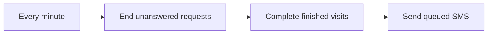

- Every minute the system makes one pass (code: `modules/jobs/run.ts`, `modules/jobs/tick.ts`; ADR 0017):
  1. It ends requests and move requests whose answer time ran out (S-01, S-07).
  2. It marks finished visits *Tamamlandy* (S-02).
  3. It sends what's queued: SMS, reminders, review asks (S-04, S-05, S-21). Outside production it also sends the demo businesses' own answers (S-20).
- Two passes never run at the same time. Each pass handles up to 100 items of each kind, and the rest wait for the next minute.
- Screens don't wait for the pass. From the exact deadline, a request already shows as expired and a finished visit as completed (code: `packages/domain/src/lifecycle.ts`). The pass then saves what people already see.
- The operations notes ask for the pace to be set before the production api goes live. A pass every minute keeps the database awake, and that costs compute hours on a free product (`docs/memory-bank/operations.md`).

> Open question Q-250: How often the system checks the clock.

## Overview

| Flow | What the system does | Trigger | Code |
|---|---|---|---|
| S-01 | Cancels an unanswered request, offers 3 times, sends an SMS | hold time ends | built |
| S-02 | Marks a finished visit *Tamamlandy* | visit end | built |
| S-03 | Limits a client to phone bookings | no-shows reach the limit | built |
| S-04 | Sends reminders | 24 h and 2 h before | built |
| S-05 | Asks for a review | 2 h after the end | built |
| S-06 | Stops counting a reported review | the business reports it | not built |
| S-07 | Drops an unanswered move | move deadline | built |
| S-08 | Treats offered times as taken or past | time passes, someone books | partly |
| S-09 | Ends the undo window | 5 min after a cancel | built |
| S-10 | Sends, checks and locks login codes | a code is asked for | built |
| S-11 | Keeps, renews and ends sign-ins | sign-in, visits, sign-out | built |
| S-12 | Links a phone's bookings and invites | sign-in | built |
| S-13 | Expires team invites | 7 days after sending | partly |
| S-14 | Blocks a person's time in other workspaces | a booking in one workspace | not built |
| S-15 | Updates open screens | any change | built |
| S-16 | Alerts the business to a new request | a request is sent | partly |
| S-17 | Makes a business public after review | Ýeral verifies it | partly |
| S-18 | Keeps quiet at night, sends summaries | quiet hours, summary times | not built |
| S-19 | Works out the typical answer time | past answers | not built |
| S-20 | Keeps demo data off production | database setup | built |
| S-21 | Retries failed SMS | sending fails | built |

## Bookings

### S-01 · A request's hold time runs out

**Goal.** A client never waits forever. If the business doesn't answer in time, the slot is freed and the client gets three other times.

**Trigger.** Time: the request's answer deadline passes. The deadline is the time the request was sent plus the business's hold time, but never later than the visit start (business spec §2, §11). Hold time options are 15 min, 30 min (default), 1 h, 2 h, 6 h and 24 h. This applies only to businesses that confirm by hand. At an instant business nothing waits.

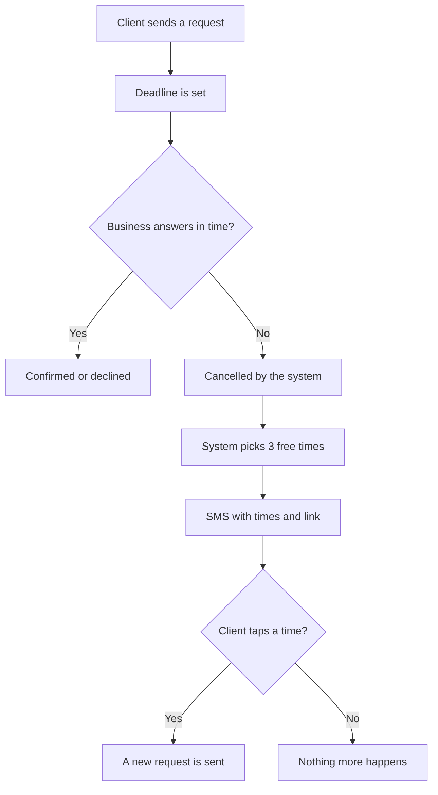

**Steps**

1. The client sends a request. The system sets its deadline and holds the slot (client spec §1 rule 1; business spec §2).
2. The business sees a timer on the request. Five minutes before the deadline, the owner and admin get *Haýyşyň wagty gutarýar* (S-16).
3. The deadline passes with no answer. The booking becomes *Ýatyryldy*, cancelled by the system (business spec §2; ADR 0017).
4. The system picks 3 free times for the same services. It looks on the same day first, nearest to the time asked for, then on the next days with free time (code: `modules/jobs/run.ts`; the spec only says "3 alternative times").
5. The client gets the expiry SMS with the times and the booking link, in their own language (client spec §6).
6. Everywhere the booking shows, it carries the hourglass label *Wagtynda jogap gelmedi* (no answer in time), with the 3 times as chips (ROUND6 A2).
7. Tapping a chip sends a **new request** for that time. It is *Garaşylýar*, or *Tassyklandy* at once at an instant business (ROUND6 A2).

**Edge cases**

- The business answers in the last seconds. Whatever reaches the system first wins. An answer after the deadline is refused with *Haýyşyň wagty geçdi* (code: `request_expired`).
- Screens show the request as expired from the exact deadline, even if the pass runs up to a minute later (code).
- A move request that runs out works differently: no times, no SMS, and the booking stays (S-07).
- The 3 times aren't held for the client, so someone else may take them (S-08).
- The times can be with any specialist, not just the one the client chose (code).

> Open question Q-159: which specialist an offered or free time is for.

- Table and class requests get no times in the code. Their SMS then reads *Şu boş wagtlar bar: —* with an empty list. The same broken text goes out when an appointment has no free time to offer.

> Open question Q-252: What an expired table or class request offers.

- At a manual business, the sent screen promises *Jogap bermese, {N} minutdan soň size başga wagtlary hödürläris.*, with N = the hold time (ROUND6 A2). When the visit starts before N minutes are up, the real wait is shorter. A 6 h or 24 h hold would read "360 minutdan" or "1440 minutdan".

> Open question Q-253: The answer time the client is shown.

- For expiry SMS at night, see chapter 8, Q-285. For expiry SMS when the client has switched confirmations off, see Q-286.
- A client who is now limited to phone bookings (S-03) can't take these times online. Only times the business offered after a decline are an exception (ROUND6 A7; the code agrees).

**Status.** Design: decided and drawn (client spec §1, §6; business spec §2; ROUND6 A2; Account-Bookings, Booking-Link) · Code: built in the api, except times for tables and classes.

### S-02 · A visit completes by itself

**Goal.** There's no "came" button. The business only acts when something went wrong.

**Trigger.** Time: the end of a confirmed booking passes.

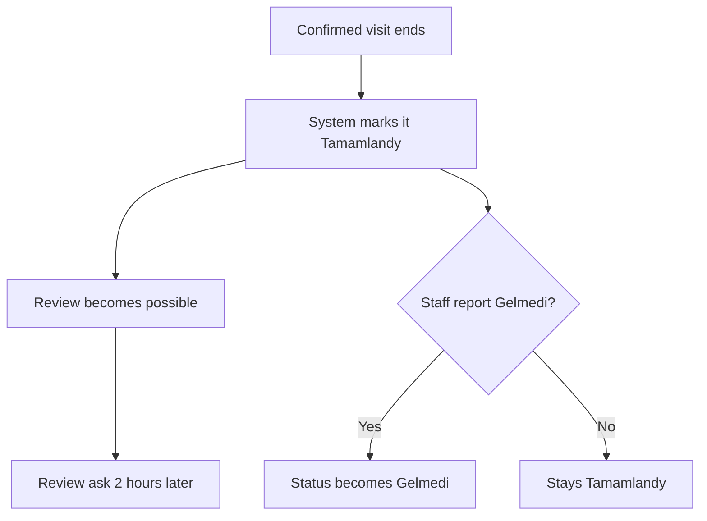

**Steps**

1. A confirmed booking's end time passes, and the system marks it *Tamamlandy* (client spec §1 rule 3; business spec §3).
2. The client can now write a review. The review ask goes out 2 hours later (S-05).
3. The visit counts toward the client's visits and the business's revenue, which is the sum of completed visits' prices (business spec §6, §14).
4. If the client didn't come, staff use *Arz et → Gelmedi* and the booking becomes *Gelmedi* (business spec §3). Staff can do this before or after the automatic completion.

**Edge cases**

- A request never completes, because it expires at the visit start at the latest (S-01).
- Team-only statuses such as *Geldi* or *Başlandy* don't change the system status (business spec §3).
- Classes: every attendee completes after the session. Staff mark single no-shows, and only after the session starts (business spec §21, §22).
- Tables: a confirmed table past its start counts as seated. The table is held 15 minutes for late guests (*Stol saklanýar*). After that, staff may give it away and mark *Gelmedi*; the system frees nothing by itself (business spec §20, §22; B-Tables).
- No time limit is set for marking a no-show. The code allows it at any time after the start, with no end. A review written before the no-show is marked stays.

> Open question Q-254: How long after a visit a no-show can be marked.

**Status.** Design: decided (client spec §1, §6; business spec §3, §20–§22) · Code: built for completion. Reporting a no-show comes with the workspace and isn't built.

### S-03 · Repeated no-shows limit a client to phone bookings

**Goal.** Protect businesses from clients who book and don't come.

**Trigger.** Event: a business marks a no-show, and the client's no-shows at that business reach the business's limit.

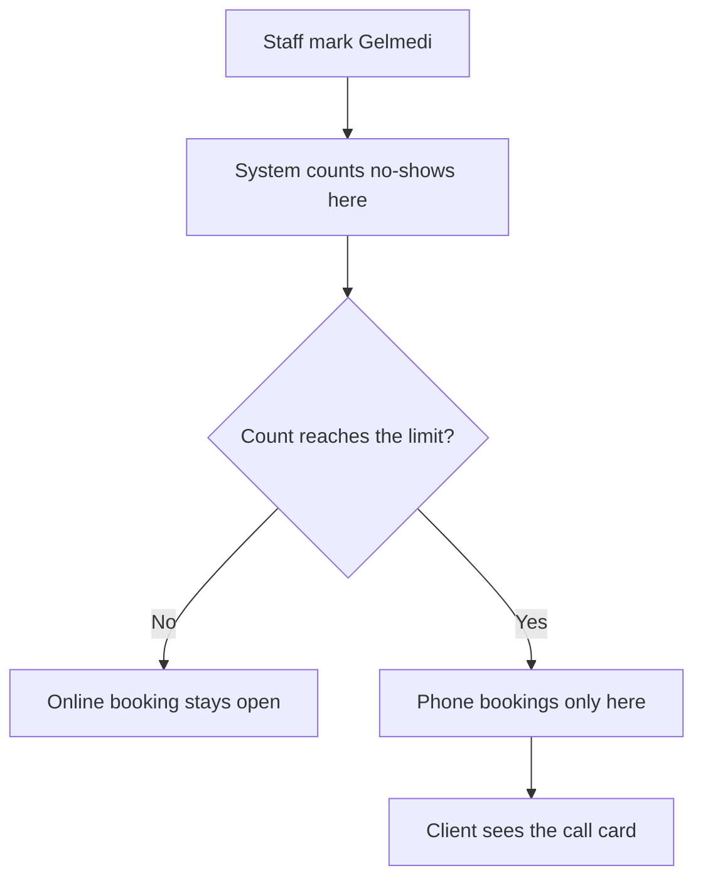

**Steps**

1. Staff mark *Gelmedi* through *Arz et* (S-02).
2. The system counts this client's no-shows at this business.
3. The limit is set in *Ýazylyş düzgünleri*: *N gelmedikden soň onlaýn ýazylyşy ýap* (1–5, default 2; 0 = never). When the count reaches it, the client can book this business only by phone (business spec §3, §8, §11).
4. Next time the client opens the business page or the booking flow signed in, they see a calm card. It reads *Bu biznese telefon arkaly ýazylyp bilersiňiz* (you can book this business by phone) and *Biznes siziň bilen ýazylyşlary jaň arkaly ylalaşmagy haýyş etdi.*, with a *Jaň et* button (ROUND6 A7). Signed out, everything looks normal until they log in.
5. The business can also set this by hand on the client card with *Diňe jaň arkaly ýazylyp biler* (business spec §6).

**Edge cases**

- The limit is per business, so other businesses aren't affected (business spec §3; code).
- The client can still take times the business offered after a decline online (ROUND6 A7).
- The code counts at the moment of each online booking. A new limit therefore applies to every client at once, and setting it to 0 lifts every automatic block.
- No-shows never expire, and the client-card switch can't lift an automatic block (code).

> Open question Q-127: no-shows: what counts and how the limit ends.

- Bookings the client already has stay as they are. The code refuses moving them online and refuses the free times offered after an expiry.

> Open question Q-154: moves and free times for a client who must call.

- The client isn't told when the limit starts (chapter 8, Q-290).

**Status.** Design: decided and drawn (business spec §3, §8; ROUND6 A7; Venue and Booking tweak `restricted`) · Code: built for the check in the api. Marking no-shows isn't built.

### S-04 · Reminders 1 day and 2 hours before

**Goal.** Fewer no-shows.

**Trigger.** Time: 24 hours and 2 hours before the start of a confirmed booking.

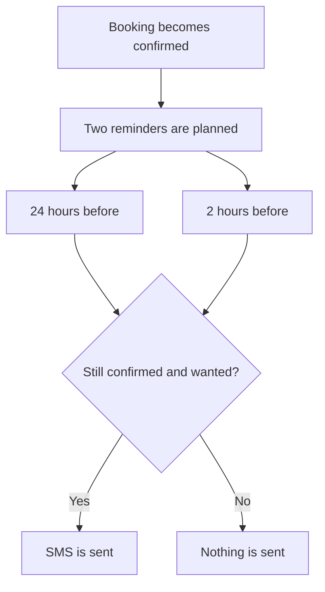

**Steps**

1. A booking can become *Tassyklandy* in four ways: the business confirms it, the business confirms instantly, the client takes an offered time, or a move is confirmed. Each time, the system plans the two reminders and the review ask (code: `modules/bookings/confirm.ts`).
2. At the planned time the system checks four things. The booking is still confirmed and still at the same time. The client's switch is on (*Ýatlatma: 1 gün öň*, *Ýatlatma: 2 sagat öň*; Account-Profile). The business hasn't stopped reminders for this client (*Ýatlatma SMS-lerini iberme*, business spec §6).
3. If all pass, it sends the SMS: *Ýatlatma: ertir {time} {business}, {address}.* (client spec §6).

**Edge cases**

- A moved booking gets new reminders for the new time, and the old ones stay quiet (code).
- A cancelled booking or a no-show gets nothing (code).
- A booking made less than 24 h ahead gets no day reminder. One made less than 2 h ahead gets no reminder at all (code).

> Open question Q-257: Reminders for bookings made at short notice.

- Early-morning visits get the 2-hour reminder at night: a 07:00 visit means an SMS at 05:00 (chapter 8, Q-285).
- Once staff can enter phone bookings (M5), the same reminders go to the number the business entered. Only mobile numbers can receive SMS (ROUND6 C1).
- For the text of the 2-hour reminder, see chapter 8, Q-293.

**Status.** Design: decided (client spec §6; Account-Profile switches) · Code: built in the api.

### S-05 · The review ask after a visit

**Goal.** Collect honest reviews from real visits.

**Trigger.** Time: 2 hours after the end of the visit (client spec §6).

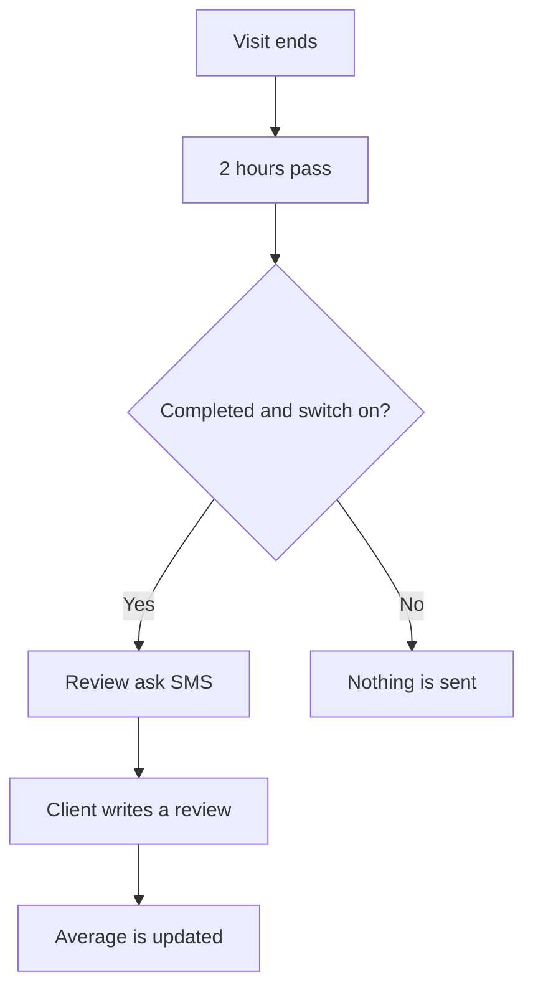

**Steps**

1. The ask is planned together with the reminders when the booking is confirmed (S-04).
2. Two hours after the end, the system checks three things. The visit is completed, not a no-show and not cancelled. The client's *Teswir haýyşy* switch is on. The business hasn't stopped SMS for this client.
3. If all pass, it sends *{business}-da bolşuňyz nähili boldy? Baha beriň: {link}*.
4. On screen, the completed booking shows *Teswir ýaz* (write a review). Client spec §6 calls this "review request (SMS + in-app)".
5. The review counts in the average at once (code) unless it's reported (S-06). There is one review per booking, and it can be edited for 7 days (client spec §4.8).

**Edge cases**

- The client may already have written a review on screen before the SMS goes. The code sends the ask anyway.

> Open question Q-258: Review ask when a review already exists.

- The link opens the booking link page `/b/{code}`. That page has no state for a finished visit; it's drawn only for declined, expired, confirmed, pending, offers expired and not found (Booking-Link).

> Open question Q-259: Where the review-ask link lands.

- Nothing says whether bookings entered by staff (phone, walk-in) get an ask.

> Open question Q-260: Review asks for bookings made by staff.

- A visit that ends late in the evening means an SMS at night (chapter 8, Q-285).

**Status.** Design: decided (client spec §6, §4.8) · Code: built in the api, without the checks above.

### S-06 · A reported review stops counting

**Goal.** A business can flag an unfair review without deleting it, and the average stays honest.

**Trigger.** Event: the business reports a review (*Arz et*).

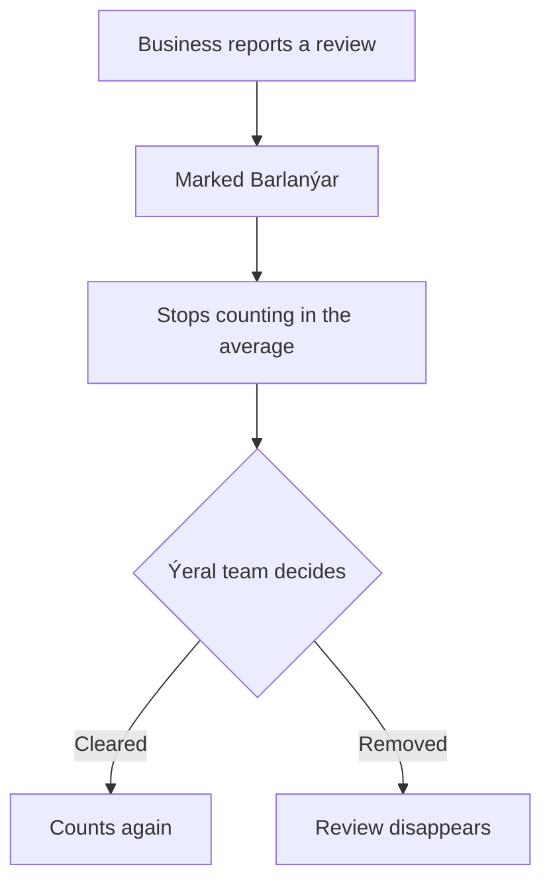

**Steps**

1. The business picks a reason and may add text (business spec §15). The reasons are *Ýalan / bu müşderi gelmedi*, *Kemsidiji sözler*, *Başga biznes barada*, *Mahabat / spam* and *Başga*.
2. The review is marked *Barlanýar* (being checked). It stays visible on both sides with a grey line: *Ýeral barlaýar · ortaça baha hasaplanmaýar* (Ýeral is checking · not counted in the average) (ROUND6 F2).
3. From that moment it stops counting in the average, the review count and the star bars (business spec §15).
4. The Ýeral team decides in the CMS. If they **clear** it, it counts again. If they **remove** it, it disappears (business spec §15; ROUND6 F2).
5. The business can reply while the review is being checked (business spec §15).

**Edge cases**

- The business can't delete reviews (business spec §15).
- The CMS isn't designed yet (Q-010), so nobody can clear or remove a review.
- Ýeral has no deadline to decide. A business could report every bad review and keep them all out of its average.

> Open question Q-261: How long a reported review may stay uncounted.

- Nobody is told the result.

> Open question Q-262: Who hears the moderation result.

**Status.** Design: decided and drawn (business spec §15; ROUND6 F2; Venue, B-Reviews) · Code: not built. Every review counts as soon as it's written, and there's no report or moderation.

### S-07 · A waiting move expires

**Goal.** A client's request to move never leaves them without a booking.

**Trigger.** Time: the move request's answer deadline passes. This applies only to businesses that confirm by hand.

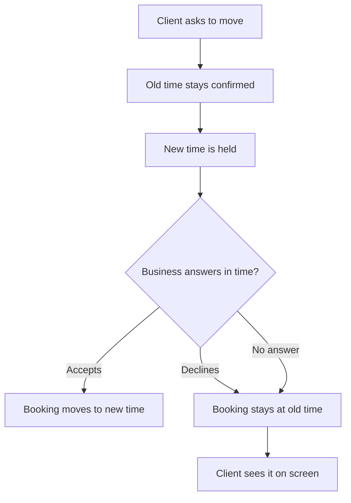

**Steps**

1. The client asks for a new time in move mode (ROUND6 A5). At a manual business the booking stays *Tassyklandy* and shows *Täze wagt soraldy: … · jogap garaşylýar* (new time asked · waiting) (ROUND6 A3).
2. The new time is held. The business sees a *Wagt üýtgetmek* request with a timer, plus a dashed ghost block *Täze wagt?* (business spec §26).
3. The deadline is the business's hold time counted from the moment the client asked. It never runs past the new time's start (code; the same rule as S-01).
4. If nobody answers, the request is dropped and the new time is freed. The booking stays at its old time (business spec §26).
5. The client sees *Täze wagt kabul edilmedi — ýazylyşyňyz öňki wagtynda galýar.* (new time not accepted; your booking stays at its old time) (ROUND6 A3). No other times are offered.

**Edge cases**

- A second move replaces the first (*Öňki haýyşyňyz … täzesi bilen çalşylar.*). Cancelling the booking also withdraws the move (ROUND6 A3; the code agrees).
- At an instant business the move happens at once, and nothing waits (ROUND6 A3).
- Code differs: the booking detail hides the move action while a move waits, so a second move can't be started from there. ROUND6 A3 says the second move replaces the first.
- Code differs: if the chosen specialist is busy at the new time, the code gives the move to another free specialist. ROUND6 A5 says there's no silent swap.
- If the business allows cancelling at any time (*Islendik wagt*), a client can ask to move shortly before the visit. The move can then still be waiting when the original visit starts.

> Open question Q-263: A waiting move that outlives the original time.

- No SMS is sent when the move isn't accepted (chapter 8, Q-289).

**Status.** Design: decided and drawn (ROUND6 A3, A5; business spec §26; Account-Bookings, B-Calendar) · Code: built in the api, with the two differences above.

### S-08 · Offered times go past or get taken

**Goal.** An offered time never promises something that's already gone.

**Trigger.** Time and events: an offered time passes, or another booking takes it.

| Kind | Who picks the times | Tapping one gives | Source |
|---|---|---|---|
| After a decline | the business, up to 3 | a **confirmed** booking at once | ROUND6 A1; business spec §2 |
| After an expiry | the system, 3 | a **new request** | ROUND6 A2 |

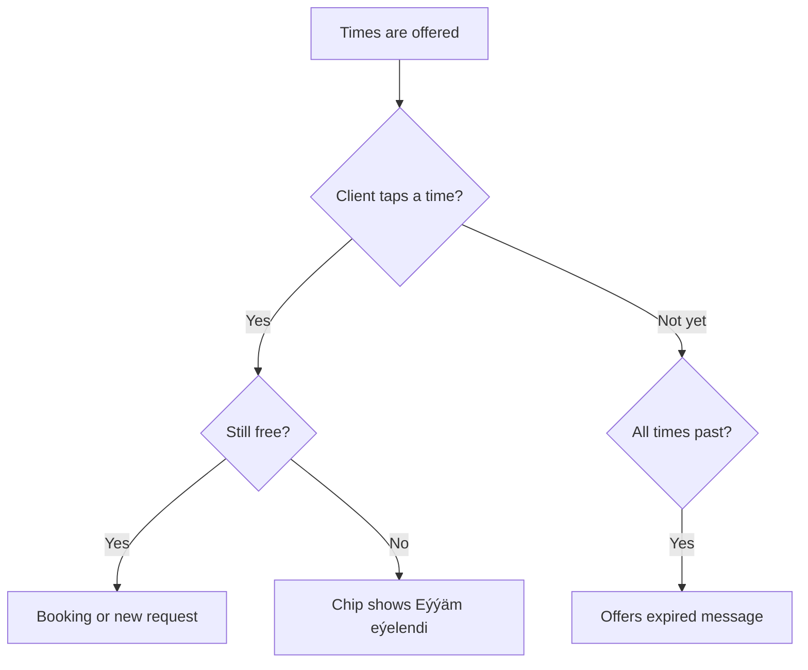

**Steps**

1. The times show as chips on the booking, in the account and on the SMS link page (ROUND6 A1, A2).
2. Nobody holds them. A chip whose time someone else took shows *Eýýäm eýelendi* (already taken).
3. When every offered time is past, the client sees *Teklip edilen wagtlaryň möhleti geçdi* (the offered times have expired) and *Başga wagt saýla* (pick another time).
4. After a decline, a declined request can turn into only one booking. Once a time is taken, the other chips go. The declined booking moves to *Geçen* with *Teklip edilen wagt kabul edildi → YR-…* (ROUND6 A1).

**Edge cases**

- Phone-only clients (S-03) can still take times the business offered (ROUND6 A7).
- Code: when the client taps a time, the system checks it's still free and refuses a taken one. The api doesn't mark chips as taken or past for display, so the screens must work that out themselves.
- "Past" isn't defined. It could mean at the start, or earlier by the business's lead time.

> Open question Q-264: When an offered time counts as past.

- The code also allows only one booking from the times offered after an expiry. The design states this only for declines.

> Open question Q-265: One booking from the times offered after an expiry.

**Status.** Design: decided and drawn (ROUND6 A1, A2; Account-Bookings, Booking-Link) · Code: partly.

### S-09 · The undo window closes

**Goal.** A client who cancels by mistake can take it back, but not forever.

**Trigger.** Time: 5 minutes after the client's own cancel (ROUND6 A6), or the visit start if that comes first (code).

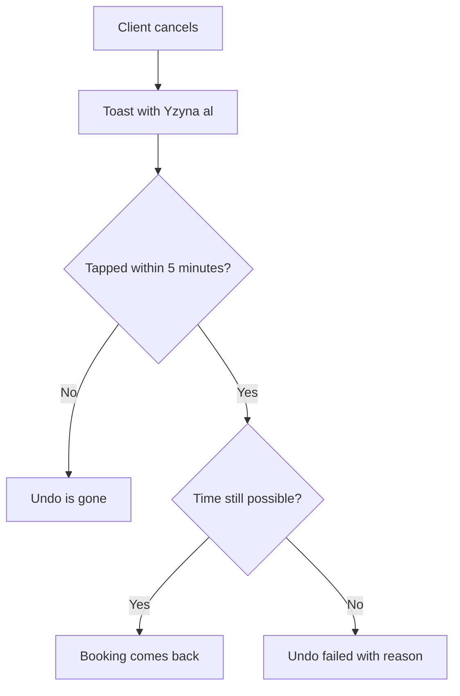

**Steps**

1. The client cancels. The booking turns grey with *Ýatyryldy*, and a toast offers *Yzyna al* (undo) (client spec §4.8). The business is told at once: *Ýatyrmak mugt, biznese derrew habar bereris.* (Account-Bookings).
2. From that moment, the slot is free for others.
3. Within 5 minutes, *Yzyna al* returns the booking to what it was. That is either *Tassyklandy*, or *Garaşylýar* with the answer time it had left (code).
4. If that isn't possible, the client sees *Yzyna alyp bolmady — {sebäbi}.* with *Başga wagt saýla*. There are four reasons (ROUND6 A6):
  - *bu wagt eýýäm başga müşderä berildi*: the time was taken.
  - *sapakda boş ýer galmady*: the class is full.
  - *ýazylyş wagty başlandy*: the visit has started.
  - *haýyşyň jogap wagty gutardy*: the request's answer time ran out.
5. After 5 minutes the grey row has no *Yzyna al*. On the next page load it moves to *Geçen* (client spec §4.8; ROUND6 A6).

**Edge cases**

- Only the client's own cancel can be undone. A business cancel or an expiry can't be (code).
- Code differs: "visit started" and "answer time ran out" come back as the same error (*Yzyna almak wagty geçdi.*), so the screen can't show which of the four reasons applies.
- A reminder that fell due inside the 5 minutes isn't sent later (code).
- If the cancel also withdrew a waiting move (S-07), the code's undo brings back only the booking.

> Open question Q-266: Undo after a cancel that withdrew a waiting move.

- For what the business hears when the client undoes, see chapter 8, Q-298.

**Status.** Design: decided and drawn (ROUND6 A6; Account-Bookings) · Code: built in the api, with one difference.

## Accounts and sign-in

### S-10 · Login codes

**Goal.** Signing in by phone is quick for people and hard to abuse.

**Trigger.** Event: someone asks for a code. That happens at login, on a phone change, at the login inside a booking, and on the SMS link page.

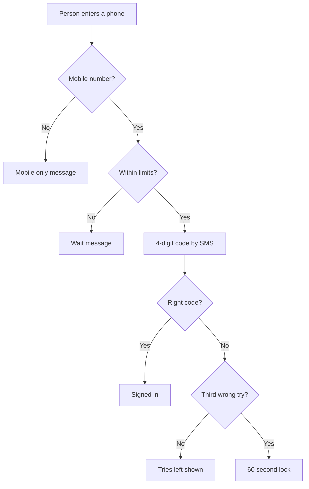

| Rule | Value | Source |
|---|---|---|
| Who can get a code | mobile numbers only (+993 6… or 7…); landlines get *Kod diňe mobil belgä iberilýär. +993 6… ýa-da 7… bilen başlaýan belgi ýazyň.* | ROUND6 C1; code |
| Code | 4 digits; checked by itself on the 4th digit | client spec §4.4 |
| Resend | after 0:59 | client spec §4.4; code |
| Wrong code | *Kod nädogry. Ýene N synanyşyk galdy.* | client spec §4.4; code |
| Lock | 60 seconds after 3 wrong tries | client spec §4.4; code |
| Code valid for | 5 minutes | code only (ADR 0019) |
| After the lock | the code is used up; ask for a new one | code only |
| Limits | 5 codes per phone per hour; 20 per internet address per hour | code only |
| Outside production | the code is always 1234 and SMS go to the log | code; ADR 0019 |
| SMS text | *Ýeral kody: {code}* | code only |
| On the SMS link page | the code goes only to the booking's own phone, shown masked and not editable | ROUND6 A1 |

**Steps**

1. The person enters a phone number. A number that isn't a mobile is refused.
2. The system checks the lock, the 59-second resend wait and the hourly limits.
3. It sends a new 4-digit code by SMS, valid for 5 minutes, and any earlier code stops working.
4. Each try uses up one of the 3 attempts before the code is checked. A right code signs the person in (S-11). If they're new, they're asked for their name.
5. The third wrong try starts a 60-second lock, and the code is used up.

**Edge cases**

- Code differs on wording. The code's lock text is *Synanyşyk köp boldy. {N} sekuntdan soň gaýtalaň.* The design has *Köp synanyşyk. 60 sekuntdan soň gaýtadan synanyşyň.* (Auth). The design itself differs between screens: Booking-Link has *Synanyşyklar gutardy. 60 sekuntdan soň täzeden synanyşyň.*
- No screen draws the message for the hourly limit (*Haýyş köp boldy. Biraz garaşyň.*). It also doesn't say the wait can be up to an hour.
- Mobile operators often put many phones behind one internet address, so 20 codes per address per hour could block real people.

> Open question Q-267: Login code limits that only the code sets.

- If sending the SMS fails, the 59-second wait has already started (code).
- The design doesn't say whether the same code works after the lock.

> Open question Q-268: After the 60-second lock, a new code or the same one.

**Status.** Design: decided and drawn (client spec §4.4, §4.7; ROUND6 C1; Auth, B-Login, Booking-Link) · Code: built in the api. The login on the link page isn't built.

### S-11 · Sessions

**Goal.** People stay signed in without typing codes often, and can sign out when they want.

**Trigger.** Events and time: sign-in, every visit, sign-out, a phone change and account deletion.

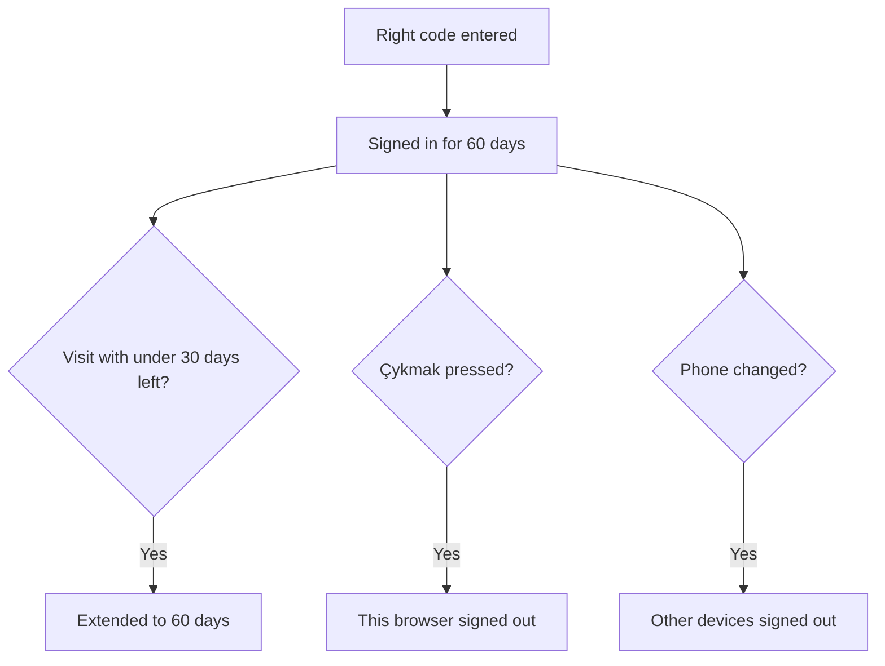

**Steps**

1. A right code signs the person in on this browser for 60 days (code; ADR 0019).
2. A visit with less than 30 days left extends the sign-in to 60 days again, so active people stay signed in.
3. One sign-in covers both yeral.app and the business workspace in the same browser. That follows from one Ýeral account (business spec §1) and the *Müşderi hökmünde aç* menu item. *Çykmak* signs out of both on that browser.
4. *Çykmak* signs out only this browser, and other devices stay signed in.
5. Changing the phone signs out every other device (code; ADR 0019).
6. Deleting the account signs the person out and cancels their upcoming bookings, and the businesses are told. The design says all bookings, reviews and favourites are deleted (Account-Profile: *Gelýän 3 ýazylyşyňyz ýatyrylar we bizneslere habar bereris.*; code).

**Edge cases**

- No "sign out on all devices" button is designed or built.
- Native apps (later) will use the same sign-in with a token (ADR 0019).
- The CMS will get separate staff accounts with a second sign-in step (ADR 0019; not designed).
- Removing someone from a workspace removes their access to it, but their Ýeral sign-in stays (business spec §1, §8).
- The design doesn't set how long a sign-in lasts. 60 days was Claude's choice, and the owner can reverse it (ADR 0019).

> Open question Q-269: How long a sign-in lasts, and signing out everywhere.

**Status.** Design: not specified · Code: built in the api.

### S-12 · Signing in links what the phone already has

**Goal.** A person who was known by their phone before signing up sees everything in one place.

**Trigger.** Event: a phone signs in. This happens at every sign-in, not only the first.

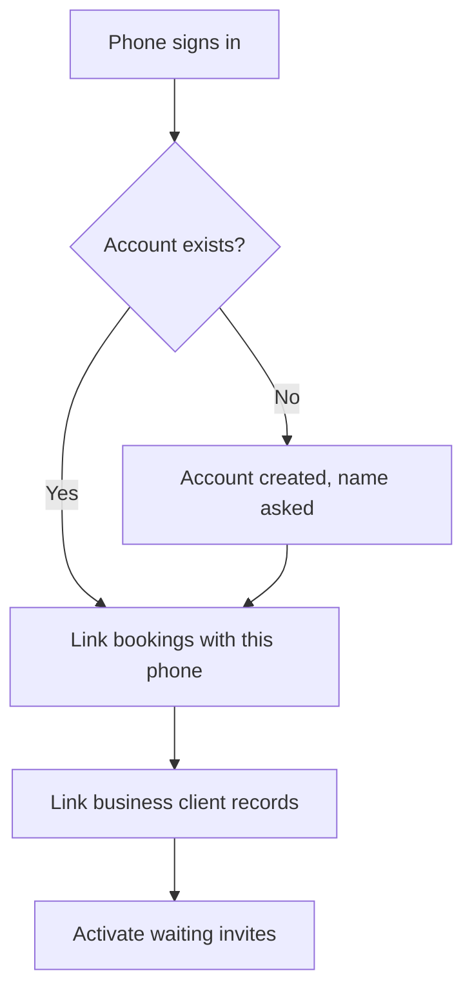

**Steps** (code: `modules/auth/routes.ts`)

1. If there's no account for this phone, the system creates one and asks for the name (client spec §4.7; business spec §1).
2. Bookings made with this phone, such as phone bookings a business entered, are linked to the account. They then show in *Ýazylyşlarym*.
3. Businesses' client records with this phone are linked to the account.
4. Team invites waiting for this phone become active at once. S-13 describes what the design wants instead.
5. In the workspace, routing follows the design: a pending invite first, then *Entek iş ýeriňiz ýok* if there's no workspace, otherwise the last workspace used (business spec §1; B-Login).

**Edge cases**

- The linking is the code's choice; no design shows it. If a phone number passes to a new person, that person would see the previous owner's bookings.

> Open question Q-270: Linking bookings made under the same phone.

**Status.** Design: routing drawn (B-Login), linking not shown · Code: built in the api.

### S-13 · Invite links expire after 7 days

**Goal.** Team invites don't stay open forever.

**Trigger.** Time: 7 days after an invite is sent or resent.

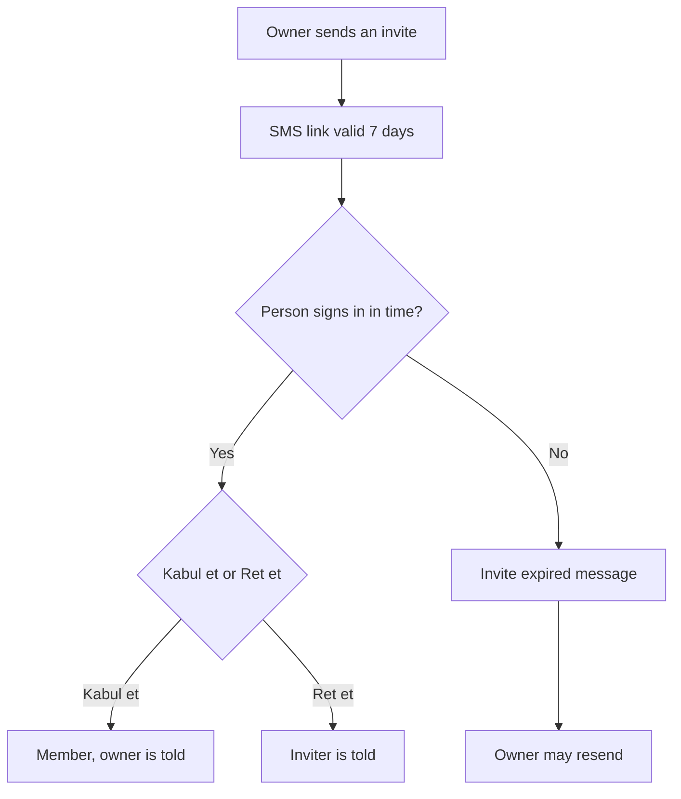

**Steps**

1. The owner invites a person with their phone number (their Ýeral login), name, specialization, access level and services (business spec §8).
2. The person gets an SMS link that's valid for 7 days. The team list shows *Çagyryldy · 19 oktýabra çenli* (invited · until 19 October), with *Täzeden iber* (resend) and *Çakylygy ýatyr* (withdraw) (business spec §8; B-Team).
3. The person signs in with that phone, and the invite screen comes first: *Kabul et* / *Ret et* (accept / decline) (business spec §1; B-Login).
4. If they accept, they become a member with the chosen access level, and the owner hears *Topar: işgär çakylygy kabul edende* (business spec §16). If they decline, the inviter is told (*… habar alar*), and joining later needs a new invite (B-Login).
5. After 7 days the invite expires. Signing in then shows *Çakylygyň möhleti geçdi* with *Her çakylyk 7 gün işleýär… Eýesinden täzeden ibermegini haýyş ediň* (B-Login).
6. A resend starts a new 7 days (B-Team).

**Edge cases**

- *Programmasyz* staff (no login) get no SMS and are active at once (business spec §11).
- The invite SMS text isn't designed (chapter 8, Q-288).
- Code differs: invites never expire. They're accepted automatically at the next sign-in, with no *Kabul et* / *Ret et*. No invite SMS is sent (code: `modules/auth/routes.ts`; the workspace isn't built).

**Status.** Design: decided and drawn (business spec §1, §8; B-Login, B-Team) · Code: partly.

## Workspaces and businesses

### S-14 · "Başga ýerde" blocks a person across workspaces

**Goal.** A specialist who works at two businesses can't be booked in both at the same time.

**Trigger.** Event: a booking is created, moved or cancelled for a person who belongs to two or more workspaces.

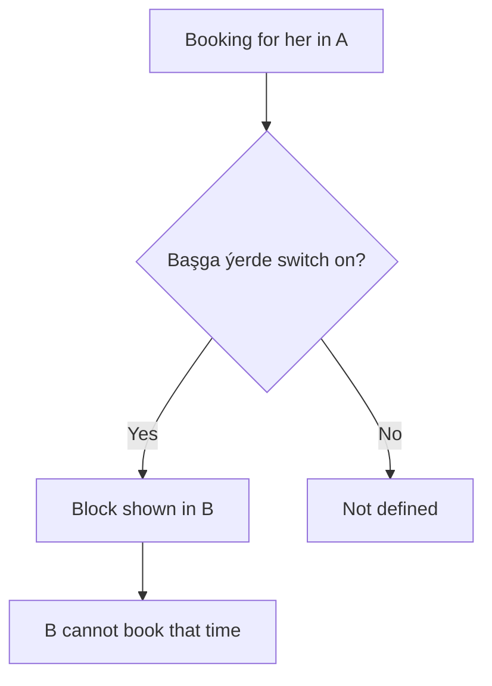

**Steps**

1. Aýna works in Glow Studio and also owns her own studio (business spec §1, demo).
2. A booking for her in one workspace shows in the other workspace's calendar as a dashed grey *Başga ýerde* block with a briefcase icon. It has no details and can't be clicked (business spec §1, §4).
3. The other workspace's online booking doesn't offer that time, and its staff can't book her then. Times under the block are refused with a toast (business spec §1, §4).
4. She controls this in *Profilim* with the switch *Beýleki iş ýerlerimdäki wagtymy «Başga ýerde» görkez* (show my time in other workspaces as "Başga ýerde"). It's on by default (business spec §1).

**Edge cases**

- *Programmasyz* staff have no account, so nothing links them across workspaces.
- What turning the switch off does isn't defined.

> Open question Q-271: What the "Başga ýerde" switch controls.

- Which bookings count isn't defined: requests, buffers, or her own bookings as a client.

> Open question Q-272: Which bookings block a person elsewhere.

**Status.** Design: decided and drawn (business spec §1, §4; B-Calendar, DS-Business) · Code: not built. Free times count only the same business's bookings.

### S-15 · Live updates on open screens

**Goal.** Screens show changes made by other people without a reload.

**Trigger.** Event: any change to a booking or a review.

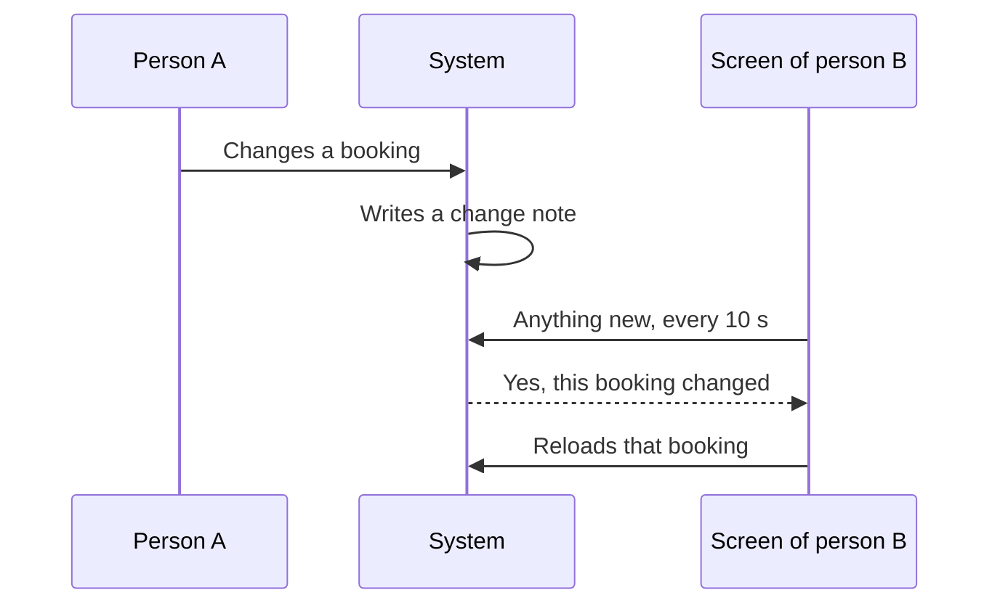

**Steps**

1. Every change leaves a short change note in the system. The note types are created, confirmed, declined, cancelled, expired, moved, completed, no-show, updated and review created (code: `packages/contract/src/events.ts`).
2. Open screens of signed-in people ask for new notes about every 10 seconds. They also ask when the window gets focus and right after the person's own action (code: `packages/sdk/src/events.ts`; `systemPatterns.md`).
3. A client gets notes about their own bookings. A team member gets notes about their active workspaces.
4. The screen then reloads what changed.

**Edge cases**

- Public pages (search, business page) don't refresh by themselves. If someone takes a time meanwhile, the client finds out when sending: *Bu wagt ýaňy alyndy. Golaý boş wagtlar:* plus the 3 nearest times (client spec §4.4).
- Code differs: a hidden tab doesn't ask at all. A workspace tab in the background therefore never learns of a new request, but B-Shell wants a browser notification exactly then ("Browser notification when the tab is in the background").
- A push connection can replace the asking later on the own server, and screens stay the same (`systemPatterns.md`).
- The design wants new requests to show "on arrival" but sets no maximum delay.

> Open question Q-273: How fast changes must reach open screens.

**Status.** Design: implied (business spec §2; B-Shell) · Code: built (the asking), with the background-tab difference.

### S-16 · A new request reaches the business

**Goal.** The business sees a new request within seconds and answers before the deadline.

**Trigger.** Event: a client sends a request or asks to move.

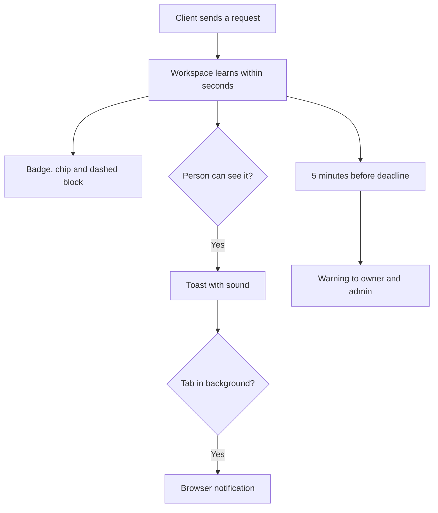

**Steps**

1. The request appears in the workspace in four places: an amber count on *Ýazylyşlar*, an *N haýyş* chip in the calendar header, a dashed block with a timer in the grid, and a row in *Haýyşlar* (business spec §2, §4, §5).
2. People who can see it get a toast at the bottom left for 6 seconds, with a soft sound. It reads *Täze haýyş: Ejegyz T. · Aýna · şu gün 15:30*. If the tab is in the background, they also get a browser notification (B-Shell; business spec §2).
3. Requests in other workspaces only raise the count in the workspace switcher (B-Shell; business spec §9).
4. Who may answer follows the setting *Haýyşlara kim jogap berýär?*. The options are *Administrator we eýesi*, *Her hünärmen özi* and *Ikisi hem* (default). Someone who can't answer sees a read-only footer instead of the buttons (business spec §2).
5. Five minutes before the deadline, the owner and admin get *Haýyşyň wagty gutarýar* (business spec §16).
6. If nobody answers, S-01 follows, or S-07 for a move.

**Edge cases**

- During quiet hours there's no sound and no alert (S-18).
- Requests for *Programmasyz* staff go to the owner and admin (business spec §2).
- For new-request SMS before the app exists, see chapter 8, Q-297.

**Status.** Design: decided and drawn (business spec §2, §16; B-Shell, B-Calendar, B-Bookings) · Code: partly. The change note exists, but the workspace, toasts and warnings aren't built.

### S-17 · A new business is verified

**Goal.** Only real businesses are public.

**Trigger.** Event: a new business finishes setup, including one created from the workspace switcher.

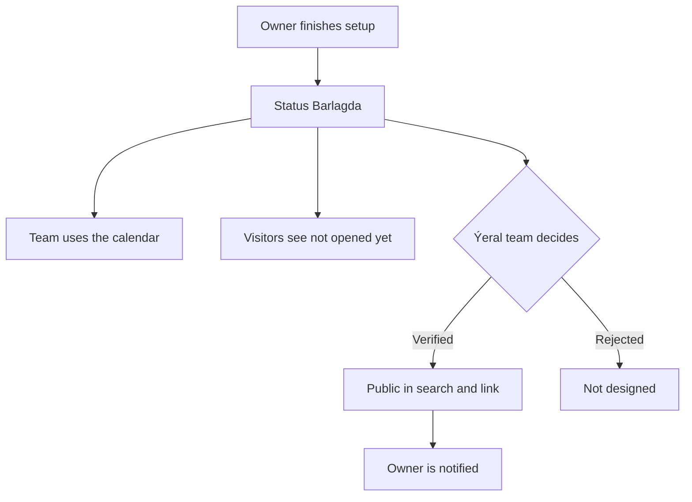

**Steps**

1. After setup the business has the status *Barlagda* (in review). It can use the calendar straight away (business spec §7).
2. Setup step 8 says *Salgyňyz we QR kodyňyz taýýar — barlagdan soň müşderiler üçin açylar.* (your link and QR code are ready and open to clients after review) (ROUND6 F1).
3. The owner and team see their own page with the banner *Sahypaňyz barlagda — häzir ony diňe siz we toparyňyz görýärsiňiz. Barlagdan soň gözlegde we salgyňyzda hemmä açylar.* (ROUND6 F1; B-Shell).
4. Visitors at the link see *Bu sahypa entek açylmady* and *Biznes Ýeral-a täze goşuldy we barlagdan geçýär. Adatça 24 sagat çekýär.*, with a *Başga ýerleri gözle* button. They see no business details. ROUND6 F1 also suggests telling search engines the page doesn't exist (States tile 11).
5. The Ýeral team verifies the business in the CMS, usually within 24 hours (business spec §7).
6. Once verified, the business appears in search, on category pages, at its link and among similar places. The owner hears *Ýeral: barlag we täzelikler*, by browser and SMS by default (business spec §16).

**Edge cases**

- The CMS isn't designed yet (Q-010; business spec §24, "admin panel … for business verification").
- Clients can't book online before verification, because nobody else can open the page. Staff can still enter phone bookings (business spec §7).
- The data has a "rejected" status with a reason, but nothing shows it on screen.

> Open question Q-274: What a rejected business sees.

- Nothing says whether changes after verification send the business back to review.

> Open question Q-275: Re-checking a verified business after changes.

- What the team checks isn't written anywhere.

> Open question Q-276: What the Ýeral team checks before verifying.

- There's no way to verify a business until the CMS exists.

> Open question Q-010: what the Ýeral team can do at launch, and with which tool.

**Status.** Design: decided and drawn for the business and the visitor (business spec §7, §26; ROUND6 F1) · Code: partly. Only verified businesses are public, and an unverified link gives a plain "not found". There's no owner preview, no banner and no verification tool.

### S-18 · Quiet hours and summaries for the business

**Goal.** The business hears what matters, but not at night.

**Trigger.** Time: the person's quiet hours and the two summary times.

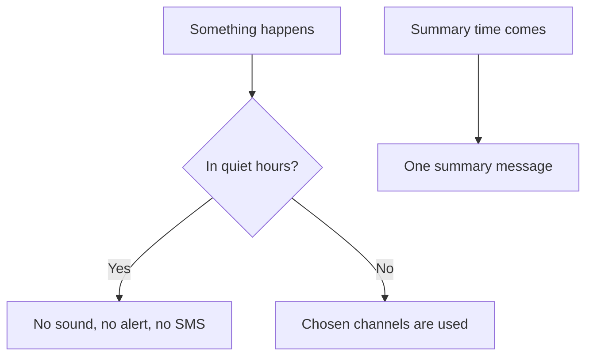

**Steps**

1. Each person sets *Habarnamalar* (notifications) for themselves: *Bu sazlamalar diňe size degişli.* (these settings apply only to you) (business spec §16; B-Notifications).
2. Quiet hours (*Gijeki dymyşlyk*) are on by default from 22:00 to 08:00. The start can be 19:00–00:00 and the end 05:00–10:00, in 30-minute steps (B-Notifications).
3. During quiet hours there's no sound and no alert in the browser or the app. SMS never go at night, even with quiet hours off: *SMS gije hiç haçan iberilmeýär* (B-Notifications; business spec §16, §22).
4. There are two summaries, each sent as one message:
  - *Ertirki ýazylyşlar* (tomorrow's bookings): who comes tomorrow, every evening, default 20:00 (range 17:00–23:00). Each specialist gets their own bookings.
  - *Gündelik jemleme* (daily summary): today's bookings and requests, every morning, default 08:00 (range 05:00–10:00). This one goes to the owner.
5. A summary time inside quiet hours shows *Bu wagt gijeki dymyşlyga düşýär — ses we push bolmaz.* (this time falls in quiet hours; no sound or push).
6. Summaries can't go by SMS. SMS is allowed only for *Täze haýyş* and *Ýeral* (business spec §22).

**Edge cases**

- What "night" means for SMS when quiet hours are off or moved isn't defined.

> Open question Q-278: What "night" means for business SMS.

- It isn't defined whether an SMS that falls at night is dropped or sent in the morning.

> Open question Q-279: A business SMS that falls in the night.

- On MVP the browser is the only alert channel, and it works only while Ýeral Biznes is open (*Ýeral Biznes açyk bolanda*). A morning summary reaches nobody whose workspace isn't open at that time.

> Open question Q-280: Summaries while the browser is the only channel.

- For a person in two workspaces, it isn't defined whether there's one set of settings or one per workspace.

> Open question Q-281: Notification settings per workspace or per person.

**Status.** Design: decided and drawn (business spec §16, §22; B-Notifications) · Code: not built.

### S-19 · The typical answer time

**Goal.** Set the client's expectations before and after they send a request.

**Trigger.** Time: the system works it out from past answers. The spec says "computed" but doesn't say when.

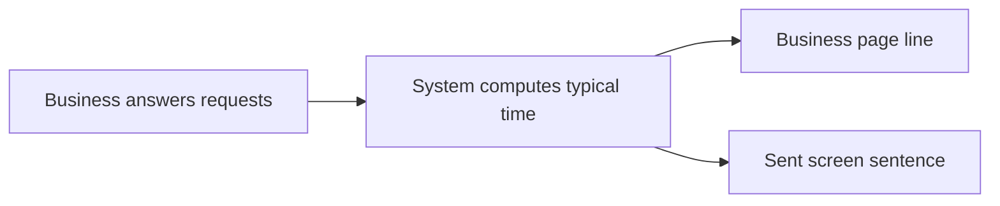

**Steps**

1. The business page shows *Adatça 15 minudyň dowamynda tassyklaýar* (usually confirms within 15 minutes) (client spec §4.3).
2. At a manual business, the sent screen shows *Biznes adatça {N1} içinde jogap berýär.* (ROUND6 A2).

**Edge cases**

- How it's computed, how often, and what a new business with no answers shows aren't defined.
- Code differs: each business stores a fixed number, set only by the demo data (default 20 minutes). Nothing computes it.
- Instant businesses don't need it.

> Open question Q-113: how the typical answer time is worked out.

**Status.** Design: decided (client spec §4.3; ROUND6 A2) · Code: not built (only a stored number).

## Behind the scenes

### S-20 · Demo data stays out of production

**Goal.** The design's demo businesses and test shortcuts never reach real people.

**Trigger.** Event: the database is set up or reset.

```mermaid
flowchart TD
  A["Database is set up"] --> B{"Which environment?"}
  B -->|"Local or Docker"| C["Full demo, code 1234"]
  B -->|"Production"| D["Categories only, demo refused"]
```

**Steps** (code: `db/seed/mode.ts`; ADR 0020; `operations.md`)

1. Local and Docker databases get the full demo from `docs/design/demo-data.json`, with Glow Studio, Barber Loft, Aýdyň ýoga and the others. The demo dates move to the day the data is loaded.
2. Production gets only the category list. Loading the demo into any remote database is refused, because it wipes the database.
3. Outside production, the login code is always 1234 and SMS go to the log.

**Things the code does that no spec describes**

- A demo business with no active team member confirms a request by itself after 20 seconds. This happens only outside production.
- Demo dates shift to the loading day but keep the design's weekdays.
- The login code is 1234 outside production (ADR 0019 mentions it).

**Edge cases**

- Whether production shows demo businesses before real ones join is left open (ADR 0020).

> Open question Q-283: Demo businesses on the live site.

**Status.** Design: not a design topic · Code: built.

### S-21 · Failed messages are retried

**Goal.** A short outage at the SMS gateway doesn't lose messages.

**Trigger.** Event: sending an SMS fails.

```mermaid
flowchart TD
  A["SMS is due"] --> B{"Still wanted?"}
  B -->|"No"| C["Dropped quietly"]
  B -->|"Yes"| D{"Sent?"}
  D -->|"Yes"| E["Done"]
  D -->|"No"| F["Retry four more times"]
  F --> G["Give up after 5 tries"]
```

**Steps** (code: `modules/jobs/run.ts`)

1. Booking SMS go into a queue with their planned time.
2. Right before sending, the system checks the booking again: its state, its time and the switches (S-04, S-05).
3. If sending fails, it tries again after 1, 2, 4 and 8 minutes.
4. After 5 failed tries, about 15 minutes in all, it gives up and keeps the record for the team to look at. Nobody is told.

**Edge cases**

- Login codes are sent straight away, not queued. If sending fails, the person sees an error and can ask again after the 59-second wait (S-10).
- A retried reminder could arrive close to the visit.
- There's no SMS gateway yet, so every environment writes SMS to the log (chapter 8, "Not decided").

> Open question Q-284: An SMS that can't be delivered.

**Status.** Design: not a design topic · Code: built (queue and retries); the gateway isn't built.
