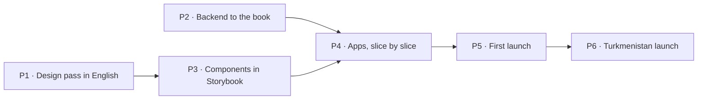

# 10. Build plan

How Ýeral gets from this closed book to the first launch, and then to the Turkmenistan launch. Claude wrote the plan
on 18.10.2026 from the book's answers; the owner decides when each launch ships. It is updated as the work moves.

## Where we start

- **The book is closed:** 123 questions answered, 242 features placed (155 in the MVP since the own server joined it on 19.10.2026). (chapters 6 and 9)
- **Built before the reset** (M0–M2, released 16.10.2026): the monorepo and CI; `@yeral/ui` with 38 components from
  the design system v0.3.1; the booking engine (`@yeral/domain`); the shared contract and client library; an api for
  every client screen on Postgres, not deployed; the Docker stack. (progress.md)
- **Not built:** the client site, the business app, the admin tool (CMS), every business endpoint, market settings.
  yeral.app still serves the old Next.js site.
- **Design:** export v0.5, drawn in Turkmen; the business app is drawn, the admin tool isn't.
- **"Code differs" lines** across chapters 2–8 list what built code must change. The biggest: Turkmen as the default
  language, editable roles instead of three fixed levels, review-ask SMS, `/b/{code}` links, Turkmenistan's values
  as constants, demo data refused in production.

## The phases

Two tracks (owner, 19.10.2026): the design pass and the backend run side by side, since the book is closed and the
backend implements its rules, not its screens (ADR 0021, amended). Components and the apps wait for the design.
Endpoint responses follow the screens, so their exact fields are adjusted when the design export lands. The design
prompts are kept in `docs/product/prompts/`.

### P1 · Design pass in English

Claude writes each prompt for Claude Design, the owner pastes it, Claude checks the result on the canvas against the
book (ADR 0021). The result is design export v0.6, every board in English (Q-133), with Russian-length text checked.

| Round | What gets drawn or redrawn |
|---|---|
| 1 | Foundations: the *Ýeral* wordmark (Q-005), English copy rules, the components with English text; the "Example" badge |
| 2 | Business app: shell, sign-in with the code on screen, setup wizard, calendar (block time, *Başga ýerde* as a plain reserved gap, internal statuses), requests, bookings list (no bulk move) |
| 3 | Business app: clients, team (the "uses the app" switch), settings (hours past midnight, booking rules), notifications, reviews, the rejected-business banner, "Try the business app" |
| 4 | Client site: home, search and map with the city choice, business page, appointment booking with the shared code step and surname, my bookings, the booking link page with a finished visit, account |
| 5 | Admin tool (cms.yeral.app), drawn for the first time: verify or reject a business, reported reviews, hide or un-verify a business, add a business for its owner, close a workspace |
| 6 | Every **Design to fix** line left in chapters 6 and 7a–7c, then the export |

### P2 · Backend to the book

No screens; every rule gets its test (ADR 0013). Runs alongside P1, in this order. Reviewed on 19.10.2026 against
every **Code differs** line (51 distinct ones; the first draft of this list covered 21) and the api as built: 34
endpoints for client screens, none for businesses or the Ýeral team, and nothing that checks access levels yet.

0. **The own server only** (owner, 19.10.2026: no Neon; done 19.10.2026, ADR 0024): the api's Cloudflare Workers
   path went (Worker entry, Wrangler, Hyperdrive, Neon config); the local Docker stack uses Caddy like the server; the
   city from the internet address is off, since first-launch visitors come through a VPN, and the city choice starts
   at the market's main city (Q-107).
1. **Market settings** (ADR 0022, ADR 0023; done 19.10.2026): language, money, phone rules and time zone read from
   one market config (`@yeral/domain/market`); English as the source language; any one language for a business's
   texts (Q-102); SMS in the market's main language for people without one (Q-292), with the brand from the messages.
   Legal texts, the SMS provider and the map area join the config with their features.
2. **The business model:** three fixed levels with a fixed permission table, enforced by the api (editing the matrix
   is Later, F-089); each account linked to its staff rows, which *Başga ýerde* needs; the specialist without the app
   (Q-216); invites with accept or decline and 7 days (F-085). With no SMS at the first launch, an invite appears when
   the invited phone signs in, and the owner can copy its link. Part 1 done 19.10.2026 (ADR 0025): the levels, the
   table, team rows linked to accounts, invites stored; part 2: the switcher, invites and the team endpoints.
3. **The "Code differs" fixes in the booking engine,** in this order, since each needs the one before: past midnight
   (Q-105); holds count only in opening hours (Q-120); reminders at night move to 21:30 the evening before (Q-285);
   then the city as data (Q-107), offered times tied to one specialist (Q-159), expiry with nothing free (Q-252), the
   no-show count restart (Q-127), move rules (Q-165, Q-263, a second move replaces the first and can be withdrawn:
   ROUND6 A3), token links instead of `/b/{code}` and the signed-out link page (Q-168, F-068), no review asks (Q-259),
   linking by phone only for 6 months plus "Is this you?" (Q-270), a changed phone keeps its client record (Q-171),
   code limits (Q-267), deleting an account (Q-172), name and surname (Q-156), time limits on no-shows, complaints and
   reviews (Q-254, Q-206, Q-126), at most 3 waiting requests per business and 10 in all (Q-124), the cancel reason
   setting (Q-163), the 4 undo reasons (ROUND6 A6), the answer time worked out (Q-113), phone-only clients and paused
   businesses (Q-154), the owner's preview of an unverified page (F-032), no average bill and the hidden-price text
   (Q-103), lateness fixed at 15 min (Q-118), a price range filter, the failed-SMS alert and late reminders dropped
   (Q-284), the SMS for a move not accepted (Q-289); and the new engine rules: *Başga ýerde* (Q-272), blocked time
   (F-121) and internal statuses (F-104, F-133).
4. **Business endpoints:** workspace, calendar, requests, bookings with CSV export (F-135), clients, team, settings,
   services, hours, reviews; photos (F-084, F-101) stored on the server's disk behind a storage port; the address with
   a map pin (F-099); browser notifications from the live events (F-170) and the staff SMS rule (F-171); the timed jobs
   for invite expiry, the 5-minute warning and the answer time.
5. **Admin endpoints:** the Ýeral team's own accounts with a second factor (F-178): with the code on the screen, a
   phone number must never open the admin tool; verify, reject and send again (Q-274), un-verify or hide a business,
   close a workspace (Q-213), review reports with the 48-hour recount, adding a business for its owner.
6. **First-launch mode** (Q-004, Q-036): example businesses marked "Example" that confirm at once, the sign-in code
   shown on the screen (never for the admin tool), a separate demo workspace reset every night, no SMS. It doesn't wait
   for the design: the demo data already has English texts, refreshed at export v0.6.
7. **Before the first launch:** deploys from GitHub over SSH after the owner approves a release (ADR 0020), nightly
   backups to Cloudflare R2 with a restore drill (F-211), error tracking and uptime alerts (F-209), sitemap data
   (F-197).

Settled while reviewing (Claude, delegated, 19.10.2026): a hold counts the business's opening hours, special days
included, not the specialist's; a reminder that falls between 22:00 and 08:00 goes at 21:30 before that night starts,
also for visits after midnight; "unused for 6 months" (Q-270) means no sign-in for 6 months; the `yr-` slug rule goes
with the `/b/{code}` links (Q-168); a lower no-show limit counts from the day it changes; the failed-SMS alert goes to
the error tracker of F-209, since Ýeral sends no e-mail.

### P3 · Components in Storybook

The 38 components updated to v0.6, then the new ones from the business app and the admin tool (calendar grid,
drawers, timers, status chips, tables), each with stories for every variant and Chromium tests. (ADR 0012)

### P4 · Apps, slice by slice

The order of Q-001: every slice ends working end to end on a local machine, with tests, before the next starts.

| Slice | What works at the end |
|---|---|
| 1 · Accounts | sign in with the code on screen, profile, the workspace switcher, invites |
| 2 · Business setup | the wizard, profile, services, hours, team, booking rules, link and QR |
| 3 · Booking loop | business page, appointment booking, answering in the calendar, my bookings, cancel, move, undo, declines with offered times, expiries |
| 4 · Daily work | calendar views, bookings list, clients, walk-ins, complaints, internal statuses, *Başga ýerde*, browser notifications, the installable business app |
| 5 · Discovery | home, search, map, categories, the city choice, search-engine pages |
| 6 · Admin tool | cms.yeral.app with the Ýeral team's own accounts and a second factor (F-178): verification, reported reviews, hiding businesses, adding a business for its owner |
| 7 · First-launch mode | example businesses, "Try the business app", privacy policy and terms in English (Q-033) |

### P5 · First launch

The client site, the business app, the admin tool and the api go to production on the owner's server (a netcup VPS 1000 in the EU (4 vCPU, 8 GB, 128 GB)) in Docker, with Cloudflare for DNS (ADR 0007, ADR 0023), from a release the owner approves
(ADR 0020). The server, its shared HTTPS front door and the api's stack are set up (19.10.2026, `infra/server`);
deploys from GitHub and backups come with P2 step 7. The new client site replaces the old one on
yeral.app. The team adds the first real businesses in the admin tool (Q-002).

### P6 · Turkmenistan launch

After investment, when the owner sets the date:

- Turkmen and Russian: Claude translates every text; a native check before launch (Q-101).
- A lawyer in Turkmenistan: law 519-V on personal data, the privacy policy and terms (Q-033, Q-037).
- The server in Turkmenistan (below), the data moved, the addresses switched (ADR 0023).
- An SMS provider and real SMS sign-in; the first-launch mode switched off for this market (Q-036).

## What it costs

| When | What | Monthly |
|---|---|---|
| From now | the server, netcup VPS 1000, shared with the owner's other projects; Storybook stays on Cloudflare | €16.68 a month, €12.32 on a 12-month term (with German VAT) |
| First launch | nothing more: the same server; database backups to Cloudflare R2 (free up to 10 GB); no SMS | — |
| Turkmenistan launch | the server, SMS per message, the lawyer once | priced then, in manats |

The domain yeral.app is already paid for.

## The server: when and what

**For the first launch:** the owner chose a netcup VPS 1000 in the EU (4 vCPU, 8 GB, 128 GB) on 19.10.2026, also for other projects
later. OVHcloud's plans were out of stock; Hetzner's cheap plans are gone. Its addresses are in ranges Turkmenistan
blocks, so people there use a VPN, as decided (Q-032).

**For the Turkmenistan launch:** a second server, inside the country. Buy it about a month before that launch date,
so there is time to test it from Ashgabat, rehearse the move and fix what breaks. What to buy:

- **Where:** a virtual server in Turkmenistan. Turkmentelecom rents KVM servers priced in manats (telecom.tm/ru/hosting).
  The law wants personal data stored in the country (Q-037), and servers abroad may be blocked (Q-032). The lawyer
  confirms before buying.
- **Size:** 4 vCPU, 8 GB RAM, 100 GB SSD or more, Ubuntu 24.04 LTS, one fixed public address. The whole stack runs on
  it in Docker: Postgres, the api, the jobs and Caddy serving the three apps (ADR 0024). That's enough for the first thousands of
  users. 2 vCPU and 4 GB is the floor.
- **Backups:** a daily encrypted copy of the database off the server, to a second place in Turkmenistan (a copy abroad
  only if the lawyer allows it).
- **Before paying:** ask for a test address and check it from home and mobile internet at several providers (Q-032).

## What the owner does, and when

| Phase | The owner |
|---|---|
| P1 | pastes each design prompt into Claude Design and reviews the result (about six rounds) |
| P2–P4 | nothing required; reviews progress when Claude reports a finished slice |
| P5 | approves the release; adds the DNS records; sets up the second factor of their admin account; meets the first businesses and adds them in the admin tool |
| P6 | the investment, the lawyer, buying the server, the SMS provider account, the native language check |

## Risks we carry

- **The code on screen** lets anyone sign in as any number, so a real business's data is open to anyone who knows its
  owner's phone (Claude's concern on Q-036).
- **Few reviews** without any ask (Claude's concern on Q-259).
- **"Everything flexible"** turns every option into a setting (Claude's concern on Q-105).
- **The database awake all day** for the every-minute jobs costs compute (Q-250).
- **Turkmen quality:** Claude's Turkmen is its weakest language (Claude's concern on Q-101).
