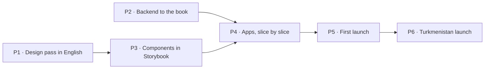

# 10. Build plan

How Ýeral gets from this closed book to the first launch, and then to the Turkmenistan launch. Claude wrote the plan
on 18.10.2026 from the book's answers; the owner decides when each launch ships. It is updated as the work moves.

## Where we start

- **The book is closed:** 123 questions answered, 242 features placed (154 in the MVP). (chapters 6 and 9)
- **Built before the reset** (M0–M2, released 16.10.2026): the monorepo and CI; `@yeral/ui` with 38 components from
  the design system v0.3.1; the booking engine (`@yeral/domain`); the shared contract and client library; an api for
  every client screen on Postgres, not deployed; the Docker stack. (progress.md)
- **Not built:** the client site, the business app, the admin tool (CMS), every business endpoint, market settings.
  yeral.app still serves the old Next.js site.
- **Design:** export v0.5, drawn in Turkmen; the business app is drawn, the admin tool isn't.
- **"Code differs" lines** across chapters 2–8 list what built code must change. The biggest: Turkmen as the default
  language, editable roles instead of three fixed levels, review-ask SMS, `/b/{code}` links, Turkmenistan's values
  as constants, demo data refused in production.

## The phases

P1 and P2 run side by side: the backend implements the book's rules and needs no screens. **This is a proposal:**
ADR 0021 put all code after the design. If the owner agrees, ADR 0021 is amended; if not, P2 starts after P1.

### P1 · Design pass in English

Claude writes each prompt for Claude Design, the owner pastes it, Claude checks the result on the canvas against the
book (ADR 0021). The result is design export v0.6, every board in English (Q-133), with Russian-length text checked.

| Round | What gets drawn or redrawn |
|---|---|
| 1 | Foundations: the *Ýeral* wordmark (Q-005), English copy rules, the components with English text; the "Example" badge |
| 2 | Business app: shell, sign-in with the code on screen, setup wizard, calendar (block time, *Başga ýerde* as a plain reserved gap, internal statuses), requests, bookings list (no bulk move) |
| 3 | Business app: clients, team (the "uses the app" switch), settings (hours past midnight, booking rules), notifications, reviews, the rejected-business banner, "Try the business app" |
| 4 | Client site: home, search and map with the city choice, business page, appointment booking with the shared code step and surname, my bookings, the booking link page with a finished visit, account |
| 5 | Admin tool (cms.yeral.app), drawn for the first time: verify or reject a business, reported reviews, hide or un-verify a business, add a business for its owner, close a workspace |
| 6 | Every **Design to fix** line left in chapters 6 and 7a–7c, then the export |

### P2 · Backend to the book

No screens; every rule gets its test (ADR 0013). In order:

1. **Market settings** (ADR 0022, ADR 0023): language, money, phone rules, time zone and legal texts read from one
   market config; English as the source language.
2. **The business model:** three fixed levels and the permission matrix instead of editable roles; the specialist
   without the app (Q-216); invites with accept or decline.
3. **The "Code differs" fixes in the booking engine:** holds count only in opening hours (Q-120), past midnight (Q-105),
   the city as data (Q-107), offered times tied to one specialist (Q-159), the no-show count restart (Q-127), move
   rules (Q-165, Q-263), token links instead of `/b/{code}` (Q-168), no review asks (Q-259), linking by phone only for
   6 months plus "Is this you?" (Q-270), code limits (Q-267), deleting an account (Q-172).
4. **Business endpoints:** workspace, calendar, requests, bookings, clients, team, settings, services, hours, reviews,
   notifications. Today the api serves only client screens.
5. **Admin endpoints:** verification, review reports, hiding a business, adding a business for its owner.
6. **First-launch mode** (Q-004, Q-036): example businesses marked "Example" that confirm at once, the sign-in code
   shown on the screen, a shared demo workspace reset every night, no SMS.

### P3 · Components in Storybook

The 38 components updated to v0.6, then the new ones from the business app and the admin tool (calendar grid,
drawers, timers, status chips, tables), each with stories for every variant and Chromium tests. (ADR 0012)

### P4 · Apps, slice by slice

The order of Q-001: every slice ends working end to end on a local machine, with tests, before the next starts.

| Slice | What works at the end |
|---|---|
| 1 · Accounts | sign in with the code on screen, profile, the workspace switcher, invites |
| 2 · Business setup | the wizard, profile, services, hours, team, booking rules, link and QR |
| 3 · Booking loop | business page, appointment booking, answering in the calendar, my bookings, cancel, move, undo, declines with offered times, expiries |
| 4 · Daily work | calendar views, bookings list, clients, walk-ins, complaints, internal statuses, *Başga ýerde*, browser notifications, the installable business app |
| 5 · Discovery | home, search, map, categories, the city choice, search-engine pages |
| 6 · Admin tool | cms.yeral.app behind Cloudflare Access: verification, reported reviews, hiding businesses, adding a business for its owner |
| 7 · First-launch mode | example businesses, "Try the business app", privacy policy and terms in English (Q-033) |

### P5 · First launch

The client site, the business app, the admin tool and the api go to production on Cloudflare with the Neon database
(ADR 0007, ADR 0023), from a release the owner approves (ADR 0020). The new client site replaces the old one on
yeral.app. The team adds the first real businesses in the admin tool (Q-002).

### P6 · Turkmenistan launch

After investment, when the owner sets the date:

- Turkmen and Russian: Claude translates every text; a native check before launch (Q-101).
- A lawyer in Turkmenistan: law 519-V on personal data, the privacy policy and terms (Q-033, Q-037).
- The server in Turkmenistan (below), the data moved, the addresses switched (ADR 0023).
- An SMS provider and real SMS sign-in; the first-launch mode switched off for this market (Q-036).

## What it costs

| When | What | Monthly |
|---|---|---|
| P1–P4 | nothing new: Storybook already runs on Cloudflare | $0 |
| First launch | Cloudflare Workers (free, then $5 when traffic needs it); Neon (its free plan to start; the jobs that run every minute keep the database awake, which may need a paid plan: Claude checks the price before going live, Q-250); R2 and Sentry free; no SMS | about $0–30 |
| Turkmenistan launch | the server, SMS per message, the lawyer once | priced then, in manats |

The domain yeral.app is already paid for.

## The server: when and what

**Not for the first launch.** It runs on Cloudflare (ADR 0023). Buy the server about a month before the Turkmenistan
launch date, so there is time to test it from Ashgabat, rehearse the move and fix what breaks.

**What to buy:**

- **Where:** a virtual server in Turkmenistan. Turkmentelecom rents KVM servers priced in manats (telecom.tm/ru/hosting).
  The law wants personal data stored in the country (Q-037), and servers abroad may be blocked (Q-032). The lawyer
  confirms before buying.
- **Size:** 4 vCPU, 8 GB RAM, 100 GB SSD or more, Ubuntu 24.04 LTS, one fixed public address. The whole stack runs on
  it in Docker: Postgres, the api, the jobs and nginx serving the three apps. That's enough for the first thousands of
  users. 2 vCPU and 4 GB is the floor.
- **Backups:** a daily encrypted copy of the database off the server, to a second place in Turkmenistan (a copy abroad
  only if the lawyer allows it).
- **Before paying:** ask for a test address and check it from home and mobile internet at several providers (Q-032).

## What the owner does, and when

| Phase | The owner |
|---|---|
| P1 | pastes each design prompt into Claude Design and reviews the result (about six rounds) |
| P2–P4 | nothing required; reviews progress when Claude reports a finished slice |
| P5 | approves the release; sets up Cloudflare Access for the admin tool once; meets the first businesses and adds them in the admin tool |
| P6 | the investment, the lawyer, buying the server, the SMS provider account, the native language check |

## Risks we carry

- **The code on screen** lets anyone sign in as any number, so a real business's data is open to anyone who knows its
  owner's phone (Claude's concern on Q-036).
- **Few reviews** without any ask (Claude's concern on Q-259).
- **"Everything flexible"** turns every option into a setting (Claude's concern on Q-105).
- **The database awake all day** for the every-minute jobs costs compute (Q-250).
- **Turkmen quality:** Claude's Turkmen is its weakest language (Claude's concern on Q-101).
