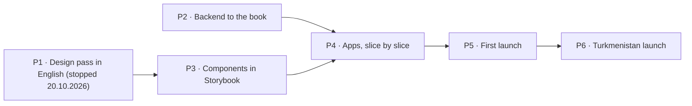

# 10. Build plan

How Ýeral gets from this closed book to the first launch, and then to the Turkmenistan launch. Claude wrote the plan
on 18.10.2026 from the book's answers; the owner decides when each launch ships. It is updated as the work moves.

## Where we start

- **The book is closed:** 123 questions answered, 242 features placed (155 in the MVP since the own server joined it on 19.10.2026). (chapters 6 and 9)
- **Built before the reset** (M0–M2, released 16.10.2026): the monorepo and CI; `@yeral/ui` with 38 components from
  the design system v0.3.1; the booking engine (`@yeral/domain`); the shared contract and client library; an api for
  every client screen on Postgres, not deployed; the Docker stack. (progress.md)
- **Not built:** the client site, the business app, the admin tool (CMS), every business endpoint, market settings.
  yeral.app still serves the old Next.js site.
- **Design:** export v0.6 in English for the design system and the business app (rounds 1–3.4, 20.10.2026); the
  client site's boards are export v0.5 in Turkmen; the admin tool isn't drawn. The redraw stopped there (Q-133
  revised): the rest is built from the book and the drawn patterns.
- **"Code differs" lines** across chapters 2–8 list what built code must change. The biggest: Turkmen as the default
  language, editable roles instead of three fixed levels, review-ask SMS, `/b/{code}` links, Turkmenistan's values
  as constants, demo data refused in production.

## The phases

Two tracks (owner, 19.10.2026): the design pass and the backend run side by side, since the book is closed and the
backend implements its rules, not its screens (ADR 0021, amended). Since 20.10.2026 components and the apps no
longer wait for the design either (owner): they follow the book, the drawn boards and the nearest drawn pattern, and
endpoint responses follow the screens as they're built. The design
prompts are kept in `docs/product/prompts/`.

### P1 · Design pass in English

Claude writes each prompt for Claude Design, the owner pastes it, Claude checks the result on the canvas against the
book (ADR 0021). The plan was export v0.6 with every board in English (Q-133); since the stop below, v0.6 covers the
design system and the business app, and the client site stays on its v0.5 boards.

Each round takes every **Design to fix** line for the boards it redraws, so no board is drawn twice. Fixes that only
matter for tables and classes wait for their own design pass after the MVP. Every prompt asks for the Russian-length
check on its new screens (Q-101). Reviewed 20.10.2026 after rounds 1–2, and again after round 3.

**Stopped after round 3.4** (owner, 20.10.2026: "Do we really need all this detailed design? … we design when it's
really necessary for critical details"; ADR 0021 amended, Q-133 revised). The book holds every decision, the
design system and the business app are drawn in English, and the client site is drawn in v0.5; redrawing it in
English would mostly translate words the code's English source holds anyway. Rounds 3.5 to 6.2 below aren't drawn:
their rules are in the book and get built in P3 and P4. Claude Design gets one small prompt only for a critical
detail with no drawn pattern, or a key screen the owner wants to see options for, and the owner reviews built
screens in Storybook and the local app.

**Small iterations** (owner, 20.10.2026: round 3, seven boards and the fixes to rounds 1–2 in one prompt, took about
three hours). From round 4 a round is cut into iterations: one prompt draws one main board, or two small ones, with
its own phone frames and design-system pieces, in about ten instructions. Fixes a check finds get their own short
prompt instead of riding on the next one. Each iteration is checked before the next is written.

| Round | Boards | What gets drawn or redrawn | Where it stands |
|---|---|---|---|
| 1 | the five design-system boards | Foundations: the *Ýeral* wordmark (Q-005), English copy rules, the components with English text; the "Example" badge; the shared code step | drawn 19.10.2026, checked 20.10.2026 (fixes in round 3) |
| 2 | B-Shell, B-Login, B-Onboarding, B-Calendar, B-Bookings, B-Mobile, DS · Business patterns | Business app: shell, sign-in with the code on screen, setup wizard, calendar (block time, *Başga ýerde* as a plain reserved gap, internal statuses), requests, bookings list (no bulk move); B-Tables, B-Classes, B-Analytics and B-Help moved to "Later" | drawn 20.10.2026, checked 20.10.2026 (fixes in round 3) |
| 3 | B-Clients, B-Client, B-Team, B-Settings, B-Services, B-Reviews, B-Landing, their phone frames | Business app: clients (specialist view, the average check), team (the "uses the app" switch, invites without SMS, read-only permissions), settings (photos, the city, hours past midnight, booking rules, link and QR states), services, reviews (moderation outcomes), the landing page with "Try the business app" without signing in; B-Notifications moved to "Later" (F-169); the fixes to rounds 1–2 | drawn 20.10.2026 (about 3 hours: too big for one prompt); checked 20.10.2026 |
| 3.1 | B-Calendar, B-Bookings, B-Shell | Fixes: one report per booking with No-show replacing (Q-206), the notifications banner for everyone, the Hidden by Ýeral banner (Q-012), Admin views shifts only | drawn and checked 20.10.2026 (what's left is listed under 3.5: the book wins over the boards) |
| 3.2 | B-Clients, B-Client | Fixes: a Specialist's own bookings only, the reminders switch (F-143), last visit, Unnamed client, the account link by phone (Q-171), tags, Total | drawn and checked 20.10.2026 (what's left is listed under 3.5: the book wins over the boards) |
| 3.3 | B-Team, B-Services | Fixes: Admin read-only on the team, Reactivate (F-114), breaks and yearly time off (F-112), the hidden price's amount (B-38), invited people in "Who does it" | drawn and checked 20.10.2026 |
| 3.4 | B-Settings, B-Onboarding | Fixes: the launch categories (chapter 4), text limits (chapter 5), special days past midnight (Q-105), every affected booking (Q-211), QR as PNG or SVG | drawn and checked 20.10.2026 (what's left is listed under 3.5: the book wins over the boards) |
| 3.5 | B-Clients, B-Client, B-Calendar, B-Bookings, B-Team, B-Services, B-Settings, B-Reviews, B-Mobile, the DS boards | Fixes after the 3.1–3.4 check: demo facts, one name per client record on staff screens and reviewers as first name + initial, the yearly special day past midnight (Q-105), the hours list without a week cap and with a request declined (Q-211), three small ones | written, not pasted: its rules are in the book and win over the boards (reviewers by first name + initial, the yearly special day past midnight, every booking ahead in the hours list, a waiting request declined, ReportMenu's "Replaces the earlier report", BusinessStatusBanner's Hidden story) |
| 4a.1 | Home | Canvas tidy (Booking-Table, Booking-Class and the three Home explorations to "Later"); home in English without the app block (F-004), the business entry (F-177), the Example badge on cards; the client footer without "Bahalar" (F-033) | written, not pasted: built in P4 slice 5 from Home v0.5 and the book |
| 4a.2 | Search, Client-Map | Search and map with the city choice (Q-107), places without a free time (Q-150), Example rows and pins; no party-size filter (tables are Later) | not drawn: built in P4 from the v0.5 board and the book |
| 4a.3 | Venue | The business page: owner preview with the booking buttons disabled (Q-153), the Call card for a phone-only client or a paused business (Q-154), the Example line, hidden prices, reviews by name and initial and under moderation, hours past midnight, "New address" for 30 days after a move (Q-215) | not drawn: built in P4 from the v0.5 board and the book |
| 4a.4 | States | Errors, empty pages, location help, not found, a page still in review (F1) | not drawn: built in P4 from the v0.5 board and the book |
| 4b.1 | Auth | The login modal with the shared code step (code on the screen first), name and optional surname (Q-156), "Is this you?" (Q-270) | not drawn: built in P4 from the v0.5 board and the book |
| 4b.2 | Booking | The appointment flow: steps, the waiting limit refusal (Q-124), the sent screen with the answer time as a clock time and no SMS promise (Q-253, Q-036), instant confirmation, the phone-only card | not drawn: built in P4 from the v0.5 board and the book |
| 4b.3 | Booking (move mode) | Change the time: specialist kept unless changed, overlapping times allowed (Q-165), a second move replaces the first | not drawn: built in P4 from the v0.5 board and the book |
| 4b.4 | Account-Bookings, part 1 | My bookings: lists, the detail drawer, who cancelled, the cancel modal with or without a reason (Q-163), undo and its four failures, "New address" on a booking ahead after the business moved (Q-215) | not drawn: built in P4 from the v0.5 board and the book |
| 4b.5 | Account-Bookings, part 2 | Declines with offered times, expiries, waiting and refused moves, the phone-only booking (Q-154) | not drawn: built in P4 from the v0.5 board and the book |
| 4b.6 | Booking-Link | The link page signed out: masked-phone sign-in, every status, the finished visit with "Write a review" (Q-170), cancelled and no-show with "Book again", "New address" as on the booking (Q-215) | not drawn: built in P4 from the v0.5 board and the book |
| 4b.7 | Account-Profile | Profile, the phone change with the code step, no review-ask switch (Q-259), the delete-account copy (Q-172) | not drawn: built in P4 from the v0.5 board and the book |
| 5.1 | admin tool: shell and sign-in | cms.yeral.app on the business app's patterns: the team's own sign-in with a second factor and its recovery (F-178), navigation | not drawn: built in P4 slice 6 on the business app's patterns |
| 5.2 | admin tool: businesses | Verify, reject with a reason and see it sent again (Q-274), hide or un-verify with a reason to the owner (Q-012), add a business for its owner (F-238), close a workspace (Q-213) | not drawn: built in P4 slice 6 on the business app's patterns |
| 5.3 | admin tool: reported reviews | The queue with the 48-hour recount, clear or remove (Q-261, Q-262) | not drawn: built in P4 slice 6 on the business app's patterns |
| 6.1 | design-system boards | Catch up with rounds 4–5: every new client and admin piece on its board with its states; remove the client-site table samples from DS · Business patterns (the Restaurant tile, the table badge) or move them to "Later" | not drawn: the new pieces go to Storybook (P3); the table and class samples (the Restaurant tile, the table badge) are Later and aren't built |
| 6.2 | every board | Demo data the same everywhere, the drift list, any **Design to fix** line still open, then the export | dropped: no export to finish |

### P2 · Backend to the book

No screens; every rule gets its test (ADR 0013). Runs alongside P1, then alongside P3 and P4, in this order. Reviewed on 19.10.2026 against
every **Code differs** line (51 distinct ones; the first draft of this list covered 21) and the api as built: 34
endpoints for client screens, none for businesses or the Ýeral team, and nothing that checks access levels yet.

0. **The own server only** (owner, 19.10.2026: no Neon; done 19.10.2026, ADR 0024): the api's Cloudflare Workers
   path went (Worker entry, Wrangler, Hyperdrive, Neon config); the local Docker stack uses Caddy like the server; the
   city from the internet address is off, since first-launch visitors come through a VPN, and the city choice starts
   at the market's main city (Q-107).
1. **Market settings** (ADR 0022, ADR 0023; done 19.10.2026): language, money, phone rules and time zone read from
   one market config (`@yeral/domain/market`); English as the source language; any one language for a business's
   texts (Q-102); SMS in the market's main language for people without one (Q-292), with the brand from the messages.
   Legal texts, the SMS provider and the map area join the config with their features.
2. **The business model:** three fixed levels with a fixed permission table, enforced by the api (editing the matrix
   is Later, F-089); each account linked to its staff rows, which *Başga ýerde* needs; the specialist without the app
   (Q-216); invites with accept or decline and 7 days (F-085). With no SMS at the first launch, an invite appears when
   the invited phone signs in, and the owner can copy its link. Done 19.10.2026 (ADR 0025): the levels, the table,
   team rows linked to accounts, the switcher, invites and the team endpoints.
3. **The "Code differs" fixes in the booking engine,** in this order, since each needs the one before: past midnight
   (Q-105; done 20.10.2026); holds count only in opening hours (Q-120; done 20.10.2026); reminders at night move to 21:30 the evening before (Q-285; done 20.10.2026);
   then the city as data (Q-107; done 20.10.2026), offered times tied to one specialist (Q-159; done 20.10.2026), expiry with nothing free (Q-252; done 20.10.2026), the
   no-show count restart (Q-127; the rule done 20.10.2026, the client card's switch with step 4), move rules (Q-165, Q-263, a second move replaces the first and can be withdrawn:
   ROUND6 A3; done 20.10.2026, the business's side with step 4), token links instead of `/b/{code}` and the signed-out link page (Q-168, F-068; the api done 20.10.2026), no review asks (Q-259; done 20.10.2026),
   linking by phone only for 6 months plus "Is this you?" (Q-270; done 20.10.2026), a changed phone keeps its client record (Q-171; done 20.10.2026),
   code limits (Q-267; done 20.10.2026), deleting an account (Q-172; done 20.10.2026), name and surname (Q-156; done 20.10.2026), time limits on no-shows, complaints and
   reviews (Q-254, Q-206, Q-126; the rules done 20.10.2026, the business's complaint endpoint with step 4), at most 3 waiting requests per business and 10 in all (Q-124; done 20.10.2026), the cancel reason
   setting (Q-163; done 20.10.2026), the 4 undo reasons (ROUND6 A6; done 20.10.2026), the answer time worked out (Q-113; done 20.10.2026, declines count with step 4), phone-only clients and paused
   businesses (Q-154; done 20.10.2026: the business page, the booking detail and the link page), the owner's preview of an unverified page (F-032; done 20.10.2026), no average bill and the hidden-price text
   (Q-103; done 20.10.2026), lateness fixed at 15 min (Q-118; done 20.10.2026), a price range filter (done 20.10.2026), the failed-SMS alert and late reminders dropped
   (Q-284; done 20.10.2026, the alert reaching people with F-209 in step 7), the SMS for a move not accepted (Q-289; done 20.10.2026), offered times keeping a request on top of Upcoming (C-40; done 20.10.2026); and the new engine rules: *Başga ýerde* (Q-272; done 20.10.2026, the calendar block with step 4), blocked time
   (F-121) and internal statuses (F-104, F-133).
4. **Business endpoints** (the booking rules, the services menu, the profile with the SMS when the business moves (Q-215), answering requests, the team's bookings by phone and walk-in, its moves and cancels, the hours and special days, the staff schedules and days off (B-47), removing someone with their bookings (B-50), blocked time (B-18), internal statuses (B-29), the calendar day and week view (B-16, B-17) and complaints (B-28) done 20.10.2026; the clients: list, lookup, card, adding, edit, notes, switches and delete (B-32–B-36), the bookings list and its CSV export (B-30, B-31), reviews with the reply and the report (B-53, B-54), the setup wizard's draft and its saved step (Q-200, B-02–B-06), photos behind a storage port (F-084, F-101), the 5-minute warning and the invites' expiry (S-01, S-13), the address's floor and room (F-099) 21.10.2026): workspace, calendar, requests, bookings with CSV export (F-135), clients, team, settings,
   services, hours, reviews; photos (F-084, F-101) stored on the server's disk behind a storage port; the address with
   a map pin (F-099); browser notifications from the live events (F-170) and the staff SMS rule (F-171); the timed jobs
   for invite expiry, the 5-minute warning and the answer time.
5. **Admin endpoints:** the Ýeral team's own accounts with a second factor (F-178; done 21.10.2026, ADR 0026: a
   login, a password and an authenticator code): with the code on the screen, a phone number must never open the
   admin tool; verify, reject and send again (Q-274), un-verify or hide a business, check a move again (F-179; done
   21.10.2026); close a workspace (Q-213), review reports with the 48-hour recount, adding a business for its owner.
6. **First-launch mode** (Q-004, Q-036): example businesses marked "Example" that confirm at once, the sign-in code
   shown on the screen (never for the admin tool; the api's part done 20.10.2026), a separate demo workspace reset every night, no SMS; appointments
   only (Q-030): the seed's table and class examples and the Restaurant and Café & tea house categories stay out of
   lists and search until tables and classes ship. It doesn't wait for the design: the seed's example businesses already
   have English texts; the demo workspace follows the business boards' demo (`docs/design/business/demo-data.json`
   and the v0.6 boards), while `docs/design/demo-data.json` stays the v0.5 client data in Turkmen.
7. **Before the first launch:** releases back (paused 21.10.2026, ADR 0009) and deploys from GitHub over SSH after the owner approves a release (ADR 0020), nightly
   backups to Cloudflare R2 with a restore drill (F-211), error tracking and uptime alerts (F-209; it alerts on the `job gave up` line), sitemap data
   (F-197). Before SMS go out: a daily cap and a rate limit per business on the SMS its team's bookings and cancels
   send to numbers it types in, and none from a business still in review (the backend review of 20.10.2026: they carry
   the business's own words, "Other reason", under Ýeral's sender).

Settled while reviewing (Claude, delegated, 19.10.2026): a hold counts the business's opening hours, special days
included, not the specialist's; a reminder that falls between 22:00 and 08:00 goes at 21:30 the evening before the visit (chapter 8),
also for visits after midnight; "unused for 6 months" (Q-270) means no sign-in for 6 months; the `yr-` slug rule goes
with the `/b/{code}` links (Q-168); a changed no-show limit applies to every client at once (revised 20.10.2026, chapter 9); the failed-SMS alert goes to
the error tracker of F-209, since Ýeral sends no e-mail.

### P3 · Components in Storybook

The 38 components updated to v0.6, then the new ones from the business app and the admin tool (calendar grid,
drawers, timers, status chips, tables), each with stories for every variant and Chromium tests. (ADR 0012) Starts
20.10.2026 without waiting for a full export, slice by slice: each P4 slice first adds the components its screens
need, from the DS boards (v0.6) and `docs/design/COMPONENTS.md`, skipping pieces marked Later and the table and class
samples; client pieces no board draws (the Call card, "Is this you?", the waiting-limit refusal, "New address", the
hourly code limit) follow the nearest drawn pattern. Every component gets a Russian-length story (about 30% longer
text), and each slice's screens are checked with Russian-length text before the slice ends (Q-101): that check
moved here from the design prompts.

### P4 · Apps, slice by slice

The order of Q-001: every slice ends working end to end on a local machine, with tests, before the next starts.

| Slice | What works at the end |
|---|---|
| 1 · Accounts | sign in with the code on screen, profile, the workspace switcher, invites (built 21.10.2026: the business app, its login, shell and My account, #99, #102, #107, #113, #115, #119, #121; the client site, its login and profile, #108, #110, #111, #114, #118) |
| 2 · Business setup | the wizard, profile, services, hours, team, booking rules, link and QR |
| 3 · Booking loop | business page, appointment booking, answering in the calendar, my bookings, cancel, move, undo, declines with offered times, expiries |
| 4 · Daily work | calendar views, bookings list, clients, walk-ins, complaints, internal statuses, *Başga ýerde*, browser notifications, the installable business app |
| 5 · Discovery | home, search, map, categories, the city choice, search-engine pages |
| 6 · Admin tool | cms.yeral.app with the Ýeral team's own accounts and a second factor (F-178): verification, reported reviews, hiding businesses, adding a business for its owner |
| 7 · First-launch mode | example businesses, "Try the business app", privacy policy and terms in English (Q-033) |

### P5 · First launch

The client site, the business app, the admin tool and the api go to production on the owner's server (a netcup VPS 1000 in the EU (4 vCPU, 8 GB, 128 GB)) in Docker, with Cloudflare for DNS (ADR 0007, ADR 0023), from a release the owner approves
(ADR 0020). The server, its shared HTTPS front door and the api's stack are set up (19.10.2026, `infra/server`);
deploys from GitHub and backups come with P2 step 7. The new client site replaces the old one on
yeral.app. The team adds the first real businesses in the admin tool (Q-002).

### P6 · Turkmenistan launch

After investment, when the owner sets the date:

- Turkmen and Russian: Claude translates every text; a native check before launch (Q-101).
- A lawyer in Turkmenistan: law 519-V on personal data, the privacy policy and terms (Q-033, Q-037).
- The server in Turkmenistan (below), the data moved, the addresses switched (ADR 0023).
- An SMS provider and real SMS sign-in; the first-launch mode switched off for this market (Q-036).

## What it costs

| When | What | Monthly |
|---|---|---|
| From now | the server, netcup VPS 1000, shared with the owner's other projects; Storybook stays on Cloudflare | €16.68 a month, €12.32 on a 12-month term (with German VAT) |
| First launch | nothing more: the same server; database backups to Cloudflare R2 (free up to 10 GB); no SMS | — |
| Turkmenistan launch | the server, SMS per message, the lawyer once | priced then, in manats |

The domain yeral.app is already paid for.

## The server: when and what

**For the first launch:** the owner chose a netcup VPS 1000 in the EU (4 vCPU, 8 GB, 128 GB) on 19.10.2026, also for other projects
later. OVHcloud's plans were out of stock; Hetzner's cheap plans are gone. Its addresses are in ranges Turkmenistan
blocks, so people there use a VPN, as decided (Q-032).

**For the Turkmenistan launch:** a second server, inside the country. Buy it about a month before that launch date,
so there is time to test it from Ashgabat, rehearse the move and fix what breaks. What to buy:

- **Where:** a virtual server in Turkmenistan. Turkmentelecom rents KVM servers priced in manats (telecom.tm/ru/hosting).
  The law wants personal data stored in the country (Q-037), and servers abroad may be blocked (Q-032). The lawyer
  confirms before buying.
- **Size:** 4 vCPU, 8 GB RAM, 100 GB SSD or more, Ubuntu 24.04 LTS, one fixed public address. The whole stack runs on
  it in Docker: Postgres, the api, the jobs and Caddy serving the three apps (ADR 0024). That's enough for the first thousands of
  users. 2 vCPU and 4 GB is the floor.
- **Backups:** a daily encrypted copy of the database off the server, to a second place in Turkmenistan (a copy abroad
  only if the lawyer allows it).
- **Before paying:** ask for a test address and check it from home and mobile internet at several providers (Q-032).

## What the owner does, and when

| Phase | The owner |
|---|---|
| P1 | pasted the design prompts (rounds 1–3.4, stopped 20.10.2026); now only an occasional small prompt for a critical detail |
| P2 | nothing required |
| P3–P4 | reviews the built components in Storybook and each finished slice in the local app; that review replaces the canvas check |
| P5 | approves the release; adds the DNS records; sets up the second factor of their admin account; meets the first businesses and adds them in the admin tool |
| P6 | the investment, the lawyer, buying the server, the SMS provider account, the native language check |

## Risks we carry

- **The code on screen** lets anyone sign in as any number, so a real business's data is open to anyone who knows its
  owner's phone (Claude's concern on Q-036).
- **Few reviews** without any ask (Claude's concern on Q-259).
- **"Everything flexible"** turns every option into a setting (Claude's concern on Q-105).
- **The database awake all day** for the every-minute jobs costs compute (Q-250).
- **Turkmen quality:** Claude's Turkmen is its weakest language (Claude's concern on Q-101).
