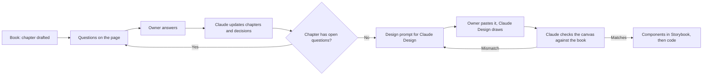

# Ýeral product book

The single source of truth for what Ýeral is and does: ideas, norms, roles, rules, limits, features, MVP scope and every
flow. Design, components and code follow this book; nothing is designed or built from a chapter that still has open
questions. (Owner, 17.10.2026)

**Read it as a page:** https://claude.ai/artifact/LY9U6jrQRo3MfoHTg3JpyN (private claude.ai page, works on phones).
Answer questions and place features there; comment on any section.

## Chapters

| # | File | What it covers |
|---|---|---|
| 1 | [01-vision.md](01-vision.md) | what Ýeral is, for whom, the market, the money, the rules that never change, how we build |
| 2 | [02-norms.md](02-norms.md) | languages, words, money, time, phones, places, copy and tone |
| 3 | [03-roles.md](03-roles.md) | guests, clients, the business team and its permissions, the Ýeral team |
| 4 | [04-rules.md](04-rules.md) | the objects, booking types, availability, statuses, confirmation, changes, reviews, verification |
| 5 | [05-limits.md](05-limits.md) | every default, range and number |
| 6 | [06-scope.md](06-scope.md) | every feature, placed in MVP, later or never |
| 7a | [07a-flows-client.md](07a-flows-client.md) | every client scenario, step by step |
| 7b | [07b-flows-business.md](07b-flows-business.md) | every business scenario, step by step |
| 7c | [07c-flows-system.md](07c-flows-system.md) | what the system does by itself |
| 8 | [08-notifications.md](08-notifications.md) | who is told what, how and when |
| 9 | [09-decisions.md](09-decisions.md) | every decision, with date and source |
| — | [questions.md](questions.md) | every open and answered question |

## How the work flows



1. **Drafting.** Claude writes a chapter from what exists (design exports, specs, ADRs, code) and turns every gap,
   conflict or unknown into a question with options and a recommendation. Nothing is decided silently.
2. **Answering.** The owner answers on the page (pick an option, add a note) and comments on any section.
3. **Recording.** Claude reads the answers, writes them into the chapters, marks the question `decided` in
   `questions.md` and logs it in chapter 9.
4. **Designing.** For closed chapters Claude writes the prompt for Claude Design; the owner pastes and submits it.
   Claude reads the result straight from the "Ýeral Web" canvas and checks it against the book. Mismatches become the
   next prompt.
5. **Building.** Components in Storybook, then code, only from closed chapters.

## Writing rules for this folder

- Plain English, short sentences. UI words in English (ADR 0022); where a Turkmen word from design v0.5 is quoted,
  put it in italics with the English: *Garaşylýar* (Pending).
- Every fact carries its source in brackets: "(business spec §25)", "(ROUND6-ANSWERS A3)", "(ADR 0017)", "(code: …)".
- Which source wins: the owner's answers in this book → the owner's direction in `docs/memory-bank/activeContext.md` →
  the latest design export (`docs/design`) → older specs and ADRs → code. Code that differs from a decided rule is noted
  as "Code differs", not asked again.
- Markdown subset (the page renderer reads exactly this): `#`–`###` headings, paragraphs, `-` / `1.` lists with one
  nesting level, pipe tables, bold, italic, inline code, links, `>` blockquotes, ```mermaid fences. No HTML.
- A question lives in `questions.md` in this exact form, and the chapter points to it with
  `> Open question Q-123: short title.` (the page shows the card there):

```
## Q-123 · Short title
chapter: 05 · status: open

What's unclear, what each source says, what the code does today.

- A · First option. (recommended)
- B · Second option.

answer: —
```

When answered: `status: decided` and `answer: B · the owner's note (dd.mm.yyyy)`. Questions that unblock the most
carry `· priority: high` after the status; the page lists them under "Start here".

Claude doesn't take an answer for granted (owner, 18.10.2026). When an answer looks weaker than another option, risky, or
in conflict with another decision, Claude records it as given and adds one line under it:
`concern: what worries Claude and the better option (dd.mm.yyyy)`. The page shows the card as "Claude has a concern",
under its own filter, with the options open again: the owner keeps the answer or changes it, and Claude then removes
the line (or rewrites the answer).
- Feature tables in chapter 6 start with the columns `ID | Feature | What it is | Proposed`; the page adds the
  MVP / Later / Never control to each row.
- Question numbers by chapter: 001–099 vision, roles, rules and scope · 100–149 norms and limits · 150–199 client
  flows · 200–249 business flows · 250–299 system flows and notifications.

## Building and publishing the page

```
node docs/product/tools/build.mjs
```

writes `docs/product/tools/dist/product-book.html` (not committed). Claude publishes it to the same claude.ai page each
time (Artifact tool, `url` of the existing page). The page's capabilities are stored with it and carried forward when a
publish leaves `capabilities` out; if they ever have to be declared again, declare exactly
`{"db": {"rules": [{"path": "", "read": "interact", "write": "admin"}]}, "user": {}, "comments": {"composer_only": true}}`
(anyone who can open the page reads; only its editors write answers and placements). Answers live in the page's database: collection `answers` (one document per
question: `choice`, `note`, `at`) and `scope` (one per feature: `place` = `mvp` · `later` · `never`, `at`). Claude reads
them with the ArtifactData tool and writes them back into this folder.
